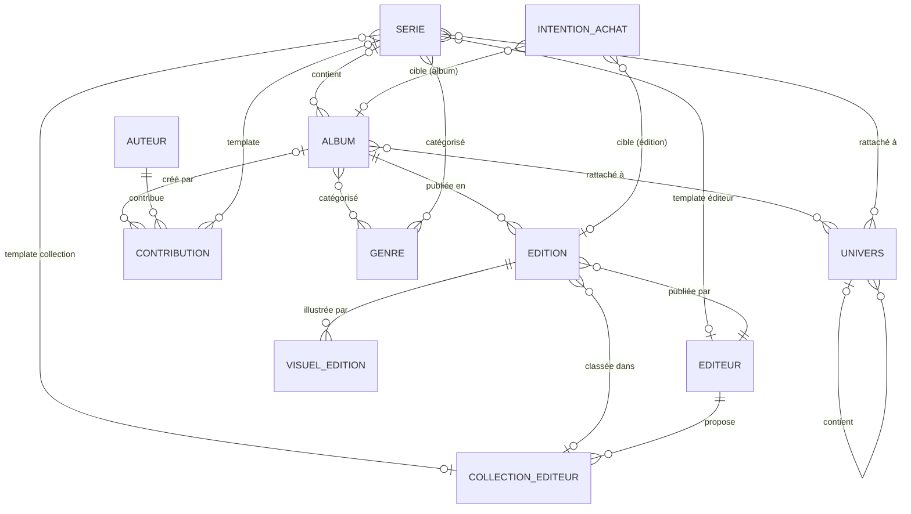

# Modèle Métier

Ce fichier décrit les entités du domaine, leurs attributs et leurs relations.

---

## Domaine

L'application gère une **collection de bandes dessinées (BD)**. Le domaine tourne autour des albums, séries, auteurs et de leur possession par un utilisateur.

---

## Glossaire des entités

| Entité | Définition |
| --- | --- |
| **Album** | Œuvre de bande dessinée suivie dans le catalogue. |
| **Édition** | Manifestation publiée d'un album (format, publication, valeur, etc.). |
| **Série** | Regroupement d'albums dans une continuité éditoriale. |
| **Auteur / Artiste** | Personne ou duo crédité sur un album (scénario, dessin, couleur). |
| **Éditeur** | Entité qui publie des éditions. |
| **Collection éditeur** | Sous-ensemble optionnel rattaché à un éditeur, utilisé pour classer des éditions. |
| **Collection utilisateur** | Ensemble des éditions possédées par l'utilisateur. Ce n'est pas une entité distincte en base : la collection est définie implicitement par les éditions dont le `Mode d'acquisition` est renseigné. |
| **Genre** | Catégorie de contenu (aventure, SF, humour, etc.). |
| **Univers** | Cadre fictionnel auquel albums/séries peuvent être rattachés, avec hiérarchie possible. |
| **Visuel d'édition** | Média rattaché à une édition avec un type de visuel. |
| **Intention d'achat** | Souhait d'acquisition portant sur un album (toute édition) ou sur une édition spécifique. |
| **Recherche enregistrée** | Recherche avancée nommée par l'administrateur, rejouable en consultation (voir `fonctionnel.md` § Recherche avancée). |
| **Paramétrage de l'application** | Réglages de l'application, fixés par l'administrateur dans le bloc « Paramétrage » de l'administration. Fiche unique. |
| **Jeton d'accès** | Jeton généré par l'administrateur, sans lequel l'outil pour agents IA n'est pas utilisable ; il détermine le niveau d'accès de l'agent (voir `fonctionnel.md` § Interface pour agents IA). |
| **Session de l'outil pour agents IA** | Conversation d'un agent avec l'outil, ouverte par un jeton d'accès : elle regroupe ses utilisations, ses objectifs et ses retours écrits (voir `fonctionnel.md` § Suivi de l'utilisation). |
| **Objectif de session** | Objectif de la demande de l'utilisateur, donné par l'agent à l'ouverture de la session ou mis à jour ensuite. |
| **Utilisation de l'outil** | Trace d'un appel d'outil ou d'une lecture de ressource par un agent, au sein d'une session. |
| **Retour écrit** | Limite signalée par l'agent, sur une utilisation précise ou sur sa session. |
| **Visite de l'interface web** | Suite des utilisations de l'interface web par un même utilisateur (visiteur ou administrateur), au cours d'une même visite, sans rien qui l'identifie (voir `fonctionnel.md` § Mesure d'audience de l'interface web). |
| **Utilisation d'une fonction** | Trace de l'affichage d'un écran ou du déclenchement d'une action de l'interface web, au sein d'une visite. |
| **Compteur d'audience mensuel** | Indicateurs d'une fonction pour un mois, sans visite ni parcours, conservés au-delà de la suppression du détail des visites. |
| **Journal des modifications** | Trace de chaque écriture sur une fiche : création, modification, suppression ou reprise d'une ancienne donnée. |

---

## Relations et cardinalités

### Album — relations

| Relation | Cardinalité | Remarques |
| --- | --- | --- |
| Album → Édition | 0..n | Un album peut n'avoir aucune édition (non encore publié). |
| Album → Série | 0..1 | Un album peut n'appartenir à aucune série (album standalone). L'attribut `Hors-série` est indépendant : un album peut être hors-série tout en appartenant à une série. |
| Album → Contribution | 0..n | Un album peut avoir plusieurs contributions. Chaque contribution a un rôle et un artiste obligatoire. |
| Album → Genre | 0..n | Genres propres à l'album. Si l'album appartient à une série, les genres affichés sont l'union des genres de l'album et de ceux de la série. |
| Album → Univers | 0..n | Univers propres à l'album. Si l'album appartient à une série, les univers affichés sont l'union des univers de l'album et de ceux de la série. |

### Édition — relations

| Relation | Cardinalité | Remarques |
| --- | --- | --- |
| Édition → Éditeur | 1 | Une édition est toujours publiée par exactement un éditeur. |
| Édition → Collection éditeur | 0..1 | Optionnelle. Si renseignée, doit appartenir à l'éditeur de l'édition. |

### Série — relations

| Relation | Cardinalité | Remarques |
| --- | --- | --- |
| Série → Genre | 0..n | |
| Série → Univers | 0..n | |
| Série → Contribution | 0..n | Auteurs de la série, et template : recopiées sur un album rattaché à la série si l'album n'en a encore aucune. |
| Série → Éditeur | 0..1 | Éditeur de la série, et template pour les nouvelles éditions. |
| Série → Collection éditeur | 0..1 | Collection de la série, et template pour les nouvelles éditions. Si renseignée, l'éditeur de la série doit l'être aussi, et la collection doit lui appartenir. |

> Les contributions, l'éditeur et la collection éditeur d'une série sont **autant des données de la série que des templates** : ils décrivent la série (fiche, recherche, bibliographie) au même titre que ses autres attributs, et servent en outre de point de départ à la saisie de ses albums et de leurs éditions. Les autres valeurs template (reliure, orientation, sens de lecture, format, catégorie, état, couleur) ne sont que des templates.

### Univers — relations

| Relation | Cardinalité | Remarques |
| --- | --- | --- |
| Univers → Univers parent | 0..1 | Relation récursive permettant une hiérarchie d'univers. Acyclicité obligatoire : un univers ne peut pas être son propre ancêtre (auto-référence interdite, cycles interdits). |

### Intention d'achat — relations

| Relation | Cardinalité | Remarques |
| --- | --- | --- |
| Intention d'achat → Album | 0..1 | Renseignée si l'intention porte sur un album (toute édition acceptable). |
| Intention d'achat → Édition | 0..1 | Renseignée si l'intention porte sur une édition spécifique. |

> **Contraintes :**
>
> - Une intention d'achat doit cibler exactement l'un des deux : un Album ou une Édition, jamais les deux, jamais aucun.
> - Une cible ne fait l'objet que d'**une seule** intention d'achat : un album est visé par au plus une intention, une édition par au plus une intention.
> - Pour un même album, l'intention porte **soit** sur l'album, **soit** sur ses éditions, jamais les deux : un album visé par une intention ne peut pas avoir en même temps une de ses éditions visée par une autre intention, et réciproquement.
> - Une édition **possédée** (`Mode d'acquisition` renseigné) ne peut pas être visée par une intention d'achat.

### Jeton d'accès et suivi de l'outil — relations

| Relation | Cardinalité | Remarques |
| --- | --- | --- |
| Jeton d'accès → Session | 0..n | Sessions ouvertes par le jeton ; supprimées avec lui (voir `fonctionnel.md` § Suppression des entités). |
| Session → Session précédente | 0..1 | Session que la session prolonge (voir `fonctionnel.md` § Suivi de l'utilisation) ; ouverte avec le même jeton d'accès. Les sessions successives d'une conversation se relient ainsi de proche en proche. |
| Session → Objectif de session | 0..n | Objectifs successifs, dans l'ordre de leur date ; aucun si l'agent n'en a jamais donné. |
| Jeton d'accès → Utilisation de l'outil | 0..n | Utilisations faites avec le jeton ; supprimées avec lui. Une requête refusée faute de jeton d'accès valable n'est rattachée à aucun jeton et n'est pas relevée. |
| Utilisation de l'outil → Session | 0..1 | Session sous laquelle l'utilisation a été faite ; absente pour une utilisation refusée faute de jeton de session valable, rattachée à son seul jeton d'accès. |
| Session → Retour écrit | 0..n | Retours écrits faits sous la session. |
| Retour écrit → Utilisation de l'outil | 0..1 | Utilisation que le retour commente ; absente pour un retour qui ne porte sur aucune utilisation (ex. une fonction absente). |

> **Contraintes :**
>
> - L'utilisation qu'un retour écrit commente appartient à la même session que lui, et une utilisation rattachée à une session l'est au même jeton d'accès que cette session.
> - Sessions, objectifs, utilisations et retours écrits ne sont jamais modifiés après leur enregistrement ; ils ne disparaissent qu'avec le jeton d'accès qui porte la session. Ce ne sont pas des fiches : leur enregistrement n'est pas consigné au journal des modifications.

### Visite de l'interface web — relations

| Relation | Cardinalité | Remarques |
| --- | --- | --- |
| Visite → Utilisation d'une fonction | 1..n | Utilisations faites au cours de la visite, dans l'ordre de leur date : le parcours de la visite. |

> **Contraintes :** les visites et leurs utilisations ne sont jamais modifiées après leur enregistrement. Une visite d'un visiteur public est supprimée avec ses utilisations 25 mois après son début, une visite de l'administrateur est conservée sans limite (voir `fonctionnel.md` § Mesure d'audience de l'interface web). Ce ne sont pas des fiches : leur enregistrement n'est pas consigné au journal des modifications. Une visite ne porte aucune donnée qui identifie l'utilisateur ou son appareil, ou permette de le reconnaître d'une visite à l'autre : de l'appareil, elle ne retient que sa catégorie et le moteur de rendu de son navigateur, avec sa version.

---

## Schéma des relations

> La **Collection utilisateur** n'est pas une entité en base. Elle est définie par le filtre `Mode d'acquisition IS NOT NULL` sur les éditions.
>
> **Contrainte (Contribution) :** Une contribution appartient à exactement l'un des deux : un Album ou une Série. Les deux références ne peuvent pas être nulles simultanément, ni renseignées toutes les deux.

---

## Attributs des entités

### Attributs communs à toutes les entités

| Attribut | Type | Obligatoire | Remarques |
| --- | --- | --- | --- |
| Date de création | date et heure | oui | Renseignée automatiquement à la création de la fiche, jamais saisie. |
| Date de dernière modification | date et heure | oui | Renseignée automatiquement à chaque modification de la fiche, jamais saisie. |

### Album

| Attribut | Type | Obligatoire | Remarques |
| --- | --- | --- | --- |
| Titre | texte | conditionnel | Obligatoire si l'album n'appartient à aucune série. Optionnel si une série est rattachée (la série + le tome peuvent suffire à identifier l'album). |
| Clé de tri | texte | non | Calculée automatiquement depuis le titre et stockée explicitement (règle de calcul : voir `fonctionnel.md` § Tri et navigation par initiale). Absente si le titre est absent ; dans ce cas, la clé de tri de la série rattachée est utilisée comme valeur de substitution pour le tri et la navigation par initiale. |
| Clé de tri manuelle | booléen | oui | `false` par défaut. Passe à `true` si l'utilisateur a explicitement modifié la clé de tri. Quand `false`, la clé est recalculée automatiquement à chaque modification du titre. |
| Type | énuméré | oui | `Régulier` (défaut) / `Intégrale`. |
| Hors-série | booléen | oui | `false` par défaut. Indépendant du type : une intégrale peut être hors-série. |
| Numéro de tome | entier | non | |
| Tome de début | entier | conditionnel | Intégrales uniquement : premier tome couvert. Doit être renseigné si et seulement si le tome de fin l'est. |
| Tome de fin | entier | conditionnel | Intégrales uniquement : dernier tome couvert. Doit être renseigné si et seulement si le tome de début l'est. |
| Date de première publication | date partielle | non | Granularité : année seule, ou mois + année. Jamais de date complète (jour inconnu). |
| Résumé | texte long | non | Résumé propre à l'album. |
| Notes personnelles | texte long | non | Annotations libres saisies par l'utilisateur. |
| Note | énuméré (1–5) | non | Appréciation de l'utilisateur : 1 = Très mauvais, 2 = Mauvais, 3 = Moyen, 4 = Bien, 5 = Très bien. |

> **Contrainte (intégrale) :** Les tomes de début et de fin sont solidaires : soit les deux sont renseignés, soit aucun des deux. De plus, `tome de début ≤ tome de fin` est obligatoire. Les tomes référencés par la séquence n'ont pas à exister en tant qu'albums dans la base : il n'y a aucune contrainte d'intégrité référentielle sur cette séquence.

### Série

| Attribut | Type | Obligatoire | Remarques |
| --- | --- | --- | --- |
| Titre | texte | oui | |
| Clé de tri | texte | oui (auto) | Calculée automatiquement depuis le titre et stockée explicitement (règle de calcul : voir `fonctionnel.md` § Tri et navigation par initiale). Toujours présente car le titre est obligatoire. |
| Clé de tri manuelle | booléen | oui | `false` par défaut. Passe à `true` si l'utilisateur a explicitement modifié la clé de tri. Quand `false`, la clé est recalculée automatiquement à chaque modification du titre. |
| Statut | énuméré | non | `En cours` / `Terminée` / `Abandonnée`. `Terminée` signifie que tous les albums prévus par les auteurs ont été publiés. |
| Nombre de tomes numérotés (théorique) | entier | non | Nombre de tomes numérotés attendus dans la séquence principale de la série, selon l'utilisateur. Ne compte pas les hors-série ni les albums sans numéro de tome. Non calculé depuis la base — sert de borne supérieure pour la détection des albums manquants (queue théorique) et à évaluer la complétude de la collection. |
| Complète | booléen | oui | `false` par défaut. Choix explicite de l'utilisateur, indépendant du nombre d'albums réellement présents dans la collection. |
| Exclure des manquants | booléen | oui | `false` par défaut. Si `true`, la série est ignorée lors de la recherche des albums manquants. |
| Exclure des estimations de sortie | booléen | oui | `false` par défaut. Si `true`, la série ne fait l'objet d'aucune estimation de sortie, quel que soit son statut. |
| Résumé | texte long | non | Résumé propre à la série. |
| Notes personnelles | texte long | non | Annotations libres saisies par l'utilisateur. |
| *(template)* Reliure | énuméré | non | Valeur par défaut pour les nouvelles éditions. |
| *(template)* Orientation | énuméré | non | Valeur par défaut pour les nouvelles éditions. |
| *(template)* Sens de lecture | énuméré | non | Valeur par défaut pour les nouvelles éditions. |
| *(template)* Format | énuméré | non | Valeur par défaut pour les nouvelles éditions. |
| *(template)* Catégorie d'édition | énuméré | non | Valeur par défaut pour les nouvelles éditions. |
| *(template)* État | énuméré | non | Valeur par défaut pour les nouvelles éditions. |
| *(template)* En couleur | booléen | non | Valeur par défaut pour les nouvelles éditions. |

> Le formulaire de création d'une série pré-remplit ses valeurs template avec les **valeurs par défaut** des attributs correspondants de l'édition (cf. § Édition) ; elles restent modifiables, et ne sont pas portées par la base (aucune clause `DEFAULT`).

### Édition

| Attribut | Type | Obligatoire | Remarques |
| --- | --- | --- | --- |
| Année d'édition | entier (année) | non | Année de publication de cette édition. |
| ISBN | texte | non | Formats **ISBN-10** et **ISBN-13/EAN-13** tous deux supportés. La saisie doit permettre de détecter les erreurs de frappe (contrôle du chiffre de vérification). |
| Reliure | énuméré | non | `Brochée` / `Cartonnée`. Proposé à la saisie : `Cartonnée`. |
| Orientation | énuméré | non | `Portrait` / `Italienne`. Proposé à la saisie : `Portrait`. |
| Sens de lecture | énuméré | non | `Gauche à droite` / `Droite à gauche`. Proposé à la saisie : `Gauche à droite`. |
| Format | énuméré | non | `Poche` / `Moyen (A5)` / `Normal (A4)` / `Grand (> A4)` / `Spécial`. Proposé à la saisie : `Normal (A4)`. |
| Nombre de pages | entier | non | |
| Catégorie | énuméré | non | `Édition originale` / `Édition spéciale` / `Tirage de tête`. |
| Dédicacée | booléen | oui | `false` par défaut. |
| En couleur | booléen | oui | `true` par défaut. |
| État | énuméré | non | `Excellent (état neuf)` / `Très bon` / `Bon` / `Moyen` / `Mauvais` / `Très mauvais`. « Excellent » plutôt que « Neuf » : une édition qui n'a pas été achetée neuve peut être dans cet état. Proposé à la saisie : `Excellent (état neuf)`. |
| Mode d'acquisition | énuméré | conditionnel | `Achat` / `Offerte` / `Échange` / `Gagnée` / `Héritée`. Obligatoire si l'édition est possédée. Conditionne le libellé de la date et du montant en interface (voir `fonctionnel.md`). |
| D'occasion | booléen | oui | `false` = neuve, `true` = occasion. |
| Date d'acquisition | date | non | Date à laquelle l'utilisateur a obtenu l'édition. |
| Date d'entrée dans la collection | date et heure | conditionnel | Renseignée automatiquement, jamais saisie, au moment où l'édition devient possédée (création d'une édition possédée, ou confirmation de l'achat d'une édition visée par une intention d'achat) ; absente tant que l'édition n'est pas possédée. Contrairement à la date d'acquisition, facultative, elle est toujours connue pour une édition possédée : elle sert à repérer les dernières entrées dans la collection. Pour une édition reprise de l'application existante, c'est la date de la reprise. |
| Nombre de mises à la une | calculé | — | Nombre de jours où l'édition a été mise à la une du dashboard, dont le tirage privilégie les éditions les moins souvent présentées (voir `fonctionnel.md` § Page d'accueil). Déduit de l'historique des mises à la une (`choix-implementation.md` § Édition « À la une » : mise en œuvre), non stocké sur l'édition : un tirage n'est jamais une écriture sur la fiche. |
| Prix d'acquisition | montant + devise (code **ISO 4217 alpha-3**, cf. `choix-implementation.md` § Représentation de la devise, ou **ancien franc**, cf. `fonctionnel.md` § Gestion des devises) | non | Optionnel. `null` = aucun montant enregistré (prix inconnu ou non applicable). Pour une édition achetée, c'est le prix payé au moment de l'acquisition. Pour les modes sans transaction financière (ex. `Offerte`, `Héritée`), le champ peut accueillir une valeur marchande connue. Stocké dans sa devise ; converti en euro à l'usage, au taux de sa date de référence (cf. `fonctionnel.md` § Gestion des devises). |
| Gratuite | booléen | oui | `false` par défaut. Indique que l'édition **n'a pas de valeur** : aucun montant n'est enregistré (ni prix payé, ni valeur marchande, ni valeur initiale) et aucune valeur n'est estimée. Interdit pour une édition achetée. Si `true`, le prix d'acquisition et la valeur initiale doivent être `null` (contrainte d'intégrité) ; ces champs sont désactivés et vidés en interface. |
| Valeur initiale | montant + devise (même représentation que le prix d'acquisition, ancien franc compris) | non | Prix de vente de l'édition à sa parution. Stocké dans sa devise ; converti en euro à l'usage, au taux de sa date de référence (cf. `fonctionnel.md` § Gestion des devises). |
| Numérotation personnelle | texte | non | Référence libre saisie par l'utilisateur (ex. cote, numéro de rangement). |
| Valeur estimée | calculée | — | Estimation du prix d'acquisition d'une édition possédée, non gratuite, dont le prix d'acquisition n'est pas renseigné (voir `fonctionnel.md` § Estimation de la valeur des éditions). Calculée dynamiquement, non stockée. |
| Notes personnelles | texte long | non | Annotations libres saisies par l'utilisateur. |

> **Valeurs par défaut des attributs énumérés** (État, Reliure, Orientation, Sens de lecture, Format) : ce sont uniquement des valeurs **proposées à la saisie**, qui pré-remplissent le formulaire de création. Elles ne sont **pas portées par la base** (aucune clause `DEFAULT` sur les colonnes correspondantes) ni appliquées à l'enregistrement : un attribut laissé vide est enregistré vide.

> **Contraintes d'intégrité :**
>
> - Si `Mode d'acquisition` est `null` (édition non possédée, ex. issue d'une intention d'achat), alors `Date d'acquisition`, `Prix d'acquisition` et `Valeur initiale` doivent également être `null` : une édition non possédée n'a pas de valeur.
> - Si `Gratuite` est `true`, alors `Prix d'acquisition` et `Valeur initiale` doivent être `null` : une édition gratuite n'a pas de valeur.
> - Si `Mode d'acquisition` est `Achat`, alors `Gratuite` doit être `false` : une édition achetée ne peut pas être gratuite.
> - Si `Prix d'acquisition` est renseigné, au moins une de ses dates de référence doit être connue : `Date d'acquisition`, `Année d'édition` ou `Date de première publication` de l'album.
> - Si `Valeur initiale` est renseignée, `Année d'édition` ou `Date de première publication` de l'album doit être connue.

### Auteur / Artiste

| Attribut | Type | Obligatoire | Remarques |
| --- | --- | --- | --- |
| Nom | texte | non | |
| Prénom | texte | non | |
| Pseudonyme | texte | non | |
| Biographie | texte long | non | |
| Nationalité | texte | non | |

> **Contraintes :** Au moins un des champs Nom ou Pseudonyme doit être renseigné. Un auteur peut représenter un duo ou collectif (ex. deux auteurs créditant sous un nom commun).

### Contribution *(relation Album ↔ Auteur/Artiste)*

| Attribut | Type | Obligatoire | Remarques |
| --- | --- | --- | --- |
| Rôle | énuméré | oui | `Scénariste` / `Dessinateur` / `Coloriste`. |
| Auteur/Artiste | référence | oui | Toute contribution est nécessairement associée à un artiste identifié. |

> Un artiste peut être associé à plusieurs rôles sur le même album (ex. scénariste et dessinateur). Chaque combinaison album + rôle + artiste constitue une ligne de contribution distincte.

### Éditeur

| Attribut | Type | Obligatoire |
| --- | --- | --- |
| Nom | texte | oui |
| Site web | URL | non |

> **Contrainte :** le nom d'un éditeur est **unique tel que saisi** : deux éditeurs ne peuvent pas porter exactement le même nom, mais des noms ne différant que par la casse (ex. `Dargaud` et `dargaud`) restent distincts.

### Collection éditeur

| Attribut | Type | Obligatoire |
| --- | --- | --- |
| Nom | texte | oui |

### Genre

| Attribut | Type | Obligatoire |
| --- | --- | --- |
| Libellé | texte | oui |

> **Contrainte :** le libellé d'un genre est **unique sans tenir compte de la casse ni des accents** : `Aventure`, `aventure` et `AVENTURE` désignent le même genre, de même que `Épopée` et `Epopee`.

### Univers

| Attribut | Type | Obligatoire | Remarques |
| --- | --- | --- | --- |
| Nom | texte | oui | |
| Description | texte long | non | |

### Visuel d'édition

| Attribut | Type | Obligatoire | Remarques |
| --- | --- | --- | --- |
| Type de visuel | énuméré | oui | Couverture / Dédicace / Page de garde / Planche / 4e de couverture. `Couverture` proposé par défaut à la saisie (formulaire pré-rempli), non porté par la base (aucune clause `DEFAULT`). |
| Fichier / URL | texte | oui | Référence au média stocké. |
| Ordre d'affichage | entier | oui | Rang au sein des visuels du même type, ajustable manuellement par l'utilisateur. |

### Intention d'achat

| Attribut | Type | Obligatoire | Remarques |
| --- | --- | --- | --- |
| Cible album | référence | conditionnel | Album visé. Renseigné si l'intention porte sur un album (toute édition). Exclusif avec "Cible édition". |
| Cible édition | référence | conditionnel | Édition visée. Renseignée si l'intention porte sur une édition spécifique. Exclusive avec "Cible album". |

> **Contraintes :** Exactement l'un des deux champs "Cible album" ou "Cible édition" doit être renseigné. Une même cible (album ou édition) ne peut être visée que par une seule intention d'achat. Un album et l'une de ses éditions ne peuvent pas être visés simultanément. Une édition possédée (`Mode d'acquisition` renseigné) ne peut pas être visée.

### Recherche enregistrée

| Attribut | Type | Obligatoire | Remarques |
| --- | --- | --- | --- |
| Nom | texte | oui | Nom sous lequel la recherche est proposée en consultation. |
| Entité recherchée | énuméré | oui | Type des entités que la recherche renvoie (voir `fonctionnel.md` § Entités recherchées). |
| Critères | expression | oui | Combinaison des critères (ET, OU, NON, groupes imbriqués), chacun avec la donnée interrogée, le chemin suivi depuis l'entité recherchée, la comparaison et sa valeur — constante ou variable (voir `fonctionnel.md` § Recherche avancée). |
| Variables | liste | non | Constantes des critères remplacées par une variable, chacune avec sa **valeur par défaut**, dont la valeur est demandée au rejeu de la recherche. |

> **Contrainte :** le nom d'une recherche enregistrée est **unique sans tenir compte de la casse ni des accents**, comme le libellé d'un genre : les recherches ne se distinguent en consultation que par leur nom.

### Paramétrage de l'application

| Attribut | Type | Obligatoire | Remarques |
| --- | --- | --- | --- |
| Format du libellé des albums | énuméré | oui | `Album (Série - Tome)` (défaut) / `Tome - Album (Série)` (voir `fonctionnel.md` § Libellé d'un album). |
| Culture d'affichage | énuméré | oui | `Français (France)`, seule culture proposée (voir `fonctionnel.md` § Langue et culture d'affichage). |

> **Contrainte :** le paramétrage est une fiche **unique**, toujours présente : il se modifie, mais ne se crée ni ne se supprime.

### Jeton d'accès

| Attribut | Type | Obligatoire | Remarques |
| --- | --- | --- | --- |
| Nom | texte | oui | Identifie l'usage du jeton (ex. l'agent ou le poste qui l'utilise). |
| Accès à l'administration | booléen | oui | `false` : niveau d'accès public ; `true` : niveau du compte administrateur (voir `fonctionnel.md` § Accès par jeton). |
| Expiration | date et heure | non | À partir de laquelle le jeton est archivé, donc refusé. Absente : le jeton reste valable jusqu'à son archivage ou sa suppression. Fixée à la génération, elle ne change que par un réarmement, qui change aussi la valeur. Si elle est renseignée, elle est **postérieure** au moment de la génération ou du réarmement : une valeur ne naît jamais expirée. |
| Archivé | booléen | oui | `false` par défaut. Un jeton archivé est refusé, mais conservé avec son historique d'utilisation (voir `fonctionnel.md` § Accès par jeton). Un jeton expiré est archivé. |
| Valeur | secret | oui | Générée par l'application, jamais saisie ; présentée une seule fois, à la génération ou au réarmement du jeton, qui la remplace, et conservée sous une forme qui ne permet pas de la présenter de nouveau. |

### Session de l'outil pour agents IA

| Attribut | Type | Obligatoire | Remarques |
| --- | --- | --- | --- |
| Ouverture | date et heure | oui | Moment de l'ouverture de la session. |
| Expiration | date et heure | oui | Fin de validité du jeton de session, annoncée à l'agent à l'ouverture (voir `fonctionnel.md` § Suivi de l'utilisation). Un redémarrage de l'outil peut aussi invalider une session, sans que son expiration change. |

### Objectif de session

| Attribut | Type | Obligatoire | Remarques |
| --- | --- | --- | --- |
| Texte | texte long | oui | Objectif tel que l'agent l'a formulé. |
| Date | date et heure | oui | Moment où l'objectif a été donné ; une utilisation relève de l'objectif le plus récent avant elle. |

### Utilisation de l'outil

| Attribut | Type | Obligatoire | Remarques |
| --- | --- | --- | --- |
| Point d'entrée | texte | oui | Outil appelé ou ressource lue. |
| Paramètres | texte long | oui | Paramètres tels que l'agent les a transmis (arguments de l'outil, adresse de la ressource) ; jamais le jeton d'accès. |
| Date | date et heure | oui | Moment de l'appel. |
| Durée | durée | oui | |
| Client | texte | non | Identité du logiciel client, s'il la transmet. |
| Issue | énuméré | oui | `Succès` / `Erreur métier` / `Erreur fonctionnelle` / `Erreur technique` (voir `fonctionnel.md` § Présentation des erreurs) / `Session refusée` (jeton de session absent, inconnu ou expiré). |
| Message d'erreur | texte long | non | Message renvoyé à l'agent, pour une utilisation en erreur. |
| Nombre de résultats | entier | non | Pour une utilisation qui renvoie des résultats. |
| Taille de la réponse | entier | oui | |

> L'indice d'efficacité et ses signaux (voir `fonctionnel.md` § Suivi de l'utilisation) sont déduits de ces utilisations, jamais stockés.

### Retour écrit

| Attribut | Type | Obligatoire | Remarques |
| --- | --- | --- | --- |
| Texte | texte long | oui | Limite signalée par l'agent. |
| Point d'entrée | texte | non | Outil ou ressource concerné, si l'agent le désigne. |
| Date | date et heure | oui | Moment du retour. |

### Visite de l'interface web

| Attribut | Type | Obligatoire | Remarques |
| --- | --- | --- | --- |
| Début | date et heure | oui | Moment de la première utilisation de la visite. |
| Administrateur | booléen | oui | `true` pour une visite de l'administrateur (session authentifiée), y compris lorsqu'il consulte la partie publique ; `false` pour un visiteur public. |
| Type d'appareil | énuméré | oui | `Ordinateur` / `Tablette` / `Smartphone`. Avec le moteur de rendu, seule caractéristique de l'appareil retenue : aucune donnée qui l'identifie. |
| Moteur de rendu | énuméré | oui | `Blink` / `Gecko` / `WebKit` / `Autre`. Moteur du navigateur employé, et non le navigateur lui-même. |
| Version du moteur | texte | non | Version du moteur de rendu, si le navigateur la transmet. |

### Utilisation d'une fonction

| Attribut | Type | Obligatoire | Remarques |
| --- | --- | --- | --- |
| Fonction | texte | oui | Écran affiché ou action déclenchée. |
| Fiche présentée | type de fiche + identifiant | conditionnel | Renseignée pour l'affichage d'un écran qui présente une fiche précise (ex. fiche d'un album), absente sinon. Conservée après la suppression de la fiche : aucune contrainte d'intégrité référentielle, comme pour le journal des modifications. |
| Paramètres | texte long | conditionnel | Renseignés pour une action qui en a (ex. critères d'une recherche, numéro de page, fiche enregistrée), absents sinon ; jamais un secret (mot de passe, valeur d'un jeton d'accès). |
| Date | date et heure | oui | Moment de l'utilisation. |

> Les indicateurs de la mesure d'audience (nombre d'utilisations et de visites, fiches et paramètres différents, utilisations répétées, fréquence, dernière utilisation, voir `fonctionnel.md` § Mesure d'audience de l'interface web) sont déduits de ces utilisations tant qu'elles sont conservées, puis des compteurs d'audience mensuels.

### Compteur d'audience mensuel

| Attribut | Type | Obligatoire | Remarques |
| --- | --- | --- | --- |
| Fonction | texte | oui | Écran ou action compté. |
| Mois | date partielle (mois + année) | oui | Mois des utilisations comptées. |
| Administrateur | booléen | oui | Visites de l'administrateur ou des visiteurs publics. |
| Type d'appareil | énuméré | oui | Comme pour la visite. |
| Moteur de rendu | énuméré | oui | Comme pour la visite. |
| Version du moteur | texte | non | Comme pour la visite. |
| Nombre d'utilisations | entier | oui | |
| Nombre de visites | entier | oui | Visites au cours desquelles la fonction a été utilisée. |
| Nombre de fiches ou de paramètres différents | entier | oui | Fiches présentées par l'écran, ou paramètres employés par l'action. |
| Nombre d'utilisations répétées | entier | oui | Utilisations qui répètent aussitôt, dans leur visite, la précédente sur la même fiche ou avec les mêmes paramètres. |
| Dernière utilisation | date et heure | oui | |

> **Contraintes :** un compteur est unique pour une fonction, un mois et une combinaison d'administrateur, de type d'appareil et de moteur de rendu avec sa version. Il est établi à partir des utilisations du mois au plus tard avant la suppression de leur détail, n'est jamais modifié ensuite, et est conservé sans limite. Ce n'est pas une fiche : son enregistrement n'est pas consigné au journal des modifications.

### Entrée du journal des modifications

| Attribut | Type | Obligatoire | Remarques |
| --- | --- | --- | --- |
| Type de fiche | énuméré | oui | `Album` / `Édition` / `Série` / `Intention d'achat` / `Auteur` / `Éditeur` / `Collection éditeur` / `Genre` / `Univers` / `Recherche enregistrée` / `Paramétrage` / `Jeton d'accès`. |
| Fiche | identifiant | oui | Identifiant de la fiche écrite. Conservé après la suppression de la fiche : aucune contrainte d'intégrité référentielle. |
| Libellé | composantes du libellé | oui | Données qui composent le libellé de la fiche (ex. titre, série et tome d'un album, cf. `fonctionnel.md` § Libellé d'un album), relevées au moment de l'écriture, pour qu'une fiche supprimée reste identifiable. Le libellé en est construit à la consultation. |
| Opération | énuméré | oui | `Création` / `Modification` / `Suppression` / `Reprise` (reprise d'une ancienne donnée depuis l'application existante). |
| Changements | liste | non | Pour une modification uniquement : chaque changement, avec l'attribut concerné, sa valeur **avant** et sa valeur **après**, telles qu'enregistrées dans la fiche ; une valeur qui désigne une autre fiche (ex. la série d'un album) l'est par les composantes de son libellé, comme ci-dessus. Un secret (valeur d'un jeton d'accès, renouvelée par son réarmement) est consigné comme changé, sans valeur avant ni après. |

> - Une entrée est ajoutée **automatiquement** à chaque écriture sur une fiche, dans la même opération ; elle n'est jamais saisie, modifiée ni supprimée, et le journal n'est jamais purgé. Sa date de création (attribut commun) est la date de l'écriture.
> - L'ajout ou le retrait d'un élément associé (genre, univers, contribution, visuel…) est un changement de la fiche qui le porte : un ajout n'a pas de valeur avant, un retrait pas de valeur après. Les éléments sans fiche propre (visuel, contribution) n'ont pas d'entrée à leur nom.
> - Aucun texte d'une entrée n'est figé à l'écriture : type de fiche, opération, attribut, valeurs et libellé sont présentés dans la culture d'affichage en vigueur lors de la consultation (`fonctionnel.md` § Langue et culture d'affichage), comme sur la fiche elle-même. Cette présentation est **idempotente** : pour une même culture d'affichage et un même paramétrage, une entrée produit toujours le même message, à chaque lecture.
> - La reprise des données ajoute au moins une entrée `Reprise` pour chaque fiche qu'elle crée ou met à jour.
> - Le journal n'est consultable que dans l'administration.
