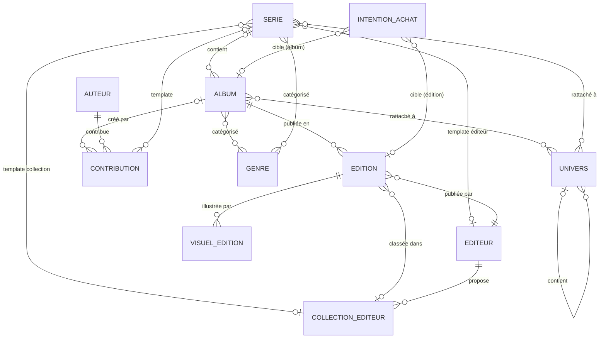

# Schéma des relations

> La **Collection utilisateur** n'est pas une entité en base. Elle est définie par le filtre `Mode d'acquisition IS NOT NULL` sur les éditions.
>
> **Contrainte (Contribution) :** Une contribution appartient à exactement l'un des deux : un Album ou une Série. Les deux références ne peuvent pas être nulles simultanément, ni renseignées toutes les deux.

---
