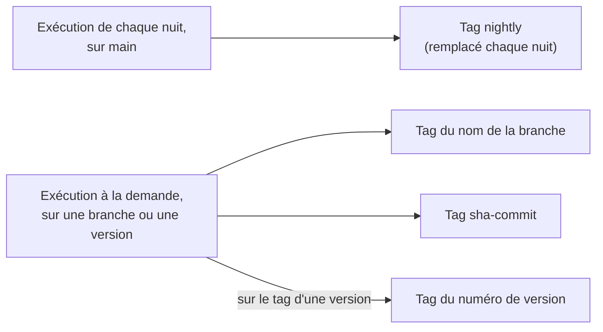
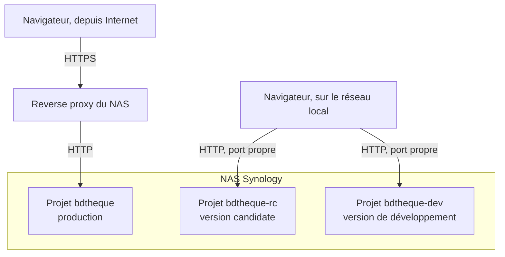
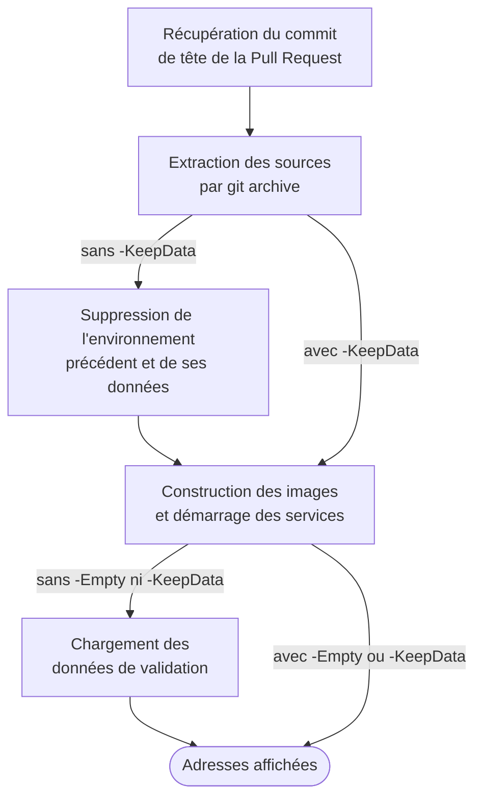
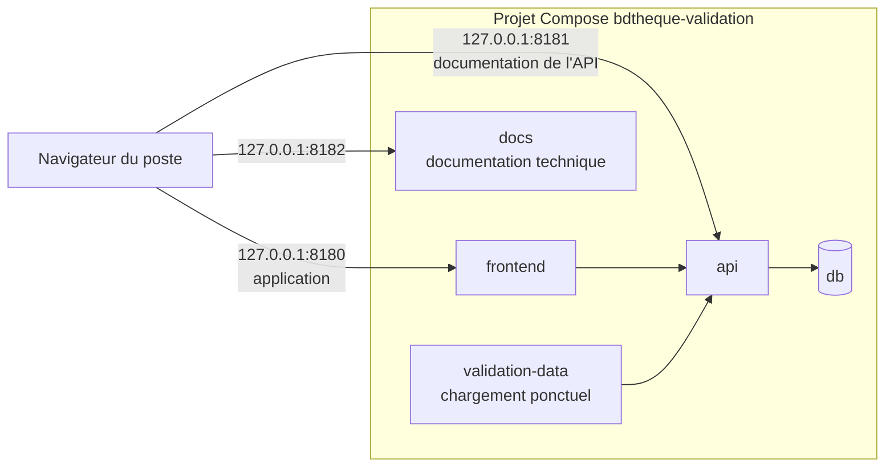

# Déploiement et environnement de validation

L'application se déploie toujours à partir du même fichier, [`docker-compose.yml`](../../../docker-compose.yml). En production, Docker Compose l'utilise tel quel et télécharge les images publiées sur Docker Hub. Pour la validation d'une Pull Request sur le poste du développeur, un second fichier vient le surcharger et les images sont construites localement. Les exigences que ces deux usages respectent sont dans [Déploiement](../../../.speckit/contraintes-techniques/architecture-deploiement/deploiement.md) et [Hébergement](../../../.speckit/contraintes-techniques/architecture-deploiement/hebergement.md) ; la procédure d'installation pas à pas est dans le [`README.md`](../../../README.md).

## Les images et leur publication

L'application est livrée sous la forme de deux images Docker, `tetram76/bdtheque-api` et `tetram76/bdtheque-frontend`. Chacune est construite en deux étapes par son Dockerfile ([`docker/api/Dockerfile`](../../../docker/api/Dockerfile), [`docker/frontend/Dockerfile`](../../../docker/frontend/Dockerfile)) : une première image, celle du SDK .NET, compile le code, puis seul le résultat est copié dans une image d'exécution ASP.NET Core *chiseled*, c'est-à-dire réduite au strict nécessaire, sans shell ni gestionnaire de paquets. La base de données n'a pas d'image propre au projet : `db` utilise l'image officielle de PostgreSQL, à une version épinglée dans `docker-compose.yml`.

Le workflow [`docker-publish.yml`](../../../.github/workflows/docker-publish.yml) publie ces images sur Docker Hub, jamais à chaque fusion. Il s'exécute chaque nuit sur `main` et publie alors les images sous le seul tag `nightly`, en remplaçant les précédentes. Il peut aussi être lancé à la demande, sur une branche ou sur le tag d'une version ; les images reçoivent alors le nom de la branche, le tag `sha-<commit>`, qui désigne exactement le commit construit, et, pour une version, son numéro.

Le schéma suivant, tracé à la main d'après le workflow, répond à la question : quel déclenchement produit quels tags sur Docker Hub ?

## La production et les pré-versions sur le NAS

Le NAS peut faire tourner plusieurs versions de l'application en même temps : la production, mais aussi une version candidate ou une version de développement. Chaque version y est un **projet Compose** distinct, c'est-à-dire un dossier qui contient le `docker-compose.yml` de cette version et son propre fichier `.env`. Docker Compose nomme les conteneurs, les réseaux et le volume de la base d'après le nom du projet ; deux versions n'ont donc rien en commun, ni base, ni réseau, ni secret interne. C'est pour cette raison que `docker-compose.yml` ne fixe aucun nom de conteneur, de réseau ou de volume. Les raisons de ce choix sont dans [Plusieurs versions sur le NAS](../../../.speckit/choix-implementation/deploiement/plusieurs-versions-sur-le-nas.md).

Seule la production est publiée sur Internet, derrière le reverse proxy du NAS, qui reçoit les requêtes en HTTPS et les retransmet en HTTP au `frontend` de la production. Les pré-versions sont jointes directement en HTTP, sur le réseau local, chacune sur son propre port.

Le schéma suivant, tracé à la main d'après la procédure du `README.dev.md`, répond à la question : comment le navigateur atteint-il chacune des versions installées sur le NAS ? Les noms des projets y sont des exemples, que rien n'impose.

Chaque projet choisit dans son `.env` le tag des images qu'il utilise : le numéro de la version pour la production, `sha-<commit>` pour une pré-version. Au démarrage, `api` applique lui-même les migrations du schéma à sa base avant de servir la moindre requête ; aucune étape d'installation séparée n'est nécessaire pour mettre la base à jour.

Le fichier [`.env.example`](../../../.env.example) sert de modèle à ce `.env`. Certaines valeurs n'ont pas de défaut : le mot de passe de la base, le secret interne partagé entre `frontend` et `api`, et le compte de l'administrateur. Si l'une d'elles manque, `docker compose` refuse de démarrer. Une fois lancés, `api` et `frontend` valident à leur tour leur configuration et s'arrêtent si elle est incorrecte ; `api` refuse aussi de démarrer si le dossier des visuels n'est pas accessible en écriture.

## L'environnement de validation sur le poste

Avant de fusionner une Pull Request qui change ce que voit l'utilisateur, celui-ci la valide en la faisant tourner sur son propre poste. Une seule commande, [`Start-Validation.ps1`](../../../scripts/Start-Validation.ps1), lance la version complète de la Pull Request (ou de n'importe quel commit), avec des données fictives et la documentation technique du même commit. Elle n'exige que `git` et un service Docker démarré ; ni le SDK .NET ni aucun fichier à modifier ne sont nécessaires. Les raisons de ce dispositif sont dans [Environnement de validation fonctionnelle](../../../.speckit/choix-implementation/deploiement/environnement-de-validation-fonctionnelle.md), et la marche à suivre dans le [`README.dev.md`](../../../README.dev.md).

Le script procède dans l'ordre suivant. Il récupère d'abord le commit de tête de la Pull Request, puis en extrait les sources par `git archive` dans un dossier temporaire : les modifications non commitées de la copie de travail ne jouent donc aucun rôle dans ce qui est validé. Il supprime ensuite l'environnement précédent avec ses données, sauf si l'option `-KeepData` demande de les garder, si bien que chaque validation repart d'une base vide. Il construit alors les images et démarre les services, en attendant qu'ils soient en bonne santé. Il charge enfin les données de validation, sauf avec les options `-Empty` ou `-KeepData`.

Le schéma suivant, tracé à la main d'après le script, répond à la question : par quelles étapes passe la commande de validation, et lesquelles ses options sautent-elles ?

Le projet Compose de validation, nommé `bdtheque-validation`, combine `docker-compose.yml` et la surcharge [`docker/validation/compose.yaml`](../../../docker/validation/compose.yaml). Les valeurs de configuration, fixes et fictives, sont lues dans [`validation.env`](../../../docker/validation/validation.env), si bien qu'il n'y a rien à générer. Les images y sont construites sous des noms propres à la validation (`bdtheque-validation-*`) et ne remplacent jamais, sur le poste, celles de Docker Hub. Les conteneurs `api` et `frontend` y tournent dans l'environnement ASP.NET Core `Validation`, qui se comporte comme la production à deux ajouts près : `api` sert la documentation de son contrat HTTP, et `frontend` accepte qu'une page impose son thème par le paramètre `?theme=` de son adresse.

Le schéma suivant, tracé à la main d'après les deux fichiers Compose, répond à la question : quels services le projet de validation démarre-t-il, et lesquels le navigateur du poste peut-il joindre, sur quel port ?

Tous les ports ne sont ouverts que sur l'adresse locale du poste, `127.0.0.1`, et ne sont donc pas joignables depuis le réseau. Le port de l'application est donné par `FRONTEND_PORT`, celui de la documentation de l'API (Scalar, sous `/scalar/v1`) par `API_PORT`, et celui de la documentation technique par `DOCS_PORT`. Le service `validation-data` n'est démarré qu'à la demande du script : il charge les données une fois, en appelant l'API d'administration, puis s'arrête.

Le service `docs` sert la documentation technique du commit validé. Son image, construite par [`docker/validation-docs/Dockerfile`](../../../docker/validation-docs/Dockerfile), part du dossier `docs/tech/` de ce commit, dont l'empreinte est inscrite au pied de chaque page. Son fonctionnement est détaillé dans [Consulter, construire, vérifier et maintenir](../documentation/consulter-et-maintenir.md).

Pour arrêter l'environnement, [`Stop-Validation.ps1`](../../../scripts/Stop-Validation.ps1) supprime les conteneurs, les réseaux, les données (sauf avec `-KeepData`) et les sources extraites. Il garde les images construites, si bien que la validation suivante ne reconstruit que ce que sa Pull Request a changé.
