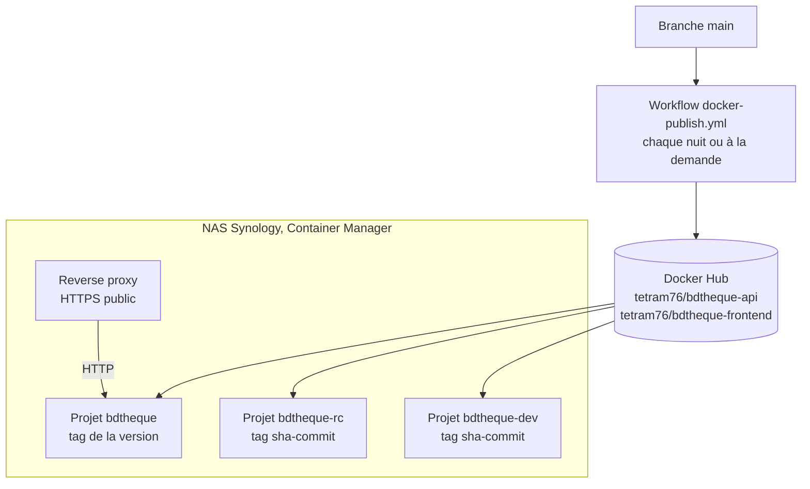
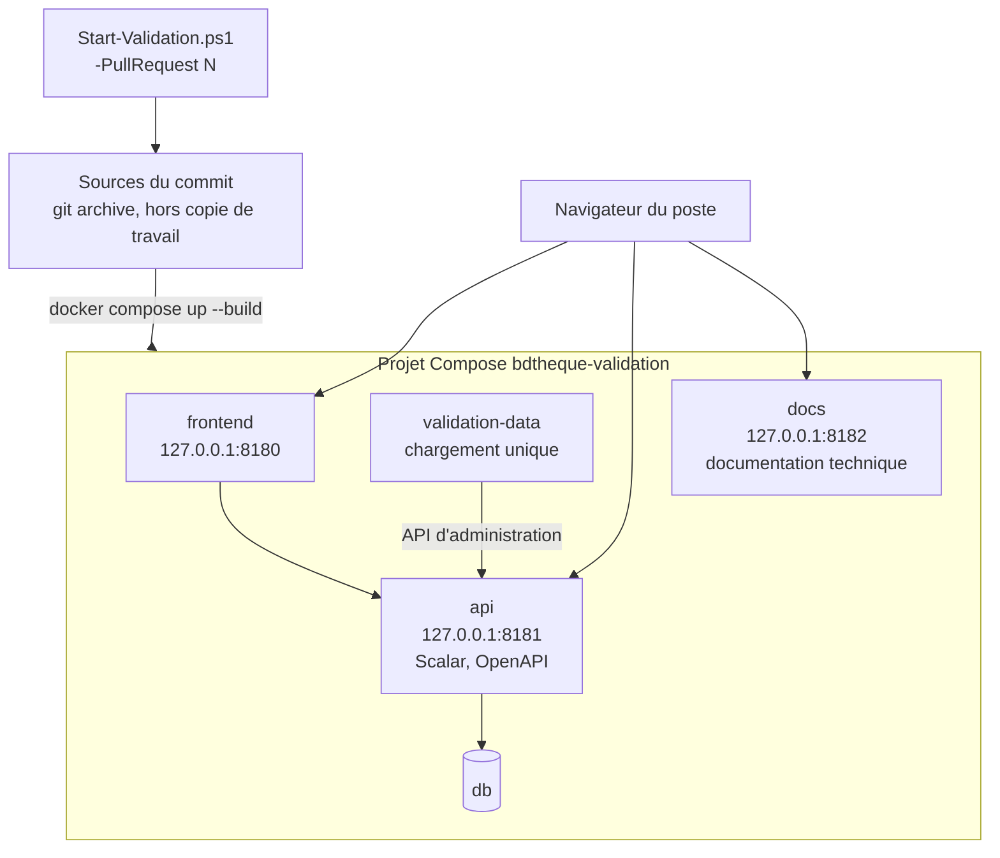

# Déploiement et environnement de validation

Le même fichier [`docker-compose.yml`](../../../docker-compose.yml) sert la production, avec les images publiées, et l'environnement de validation, qui le surcharge. Exigences : [Déploiement](../../../.speckit/contraintes-techniques/architecture-deploiement/deploiement.md), [Hébergement](../../../.speckit/contraintes-techniques/architecture-deploiement/hebergement.md) ; procédure d'installation : [`README.md`](../../../README.md).

## Production et pré-versions

Question du schéma : *d'où viennent les images, et comment plusieurs versions cohabitent-elles sur le NAS ?* Schéma interprétatif.

- **Un projet Compose par version**, chacun dans son dossier, avec son `.env` : ses conteneurs, réseaux et volume `db-data` lui sont propres ; seul le `frontend` de la production est derrière le reverse proxy, les pré-versions sont jointes en HTTP interne ([Plusieurs versions sur le NAS](../../../.speckit/choix-implementation/deploiement/plusieurs-versions-sur-le-nas.md)).
- **Images** : `api` et `frontend`, construites par [`docker/api/Dockerfile`](../../../docker/api/Dockerfile) et [`docker/frontend/Dockerfile`](../../../docker/frontend/Dockerfile) (SDK .NET pour la compilation, ASP.NET Core *chiseled* pour l'exécution), publiées par [`docker-publish.yml`](../../../.github/workflows/docker-publish.yml) ; `db` est l'image PostgreSQL officielle épinglée.
- **Schéma de la base** : appliqué par `api` à son démarrage (migrations EF Core), avant de servir.
- **Variables** : modèle dans [`.env.example`](../../../.env.example) ; `docker compose` refuse de démarrer sans les valeurs obligatoires (mot de passe de la base, secret interne, compte administrateur), et `api` comme `frontend` valident leur configuration au démarrage.

## Environnement de validation

La version d'une Pull Request (ou de tout commit) lancée sur le poste par une commande, pour sa validation fonctionnelle et pour en consulter la documentation technique. Raisons et alternatives : [Environnement de validation fonctionnelle](../../../.speckit/choix-implementation/deploiement/environnement-de-validation-fonctionnelle.md) ; marche à suivre : [`README.dev.md`](../../../README.dev.md).

Question du schéma : *qu'est-ce que la commande de validation construit et démarre, et qu'ouvre-t-elle au navigateur du poste ?* Schéma interprétatif.

- **Construit depuis le commit validé** : les sources sont extraites par `git archive` dans un dossier temporaire, puis les images sont construites localement sous des noms propres à la validation (`bdtheque-validation-*`), jamais celles de Docker Hub.
- **Surcharge** : [`docker/validation/compose.yaml`](../../../docker/validation/compose.yaml), avec les valeurs fixes et fictives de [`validation.env`](../../../docker/validation/validation.env) ; `api` et `frontend` y tournent dans l'environnement ASP.NET Core `Validation`, qui ajoute la documentation de l'API et le thème choisi par l'adresse.
- **Ports ouverts au seul poste** (`127.0.0.1`) : application (`FRONTEND_PORT`), documentation de l'API par Scalar (`API_PORT`, `/scalar/v1`), documentation technique du commit (`DOCS_PORT`).
- **Documentation technique** : le service `docs`, image construite par [`docker/validation-docs/Dockerfile`](../../../docker/validation-docs/Dockerfile) depuis le `docs/tech/` du commit validé, dont l'empreinte figure au pied de chaque page. Détail : [Consulter, construire, vérifier et maintenir](../documentation/consulter-et-maintenir.md).
- **Arrêt** : [`Stop-Validation.ps1`](../../../scripts/Stop-Validation.ps1) supprime conteneurs, réseaux, volumes et sources extraites ; chaque lancement repart d'une base vide et reconstruit ce que le commit a changé.
