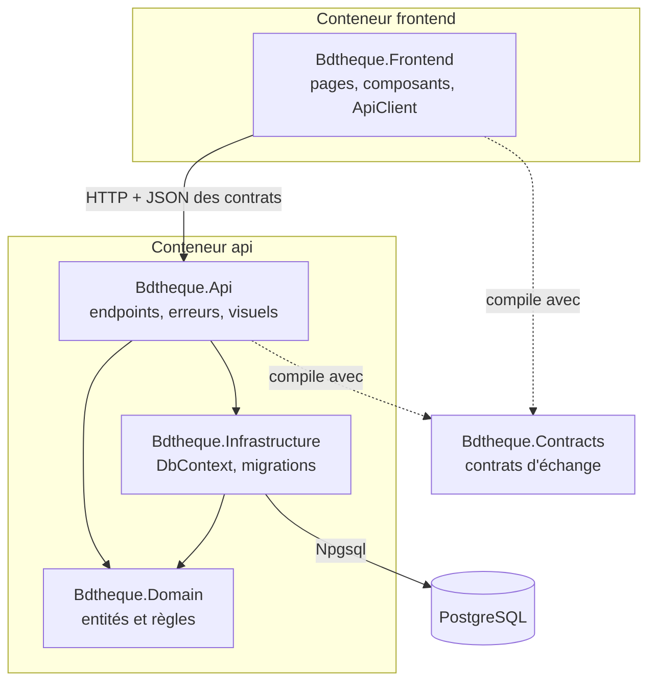

# Projets de la solution

La solution [`Bdtheque.slnx`](../../../Bdtheque.slnx) découpe le code par responsabilité ; les références entre projets imposent les couches à la compilation. Les raisons de ce découpage sont dans [Organisation du code](../../../.speckit/choix-implementation/organisation-du-code.md) ; les références exactes, générées depuis les fichiers de projet, dans [Dépendances des projets](../references/dependances-des-projets.md).

## À l'exécution

Question du schéma : *par où passe une requête, d'un projet à l'autre, une fois l'application démarrée ?* Schéma interprétatif.

## Projets de l'application

| Projet | Ce qu'il porte | Exécuté par | Point d'entrée |
| --- | --- | --- | --- |
| `Bdtheque.Domain` | Entités, règles métier, erreurs métier ; ni EF Core ni framework web. | `api` | [`src/Bdtheque.Domain/`](../../../src/Bdtheque.Domain/) |
| `Bdtheque.Infrastructure` | `BdthequeDbContext`, configurations EF Core, migrations, collations. | `api` | [`BdthequeDbContext`](../../../src/Bdtheque.Infrastructure/BdthequeDbContext.cs) |
| `Bdtheque.Contracts` | Contrats JSON échangés entre `api` et ses clients, découplés des entités. | `api`, `frontend`, données de validation | [`src/Bdtheque.Contracts/`](../../../src/Bdtheque.Contracts/) |
| `Bdtheque.Api` | Endpoints Minimal API par famille de routes, gestion des erreurs, stockage des visuels, mesure d'audience, tâches quotidiennes. | `api` | [`Program.cs`](../../../src/Bdtheque.Api/Program.cs), [`RouteGroups`](../../../src/Bdtheque.Api/Endpoints/RouteGroups.cs) |
| `Bdtheque.Frontend` | Composants Blazor (rendu serveur), thèmes, authentification de l'administrateur, client de l'API, relais des médias. | `frontend` | [`Program.cs`](../../../src/Bdtheque.Frontend/Program.cs), [`ApiClient`](../../../src/Bdtheque.Frontend/Api/ApiClient.cs) |
| `Bdtheque.HealthProbe` | Sonde du bilan de santé des images, sans shell ni `curl`. | images `api` et `frontend` | [`src/Bdtheque.HealthProbe/`](../../../src/Bdtheque.HealthProbe/) |
| `Bdtheque.ValidationData` | Données fictives de l'environnement de validation, chargées par l'API d'administration ; jamais déployé. | environnement de validation | [`src/Bdtheque.ValidationData/`](../../../src/Bdtheque.ValidationData/) |

## Projets de tests

| Projet | Ce qu'il vérifie | Ressources |
| --- | --- | --- |
| `Bdtheque.Domain.Tests` | Règles du domaine. | aucune |
| `Bdtheque.Infrastructure.Tests` | Persistance (migrations, contraintes) ; tests du dépôt (catégorie `Repository`), qui confrontent ses fichiers à leurs règles, dont la structure du `.speckit/` et de cette documentation. | PostgreSQL (Testcontainers) pour la persistance |
| `Bdtheque.Api.Tests` | Endpoints sur l'API hébergée en mémoire. | PostgreSQL |
| `Bdtheque.Frontend.Tests` | Composants Blazor (bUnit), sans navigateur. | aucune |
| `Bdtheque.EndToEnd.Tests` | Application complète pilotée dans Chromium (Playwright), captures de référence. | PostgreSQL, Chromium |
| `Bdtheque.ValidationData.Tests` | Chargement des données de validation par l'API. | PostgreSQL |
| `Bdtheque.Documentation.Tests` | Site de cette documentation : construction, rendu des diagrammes, détection de l'impact documentaire, références générées. | Chromium, `git`, `pwsh` |
| `Bdtheque.Testing` | Bibliothèque partagée : serveur PostgreSQL de test, hôte de l'API. | — |

Outillage et stratégie de test : [Outillage de développement](../../../.speckit/choix-implementation/outillage.md).
