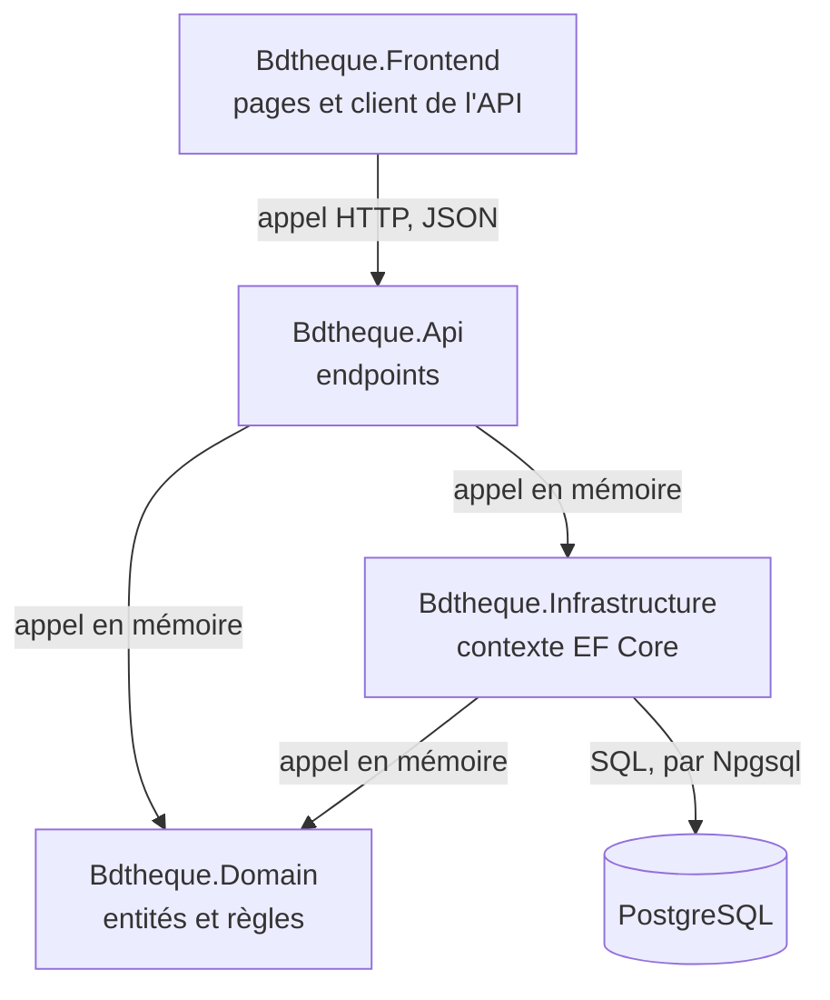

# Projets de la solution

La solution [`Bdtheque.slnx`](../../../Bdtheque.slnx) découpe le code en projets selon leur responsabilité. Ce découpage n'est pas seulement une convention : un projet ne peut utiliser que les projets qu'il référence, si bien que les règles de dépendance entre couches sont vérifiées par le compilateur. Le domaine, par exemple, ne référence ni EF Core ni ASP.NET Core, et ne peut donc pas en dépendre par mégarde. Les raisons de ce découpage sont données dans [Organisation du code](../../../.speckit/choix-implementation/organisation-du-code.md) ; la liste exacte des références entre projets, générée depuis les fichiers de projet, est dans [Dépendances des projets](../references/dependances-des-projets.md).

## Le trajet d'une requête à travers les projets

Une fois l'application démarrée, une requête de page entre par `Bdtheque.Frontend`, qui appelle l'API en HTTP. Dans le conteneur `api`, `Bdtheque.Api` reçoit l'appel, confie les règles à `Bdtheque.Domain` et l'accès aux données à `Bdtheque.Infrastructure`, qui s'adresse à PostgreSQL par le pilote Npgsql. Les deux côtés de l'appel HTTP s'entendent sur la forme des messages JSON parce qu'ils compilent tous deux avec `Bdtheque.Contracts`, qui définit ces messages ; ce partage se joue à la compilation et n'apparaît donc pas dans le schéma, qui ne montre que les appels à l'exécution.

Le schéma suivant, tracé à la main d'après le code, répond à la question : quel projet appelle quel autre pendant le traitement d'une requête, et par quel moyen ?

## Projets de l'application

Chaque projet de l'application a une responsabilité unique, et n'est exécuté que là où elle sert.

| Projet | Ce qu'il porte | Exécuté par | Point d'entrée |
| --- | --- | --- | --- |
| `Bdtheque.Domain` | Il contient les entités, les règles métier et les erreurs métier. Il ne dépend ni d'EF Core ni d'un framework web, ce qui permet de tester les règles sans base ni serveur. | `api` | [`src/Bdtheque.Domain/`](../../../src/Bdtheque.Domain/) |
| `Bdtheque.Infrastructure` | Il contient le contexte EF Core `BdthequeDbContext`, la configuration qui associe les entités aux tables, les migrations du schéma et les collations des colonnes texte. | `api` | [`BdthequeDbContext`](../../../src/Bdtheque.Infrastructure/BdthequeDbContext.cs) |
| `Bdtheque.Contracts` | Il définit les messages JSON qu'`api` échange avec ses clients. Ces contrats sont distincts des entités, si bien que le domaine peut évoluer sans changer ce que voient les clients. | `api`, `frontend` et le chargeur des données de validation | [`src/Bdtheque.Contracts/`](../../../src/Bdtheque.Contracts/) |
| `Bdtheque.Currencies` | Il donne les décimales d'un montant dans chaque devise, d'après l'unité mineure de l'ISO 4217. Le domaine s'en sert pour refuser un montant trop précis, et le frontend pour présenter chaque montant et limiter sa saisie ; ce petit projet sans dépendance leur évite de tenir chacun sa table, sans que le frontend dépende du domaine. | `api` et `frontend` | [`CurrencyDecimals`](../../../src/Bdtheque.Currencies/CurrencyDecimals.cs) |
| `Bdtheque.Api` | Il déclare les endpoints, regroupés par famille de routes (style *Minimal API* d'ASP.NET Core), et porte la gestion des erreurs, le stockage des visuels, la mesure d'audience et les tâches quotidiennes. | `api` | [`Program.cs`](../../../src/Bdtheque.Api/Program.cs), [`RouteGroups`](../../../src/Bdtheque.Api/Endpoints/RouteGroups.cs) |
| `Bdtheque.Frontend` | Il contient les composants Blazor rendus côté serveur, les thèmes, l'authentification de l'administrateur, le client de l'API et le relais des fichiers des visuels. | `frontend` | [`Program.cs`](../../../src/Bdtheque.Frontend/Program.cs), [`ApiClient`](../../../src/Bdtheque.Frontend/Api/ApiClient.cs) |
| `Bdtheque.HealthProbe` | C'est un petit programme qui interroge `/health` pour le bilan de santé des images Docker. Il remplace `curl`, absent des images d'exécution, qui n'ont pas non plus de shell. | les images `api` et `frontend` | [`src/Bdtheque.HealthProbe/`](../../../src/Bdtheque.HealthProbe/) |
| `Bdtheque.ValidationData` | Il charge des données fictives dans l'environnement de validation, en passant par l'API d'administration comme le ferait l'utilisateur. Il n'est jamais déployé en production. | l'environnement de validation | [`src/Bdtheque.ValidationData/`](../../../src/Bdtheque.ValidationData/) |

## Projets de tests

Les tests sont répartis en projets selon ce qu'ils vérifient et les ressources dont ils ont besoin pour s'exécuter : certains se contentent du code, d'autres démarrent un serveur PostgreSQL dans un conteneur (par la bibliothèque Testcontainers) ou pilotent un navigateur Chromium.

| Projet | Ce qu'il vérifie | Ressources nécessaires |
| --- | --- | --- |
| `Bdtheque.Domain.Tests` | Il vérifie les règles du domaine. | Aucune. |
| `Bdtheque.Infrastructure.Tests` | Il vérifie la persistance (migrations, contraintes de la base). Il contient aussi les tests du dépôt, de catégorie `Repository`, qui confrontent les fichiers du dépôt à leurs règles, dont la structure du `.speckit/` et celle de cette documentation. Parmi eux, ceux du verrou de l'environnement de validation lancent ses scripts, qui doivent refuser de démarrer pendant qu'une autre opération le tient, et ceux de `Get-SpeckitConcepts.ps1` et des scripts de la dette qualité au fil de l'eau lancent ces scripts dans un dépôt `git` jetable, sortie redirigée comme pour un agent. | PostgreSQL, pour les tests de persistance seulement ; PowerShell (`pwsh`), pour ceux qui lancent un script, et `git` pour ceux de `Get-SpeckitConcepts.ps1` et de la dette qualité. |
| `Bdtheque.Api.Tests` | Il vérifie les endpoints, sur une API hébergée en mémoire dans le processus du test. | PostgreSQL. |
| `Bdtheque.Frontend.Tests` | Il vérifie les composants Blazor avec bUnit, qui les rend sans navigateur. | Aucune. |
| `Bdtheque.EndToEnd.Tests` | Il pilote l'application complète dans Chromium avec Playwright, et compare les captures de référence des écrans. | PostgreSQL et Chromium. |
| `Bdtheque.ValidationData.Tests` | Il vérifie que les données de validation se chargent par l'API. | PostgreSQL. |
| `Bdtheque.Documentation.Tests` | Il construit le site de cette documentation, vérifie le rendu de ses diagrammes, la détection de l'impact documentaire et les références générées. | Chromium, `git` et PowerShell (`pwsh`). |
| `Bdtheque.Testing` | Ce n'est pas un projet de tests, mais la bibliothèque qu'ils partagent : serveur PostgreSQL de test et hôte de l'API. | Sans objet. |

Les choix d'outillage des tests sont expliqués dans [Outillage de développement](../../../.speckit/choix-implementation/outillage.md), et leur organisation dans [Stratégie de tests](../integration-et-tests/strategie-de-tests.md).
