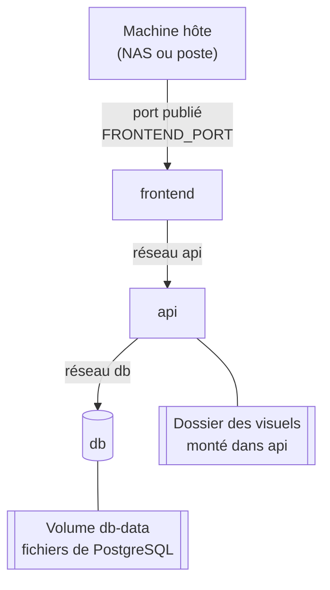
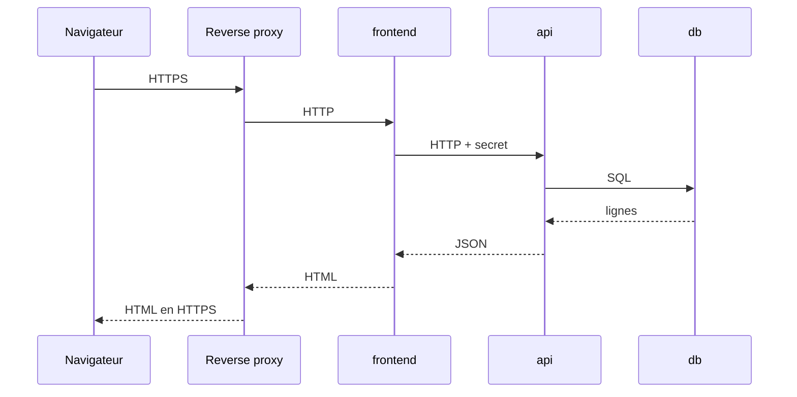

# Vue d'ensemble

BDthèque est une application web découpée en trois conteneurs Docker, assemblés par [`docker-compose.yml`](../../../docker-compose.yml). Le conteneur `frontend` produit les pages HTML que voit l'utilisateur ; le conteneur `api` porte les règles de l'application et l'accès aux données ; le conteneur `db` exécute la base PostgreSQL qui les conserve. Ce découpage en tiers est imposé par la spécification, qui exige aussi que le navigateur ne parle qu'à `frontend` et que seul `api` accède à la base : voir [Architecture des tiers](../../../.speckit/contraintes-techniques/architecture-deploiement/architecture-des-tiers.md) et [Hébergement](../../../.speckit/contraintes-techniques/architecture-deploiement/hebergement.md).

## Les conteneurs et leurs réseaux

Docker Compose relie les conteneurs par deux réseaux privés, chacun nommé d'après le conteneur auquel il donne accès et rejoint par les seuls conteneurs qui l'appellent. Le réseau `api` réunit donc `api` et `frontend`, et le réseau `db` réunit `db` et `api`. Comme `frontend` ne rejoint pas le réseau `db`, il n'a aucun moyen d'atteindre la base, même s'il était compromis ; un test du dépôt, [`DockerComposeTests`](../../../tests/Bdtheque.Infrastructure.Tests/DockerComposeTests.cs), vérifie cette règle de nommage dans les fichiers Compose et le fait que seul `api` rejoigne le réseau `db`. Les raisons de cette règle sont dans [Réseaux des conteneurs](../../../.speckit/choix-implementation/deploiement/reseaux-des-conteneurs.md). Un seul port est publié sur la machine hôte, celui de `frontend` (variable `FRONTEND_PORT`, 8080 par défaut) : `api` et `db` ne sont joignables que de l'intérieur de leurs réseaux.

Le schéma suivant, tracé à la main d'après `docker-compose.yml`, répond à une seule question : quel conteneur peut joindre quel autre, par quel réseau, et où sont rangées les données ?

| Conteneur | Rôle | Exposition |
| --- | --- | --- |
| `frontend` | Il rend les pages de la consultation et de l'administration, gère la connexion de l'administrateur et relaie au navigateur les fichiers des visuels, qu'il obtient d'`api`. | C'est le seul conteneur publié sur l'hôte, et il n'écoute qu'en HTTP. |
| `api` | Il expose les endpoints des familles `/admin`, `/catalog` et `/audience`, applique les règles, lit et écrit la base et le dossier des visuels, et applique les migrations du schéma à son démarrage. | Il n'est publié sur aucun port : seul `frontend` le joint, par le réseau `api`. |
| `db` | Il exécute PostgreSQL, dans une image dont la version est épinglée dans `docker-compose.yml`. | Il n'est relié qu'au réseau `db`, que `frontend` ne rejoint pas. |

## Le parcours d'une requête

En production, le navigateur ne joint pas directement `frontend`. Il passe par le *reverse proxy* du NAS, c'est-à-dire le serveur web du NAS qui reçoit les requêtes publiques en HTTPS, les déchiffre et les retransmet en HTTP au conteneur. Pour construire une page, `frontend` appelle ensuite `api` en HTTP, en joignant à chaque appel un *secret interne*, une valeur partagée entre les deux conteneurs par leur configuration (`INTERNAL_API_KEY`) ; `api` interroge enfin la base en SQL.

Le schéma suivant, tracé à la main d'après le code, répond à la question : par quels intermédiaires passe une demande de page, et sous quelle forme ?

En dehors de ce parcours, `frontend` télécharge lui-même, au démarrage puis chaque jour, les plages de numéros ISBN publiées par l'Agence internationale de l'ISBN, dont il se sert pour présenter un ISBN avec ses tirets ([`Program.cs` du frontend](../../../src/Bdtheque.Frontend/Program.cs), service `IsbnRangesRefresher`). C'est le seul appel que l'application émet vers Internet.

## Les frontières de sécurité

La sécurité de l'ensemble repose sur quatre frontières, chacune tenue par un conteneur précis.

- **Le chiffrement TLS** est assuré par le reverse proxy du NAS, et non par l'application. Le conteneur `frontend` n'écoute donc qu'en HTTP et ne redirige jamais vers HTTPS. Pour que les liens et les cookies qu'il produit correspondent à l'adresse que voit le navigateur, et non à celle de la connexion du proxy, `frontend` applique à chaque requête, avant tout autre traitement, l'adresse publique déclarée dans `PublicAddress__Url` ([`Program.cs` du frontend](../../../src/Bdtheque.Frontend/Program.cs)).
- **L'identité de l'utilisateur** n'est connue que de `frontend`, qui authentifie l'administrateur par un cookie. Le conteneur `api` ne connaît aucun utilisateur : il fait confiance à `frontend`, qui réserve à l'administrateur authentifié les pages de l'administration et, par elles, les appels aux endpoints `/admin`. Rien côté `api` ne vérifie que l'appelant est l'administrateur ; c'est une propriété de `frontend` qu'il faut préserver. Le détail est dans [Authentification et appels internes](../mecanismes/authentification-et-appels-internes.md).
- **Le réseau** isole `api`, qui n'est publié sur aucun port. Par défense en profondeur, `api` exige en plus le secret interne sur chaque requête, sauf sur `/health`, que Docker interroge pour connaître l'état du conteneur, et sur la documentation de l'API, qui n'est servie qu'en développement et dans l'environnement de validation.
- **Les données**, c'est-à-dire la base et le dossier des visuels, ne sont accessibles qu'à `api`. Le navigateur reçoit les images des visuels par l'intermédiaire de `frontend`, qui les demande à `api` et les lui retransmet.

## Où lire le code

- L'assemblage des conteneurs, de leurs réseaux et de leurs volumes est décrit dans [`docker-compose.yml`](../../../docker-compose.yml).
- Le démarrage d'`api` (enregistrement des services, migrations, middlewares, familles de routes) se lit dans le [`Program.cs` de l'API](../../../src/Bdtheque.Api/Program.cs).
- Le démarrage de `frontend` (rendu des pages, authentification, client de l'API, relais des visuels) se lit dans le [`Program.cs` du frontend](../../../src/Bdtheque.Frontend/Program.cs).
- Le rôle de chaque projet .NET, et le conteneur qui l'exécute, sont décrits dans [Projets de la solution](projets-de-la-solution.md).
