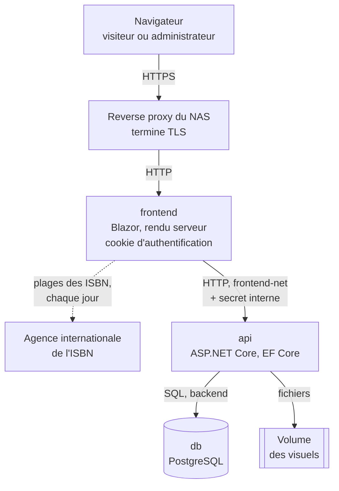

# Vue d'ensemble

BDthèque est une application web en trois conteneurs : `frontend` rend les pages, `api` porte les règles et les données, `db` les conserve. Le navigateur ne parle qu'à `frontend` ; seul `api` parle à `db`. Contraintes qui l'imposent : [Architecture des tiers](../../../.speckit/contraintes-techniques/architecture-deploiement/architecture-des-tiers.md), [Hébergement](../../../.speckit/contraintes-techniques/architecture-deploiement/hebergement.md).

## Conteneurs et échanges

Question du schéma : *qui échange avec qui, par quel canal, et où passent les frontières de sécurité ?* Schéma interprétatif, tenu à la main : sa compilation vérifie sa syntaxe, pas sa fidélité au code.

| Conteneur | Rôle | Exposition |
| --- | --- | --- |
| `frontend` | Pages de la consultation et de l'administration, connexion de l'administrateur, relais des médias des visuels. | Seul conteneur publié sur l'hôte (`FRONTEND_PORT`, 8080 par défaut), en HTTP. |
| `api` | Endpoints `/admin`, `/catalog` et `/audience`, règles applicatives, persistance, visuels, migrations appliquées au démarrage. | Jamais publié : joint par `frontend` sur le réseau `frontend-net`. |
| `db` | PostgreSQL, image épinglée dans [`docker-compose.yml`](../../../docker-compose.yml). | Réseau `backend` seul, que `frontend` ne rejoint pas. |

## Frontières de sécurité

- **TLS** : terminé par le reverse proxy du NAS ; `frontend` n'écoute qu'en HTTP et ne redirige jamais vers HTTPS. Derrière le proxy, l'adresse publique déclarée (`PublicAddress__Url`) est appliquée à chaque requête avant tout traitement ([`Program.cs` du frontend](../../../src/Bdtheque.Frontend/Program.cs)).
- **Utilisateur** : seul `frontend` connaît l'administrateur, par son cookie ; `api` ne connaît aucun utilisateur. Les pages de l'administration sont réservées en bloc à l'administrateur authentifié ; les endpoints `/admin` sont appelés par ces pages, par les contrôles et les listes qu'elles emploient, et par le relais des visuels en attente, réservé lui aussi à l'administrateur. Rien côté `api` ne le vérifie : c'est une propriété de `frontend`, à préserver. Détail : [Authentification et appels internes](../mecanismes/authentification-et-appels-internes.md).
- **Réseau** : `api` n'est publié sur aucun port de l'hôte, et exige en outre de chaque requête le secret interne partagé avec `frontend` (défense en profondeur), sauf `/health` et, hors production, la documentation de l'API.
- **Données** : la base et le volume des visuels sont privés à `api` ; le navigateur reçoit les médias des visuels par le relais de `frontend`.

## Points d'entrée

- Assemblage des conteneurs, réseaux et volumes : [`docker-compose.yml`](../../../docker-compose.yml).
- Démarrage d'`api` (services, migrations, middlewares, familles de routes) : [`Program.cs` de l'API](../../../src/Bdtheque.Api/Program.cs).
- Démarrage de `frontend` (rendu, authentification, client de l'API, relais) : [`Program.cs` du frontend](../../../src/Bdtheque.Frontend/Program.cs).
- Rôle de chaque projet .NET : [Projets de la solution](projets-de-la-solution.md).
