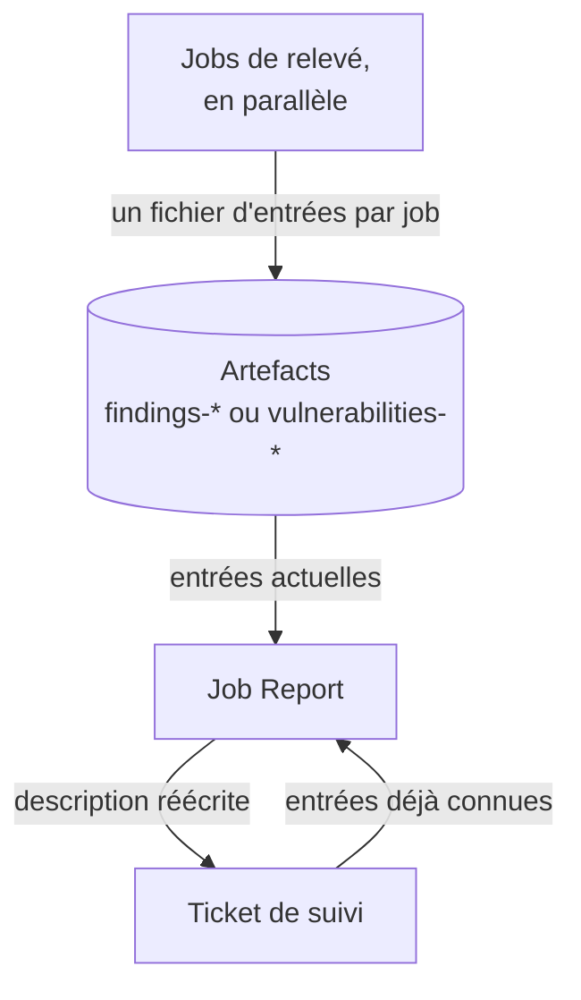

# Contrôles périodiques

Le CI ne voit que ce que change une Pull Request. Or la qualité du code de `main` et la sécurité de ses dépendances évoluent aussi sans qu'aucune Pull Request n'y touche : une règle d'analyse change, une vulnérabilité est publiée pour un package déjà utilisé. Deux workflows planifiés surveillent donc `main` à intervalles réguliers. [`quality-audit.yml`](../../../.github/workflows/quality-audit.yml) contrôle la qualité du code chaque semaine, et [`security-audit.yml`](../../../.github/workflows/security-audit.yml) contrôle la sécurité chaque jour.

Aucun des deux n'est un check requis : ils ne bloquent aucune fusion. Ce qu'ils relèvent est consigné dans un ticket de suivi, un ticket GitHub par contrôle qui décrit l'état courant de ce qui reste à corriger, et c'est l'agent qui traite ensuite ces entrées. Les règles de ces contrôles sont fixées par [Contrôle qualité hebdomadaire](../../../.speckit/gestion-projet/depot/controle-qualite-hebdomadaire.md) et [Mises à jour des dépendances](../../../.speckit/gestion-projet/depot/mises-a-jour-des-dependances.md), et la forme de leur ticket par [Issues](../../../.speckit/gestion-projet/revue-tickets/issues.md#tickets-de-suivi-des-harnais).

## Le déroulement d'une exécution

Les deux workflows suivent le même déroulement. Plusieurs jobs de relevé s'exécutent en parallèle, chacun pour une source (SonarQube Cloud, les packages NuGet, les images…), et produisent chacun un fichier d'entrées. Une entrée est une ligne de texte qui désigne un problème de façon stable d'une exécution à l'autre, sans numéro de ligne ni version, par exemple `sonar <règle> <fichier>` ou `nuget <package>: <avis>`. Le job `Report` rassemble ensuite ces fichiers et met à jour le ticket de suivi.

Le schéma suivant, tracé à la main et commun aux deux workflows, répond à une seule question : par où passent les entrées relevées, des jobs de relevé jusqu'au ticket de suivi ?



Le job `Report` procède en quatre temps :

1. Il retrouve le ticket de suivi par ses deux étiquettes, `quality-audit` ou `security-audit` d'une part, et `harness` d'autre part, qu'il crée au besoin. Il ne se fie jamais au titre du ticket, que l'utilisateur peut changer.
2. Il lit les entrées déjà connues, que la description du ticket porte entre des marqueurs HTML invisibles (`<!-- list -->` … `<!-- end -->`, et pour la qualité `<!-- critical -->` et `<!-- to-treat -->`). Une entrée actuelle absente de cette liste est une entrée nouvelle.
3. Il réécrit la description en entier, avec la ligne `Dernier contrôle : <date>`. Cette réécriture fait disparaître la ligne `Dernière prise en compte` que l'agent ajoute après chaque traitement, ce qui signale qu'un nouveau traitement est dû ([Traitement du contrôle qualité à la reprise du travail](../../../.speckit/gestion-projet/depot/traitement-du-controle-qualite-a-la-reprise-du-travail.md), [Relevé des versions à la reprise du travail](../../../.speckit/gestion-projet/depot/releve-des-versions-a-la-reprise-du-travail.md)).
4. Il crée le ticket s'il n'existe pas, le rouvre tant qu'une entrée reste, et le ferme quand il n'en reste plus. Le ticket qu'il crée reçoit, en plus de ses deux étiquettes, l'étiquette `agent`, que porte tout ticket créé sans demande de l'utilisateur ; le workflow crée lui-même ses trois étiquettes, avec leur description, si elles manquent.

Ces workflows n'échouent pas parce qu'une étape s'est mal passée, mais pour prévenir : GitHub notifie l'échec d'un workflow planifié à l'utilisateur qui l'a créé. Les conditions d'échec, propres à chaque contrôle, sont décrites plus bas. Chaque workflow ne s'exécute qu'une fois à la fois, grâce à un groupe de concurrence qui fait attendre une exécution plutôt que de l'annuler, et chacun peut aussi être lancé à la demande (`workflow_dispatch`).

## Le contrôle qualité hebdomadaire

Ce contrôle s'exécute chaque lundi à 4 h 23 en temps universel, sur `main`. Trois jobs relèvent les entrées, et un quatrième en fait la synthèse :

| Job | Ce qu'il relève | Forme de ses entrées |
| --- | --- | --- |
| `SonarQube Cloud` | Il interroge l'API Web de SonarQube Cloud, sans jeton, sur la branche `main`. Il relève les problèmes ouverts et les points sensibles de sécurité à revoir. Pour chaque condition de la porte de qualité en échec, il relève les problèmes du nouveau code qui la font échouer, ou la condition elle-même si aucun problème ne la désigne. Il relève enfin les problèmes de gravité `BLOCKER` ou `HIGH`. | `sonar`, `hotspot`, `gate` |
| `Style rules` | Il construit la solution avec un fichier `.globalconfig` écrit sur l'exécuteur, qui change en avertissements une liste de règles de style `IDE…` tenue dans le workflow, sans faire échouer la construction. Il relève les avertissements de son journal. | `style <règle> <fichier>` |
| `Mutation tests` | Il exécute des tests de mutation avec Stryker.NET (outil local de [`dotnet-tools.json`](../../../dotnet-tools.json)) sur les tests de `Bdtheque.Domain.Tests`. Un test de mutation modifie le code, par exemple en inversant une condition, puis vérifie qu'au moins un test échoue ; une modification qui ne fait échouer aucun test, un mutant survivant, révèle un comportement que les tests ne vérifient pas. Le job relève les mutants survivants et ceux qu'aucun test n'exécute, en rejouant tous les mutants à chaque fois. | `mutant <fichier> <mutateur>: <code> → <remplacement>` |
| `Report` | Il met à jour le ticket, mais seulement sur `main` : une exécution lancée sur une autre branche laisse ses relevés dans son journal et ses artefacts, sans toucher au ticket. | — |

Le job `Report` range chaque entrée dans l'une des trois sections de la description, selon son urgence :

- La section **Critique** reçoit les problèmes qui font échouer la porte de qualité, les conditions en échec sans problème désigné, et les problèmes bloquants ou de gravité haute.
- La section **Prioritaire** reçoit tous les autres problèmes de SonarQube Cloud, problèmes ou points sensibles.
- La section **Au fil de l'eau** reçoit le reste, c'est-à-dire les écarts de style et les mutants.

Le contrôle échoue à chaque exécution tant qu'une entrée critique demeure, et une seule fois pour chaque entrée prioritaire nouvelle ; il n'échoue jamais pour une entrée au fil de l'eau. Lors de la toute première exécution, faute de ticket, aucune entrée n'est tenue pour nouvelle. Le ticket que crée ce contrôle reçoit le type `Task`.

## Le contrôle de sécurité quotidien

Ce contrôle s'exécute chaque jour à 6 h 11 en temps universel. Trois jobs relèvent les vulnérabilités connues, et un quatrième en fait la synthèse :

| Job | Ce qu'il relève | Forme de ses entrées |
| --- | --- | --- |
| `NuGet packages` | Il exécute `dotnet list package --vulnerable --include-transitive` sur la solution, qui confronte chaque package, y compris ceux qu'on n'utilise qu'indirectement, aux avis de la *GitHub Advisory Database*, la base des vulnérabilités publiées que tient GitHub. | `nuget <package>: <avis>` |
| `Docker image (api, frontend, db)` | Il analyse avec Docker Scout, sous le compte `tetram76`, les images publiées `tetram76/bdtheque-api:nightly` et `tetram76/bdtheque-frontend:nightly`, ainsi que l'image de `db` qu'il lit dans `docker-compose.yml`. Il relève toutes leurs vulnérabilités connues, qu'une correction existe ou non. | `image <image>: <CVE>` |
| `GitHub Actions` | Pour chaque action utilisée par les workflows, à la version qu'indique le commentaire placé à côté de son empreinte, il interroge la *GitHub Advisory Database* (`/advisories?ecosystem=actions&affects=…`). Une action située dans un sous-dossier compte comme le dépôt qui la contient. | `action <action>: <avis>` |
| `Report` | Il réunit toutes les entrées en une seule liste dans le ticket. | — |

Ce contrôle échoue une seule fois pour chaque vulnérabilité nouvelle, et non chaque jour tant qu'elle reste connue. Les images de l'application qu'il analyse sont celles de la dernière publication `nightly` ([Déploiement et environnement de validation](../architecture/deploiement.md)) : une correction fusionnée n'y apparaît qu'après la publication suivante.

## Le relevé des versions

Le contrôle de sécurité dit quelles vulnérabilités sont connues, mais pas quelles nouvelles versions existent. C'est l'objet du relevé des versions, que l'agent mène lui-même avec [`Get-DependencyUpdates.ps1`](../../../scripts/Get-DependencyUpdates.ps1). Le script demande `dotnet` et un `gh` authentifié ; il ne lit que les sources officielles et ne modifie rien. Il liste chaque version disponible avec sa portée et sa date :

- Pour les packages NuGet, les outils .NET locaux et les actions des workflows, il donne la version la plus récente de la version majeure en usage et, à part, la version majeure la plus récente.
- Pour les images de .NET, qu'il lit dans [`docker/api/Dockerfile`](../../../docker/api/Dockerfile), il donne le dernier SDK et le dernier runtime du canal en usage, ainsi que chaque canal LTS plus récent.
- Pour l'image PostgreSQL de `docker-compose.yml`, il donne la version la plus récente de sa version majeure, la version majeure la plus récente, et une version d'Alpine plus récente s'il en existe une.

La colonne `TooRecent` signale une version publiée depuis moins de sept jours, seuil réglable par `-MinimumAgeDays`. Le script affiche ensuite les vulnérabilités connues des packages NuGet, puis la dernière exécution du contrôle de sécurité sur `main` et les vulnérabilités de son ticket. Il s'arrête si l'empreinte d'une action ne correspond pas au commit de la version indiquée dans son commentaire.

```powershell
./scripts/Get-DependencyUpdates.ps1
```

## Invariants à préserver

- Aucun de ces contrôles n'écrit dans le dépôt ni n'ouvre de Pull Request : ils ne tiennent que leur ticket.
- Une entrée ne porte ni numéro de ligne ni version. Sinon, chaque modification voisine ou chaque montée de version en ferait une entrée nouvelle, et déclencherait une notification.
- Le ticket de suivi est retrouvé par ses deux étiquettes, jamais par son titre, que l'utilisateur peut changer.
- Aucun des deux n'est un check requis : une vulnérabilité sans correction ou une dette de qualité ne bloque aucune fusion.
