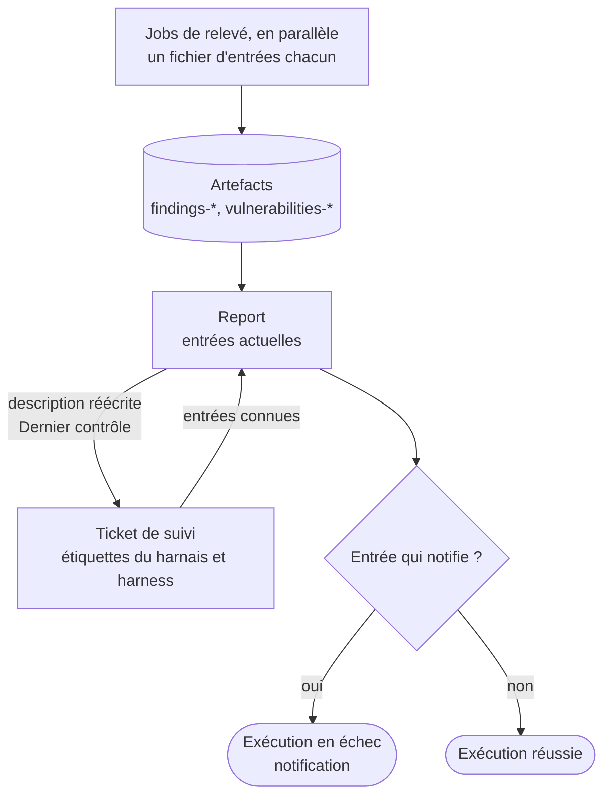

# Contrôles périodiques

Deux workflows planifiés surveillent `main` hors des Pull Requests, sans être des checks requis : [`quality-audit.yml`](../../../.github/workflows/quality-audit.yml), chaque semaine, et [`security-audit.yml`](../../../.github/workflows/security-audit.yml), chaque jour. Chacun tient l'état de ce qu'il relève dans le ticket de suivi de son harnais, et n'échoue que pour notifier l'utilisateur qui a créé le workflow. Leurs règles sont dans [Contrôle qualité hebdomadaire](../../../.speckit/gestion-projet/depot/controle-qualite-hebdomadaire.md) et [Mises à jour des dépendances](../../../.speckit/gestion-projet/depot/mises-a-jour-des-dependances.md) ; la forme du ticket, dans [Issues](../../../.speckit/gestion-projet/revue-tickets/issues.md#tickets-de-suivi-des-harnais).

## Parcours d'une exécution

Question du schéma : *comment une exécution passe-t-elle des relevés au ticket de suivi, et quand échoue-t-elle ?* Schéma interprétatif, commun aux deux workflows.



- **Entrée** : une ligne de texte, sans numéro de ligne ni version, qui reste la même d'une exécution à l'autre (ex. `sonar <règle> <fichier>`, `nuget <package>: <avis>`).
- **Ticket retrouvé par ses deux étiquettes** (`quality-audit` ou `security-audit`, et `harness`), créées au besoin ; créé s'il n'existe pas, réouvert tant qu'une entrée reste, fermé sinon.
- **Entrées connues** : celles que la description du ticket porte entre ses marqueurs (`<!-- list -->`… `<!-- end -->`, et pour la qualité `<!-- critical -->`, `<!-- to-treat -->`) ; une entrée absente est nouvelle.
- **Description réécrite en entier** à chaque exécution, avec la ligne `Dernier contrôle : <date>` : la ligne `Dernière prise en compte`, que l'agent ajoute à chaque traitement, en disparaît ([Traitement du contrôle qualité à la reprise du travail](../../../.speckit/gestion-projet/depot/traitement-du-controle-qualite-a-la-reprise-du-travail.md), [Relevé des versions à la reprise du travail](../../../.speckit/gestion-projet/depot/releve-des-versions-a-la-reprise-du-travail.md)).
- **Un seul contrôle à la fois** par workflow (groupe de concurrence, sans annulation). Les deux se lancent aussi à la demande (`workflow_dispatch`).

## Contrôle qualité hebdomadaire

Le lundi à 4 h 23 (UTC), sur `main`.

| Job | Ce qu'il relève | Entrée |
| --- | --- | --- |
| `SonarQube Cloud` | Par l'API Web de SonarQube Cloud, sans jeton : problèmes ouverts et points sensibles à revoir de la branche `main` ; pour chaque condition en échec de sa porte de qualité, les problèmes du nouveau code qui la font échouer, ou la condition elle-même si aucun ne la désigne ; problèmes de gravité `BLOCKER` ou `HIGH`. | `sonar`, `hotspot`, `gate` |
| `Style rules` | Construction de la solution avec un `.globalconfig` écrit sur l'exécuteur, qui fait de la liste de règles `IDE…` du workflow des avertissements, sans échec ; les avertissements relevés dans son journal. | `style <règle> <fichier>` |
| `Mutation tests` | Stryker.NET (outil local de [`dotnet-tools.json`](../../../dotnet-tools.json)) sur les tests de `Bdtheque.Domain.Tests`, tous les mutants à chaque exécution ; mutants survivants ou sans couverture. | `mutant <fichier> <mutateur>: <code> → <remplacement>` |
| `Report` | Sur `main` seulement : une exécution lancée sur une autre branche laisse ses relevés dans son journal et ses artefacts. | — |

Le rapport range chaque entrée dans une seule section de la description :

- **Critique** : les problèmes qui font échouer la porte, les conditions sans problème, les problèmes bloquants ou hauts ;
- **Prioritaire** : tout autre problème de SonarQube Cloud (`sonar`, `hotspot`) ;
- **Au fil de l'eau** : le reste, écarts de style et mutants.

Il **échoue** tant qu'une entrée critique reste, à chaque exécution, et une fois pour une entrée prioritaire nouvelle ; jamais pour une entrée au fil de l'eau. La première exécution, faute de ticket, ne tient aucune entrée pour nouvelle. Le ticket est créé avec le type `Task`.

## Contrôle de sécurité quotidien

Chaque jour à 6 h 11 (UTC).

| Job | Ce qu'il relève | Entrée |
| --- | --- | --- |
| `NuGet packages` | `dotnet list package --vulnerable --include-transitive` sur la solution : avis de la *GitHub Advisory Database* sur tout package, transitif compris. | `nuget <package>: <avis>` |
| `Docker image (api, frontend, db)` | Docker Scout, compte `tetram76` : toutes les vulnérabilités connues, corrigées ou non, des images `tetram76/bdtheque-api:nightly` et `tetram76/bdtheque-frontend:nightly`, et de l'image de `db` lue dans `docker-compose.yml`. | `image <image>: <CVE>` |
| `GitHub Actions` | Pour chaque action des workflows, à la version du commentaire de son empreinte : avis de la *GitHub Advisory Database* (`/advisories?ecosystem=actions&affects=…`) ; une action d'un sous-dossier compte comme son dépôt. | `action <action>: <avis>` |
| `Report` | Toutes les entrées en une liste. | — |

Il **échoue** une fois pour chaque vulnérabilité nouvelle, et non chaque jour tant qu'elle reste connue. Les images de l'application analysées sont celles de la dernière publication `nightly` ([Déploiement et environnement de validation](../architecture/deploiement.md)) : une correction n'y apparaît qu'après la publication qui suit sa fusion.

## Relevé des versions

[`Get-DependencyUpdates.ps1`](../../../scripts/Get-DependencyUpdates.ps1), exécuté par l'agent (`dotnet` et `gh` authentifié requis), ne lit que les sources officielles et ne modifie rien. Il liste, avec leur portée et leur date :

- pour les packages NuGet, les outils .NET locaux et les actions des workflows, la version la plus récente de la version majeure en usage et, à part, la version majeure la plus récente ;
- pour les images de .NET (lues dans [`docker/api/Dockerfile`](../../../docker/api/Dockerfile)), le dernier SDK et le dernier runtime du canal en usage, et chaque canal LTS plus récent ;
- pour l'image PostgreSQL de `docker-compose.yml`, la plus récente de sa version majeure, la version majeure la plus récente, et une version d'Alpine plus récente.

La colonne `TooRecent` signale une version publiée depuis moins de 7 jours (`-MinimumAgeDays`). Le script affiche ensuite les vulnérabilités connues des packages NuGet, puis la dernière exécution du contrôle de sécurité sur `main` et les vulnérabilités de son ticket. Il s'arrête sur une action dont l'empreinte n'est pas le commit de la version de son commentaire.

```powershell
./scripts/Get-DependencyUpdates.ps1
```

## Invariants à préserver

- Aucun de ces contrôles n'écrit dans le dépôt ni n'ouvre de Pull Request : ils ne tiennent que leur ticket.
- Une entrée ne porte ni ligne ni version : sinon chaque modification voisine ou chaque montée en ferait une entrée nouvelle, et une notification.
- Le ticket de suivi est retrouvé par ses deux étiquettes, jamais par son titre, que l'utilisateur peut changer.
- Ni l'un ni l'autre n'est un check requis : une vulnérabilité sans correction ou une dette ne bloque aucune fusion.
