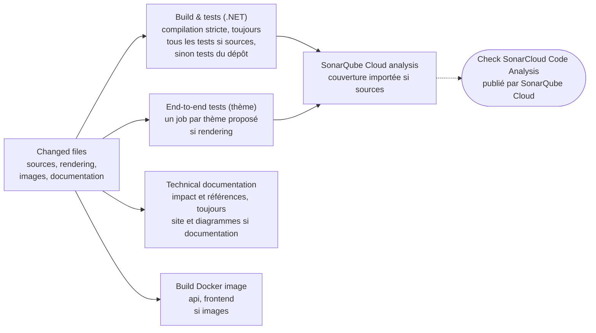

# Intégration continue

Le pipeline de non-régression est un seul workflow, [`ci.yml`](../../../.github/workflows/ci.yml). Ses règles (tests selon ce que modifie la Pull Request, checks requis, quotas) sont dans [Intégration continue (CI)](../../../.speckit/gestion-projet/depot/integration-continue-ci.md) ; ses choix d'outillage et leurs raisons, dans la section « CI » d'[Outillage de développement](../../../.speckit/choix-implementation/outillage.md). Les projets de tests qu'il exécute sont décrits dans [Stratégie de tests](strategie-de-tests.md) ; la publication des images, workflow à part, dans [Déploiement et environnement de validation](../architecture/deploiement.md).

## Déclencheurs

| Évènement | Fichiers tenus pour modifiés | Exécution annulée par une suivante |
| --- | --- | --- |
| Pull Request vers `main` | Ceux de la Pull Request telle qu'elle serait fusionnée | Oui, celle du commit précédent de la même PR |
| Push sur `main` | Tous | Non |
| Lancement à la demande (`workflow_dispatch`), pour l'analyse de `main` après la publication d'une version | Tous | Non |

L'annulation vient du groupe de concurrence du workflow : le numéro de la PR, ou l'empreinte du commit pour `main`.

## Jobs et leurs conditions

Question du schéma : *quels jobs s'exécutent, dans quel ordre, et quelles étapes chacun omet-il selon les fichiers modifiés ?* Schéma interprétatif, d'après `ci.yml`.

Chaque job s'exécute toujours ; seules ses étapes sont omises (`if:` sur une sortie de `Changed files`). La liste des checks ne dépend donc pas de la Pull Request, ce qui permet au Ruleset de `main` de tous les exiger ([Configuration du repository GitHub](../../../.speckit/gestion-projet/depot/configuration-du-repository-github.md)). Le job de l'analyse attend ceux des tests : si l'un d'eux échoue, l'analyse ne s'exécute pas, et le check de la porte de qualité ne se présente pas.

### Classement des fichiers modifiés

Le job `Changed files` compare, sur une Pull Request, le commit de fusion que construit GitHub à son premier parent, la tête de `main` (`git diff --name-only --no-renames HEAD^1 HEAD`) : un fichier déplacé compte à ses deux chemins. Il en tire quatre sorties, chacune vraie si au moins un fichier en relève :

| Sortie | Fichiers qui en relèvent | Étapes qu'elle commande |
| --- | --- | --- |
| `sources` | Tout fichier hors de `.speckit/`, `.claude/`, `poc/`, `docs/`, `scripts/`, `docker/`, `.github/`, `tests/Bdtheque.Documentation.Tests/`, des fichiers Markdown de la racine, de `docker-compose.yml`, `.env.example`, `.dockerignore`, `.gitignore` ; plus `ci.yml` lui-même, le contrat OpenAPI versionné (`docs/tech/references/openapi-v1.json`), que comparent les tests de l'API, et le schéma de la base (`docs/tech/references/schema-de-la-base.md`), que comparent les tests de l'infrastructure | Contrôle des migrations, tous les tests sans navigateur avec couverture, import de la couverture par l'analyse |
| `rendering` | Les `sources`, hors des projets de tests sans navigateur (`Bdtheque.Api.Tests`, `Bdtheque.Domain.Tests`, `Bdtheque.Frontend.Tests`, `Bdtheque.Infrastructure.Tests`, `Bdtheque.ValidationData.Tests`) et de ces deux références | Tous les jobs de bout en bout |
| `images` | Tout fichier hors de `.speckit/`, `.claude/`, `poc/`, `docs/`, `scripts/`, `tests/`, `.github/`, `docker/validation-data/`, `docker/validation-docs/`, des fichiers Markdown de la racine, de `docker-compose.yml`, `.env.example`, `.gitignore` ; plus `ci.yml` | Construction et analyse des images |
| `documentation` | `docs/`, les trois scripts de la documentation, `tests/Bdtheque.Documentation.Tests/`, `tests/Directory.Build.props`, `dotnet-tools.json`, `Directory.Packages.props`, `Directory.Build.props`, `ci.yml` | Construction du site et rendu des diagrammes |

Tout fichier qu'aucun motif n'écarte compte : un fichier nouveau, inconnu des motifs, déclenche tout. Hors Pull Request, les quatre sorties sont vraies. Le journal du job liste les fichiers de chaque catégorie.

### `Build & tests (.NET)`

- **Toujours** : restauration et compilation de toute la solution en `Release`, avertissements en erreur ([`Directory.Build.props`](../../../Directory.Build.props)).
- **Si `sources`** :
  - modèle EF Core comparé aux migrations (`dotnet ef migrations has-pending-model-changes`) : un changement du modèle commité sans sa migration fait échouer le job ;
  - **seule exécution** des tests sans navigateur, tous les projets sauf `Bdtheque.EndToEnd.Tests` et `Bdtheque.Documentation.Tests`, avec la collecte de couverture (coverlet, format OpenCover), `Bdtheque.Testing` exclu de la mesure ; rapports publiés en artefact `coverage`.
- **Sinon** : les seuls tests du dépôt, `Category=Repository` de `Bdtheque.Infrastructure.Tests`, qui lisent ses fichiers sans conteneur ni navigateur ([Stratégie de tests](strategie-de-tests.md#tests-du-dépôt)), sans couverture.

Ce job enregistre le cache des packages NuGet, sous une clé tirée de la version du SDK, de `Directory.Packages.props`, des `Directory.Build.props`, des fichiers de projet et de `dotnet-tools.json`, sans clé de repli ; les autres jobs le lisent (l'analyse l'enregistre aussi, sous la même clé).

### `End-to-end tests (<thème>)`

Une matrice `theme: [base, planche, gazette, couverture]`, dans l'ordre de `ThemeCatalog.Offered`, sans arrêt au premier thème en échec. Si `rendering` :

1. compilation du seul projet de bout en bout, packages lus dans le cache ;
2. installation du seul Chromium sans interface (`playwright.ps1 install --with-deps --only-shell chromium`) ;
3. interfaces créées par Docker réglées sans adresse IPv6 de lien local (`sysctl … addr_gen_mode=1`), puis relevé des changements d'adresses (`ip monitor`) et des évènements de Docker pendant les tests ;
4. tests, avec `BDTHEQUE_TEST_THEME` fixé au thème du job : le job `base` exécute tout le projet, les autres le seul trait `Themes=Each` ([Stratégie de tests](strategie-de-tests.md#thème-imposé)) ; couverture publiée en artefact `coverage-end-to-end-<thème>` ;
5. échec du job si une interface de Docker a gagné ou perdu une adresse pendant les tests, quel que soit leur résultat.

En cas d'échec, le job publie le relevé du réseau et les captures qui diffèrent de leur référence, avec leur image de différence (artefact `captures-<thème>`).

### `Technical documentation`

- **Sur une Pull Request** : historique complet récupéré, pour qu'un commit de la PR puisse porter le *trailer* `Documentation-technique:` ; impact des changements vérifié (`Get-TechnicalDocumentationImpact.ps1 -Check`).
- **Toujours** : références générées comparées à leurs sources (`Update-TechnicalReferences.ps1 -Check`), le contrat OpenAPI excepté, que comparent les tests de l'API ([Contrat HTTP de l'API](../references/api-http.md#contrat-versionné)), comme le [schéma de la base](../references/schema-de-la-base.md), que comparent ceux de l'infrastructure.
- **Si `documentation`** : DocFX restauré, Chromium installé, tests de `Bdtheque.Documentation.Tests` (construction du site, rendu des diagrammes).

Le détail de ces contrôles : [Consulter, construire, vérifier et maintenir](../documentation/consulter-et-maintenir.md#contrôles).

### `SonarQube Cloud analysis`

Après les jobs de tests, il recompile la solution sous le scanner (`dotnet-sonarscanner`, outil local de [`dotnet-tools.json`](../../../dotnet-tools.json)), sur l'historique complet, sans exécuter aucun test :

- **version** de l'analyse : le dernier tag (`git describe --tags --abbrev=0`), qui fait du code changé depuis la dernière version publiée le nouveau code ;
- **couverture** : si `sources`, les rapports de tous les jobs de tests (artefacts `coverage*`) réunis dans un dossier et importés ; sinon aucun ;
- **exclusions** : `.speckit/**`, `poc/**`, les migrations, le dossier des rapports ; exclus de la seule couverture : les scripts PowerShell et ceux de `wwwroot` du frontend ;
- **jeton** : secret de dépôt `SONAR_TOKEN`.

Une analyse qui n'aboutit pas fait échouer ce job seul. Le verdict de la porte de qualité est le check `SonarCloud Code Analysis`, que publie l'application SonarQube Cloud après l'analyse ; son traitement sur une Pull Request suit [Analyse SonarQube Cloud](../../../.speckit/gestion-projet/revue-tickets/analyse-sonarqube-cloud.md).

### `Build Docker image (<image>)`

Une matrice `image: [api, frontend]`. Si `images` :

1. image construite par BuildKit pour `linux/amd64`, comme les images publiées, chargée localement sans être poussée, avec le cache de GitHub Actions propre à chaque image ;
2. connexion à Docker Hub (compte `tetram76`, secret `DOCKERHUB_TOKEN`), **après** la construction : rien de ce qu'elle télécharge ne compte sous le compte ;
3. analyse de l'image locale par Docker Scout : le job échoue sur toute vulnérabilité **corrigeable** d'un package NuGet ([Analyse des vulnérabilités des images Docker](../../../.speckit/gestion-projet/revue-tickets/analyse-des-vulnerabilites-des-images-docker.md)).

## Tests du dépôt qui lisent ce workflow

- [`SdkVersionTests`](../../../tests/Bdtheque.Infrastructure.Tests/SdkVersionTests.cs) : chaque `dotnet-version` des workflows est celle du SDK des Dockerfiles.
- [`DockerHubPullsTests`](../../../tests/Bdtheque.Infrastructure.Tests/DockerHubPullsTests.cs) : les Dockerfiles ne téléchargent aucune image de Docker Hub, et l'analyse des images de `ci.yml` et de `docker-publish.yml` ne lit aucune image publiée.
- [`TestThemesTests`](../../../tests/Bdtheque.EndToEnd.Tests/TestThemesTests.cs), parmi les tests de bout en bout : la matrice des thèmes est celle des thèmes proposés, dans leur ordre, le premier exécutant aussi les tests hors trait.

## Invariants à préserver

- Un job ajouté, renommé ou retiré change la liste des checks : le Ruleset de `main` est mis à jour dans le même mouvement.
- Aucun job n'est sauté par une condition : seules ses étapes le sont.
- Les tests ne s'exécutent qu'une fois par push : l'analyse réunit leurs couvertures sans les rejouer.
- Un fichier qu'aucun motif du classement n'écarte déclenche tout ; un motif ajouté ne doit écarter que ce qu'aucun test, aucune image et aucun écran ne lit.
- Un thème ajouté au catalogue s'ajoute à la matrice des jobs de bout en bout, ce que vérifie `TestThemesTests`.
