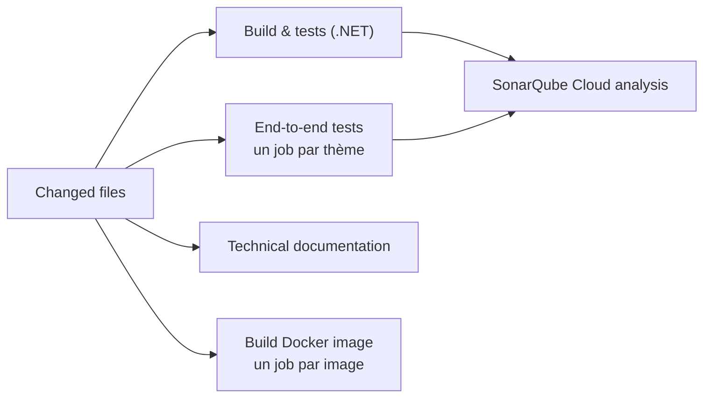

# Intégration continue

L'intégration continue de BDthèque tient en un seul workflow GitHub Actions, [`ci.yml`](../../../.github/workflows/ci.yml). Il construit la solution, exécute les tests, vérifie la documentation technique, analyse le code avec SonarQube Cloud et construit les images Docker. C'est le filet de sécurité de la non-régression : une Pull Request ne peut être fusionnée que si chacun de ses jobs a réussi.

Cette page décrit ce que fait le workflow. Les règles qu'il applique, comme le fait de n'exécuter que les tests qu'une Pull Request peut faire échouer ou la gestion des quotas, sont fixées par [Intégration continue (CI)](../../../.speckit/gestion-projet/depot/integration-continue-ci.md), et les raisons de ses choix d'outillage par la section « CI » d'[Outillage de développement](../../../.speckit/choix-implementation/outillage.md). Les projets de tests qu'il exécute sont présentés dans [Stratégie de tests](strategie-de-tests.md). La publication des images sur Docker Hub est l'affaire d'un autre workflow, décrit dans [Déploiement et environnement de validation](../architecture/deploiement.md).

## Quand le workflow s'exécute

Le workflow se déclenche dans trois cas, résumés ci-dessous. Une Pull Request ne déclenche le CI que si elle vise `main`.

| Évènement | Fichiers que le workflow tient pour modifiés | L'exécution est-elle annulée par une suivante ? |
| --- | --- | --- |
| Une Pull Request vers `main` reçoit un commit. | Ceux que modifierait la fusion de la Pull Request dans `main`. | Oui : un nouveau push sur la même Pull Request annule l'exécution du commit précédent, devenue inutile. |
| Un commit arrive sur `main`, à la fusion d'une Pull Request. | Tous les fichiers. | Non. |
| L'agent lance le workflow à la demande (`workflow_dispatch`), pour analyser `main` après la publication d'une version. | Tous les fichiers. | Non. |

L'annulation repose sur le groupe de concurrence du workflow, une notion de GitHub Actions qui empêche deux exécutions d'un même groupe de coexister. Le groupe d'une Pull Request porte son numéro, si bien qu'un push chasse l'exécution précédente et épargne les quotas de Docker Hub et de l'API GitHub. Sur `main`, chaque commit a son propre groupe, si bien qu'aucune exécution n'en annule une autre.

## Les jobs et leur enchaînement

Le workflow compte six jobs, dont deux se démultiplient en matrice, c'est-à-dire en un job par valeur d'un paramètre : un job de bout en bout par thème, un job de construction par image. Le schéma suivant, tracé à la main d'après `ci.yml`, répond à une seule question : quel job attend la fin de quel autre avant de démarrer ?

Tous les jobs s'exécutent sur des exécuteurs `ubuntu-26.04`, la version d'Ubuntu des images d'exécution de l'application, comme ceux des autres workflows du dépôt. Les tests de l'ordre et du formatage français utilisent la bibliothèque ICU de la machine qui les exécute : sur la même version d'Ubuntu que les images, ils vérifient donc le comportement qu'aura l'application en production. Un test du dépôt, présenté dans [Stratégie de tests](strategie-de-tests.md#tests-du-dépôt), refuse un exécuteur d'une autre version.

Le premier job, `Changed files`, classe les fichiers modifiés. Les quatre jobs suivants démarrent en parallèle dès qu'il a fini. L'analyse SonarQube Cloud attend en outre la fin de tous les jobs de tests, parce qu'elle importe la couverture qu'ils ont mesurée ; si l'un d'eux échoue, l'analyse ne s'exécute pas.

Le verdict de la porte de qualité de SonarQube Cloud n'apparaît pas sur ce schéma, car ce n'est pas un job du workflow : c'est un check à part, `SonarCloud Code Analysis`, que l'application SonarQube Cloud publie elle-même sur le commit une fois l'analyse reçue. Quand l'analyse ne s'exécute pas, ce check ne se présente pas.

### Des jobs toujours exécutés, des étapes omises

Chaque job s'exécute à chaque fois ; ce sont ses étapes qui s'omettent selon les fichiers modifiés, grâce à une condition `if:` qui lit les sorties de `Changed files`. Ce détail compte à cause des checks requis. Un check requis est un job dont le Ruleset de `main`, l'ensemble des règles de protection de la branche sur GitHub, exige la réussite avant toute fusion ([Configuration du repository GitHub](../../../.speckit/gestion-projet/depot/configuration-du-repository-github.md)). Si un job était sauté, ou si le workflow ne se déclenchait pas, son check resterait en attente et bloquerait la fusion. En gardant tous les jobs, le workflow présente toujours la même liste de checks, et le Ruleset peut tous les exiger.

## Classement des fichiers modifiés

Le job `Changed files` décide de ce que les autres jobs exécuteront. Sur une Pull Request, il compare le commit de fusion que GitHub construit pour elle à son premier parent, qui est la tête de `main` (`git diff --name-only --no-renames HEAD^1 HEAD`) : leur différence est exactement ce que la fusion apporterait. L'option `--no-renames` fait compter un fichier déplacé à son ancien chemin comme au nouveau.

Il en tire quatre indicateurs, ses sorties, dont chacun est vrai dès qu'au moins un fichier modifié en relève :

| Sortie | Fichiers qui la rendent vraie | Étapes qu'elle déclenche |
| --- | --- | --- |
| `sources` | Tout fichier qui n'est pas de la documentation ou un outillage que les tests n'exécutent pas. Sont écartés `.speckit/`, `.claude/`, `poc/`, `docs/`, `scripts/`, `docker/`, `.github/`, `tests/Bdtheque.Documentation.Tests/`, les fichiers Markdown de la racine, `docker-compose.yml`, `.env.example`, `.dockerignore` et `.gitignore`. Trois fichiers comptent pourtant comme sources : `ci.yml` lui-même, le contrat OpenAPI versionné (`docs/tech/references/openapi-v1.json`), que comparent les tests de l'API, et le schéma de la base (`docs/tech/references/schema-de-la-base.md`), que comparent ceux de l'infrastructure. | Le contrôle des migrations, l'exécution de tous les tests sans navigateur avec la mesure de couverture, et l'import de cette couverture par l'analyse. |
| `rendering` | Les sources qui peuvent changer le rendu d'un écran, c'est-à-dire toutes sauf les projets de tests sans navigateur (`Bdtheque.Api.Tests`, `Bdtheque.Domain.Tests`, `Bdtheque.Frontend.Tests`, `Bdtheque.Infrastructure.Tests`, `Bdtheque.ValidationData.Tests`) et les deux références de `docs/`. | Tous les tests de bout en bout, captures de référence comprises. |
| `images` | Tout fichier qui entre dans les images `api` et `frontend`. Sont écartés `.speckit/`, `.claude/`, `poc/`, `docs/`, `scripts/`, `tests/`, `.github/`, `docker/validation-data/`, `docker/validation-docs/`, les fichiers Markdown de la racine, `docker-compose.yml`, `.env.example` et `.gitignore`, à l'exception de `ci.yml`, qui construit et analyse ces images. | La construction et l'analyse des images. |
| `documentation` | Les pages de `docs/`, les trois scripts de la documentation technique, `tests/Bdtheque.Documentation.Tests/`, `tests/Directory.Build.props`, `dotnet-tools.json`, `Directory.Packages.props`, `Directory.Build.props` et `ci.yml`. | La construction du site de la documentation et la vérification du rendu de ses diagrammes. |

Le classement est sûr par défaut : un fichier qu'aucun motif n'écarte compte comme source, comme source du rendu et comme élément des images. Un fichier d'un genre nouveau, que personne n'a encore classé, déclenche donc tout. Hors Pull Request, les quatre sorties sont vraies. Le journal du job liste les fichiers retenus dans chaque catégorie, ce qui permet de comprendre après coup pourquoi une étape s'est exécutée ou non.

## Ce que fait chaque job

### `Build & tests (.NET)`

Ce job restaure puis compile toute la solution en configuration `Release`, et il le fait toujours, quels que soient les fichiers modifiés. Les avertissements du compilateur y sont des erreurs ([`Directory.Build.props`](../../../Directory.Build.props)), si bien qu'un avertissement suffit à faire échouer le CI.

Quand une source a changé, le job vérifie ensuite que le modèle EF Core correspond aux migrations (`dotnet ef migrations has-pending-model-changes`) : une modification du modèle commitée sans la migration qui l'accompagne fait échouer le job. Il exécute alors tous les tests sans navigateur, c'est-à-dire tous les projets de tests sauf `Bdtheque.EndToEnd.Tests` et `Bdtheque.Documentation.Tests`. C'est la seule exécution de ces tests du push. Elle mesure la couverture du code avec coverlet, au format OpenCover, en excluant la bibliothèque `Bdtheque.Testing` de la mesure, et publie les rapports dans l'artefact `coverage` pour l'analyse SonarQube Cloud.

Quand aucune source n'a changé, le job n'exécute que les tests du dépôt, ceux de `Bdtheque.Infrastructure.Tests` de catégorie `Repository`, qui vérifient les fichiers du dépôt sans conteneur ni navigateur ([Stratégie de tests](strategie-de-tests.md#tests-du-dépôt)). Aucune couverture n'est alors mesurée.

C'est aussi ce job qui enregistre le cache des packages NuGet que les autres jobs relisent. Sa clé dépend de la version du SDK, de `Directory.Packages.props`, des `Directory.Build.props`, des fichiers de projet et de `dotnet-tools.json`, sans clé de repli : tout changement de ces fichiers repart d'un cache neuf. Le job de l'analyse enregistre le même cache, sous la même clé.

### `End-to-end tests (<thème>)`

Les tests de bout en bout pilotent l'application complète dans un navigateur. Ils s'exécutent dans une matrice d'un job par thème proposé, `theme: [base, planche, gazette, couverture]`, dans l'ordre de `ThemeCatalog.Offered`, et un thème en échec n'interrompt pas les autres. Quand le rendu peut avoir changé, chaque job enchaîne les étapes suivantes :

1. Il compile le seul projet de bout en bout, à partir des packages du cache.
2. Il installe Chromium dans sa version sans interface (`playwright.ps1 install --with-deps --only-shell chromium`).
3. Il règle les interfaces réseau que crée Docker pour qu'elles ne reçoivent pas d'adresse IPv6 de lien local (`sysctl … addr_gen_mode=1`), puis il enregistre, pendant toute la durée des tests, les changements d'adresses (`ip monitor`) et les évènements de Docker.
4. Il exécute les tests en fixant la variable `BDTHEQUE_TEST_THEME` au thème du job. Le job `base` exécute tout le projet, tandis que les autres n'exécutent que les tests marqués du trait `Themes=Each`, ceux dont le résultat dépend du thème ([Stratégie de tests](strategie-de-tests.md#thème-imposé)). La couverture est publiée dans l'artefact `coverage-end-to-end-<thème>`.
5. Il échoue si une interface de Docker a gagné ou perdu une adresse pendant les tests, même si ceux-ci ont réussi.

Quand le job échoue, il publie le relevé des changements du réseau, ainsi que les captures qui diffèrent de leur référence accompagnées de leur image de différence, dans l'artefact `captures-<thème>`.

### `Technical documentation`

Ce job vérifie la documentation technique ; ses contrôles sont expliqués en détail dans [Consulter, construire, vérifier et maintenir](../documentation/consulter-et-maintenir.md#contrôles).

Sur une Pull Request, il récupère tout l'historique de la branche, puis vérifie l'impact des changements (`Get-TechnicalDocumentationImpact.ps1 -Check`) : chaque page qui décrit un fichier modifié doit avoir été mise à jour, ou un commit de la Pull Request doit porter le *trailer* `Documentation-technique:`, une ligne de la forme `Clé: valeur` en fin de message de commit, qui dit pourquoi elle n'a pas à l'être. L'historique complet est nécessaire pour lire ces messages.

Il compare toujours les références générées à leurs sources (`Update-TechnicalReferences.ps1 -Check`). Deux références font exception, parce qu'elles exigent une base PostgreSQL : le contrat OpenAPI, que comparent les tests de l'API ([Contrat HTTP de l'API](../references/api-http.md#contrat-versionné)), et le [schéma de la base](../references/schema-de-la-base.md), que comparent ceux de l'infrastructure.

Quand la documentation ou son outillage a changé, il restaure DocFX, installe Chromium et exécute `Bdtheque.Documentation.Tests`, qui construisent le site et vérifient le rendu de chaque diagramme.

### `SonarQube Cloud analysis`

Ce job soumet le code à SonarQube Cloud, le service d'analyse statique du projet. Il démarre après tous les jobs de tests, récupère tout l'historique du dépôt, puis recompile la solution sous le contrôle du scanner (`dotnet-sonarscanner`, outil local de [`dotnet-tools.json`](../../../dotnet-tools.json)) ; il n'exécute lui-même aucun test. Plusieurs réglages accompagnent l'analyse :

- La version déclarée de l'analyse est le dernier tag du dépôt (`git describe --tags --abbrev=0`). SonarQube Cloud tient ainsi pour « nouveau code » tout ce qui a changé depuis la dernière version publiée.
- Quand une source a changé, le job réunit dans un même dossier les rapports de couverture de tous les jobs de tests, c'est-à-dire les artefacts `coverage*`, et les transmet à l'analyse. Sinon, aucun rapport n'est importé, puisque aucun code mesuré n'a changé.
- L'analyse ignore `.speckit/**`, `poc/**`, les migrations, que génère EF Core, et le dossier des rapports. Les scripts et modules PowerShell (`.ps1`, `.psm1`), les scripts de `wwwroot` du frontend et celui du modèle du site de la documentation technique sont analysés, mais exclus de la seule couverture, que seuls les tests .NET mesurent.
- Le job s'authentifie par le secret de dépôt `SONAR_TOKEN`.

Une analyse qui n'aboutit pas fait échouer ce seul job. La suite à donner à son résultat sur une Pull Request est fixée par [Analyse SonarQube Cloud](../../../.speckit/gestion-projet/revue-tickets/analyse-sonarqube-cloud.md).

### `Build Docker image (<image>)`

Ce job construit et analyse les deux images de l'application, dans une matrice `image: [api, frontend]`. Quand ce dont elles sont faites a changé, il enchaîne trois étapes :

1. Il construit l'image avec BuildKit pour `linux/amd64`, la plateforme des images publiées, de sorte qu'une Pull Request ne puisse pas casser leur publication. L'image est chargée localement sans être poussée, et chaque image a son propre cache dans celui de GitHub Actions.
2. Il se connecte ensuite à Docker Hub, avec le compte `tetram76` et le secret `DOCKERHUB_TOKEN`. La connexion vient après la construction pour que rien de ce que télécharge celle-ci ne compte dans le quota du compte.
3. Il analyse l'image locale avec Docker Scout, l'outil d'analyse des vulnérabilités de Docker, et échoue sur toute vulnérabilité corrigeable d'un package NuGet ([Analyse des vulnérabilités des images Docker](../../../.speckit/gestion-projet/revue-tickets/analyse-des-vulnerabilites-des-images-docker.md)).

## Les tests qui vérifient ce workflow

Plusieurs tests lisent `ci.yml` pour s'assurer qu'il reste cohérent avec le reste du dépôt :

- [`SdkVersionTests`](../../../tests/Bdtheque.Infrastructure.Tests/SdkVersionTests.cs) vérifie que chaque `dotnet-version` des workflows est celle du SDK des Dockerfiles.
- [`DockerHubPullsTests`](../../../tests/Bdtheque.Infrastructure.Tests/DockerHubPullsTests.cs) vérifie que les Dockerfiles ne téléchargent aucune image de Docker Hub, et que l'analyse des images de `ci.yml` et de `docker-publish.yml` ne lit aucune image publiée.
- [`TestThemesTests`](../../../tests/Bdtheque.EndToEnd.Tests/TestThemesTests.cs), parmi les tests de bout en bout, vérifie que la matrice des thèmes est celle des thèmes proposés, dans le même ordre, et que le premier job exécute aussi les tests sans trait.

## Invariants à préserver

- Ajouter, renommer ou retirer un job change la liste des checks : le Ruleset de `main` doit être mis à jour dans le même mouvement, sans quoi un job ajouté n'est pas exigé et un job retiré reste attendu sans jamais se présenter.
- Aucun job n'est sauté par une condition : seules ses étapes le sont.
- Les tests ne s'exécutent qu'une fois par push. L'analyse réunit leurs couvertures sans les rejouer.
- Un fichier qu'aucun motif du classement n'écarte déclenche tout. Un motif ajouté ne doit donc écarter que des fichiers qu'aucun test, aucune image et aucun écran ne lisent.
- Un thème ajouté au catalogue doit l'être aussi à la matrice des jobs de bout en bout, ce que vérifie `TestThemesTests`.
