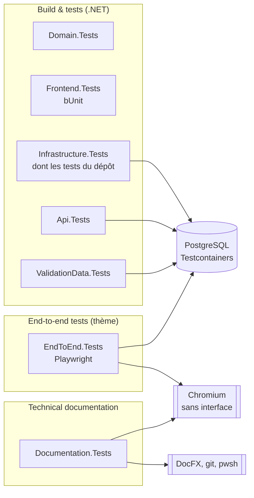

# Stratégie de tests

Comment les tests sont organisés, ce dont chacun a besoin pour s'exécuter et ce qui les rend indépendants du moment et du thème. Les règles (TDD, non-régression, tests qui ont un facteur temps, tests indépendants du thème) sont dans [Qualité du code](../../../.speckit/gestion-projet/gouvernance/qualite-du-code.md) ; les choix d'outils et leurs raisons, dans la section « Tests » d'[Outillage de développement](../../../.speckit/choix-implementation/outillage.md). Ce que vérifie chaque projet est résumé dans [Projets de la solution](../architecture/projets-de-la-solution.md#projets-de-tests) ; comment le CI les exécute, dans [Intégration continue](integration-continue.md).

## Projets, ressources et jobs

Question du schéma : *de quelles ressources chaque projet de tests a-t-il besoin, et quel job du CI l'exécute ?* Schéma interprétatif, d'après les projets de `tests/` et `ci.yml`.



- **Références communes** : [`tests/Directory.Build.props`](../../../tests/Directory.Build.props) ajoute à tout projet dont le nom finit par `.Tests` xunit, son exécuteur, le SDK de test et le collecteur de couverture (coverlet) ; il marque tous les projets de `tests/`, `Bdtheque.Testing` compris, comme code de test pour SonarQube Cloud.
- **Bibliothèque partagée**, [`Bdtheque.Testing`](../../../tests/Bdtheque.Testing/Bdtheque.Testing.csproj) : le serveur PostgreSQL des tests et ses bases ([Persistance : modèle et schéma](../mecanismes/persistance-modele-et-schema.md#base-des-tests)), l'hôte de l'API en mémoire ([`ApiHostFactory`](../../../tests/Bdtheque.Testing/ApiHostFactory.cs)), l'horloge des tests ([`TestClock`](../../../tests/Bdtheque.Testing/TestClock.cs)).
- **Docker** est requis par tout test qui touche à PostgreSQL : le conteneur est démarré par Testcontainers, de la même image que `db` dans [`docker-compose.yml`](../../../docker-compose.yml).

## Tests du dépôt

Les tests de `Bdtheque.Infrastructure.Tests` marqués `[Trait("Category", RepositoryFiles.Category)]` ([`RepositoryFiles`](../../../tests/Bdtheque.Infrastructure.Tests/RepositoryFiles.cs), catégorie `Repository`) confrontent les fichiers du dépôt à leurs règles, sans conteneur ni navigateur ; une Pull Request qui ne modifie aucune source n'exécute qu'eux.

| Test | Ce qu'il vérifie |
| --- | --- |
| [`SpeckitStructureTests`](../../../tests/Bdtheque.Infrastructure.Tests/SpeckitStructureTests.cs) | Structure du `.speckit/` : en-têtes, cartes, liens, `applies_to`, table des moments d'`AGENTS.md`, ordre de `log.md`. |
| [`TechnicalDocumentationStructureTests`](../../../tests/Bdtheque.Infrastructure.Tests/TechnicalDocumentationStructureTests.cs) | Structure de cette documentation ([Consulter, construire, vérifier et maintenir](../documentation/consulter-et-maintenir.md#contrôles)). |
| [`SdkVersionTests`](../../../tests/Bdtheque.Infrastructure.Tests/SdkVersionTests.cs), [`RuntimeImageTests`](../../../tests/Bdtheque.Infrastructure.Tests/RuntimeImageTests.cs) | Même SDK dans les Dockerfiles et les workflows ; même image d'exécution dans les Dockerfiles. |
| [`DockerHubPullsTests`](../../../tests/Bdtheque.Infrastructure.Tests/DockerHubPullsTests.cs) | Aucune image de Docker Hub dans les Dockerfiles ; aucune image publiée lue par l'analyse des images. |
| [`DockerComposeTests`](../../../tests/Bdtheque.Infrastructure.Tests/DockerComposeTests.cs) | Noms, ports et données de `docker-compose.yml` propres à chaque déploiement ; ports de la validation ouverts au seul poste. |
| [`PostgreSqlTestServerTests`](../../../tests/Bdtheque.Infrastructure.Tests/PostgreSqlTestServerTests.cs) (`Image_MatchesDockerComposeDbService`) | Image PostgreSQL des tests identique à celle de `db`. |
| [`FrontendWebAssetsTests`](../../../tests/Bdtheque.Infrastructure.Tests/FrontendWebAssetsTests.cs) | Ressources web d'ASP.NET Core exigées par le frontend, quels que soient les fichiers présents à la restauration. |

## Heure et données des tests

- **Horloge de l'application remplacée** : [`TestClock`](../../../tests/Bdtheque.Testing/TestClock.cs) donne soit l'heure du système, pour un test qui fournit lui-même chaque date dont il dépend, soit une heure propre (`StartingAt`), qui part d'un instant fixe et avance d'une milliseconde à chaque lecture. Un test peut fixer `UtcNow`, qui reste en place jusqu'à ce qu'il le change.
- **Application de bout en bout à heure fixe** : [`ApplicationHost`](../../../tests/Bdtheque.EndToEnd.Tests/ApplicationHost.cs) démarre `api` et `frontend` sur la même horloge, à partir de `Origin` (le 15 janvier 2026 à 23 h 20 en temps universel), et ouvre le navigateur dans le fuseau `Europe/Paris`, où il est déjà le lendemain ; il ouvre aussi chaque contexte en mouvement réduit, sauf si le test en demande un autre.
- **Une application de test par état présenté** pour un écran qui dépend de toute la collection (accueil) : la base partagée par les autres tests changerait son rendu selon leur ordre.

## Thème imposé

Chaque test de bout en bout dont le résultat peut dépendre du thème le fixe, et s'exécute dans chaque thème proposé :

- **Lignes du test** : l'attribut `InEachTheme` de [`TestThemes`](../../../tests/Bdtheque.EndToEnd.Tests/TestThemes.cs) fournit une ligne par thème couvert, la clé du thème en premier argument (`[Theory, InEachTheme]`, ou `[InEachTheme(320)]` à la place d'`[InlineData(320)]`) ; `EachTheme` marque une théorie dont les lignes viennent d'ailleurs (les captures, thème par écran par largeur). Les deux posent le trait `Themes=Each`.
- **Thèmes couverts** : tous les thèmes de `ThemeCatalog.Offered`, ou le seul thème que nomme la variable `BDTHEQUE_TEST_THEME` (une valeur qui ne nomme aucun thème proposé fait échouer le test). Le CI la fixe dans chaque job de bout en bout ; seul le job du premier thème exécute aussi les tests sans le trait.
- **Thème de la requête** : chaque contexte du navigateur est ouvert par `BrowserTest.NewContextAsync(theme)`, qui envoie l'en-tête `X-Test-Theme` ; [`RequestThemeSelector`](../../../tests/Bdtheque.EndToEnd.Tests/RequestThemeSelector.cs), enregistré par l'hôte des tests seulement, en tire le thème de la page.
- **Vérification** : [`TestThemesTests`](../../../tests/Bdtheque.EndToEnd.Tests/TestThemesTests.cs) échoue pour une théorie qui prend un paramètre `theme` sans l'un des deux attributs, et pour une matrice du CI qui n'est pas celle des thèmes proposés.

## API interdites par le compilateur

Trois projets référencent l'analyseur des API interdites (`Microsoft.CodeAnalysis.BannedApiAnalyzers`), avec leur liste et sa raison, symbole par symbole ; un appel interdit ne compile pas :

| Projet | Liste | Interdits |
| --- | --- | --- |
| `Bdtheque.Frontend.Tests` | [`BannedSymbols.txt`](../../../tests/Bdtheque.Frontend.Tests/BannedSymbols.txt) | Déclenchements d'évènements de bUnit (synchrones, `TriggerEvent`, `UploadFiles`) : un évènement passe par [`CircuitEvents`](../../../tests/Bdtheque.Frontend.Tests/Controls/CircuitEvents.cs). |
| `Bdtheque.EndToEnd.Tests` | [`BannedSymbols.txt`](../../../tests/Bdtheque.EndToEnd.Tests/BannedSymbols.txt) | Attentes de Playwright en deux temps (`WaitForLoadStateAsync`, `WaitForURLAsync`, `WaitForNavigationAsync`…) ; ouverture d'un contexte ou d'une page hors de `BrowserTest`, qui laisserait le thème au tirage. |
| `Bdtheque.Documentation.Tests` | [`BannedSymbols.txt`](../../../tests/Bdtheque.Documentation.Tests/BannedSymbols.txt) | Les mêmes attentes de Playwright. |

## Captures de référence

- **Une capture par écran, thème et largeur**, prise une fois la page prête, par les tests de [`Captures/`](../../../tests/Bdtheque.EndToEnd.Tests/Captures/) ; [`CaptureStore`](../../../tests/Bdtheque.EndToEnd.Tests/Captures/CaptureStore.cs) range les références sous `Captures/References/<thème>/<écran>.png`.
- **Comparaison pixel par pixel** par [`CaptureComparison`](../../../tests/Bdtheque.EndToEnd.Tests/Captures/CaptureComparison.cs), à une unité près par composante de couleur ; une différence de taille échoue sans comparer les pixels. Une capture qui diffère est écrite, avec son image de différence (pixels en cause en magenta sur la référence estompée), sous `TestResults/captures`.
- **Sous Linux seulement** : [`LinuxTheoryAttribute`](../../../tests/Bdtheque.EndToEnd.Tests/Captures/LinuxTheoryAttribute.cs) saute les captures sur un autre système. Le CI les compare dans les jobs de bout en bout, un thème par job.
- **En local**, [`Test-Captures.ps1`](../../../scripts/Test-Captures.ps1) les exécute dans l'image officielle de Playwright pour .NET, à la version du package `Microsoft.Playwright`, sur une copie de la copie de travail ; la base des tests y est un conteneur voisin, par le socket Docker du poste. Durées bornées : une minute par test, quatre minutes et demie pour l'ensemble.

  ```powershell
  ./scripts/Test-Captures.ps1                                   # comparer
  ./scripts/Test-Captures.ps1 -Update                           # remplacer les références
  ./scripts/Test-Captures.ps1 -Update -Filter admin-logout, AdminHome
  ```

  `-Update` fixe `BDTHEQUE_UPDATE_CAPTURES=1` : les captures prises deviennent les références, à relire avant de les commiter.

## Exécuter les tests

```powershell
dotnet test Bdtheque.slnx                                                   # tout, Docker requis
dotnet test tests/Bdtheque.Infrastructure.Tests --filter "Category=Repository"  # tests du dépôt seuls
$env:BDTHEQUE_TEST_THEME = 'gazette'; dotnet test tests/Bdtheque.EndToEnd.Tests --filter "Themes=Each"
```

Les tests de bout en bout installent eux-mêmes Chromium sans interface s'il manque.

## Invariants à préserver

- Aucun test ne lit l'heure de la machine : il lit celle de l'application.
- Aucun test de bout en bout ne laisse le thème au tirage, hors des tests du tirage lui-même ; une théorie dans chaque thème porte le trait qui la répartit entre les jobs.
- Les références des captures ne changent qu'après la validation fonctionnelle du rendu ([Thèmes](../../../.speckit/choix-implementation/socle/themes.md), captures de référence).
- Toute ressource ouverte par un test (contexte de navigateur, connexion, conteneur) est libérée par lui.
