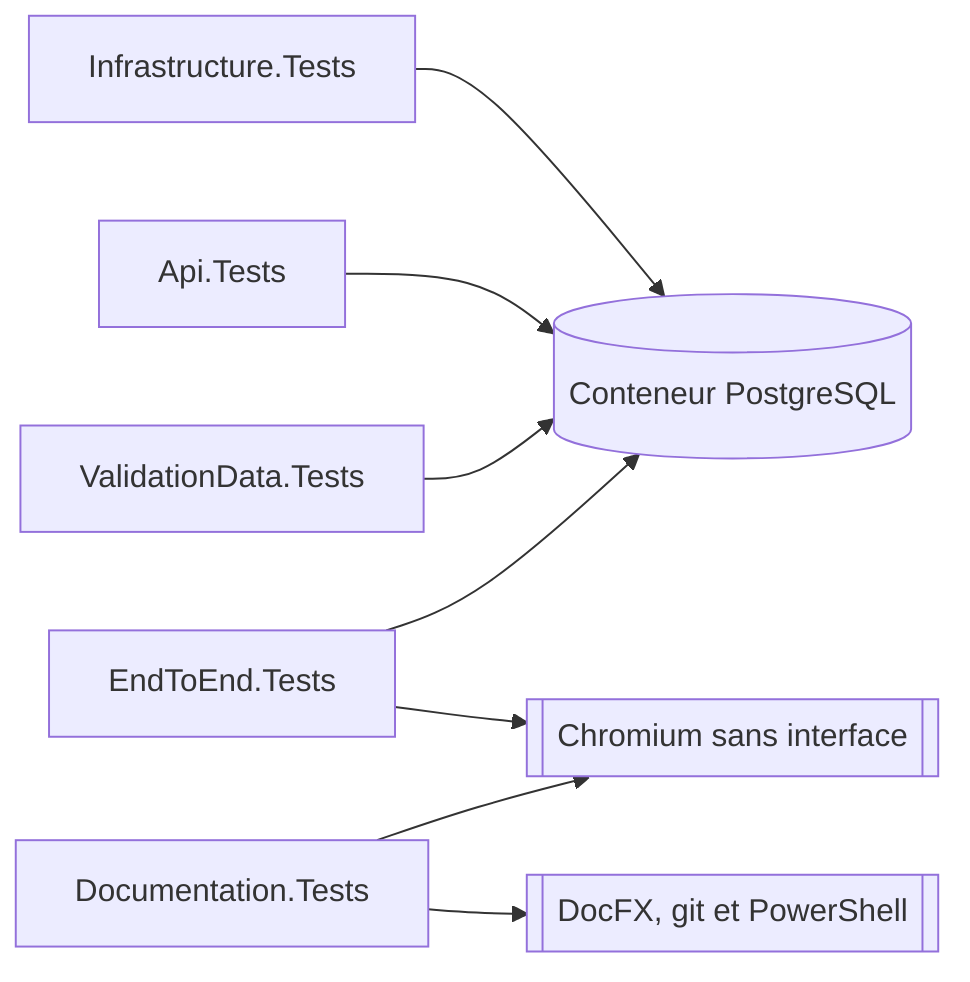

# Stratégie de tests

Cette page explique comment les tests de BDthèque sont répartis entre projets, ce dont chacun a besoin pour s'exécuter, et par quels mécanismes ils restent reproductibles alors que l'application dépend de l'heure et tire au hasard le thème de chaque visite. Les règles que suivent les tests, comme le TDD, la non-régression ou l'exécution dans chaque thème, sont fixées par [Qualité du code](../../../.speckit/gestion-projet/gouvernance/qualite-du-code.md) ; les raisons des outils retenus sont dans la section « Tests » d'[Outillage de développement](../../../.speckit/choix-implementation/outillage.md). Ce que vérifie chaque projet est résumé dans [Projets de la solution](../architecture/projets-de-la-solution.md#projets-de-tests), et la façon dont le CI les exécute dans [Intégration continue](integration-continue.md).

## Les projets de tests et ce dont ils ont besoin

Tous les tests sont écrits avec xunit. Ils se répartissent en sept projets, que le CI exécute dans trois jobs distincts :

| Projet | Ce qu'il exerce | Job du CI qui l'exécute |
| --- | --- | --- |
| `Bdtheque.Domain.Tests` | Les règles du domaine, en mémoire. | `Build & tests (.NET)` |
| `Bdtheque.Frontend.Tests` | Les composants Blazor, rendus par bUnit, une bibliothèque qui rend un composant sans navigateur. | `Build & tests (.NET)` |
| `Bdtheque.Infrastructure.Tests` | La persistance sur une vraie base PostgreSQL, ainsi que les tests du dépôt (ci-dessous). | `Build & tests (.NET)` |
| `Bdtheque.Api.Tests` | Les endpoints de l'API, appelés sur un hôte en mémoire relié à une vraie base. | `Build & tests (.NET)` |
| `Bdtheque.ValidationData.Tests` | Le chargement des données fictives de l'environnement de validation. | `Build & tests (.NET)` |
| `Bdtheque.EndToEnd.Tests` | L'application complète, `api` et `frontend`, pilotée dans un navigateur par Playwright. | `End-to-end tests`, un job par thème |
| `Bdtheque.Documentation.Tests` | Le site de la documentation technique, construit puis ouvert dans un navigateur. | `Technical documentation` |

Certains de ces projets ont besoin de ressources extérieures au processus de test. Le schéma suivant, tracé à la main d'après les projets de `tests/`, répond à une seule question : de quelle ressource extérieure chaque projet a-t-il besoin pour s'exécuter ? Les projets qui n'en demandent aucune, `Domain.Tests` et `Frontend.Tests`, n'y figurent pas.



Les tests du dépôt, bien qu'ils fassent partie d'`Infrastructure.Tests`, n'ont besoin d'aucune de ces ressources : ils lisent des fichiers, et ceux qui vérifient un script du dépôt l'exécutent avec PowerShell, au besoin dans un dépôt git jetable.

Le conteneur PostgreSQL est démarré par Testcontainers, une bibliothèque qui lance un conteneur Docker le temps des tests et le supprime ensuite. Docker est donc requis par tout test qui touche à la base. Le conteneur utilise la même image que le service `db` de [`docker-compose.yml`](../../../docker-compose.yml), si bien que les tests s'exécutent sur le même moteur qu'en production.

Deux éléments communs servent à tous ces projets. D'abord, [`tests/Directory.Build.props`](../../../tests/Directory.Build.props) ajoute à tout projet dont le nom se termine par `.Tests` les références à xunit, à son exécuteur, au SDK de test et au collecteur de couverture coverlet ; il déclare aussi tous les projets de `tests/` comme du code de test auprès de SonarQube Cloud. Ensuite, la bibliothèque partagée [`Bdtheque.Testing`](../../../tests/Bdtheque.Testing/Bdtheque.Testing.csproj) fournit le serveur PostgreSQL des tests, l'hôte de l'API en mémoire ([`ApiHostFactory`](../../../tests/Bdtheque.Testing/ApiHostFactory.cs)) et l'horloge des tests ([`TestClock`](../../../tests/Bdtheque.Testing/TestClock.cs)). Le serveur PostgreSQL applique une seule fois les migrations à une base modèle, puis donne à chaque test sa propre base, clonée de ce modèle : les tests sont isolés les uns des autres sans rejouer toutes les migrations à chaque fois ([Persistance : modèle et schéma](../mecanismes/persistance-modele-et-schema.md)).

## Tests du dépôt

Les tests du dépôt confrontent les fichiers du dépôt à leurs règles, sans conteneur ni navigateur : la structure du `.speckit/`, celle de cette documentation, la cohérence des Dockerfiles, du fichier Compose et des workflows. Ce sont les tests de `Bdtheque.Infrastructure.Tests` marqués `[Trait("Category", RepositoryFiles.Category)]`, c'est-à-dire de catégorie `Repository` ([`RepositoryFiles`](../../../tests/Bdtheque.Infrastructure.Tests/RepositoryFiles.cs)). Parce qu'ils sont rapides et ne demandent rien, ce sont les seuls tests qu'exécute une Pull Request qui ne modifie aucune source.

| Test | Ce qu'il vérifie |
| --- | --- |
| [`SpeckitStructureTests`](../../../tests/Bdtheque.Infrastructure.Tests/SpeckitStructureTests.cs) | Il vérifie la structure du `.speckit/` : en-têtes, cartes, liens, motifs `applies_to`, table des moments d'`AGENTS.md` et ordre de `log.md`. |
| [`SpeckitConceptsScriptTests`](../../../tests/Bdtheque.Infrastructure.Tests/SpeckitConceptsScriptTests.cs) | Il exécute [`Get-SpeckitConcepts.ps1`](../../../scripts/Get-SpeckitConcepts.ps1) sortie redirigée, comme le lance un agent avant chaque push, et vérifie que le script écrit en texte chaque concept qui régit un fichier modifié, suivi de chacun de ces fichiers en entier, ou dit qu'aucun concept n'en régit. |
| [`TechnicalDocumentationStructureTests`](../../../tests/Bdtheque.Infrastructure.Tests/TechnicalDocumentationStructureTests.cs) | Il vérifie la structure de cette documentation, comme l'explique [Consulter, construire, vérifier et maintenir](../documentation/consulter-et-maintenir.md#contrôles). |
| [`SdkVersionTests`](../../../tests/Bdtheque.Infrastructure.Tests/SdkVersionTests.cs), [`RuntimeImageTests`](../../../tests/Bdtheque.Infrastructure.Tests/RuntimeImageTests.cs) | Ils vérifient que les Dockerfiles et les workflows utilisent le même SDK, que les Dockerfiles utilisent la même image d'exécution, et que les jobs des workflows s'exécutent sur la version d'Ubuntu de cette image, dont ils partagent ainsi la bibliothèque ICU. |
| [`DockerHubPullsTests`](../../../tests/Bdtheque.Infrastructure.Tests/DockerHubPullsTests.cs) | Il vérifie qu'aucun Dockerfile ne télécharge d'image de Docker Hub, et que l'analyse des images ne lit aucune image publiée. |
| [`DockerComposeTests`](../../../tests/Bdtheque.Infrastructure.Tests/DockerComposeTests.cs) | Il vérifie que les noms, les ports et les données de `docker-compose.yml` sont propres à chaque déploiement, que chaque réseau des fichiers Compose porte le nom du conteneur auquel il donne accès, que seul `api` rejoint celui de `db`, que l'environnement de validation n'emploie que les réseaux du déploiement, et que les ports de l'environnement de validation ne sont ouverts qu'au poste. |
| [`PostgreSqlTestServerTests`](../../../tests/Bdtheque.Infrastructure.Tests/PostgreSqlTestServerTests.cs), méthode `Image_MatchesDockerComposeDbService` | Il vérifie que l'image PostgreSQL des tests est celle du service `db`. |
| [`FrontendWebAssetsTests`](../../../tests/Bdtheque.Infrastructure.Tests/FrontendWebAssetsTests.cs) | Il vérifie que les ressources web d'ASP.NET Core dont a besoin le frontend sont bien produites, quels que soient les fichiers présents lors de la restauration. |

## L'heure dans les tests

L'application lit l'heure par une horloge qu'on peut remplacer, et aucun test ne lit l'heure de la machine. Dans les tests, cette horloge est [`TestClock`](../../../tests/Bdtheque.Testing/TestClock.cs), qui fonctionne de deux façons. Un test qui fournit lui-même chaque date dont il dépend utilise l'heure du système. Un test qui a besoin d'une heure reproductible utilise `StartingAt`, qui part d'un instant fixe et avance d'une milliseconde à chaque lecture, de sorte que deux lectures successives ne donnent jamais le même instant. Un test peut aussi fixer `UtcNow`, qui garde alors cette valeur jusqu'à ce qu'il la change.

L'hôte de l'API des tests n'exécute jamais les tâches de fond de l'application, comme la réconciliation des visuels ou la conservation de la mesure d'audience. Démarrées avec l'hôte, elles s'exécuteraient pendant le premier test de la classe, sur une heure lue avant que ce test ne fixe la sienne, et pourraient supprimer les données qu'il vient d'écrire sur une heure passée. [`ApplicationBackgroundTasks`](../../../tests/Bdtheque.Testing/ApplicationBackgroundTasks.cs) remplace donc, dans l'hôte, chaque service hébergé que définit l'application par un service qui ne fait rien, en laissant ceux du framework, dont le serveur web. Un test qui vérifie une tâche l'exécute lui-même, sur son heure, en appelant sa méthode d'exécution.

Les tests de bout en bout vont plus loin. [`ApplicationHost`](../../../tests/Bdtheque.EndToEnd.Tests/ApplicationHost.cs) démarre `api` et `frontend` sur la même horloge, à partir de l'instant `Origin`, le 15 janvier 2026 à 23 h 20 en temps universel. Il ouvre le navigateur dans le fuseau `Europe/Paris`, où l'on est déjà le 16 janvier : une date devinée en temps universel au lieu de celle du navigateur s'y voit donc dans tous les tests. Il ouvre aussi chaque contexte du navigateur en mouvement réduit, sauf si un test demande un autre réglage : l'écran d'accueil de la première requête laisse alors place à la page aussitôt, au lieu de retenir chaque test le temps de son animation.

Enfin, un écran qui dépend de toute la collection, comme la page d'accueil, est testé sur une application de test démarrée pour l'état qu'il présente. Sur la base partagée par les autres tests, son rendu changerait selon l'ordre dans lequel ceux-ci s'exécutent.

## Thème imposé

En production, l'application tire au hasard le thème de chaque visite. Un test qui laisserait faire ce tirage s'exécuterait dans un thème différent à chaque fois, et pourrait réussir ou échouer selon le hasard. C'est pourquoi chaque test de bout en bout dont le résultat peut dépendre du thème impose ce thème, et s'exécute une fois dans chaque thème proposé. Le mécanisme repose sur quatre éléments :

- La déclaration des lignes d'un test. L'attribut `InEachTheme` de [`TestThemes`](../../../tests/Bdtheque.EndToEnd.Tests/TestThemes.cs) fournit une ligne par thème, avec la clé du thème en premier argument ; on l'écrit `[Theory, InEachTheme]`, ou `[InEachTheme(320)]` à la place d'`[InlineData(320)]`. L'attribut `EachTheme` marque quant à lui une théorie dont les lignes viennent d'ailleurs, comme les captures, qui croisent thème, écran et largeur. Les deux attributs posent le trait `Themes=Each`, qui permet au CI de répartir ces tests entre ses jobs.
- Le choix des thèmes couverts. Par défaut, un test couvre tous les thèmes de `ThemeCatalog.Offered`. Si la variable d'environnement `BDTHEQUE_TEST_THEME` nomme un thème, il ne couvre que celui-là ; si elle nomme un thème qui n'est pas proposé, le test échoue. Le CI fixe cette variable dans chacun de ses jobs de bout en bout, et seul le job du premier thème exécute aussi les tests dépourvus du trait.
- La transmission du thème à l'application. Chaque contexte du navigateur est ouvert par `BrowserTest.NewContextAsync(theme)`, qui ajoute à chaque requête l'en-tête `X-Test-Theme`. [`RequestThemeSelector`](../../../tests/Bdtheque.EndToEnd.Tests/RequestThemeSelector.cs), que seul l'hôte des tests enregistre, lit cet en-tête et en tire le thème de la page. Ce mécanisme n'existe donc pas dans l'application de production.
- Le contrôle. [`TestThemesTests`](../../../tests/Bdtheque.EndToEnd.Tests/TestThemesTests.cs) échoue pour une théorie qui prend un paramètre `theme` sans porter l'un des deux attributs, et pour une matrice du CI qui ne serait pas celle des thèmes proposés.

## Les API interdites par le compilateur

Certaines méthodes des outils de test fonctionnent mais conduisent à des tests instables ou laissent le thème au hasard. Plutôt que de compter sur la vigilance de chacun, trois projets référencent l'analyseur des API interdites (`Microsoft.CodeAnalysis.BannedApiAnalyzers`) : chaque projet tient une liste de symboles interdits, avec la raison de chaque interdiction, et un appel à l'un d'eux ne compile pas.

| Projet | Liste | Ce qui est interdit, et pourquoi |
| --- | --- | --- |
| `Bdtheque.Frontend.Tests` | [`BannedSymbols.txt`](../../../tests/Bdtheque.Frontend.Tests/BannedSymbols.txt) | Les déclenchements d'évènements de bUnit (ses méthodes synchrones, `TriggerEvent`, `UploadFiles`) sont interdits : un évènement passe par [`CircuitEvents`](../../../tests/Bdtheque.Frontend.Tests/Controls/CircuitEvents.cs). |
| `Bdtheque.EndToEnd.Tests` | [`BannedSymbols.txt`](../../../tests/Bdtheque.EndToEnd.Tests/BannedSymbols.txt) | Les attentes de Playwright en deux temps (`WaitForLoadStateAsync`, `WaitForURLAsync`, `WaitForNavigationAsync`…) sont interdites, de même que l'ouverture d'un contexte ou d'une page hors de `BrowserTest`, qui laisserait le thème au tirage. |
| `Bdtheque.Documentation.Tests` | [`BannedSymbols.txt`](../../../tests/Bdtheque.Documentation.Tests/BannedSymbols.txt) | Les mêmes attentes de Playwright sont interdites. |

## Les captures de référence

Les tests vérifient la structure et le comportement des écrans, mais ne voient pas leur rendu. Les captures de référence comblent ce manque : ce sont des images des écrans, validées une fois par l'utilisateur et versionnées, auxquelles chaque exécution compare l'écran tel qu'il est rendu.

Les tests de [`Captures/`](../../../tests/Bdtheque.EndToEnd.Tests/Captures/) prennent une capture par écran, par thème et par largeur d'écran, une fois la page prête. [`CaptureStore`](../../../tests/Bdtheque.EndToEnd.Tests/Captures/CaptureStore.cs) range les références sous `Captures/References/<thème>/<écran>.png`. [`CaptureComparison`](../../../tests/Bdtheque.EndToEnd.Tests/Captures/CaptureComparison.cs) compare ensuite la capture à sa référence pixel par pixel, en tolérant un écart d'une unité par composante de couleur ; si les deux images n'ont pas la même taille, la comparaison échoue sans examiner les pixels. Une capture qui diffère est écrite sous `TestResults/captures`, avec une image de différence qui montre en magenta les pixels en cause sur la référence estompée.

Les polices ne sont pas rendues de la même façon d'un système d'exploitation à l'autre, si bien que les captures ne se comparent que sous Linux, où les références sont prises : [`LinuxTheoryAttribute`](../../../tests/Bdtheque.EndToEnd.Tests/Captures/LinuxTheoryAttribute.cs) les saute sur tout autre système. Le CI les compare dans ses jobs de bout en bout, un thème par job.

Sur un poste de développement, [`Test-Captures.ps1`](../../../scripts/Test-Captures.ps1) exécute les captures dans l'image officielle de Playwright pour .NET, à la version du package `Microsoft.Playwright`, sur une copie de la copie de travail. La base des tests y tourne dans un conteneur voisin, démarré par le socket Docker du poste. La durée est bornée à une minute par test et à six minutes pour l'ensemble. Quand le poste fait passer son HTTPS par un proxy qui le signe de nouveau, comme dans une session cloud de Claude Code, la variable `SSL_CERT_FILE` d'OpenSSL y désigne le fichier des autorités de certification auxquelles il fait confiance : le script le monte alors en lecture seule dans le conteneur, sous la même variable, que .NET lit sous Linux pour ses certificats racines. Sans ce fichier, la restauration des packages NuGet échouerait dans le conteneur sur le certificat du proxy. Un poste sans cette variable, comme le CI, qui n'emploie pas le script, ne voit aucun changement.

```powershell
./scripts/Test-Captures.ps1                                   # comparer
./scripts/Test-Captures.ps1 -Update                           # remplacer les références
./scripts/Test-Captures.ps1 -Update -Filter admin-logout, AdminHome
```

L'option `-Update` fixe la variable `BDTHEQUE_UPDATE_CAPTURES=1` : les captures prises deviennent alors les nouvelles références, qu'il faut relire avant de les commiter. Le conteneur ne rapporte les références dans la copie de travail que si toute l'exécution a réussi : un échec de la construction ou d'un test les laisse toutes telles qu'elles étaient, plutôt qu'à moitié reprises, et le script annonce alors qu'elles n'ont pas été mises à jour, en gardant le code de sortie de l'échec. [`CaptureScriptTests`](../../../tests/Bdtheque.Infrastructure.Tests/CaptureScriptTests.cs) vérifie ce message de fin dans les deux cas, avec un faux `docker` qui ne démarre aucun conteneur.

## Exécuter les tests

Les commandes suivantes exécutent respectivement tous les tests, les seuls tests du dépôt, et les tests de bout en bout dépendant du thème dans un thème donné :

```powershell
dotnet test Bdtheque.slnx                                                   # tout, Docker requis
dotnet test tests/Bdtheque.Infrastructure.Tests --filter "Category=Repository"  # tests du dépôt seuls
$env:BDTHEQUE_TEST_THEME = 'gazette'; dotnet test tests/Bdtheque.EndToEnd.Tests --filter "Themes=Each"
```

Les tests de bout en bout installent eux-mêmes Chromium sans interface s'il manque sur le poste.

## Invariants à préserver

- Aucun test ne lit l'heure de la machine : il lit celle de l'application.
- L'hôte des tests n'exécute aucune tâche de fond de l'application : un test exécute lui-même celle qu'il vérifie.
- Aucun test de bout en bout ne laisse le thème au tirage, sauf les tests du tirage lui-même. Une théorie exécutée dans chaque thème porte le trait qui la répartit entre les jobs du CI.
- Les références des captures ne changent qu'après la validation fonctionnelle du rendu ([Thèmes](../../../.speckit/choix-implementation/socle/themes.md), captures de référence).
- Toute ressource qu'ouvre un test, qu'il s'agisse d'un contexte de navigateur, d'une connexion ou d'un conteneur, est libérée par ce test.
