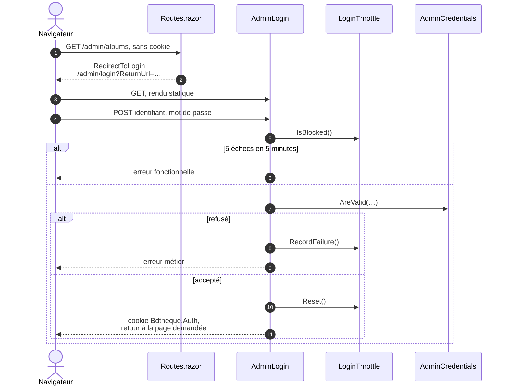
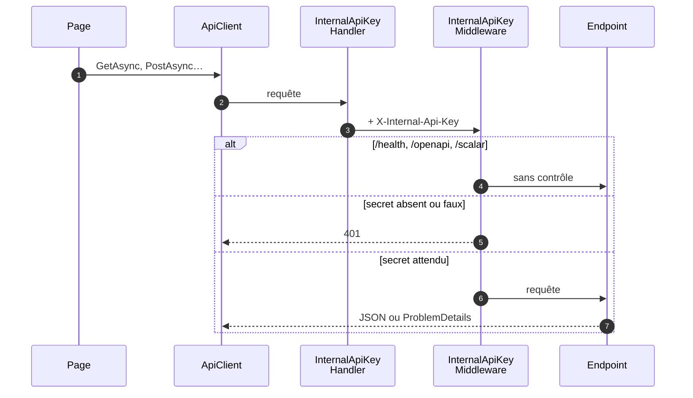

# Authentification et appels internes

`frontend` agit en *Backend For Frontend* : il authentifie l'administrateur par un cookie et appelle `api` pour lui, avec un secret partagé ; `api` ne connaît aucun utilisateur. Choix et raisons : [Authentification : mise en œuvre](../../../.speckit/choix-implementation/socle/transverse/authentification-mise-en-oeuvre.md) ; exigence : [Authentification](../../../.speckit/contraintes-techniques/architecture-deploiement/authentification.md).

## Connexion de l'administrateur

Question du schéma : *comment une page de l'administration demandée sans être connecté mène-t-elle à la connexion, puis y revient-elle ?* Schéma interprétatif.

- **Pages réservées en bloc** : l'attribut `[Authorize]` de [`Pages/Admin/_Imports.razor`](../../../src/Bdtheque.Frontend/Components/Pages/Admin/_Imports.razor) couvre toute page du dossier ; une page refusée passe par [`RedirectToLogin`](../../../src/Bdtheque.Frontend/Components/Layout/RedirectToLogin.razor), qui recharge entièrement la page de connexion pour qu'elle passe par l'authentification d'ASP.NET Core, une page qui écrit un cookie devant être rendue statiquement.
- **Identifiants** : comparés en temps constant sur leurs empreintes SHA-256 par [`AdminCredentials`](../../../src/Bdtheque.Frontend/Security/AdminCredentials.cs), d'après `AdminAccount__Login` et `AdminAccount__Password`, sans lesquels `frontend` ne démarre pas.
- **Tentatives limitées** : [`LoginThrottle`](../../../src/Bdtheque.Frontend/Security/LoginThrottle.cs), unique pour l'application (singleton), retient les échecs des 5 dernières minutes ; au-delà de 5, toute tentative est refusée sans vérification jusqu'à ce que le plus ancien échec sorte de la fenêtre.
- **Retour** : [`ReturnPath.AfterSignIn`](../../../src/Bdtheque.Frontend/Navigation/ReturnPath.cs) n'accepte qu'un chemin de l'application, résolu puis vérifié contre son adresse ; sinon, l'accueil de l'administration.
- **Déconnexion** : un formulaire `POST` protégé contre la falsification, [`AdminLogout.razor`](../../../src/Bdtheque.Frontend/Components/Pages/AdminLogout.razor), jamais un lien.

## Appel de l'API

Question du schéma : *comment une requête de `frontend` atteint-elle un endpoint d'`api`, et qu'est-ce qui la laisse passer ?* Schéma interprétatif.

- **Un client unique**, [`ApiClient`](../../../src/Bdtheque.Frontend/Api/ApiClient.cs), enregistré dans [`Program.cs` du frontend](../../../src/Bdtheque.Frontend/Program.cs) avec [`InternalApiKeyHandler`](../../../src/Bdtheque.Frontend/Api/InternalApiKeyHandler.cs), qui pose le secret `InternalApiKey__Key` sur chaque requête et remplace toute valeur déjà présente.
- **Côté `api`**, [`InternalApiKeyMiddleware`](../../../src/Bdtheque.Api/Security/InternalApiKeyMiddleware.cs) refuse en `401` toute requête sans le secret, hormis `/health` et la documentation de l'API, qui n'existe que dans les environnements `Development` et `Validation`. Ce contrôle est une défense en profondeur : `api` n'est déjà joignable que par le réseau interne.
- **Erreurs** : une réponse en échec est un ProblemDetails dont le type est l'une des trois catégories d'erreur ([Erreurs métier, fonctionnelles et techniques](../../../.speckit/choix-implementation/ecritures/erreurs-metier-fonctionnelles-et-techniques.md)) ; le refus du middleware, sans corps propre, reçoit la catégorie technique.

## Relais des médias des visuels

Le volume des visuels est privé à `api` : le navigateur demande leurs médias à `frontend`, qui les relaie en flux par [`VisualMediaRelay`](../../../src/Bdtheque.Frontend/Api/VisualMediaRelay.cs) (YARP), sous les mêmes chemins.

- **Routes relayées, et elles seules** : `/catalog/visuals/{id}/display` et `/original`, publiques ; `/admin/visuals/pending/{id}/display` et `/original`, réservées à l'administrateur (`RequireAuthorization`).
- **Requête relayée** : par le même gestionnaire que `ApiClient`, donc avec le secret interne ; les cookies du visiteur sont retirés, `api` ne connaissant pas l'utilisateur.

## Invariants à préserver

- `api` ne vérifie aucun utilisateur : toute route `/admin` n'est sûre que tant que `frontend` ne l'appelle ou ne la relaie que pour l'administrateur authentifié.
- Le secret interne n'est jamais transmis au navigateur, et une valeur reçue du navigateur n'est jamais transmise à `api`.
- La page de connexion et la déconnexion restent rendues statiquement (cookie écrit ou effacé par la réponse HTTP).
