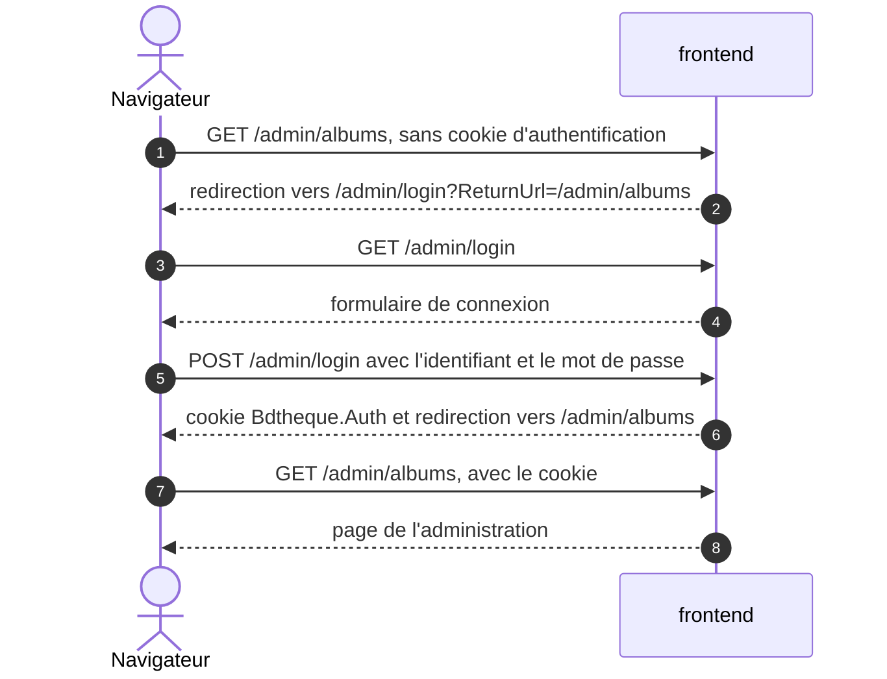
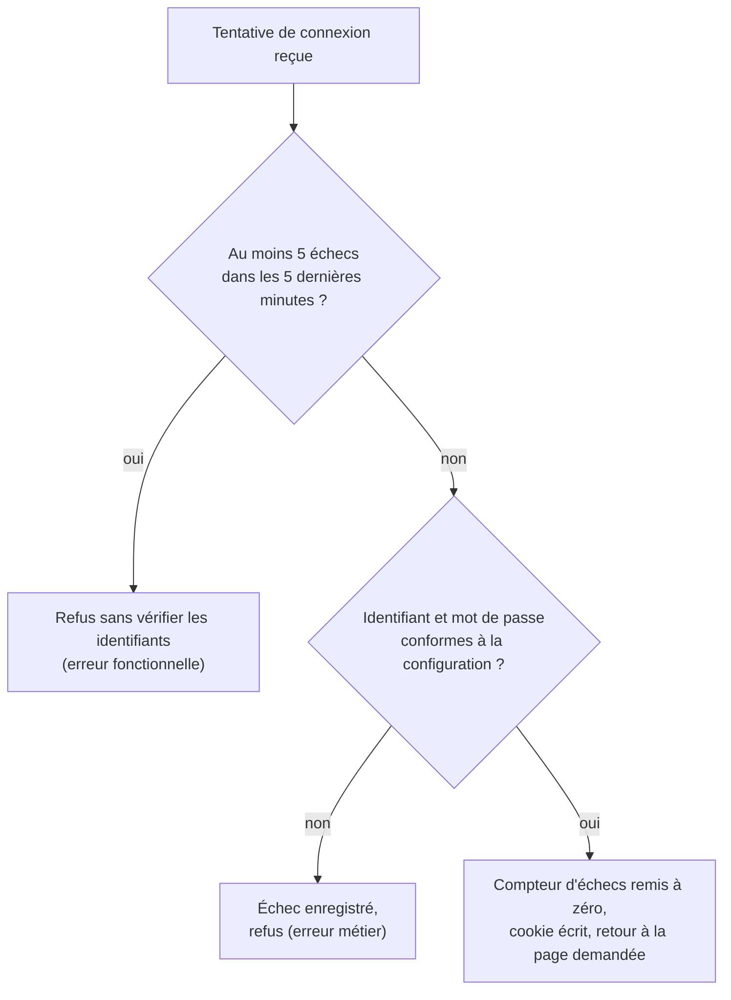
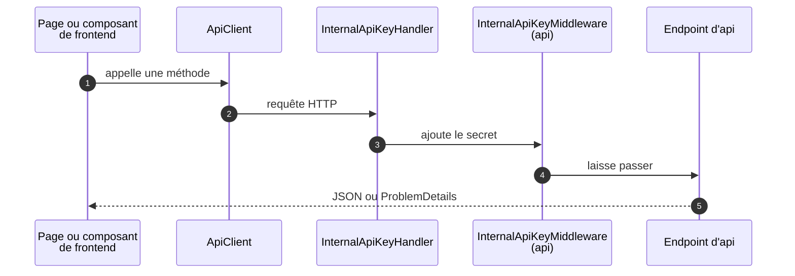

# Authentification et appels internes

L'application n'a qu'un seul utilisateur authentifié, l'administrateur ; la consultation est publique. Seul `frontend` sait qui est connecté. Il joue le rôle de ce qu'on appelle un *Backend For Frontend* (BFF) : c'est un serveur placé entre le navigateur et l'API, qui tient la session de l'utilisateur dans un cookie et appelle l'API en son nom. `api`, de son côté, ne connaît aucun utilisateur ; il se contente de vérifier que chaque requête vient bien de `frontend`, grâce à un secret que les deux conteneurs partagent. Les raisons de ce découpage sont données dans [Authentification : mise en œuvre](../../../.speckit/choix-implementation/socle/transverse/authentification-mise-en-oeuvre.md), et l'exigence d'un compte administrateur unique dans [Authentification](../../../.speckit/contraintes-techniques/architecture-deploiement/authentification.md).

## Connexion de l'administrateur

Toutes les pages du dossier `Pages/Admin` sont réservées à l'administrateur connecté, parce que le fichier [`Pages/Admin/_Imports.razor`](../../../src/Bdtheque.Frontend/Components/Pages/Admin/_Imports.razor) leur applique en bloc l'attribut `[Authorize]`. Quand un visiteur non connecté demande l'une d'elles, le routeur de Blazor, [`Routes.razor`](../../../src/Bdtheque.Frontend/Components/Routes.razor), ne la rend pas : il rend à sa place le composant [`RedirectToLogin`](../../../src/Bdtheque.Frontend/Components/Layout/RedirectToLogin.razor), qui envoie le navigateur vers la page de connexion en lui transmettant, dans le paramètre `ReturnUrl`, l'adresse de la page demandée. Cette redirection recharge entièrement la page plutôt que de naviguer à l'intérieur de Blazor, parce que la page de connexion doit écrire un cookie : elle doit donc être produite par une vraie réponse HTTP, ce qui n'est possible qu'avec un rendu statique traversant toute la chaîne d'authentification d'ASP.NET Core.

Le schéma suivant, tracé à la main d'après le code, ne montre que les échanges entre le navigateur et `frontend`. Il répond à la question suivante : quelles requêtes le navigateur envoie-t-il, de la page de l'administration demandée sans être connecté jusqu'au retour sur cette page une fois connecté ?

Quand le formulaire est envoyé, la page [`AdminLogin`](../../../src/Bdtheque.Frontend/Components/Pages/AdminLogin.razor) décide de la réponse en trois temps, que montre le second schéma, lui aussi tracé à la main. Il répond à une autre question : comment la page décide-t-elle d'accepter ou de refuser une tentative de connexion ?

Ces trois temps reposent sur les éléments suivants :

- Le limiteur [`LoginThrottle`](../../../src/Bdtheque.Frontend/Security/LoginThrottle.cs) mémorise l'heure des échecs récents. Il existe en un seul exemplaire pour toute l'application, car derrière le reverse proxy aucune requête ne dit de façon fiable qui l'envoie : les échecs de tous les visiteurs comptent donc ensemble. Dès que cinq échecs se sont produits dans les cinq dernières minutes, toute tentative est refusée sans même vérifier les identifiants, jusqu'à ce que le plus ancien échec sorte de cette fenêtre. Une connexion réussie efface les échecs mémorisés.
- La vérification des identifiants est faite par [`AdminCredentials`](../../../src/Bdtheque.Frontend/Security/AdminCredentials.cs), qui compare l'identifiant et le mot de passe saisis à ceux des variables d'environnement `AdminAccount__Login` et `AdminAccount__Password`. La comparaison porte sur leurs empreintes SHA-256 et se fait en temps constant, si bien que la durée d'un refus ne révèle rien de la partie juste d'une valeur ni de sa longueur. Sans ces deux variables, `frontend` refuse de démarrer.
- L'adresse de retour est contrôlée par [`ReturnPath.AfterSignIn`](../../../src/Bdtheque.Frontend/Navigation/ReturnPath.cs). Elle n'accepte qu'un chemin de l'application : elle le résout par rapport à l'adresse de l'application et vérifie que le résultat y reste. Toute autre valeur, par exemple l'adresse d'un autre site, mène à l'accueil de l'administration ; la page de connexion ne peut ainsi pas servir à faire sortir le visiteur vers un site tiers.

La déconnexion suit le même principe d'une page rendue statiquement : [`AdminLogout.razor`](../../../src/Bdtheque.Frontend/Components/Pages/AdminLogout.razor) efface le cookie en réponse à un formulaire envoyé en `POST` et protégé contre la falsification de requête. Elle n'est jamais déclenchée par un simple lien, sans quoi une page d'un autre site pourrait déconnecter l'administrateur à son insu.

## Appel de l'API par `frontend`

Toutes les pages et tous les composants de `frontend` appellent `api` par un seul client HTTP, [`ApiClient`](../../../src/Bdtheque.Frontend/Api/ApiClient.cs). Ce client est enregistré dans le [`Program.cs` du frontend](../../../src/Bdtheque.Frontend/Program.cs) avec un gestionnaire de messages, [`InternalApiKeyHandler`](../../../src/Bdtheque.Frontend/Api/InternalApiKeyHandler.cs), qui ajoute à chaque requête l'en-tête `X-Internal-Api-Key` portant le **secret interne**. Ce secret est une valeur que l'exploitant choisit et que le fichier Compose transmet aux deux conteneurs, depuis la variable `INTERNAL_API_KEY`, sous le nom `InternalApiKey__Key` ; il ne quitte jamais le serveur. Si la requête portait déjà cet en-tête, le gestionnaire le remplace, de sorte qu'une valeur venue du navigateur n'est jamais transmise à `api`.

Le schéma suivant, tracé à la main d'après le code, répond à la question : par quels composants passe une requête de `frontend` avant d'atteindre un endpoint d'`api` ?

Côté `api`, le middleware [`InternalApiKeyMiddleware`](../../../src/Bdtheque.Api/Security/InternalApiKeyMiddleware.cs) examine chaque requête avant tout endpoint. Il laisse passer sans contrôle trois familles de chemins : `/health`, que l'orchestrateur interroge pour savoir si le conteneur est en bonne santé, ainsi que `/openapi` et `/scalar`, la documentation interactive de l'API, qui n'existe que dans les environnements `Development` et `Validation` et doit rester accessible depuis un simple navigateur. Pour toutes les autres requêtes, il répond `401` si l'en-tête est absent ou ne porte pas le secret attendu. Ce contrôle est une défense en profondeur : `api` n'est déjà joignable que par le réseau interne de Docker, et le secret ne sert qu'à refuser un appel direct qui aurait contourné cet isolement.

Quand `api` répond par une erreur, le corps est un ProblemDetails, le format standard des erreurs HTTP, dont le type désigne l'une des trois catégories d'erreur de l'application ([Erreurs métier, fonctionnelles et techniques](../../../.speckit/choix-implementation/ecritures/erreurs-metier-fonctionnelles-et-techniques.md)). Le refus du middleware n'a pas de corps : le client le lit donc comme une erreur technique, comme toute réponse qui n'est pas un ProblemDetails de l'une de ces catégories ([Erreurs, de la règle à leur présentation](erreurs.md)).

## Relais des médias des visuels

Les fichiers des visuels d'une édition, qu'il s'agisse de couvertures, de dédicaces ou de planches, sont stockés sur un volume que seul `api` peut lire, alors que le navigateur ne parle qu'à `frontend`. Pour afficher une image, le navigateur la demande donc à `frontend`, qui la relaie depuis `api` sous le même chemin. Ce relais, [`VisualMediaRelay`](../../../src/Bdtheque.Frontend/Api/VisualMediaRelay.cs), s'appuie sur YARP, la bibliothèque de reverse proxy de Microsoft : le fichier est transmis en flux, sans être chargé en mémoire, et les en-têtes de cache fixés par `api` sont conservés.

Le relais ne transmet que quatre routes, afin que `frontend` ne devienne pas un proxy ouvert vers `api` :

| Route | Accès |
| --- | --- |
| `/catalog/visuals/{id}/display` et `/catalog/visuals/{id}/original` | Publiques : ce sont les visuels enregistrés, affichés dans la consultation. |
| `/admin/visuals/pending/{id}/display` et `/admin/visuals/pending/{id}/original` | Réservées à l'administrateur connecté (`RequireAuthorization`) : ce sont les visuels téléversés pendant la saisie d'une édition, en attente de son enregistrement. |

La requête relayée passe par le même gestionnaire de messages que `ApiClient` et porte donc le secret interne. Le relais en retire en revanche les cookies du visiteur, puisque `api` ne connaît pas l'utilisateur et n'a pas à les recevoir.

## Invariants à préserver

- `api` ne vérifie l'identité d'aucun utilisateur. Une route `/admin` n'est donc sûre que tant que `frontend` ne l'appelle ou ne la relaie que pour l'administrateur authentifié ; c'est une propriété de `frontend` à préserver à chaque nouvelle page ou nouvelle route relayée.
- Le secret interne n'est jamais transmis au navigateur, et aucune valeur de l'en-tête `X-Internal-Api-Key` reçue du navigateur n'est transmise à `api`.
- La page de connexion et la déconnexion restent rendues statiquement, puisque c'est la réponse HTTP qui écrit ou efface le cookie d'authentification.
