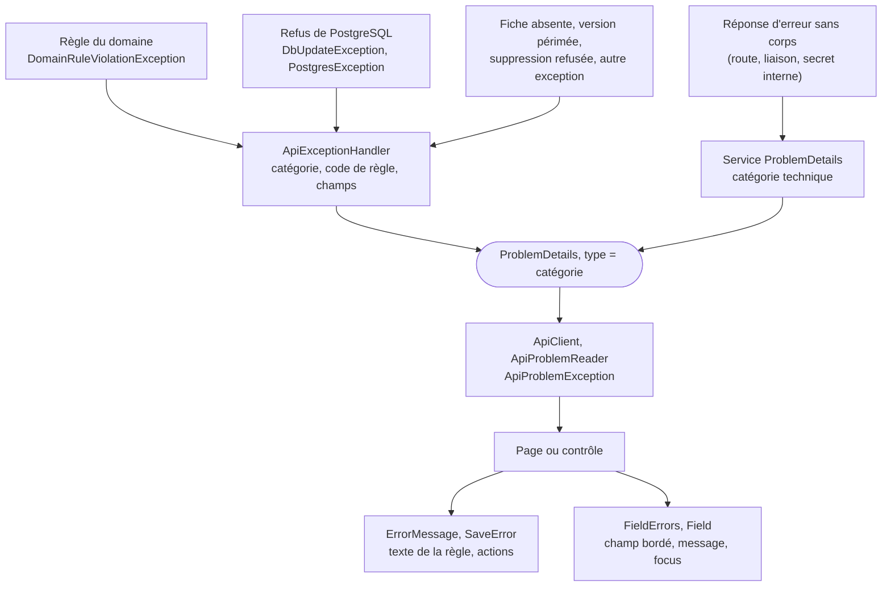
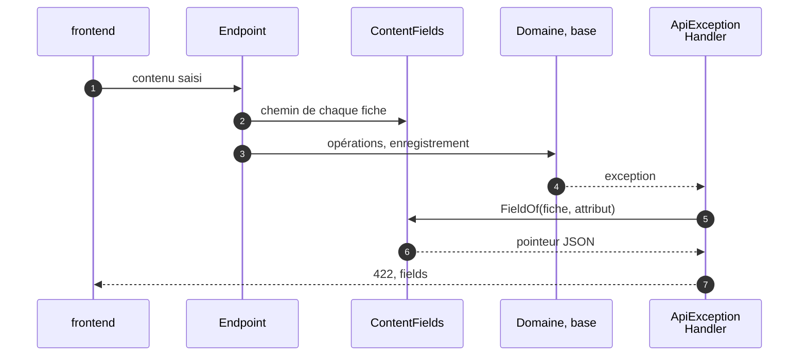

# Erreurs, de la règle à leur présentation

Toute erreur présentée à l'utilisateur appartient à l'une de trois catégories, distinguées au premier coup d'œil ([Présentation des erreurs](../../../.speckit/fonctionnel/presentation-des-erreurs.md)) : **métier** (une saisie à corriger), **fonctionnelle** (une demande qui ne peut aboutir en l'état des données), **technique** (rien que l'utilisateur ait causé). `api` classe chaque échec dans l'une d'elles et l'envoie en ProblemDetails ; `frontend` la lit et la présente. Les raisons de ces choix sont dans [Erreurs métier, fonctionnelles et techniques](../../../.speckit/choix-implementation/ecritures/erreurs-metier-fonctionnelles-et-techniques.md) et dans la section « Présentation » de [Frontend](../../../.speckit/choix-implementation/socle/frontend.md).

## Parcours

Question du schéma : *par où passe une erreur, de l'endroit où elle est détectée jusqu'à son affichage ?* Schéma interprétatif.

## Côté `api` : classer et désigner

- **Erreur métier du domaine** : une règle enfreinte lève [`DomainRuleViolationException`](../../../src/Bdtheque.Domain/Common/DomainRuleViolationException.cs), avec un code de règle stable de [`DomainRules`](../../../src/Bdtheque.Domain/Common/DomainRules.cs) et, quand la règle porte sur une valeur, la fiche et l'attribut en cause. Le message de l'exception ne sert qu'aux journaux ; un code publié n'est jamais renommé.
- **Deux points produisent les réponses d'erreur**, aucun endpoint n'en construit :
  - [`ApiExceptionHandler`](../../../src/Bdtheque.Api/Errors/ApiExceptionHandler.cs), pour toute exception : il la classe, journalise une erreur technique en `Error` et toute autre en `Information`, puis écrit un ProblemDetails sans rien d'interne ;
  - le service ProblemDetails, configuré dans [`Program.cs` de l'API](../../../src/Bdtheque.Api/Program.cs) avec `UseStatusCodePages`, pour toute réponse d'erreur émise sans corps (route inconnue, requête impossible à lier, secret interne absent), classée technique ; un `type` hors des trois catégories y est remplacé par la catégorie technique.

| Échec | Catégorie, statut |
| --- | --- |
| `DomainRuleViolationException` ; index unique violé (code de règle par [`UniqueIndexRules`](../../../src/Bdtheque.Api/Errors/UniqueIndexRules.cs)) ; texte trop long ; suppression refusée ; retrait d'une fiche que désigne une recherche enregistrée | Métier, `422`, avec `ruleCode` |
| Fiche absente, clé étrangère vers une fiche supprimée entre-temps | Fonctionnelle, `404` |
| Version périmée, impact de suppression changé | Fonctionnelle, `409` |
| Toute autre exception, toute réponse sans corps | Technique, `500` ou le statut du framework |

Le classement des échecs de la base selon leur code d'erreur PostgreSQL est détaillé dans [Persistance : écriture d'un agrégat](persistance-ecriture-d-un-agregat.md).

### Contenu d'une réponse

Les membres d'un ProblemDetails, nommés par [`ProblemTypes`](../../../src/Bdtheque.Contracts/Errors/ProblemTypes.cs), du projet des contrats que partagent `api` et `frontend` :

| Membre | Contenu |
| --- | --- |
| `type` | `urn:bdtheque:problem:business`, `…:functional` ou `…:technical`, et rien d'autre. |
| `ruleCode` | Code de la règle enfreinte, pour une erreur métier. |
| `fields` | Pointeurs JSON (RFC 6901), dans le contenu que la requête a envoyé, des champs à corriger, le premier d'abord (ex. `/title`, `/collections/1/name`). |
| `relatedFields` | Champs dont la valeur heurte celle à corriger, laissés tels quels par la requête : présentés avec l'erreur, pas à corriger. |
| `impact` | Impact actuel d'une suppression refusée ou dont l'impact a changé. |

### Champ en cause

Question du schéma : *comment une erreur métier sait-elle quel champ du formulaire désigner ?* Schéma interprétatif.

- **Où chaque fiche est saisie** : [`ContentFields`](../../../src/Bdtheque.Api/Errors/ContentFields.cs), un service par requête, retient le chemin de chaque fiche que l'endpoint applique (`Place` ; `Create` place aussi la fiche dont la construction échoue), et un attribut saisi sous un autre nom (ex. la clé de tri manuelle d'un album, `/manualSortKey`). Il retient aussi, à chaque enregistrement, les fiches que la requête écrit : une contrainte différable n'est vérifiée qu'au commit, quand ces fiches paraissent déjà inchangées.
- **Valeurs en cause** : [`BusinessErrorFields`](../../../src/Bdtheque.Api/Errors/BusinessErrorFields.cs) les tire de l'exception :
  - règle du domaine : la fiche et l'attribut qu'elle nomme ;
  - texte trop long : les valeurs écrites plus longues que la longueur que le modèle déclare pour leur colonne, PostgreSQL ne nommant ni la colonne ni la ligne ;
  - valeur déjà prise : les fiches de la requête dont les valeurs de l'index se heurtent entre elles, comparées comme leur collation les compare ; à défaut, celle que la base dit déjà détenue par une autre ligne. Parmi elles, celles que la requête a écrites sont à corriger, les autres seulement associées. Seules comptent les propriétés saisies de l'index, hors clés étrangères.

## Côté `frontend` : lire et présenter

- **Lecture** : [`ApiClient`](../../../src/Bdtheque.Frontend/Api/ApiClient.cs) lève [`ApiProblemException`](../../../src/Bdtheque.Frontend/Api/ApiProblem.cs) pour tout appel qui n'aboutit pas, avec un [`ApiProblem`](../../../src/Bdtheque.Frontend/Api/ApiProblem.cs) : catégorie, statut, code de règle, impact, champs. [`ApiProblemReader`](../../../src/Bdtheque.Frontend/Api/ApiProblemReader.cs) ne prend pour ce qu'il dit qu'un `application/problem+json` d'une des trois catégories ; tout autre échec (autre corps, page d'erreur d'un proxy, réseau, délai dépassé, réponse illisible) est technique.
- **Présentation commune** : [`ErrorMessage`](../../../src/Bdtheque.Frontend/Components/Errors/ErrorMessage.razor) rend toute erreur, en entier ou en forme compacte dans un contrôle (suggestions d'un choix, envoi d'un visuel, collections d'un éditeur), sa catégorie portée par l'attribut `data-error-category`, qui donne cadre, icône et couleur dans chaque thème. Une erreur technique n'a qu'un texte générique, ou celui de l'action du contrôle qui a échoué.
- **Erreur d'enregistrement** : [`SaveError`](../../../src/Bdtheque.Frontend/Components/Controls/SaveError.razor) ajoute les actions de chaque catégorie, sur une fiche de saisie interactive comme dans un formulaire statique d'une liste : « Recharger la fiche » et « Voir mes changements » pour une fiche modifiée entre-temps, « Réessayer » pour un problème technique.
- **Textes**, en ressources de [`Components/Errors/`](../../../src/Bdtheque.Frontend/Components/Errors/), le frontend ne référençant pas le domaine :
  - `RuleMessages.resx`, le texte de chaque code de règle, présenté en tête ;
  - `FieldMessages.resx`, le texte court sous le champ en cause, à défaut celui de la règle, et le texte d'un champ associé ;
  - `ErrorMessage.resx`, les noms des catégories et les textes génériques ;
  - `EntityNames.resx`, les types de fiche de l'impact d'une suppression.
- **Champ en cause** : une fiche de saisie construit un [`FieldErrors`](../../../src/Bdtheque.Frontend/Components/Errors/FieldErrors.cs) de l'erreur du dernier enregistrement. Chaque contrôle lui donne le pointeur du champ qu'il saisit (`Errors.For("/title")`) ; une fiche créée sur place est retrouvée par sa place parmi les fiches nouvelles que cet enregistrement a envoyées (`ForAdded`). Le composant [`Field`](../../../src/Bdtheque.Frontend/Components/Controls/Field.razor) borde le champ, écrit le message sous lui et marque un champ seulement associé (`data-error-related`).
- **Focus** : une fois l'erreur rendue, [`entry-form.js`](../../../src/Bdtheque.Frontend/wwwroot/entry-form.js) (`revealProblem`, appelé par `EntryForm`) donne le focus au premier champ marqué `aria-invalid` ou `data-error-focus` qui n'est pas seulement associé, centré à l'écran, au-dessus de la barre d'enregistrement ; à défaut, il fait défiler jusqu'à l'erreur en tête. Dans un panneau ou une ligne d'une liste statique, c'est l'attribut `autofocus` du premier champ à corriger.
- **Erreurs que le frontend rencontre seul**, présentées par le même composant : la page introuvable, réexécutée par `UseStatusCodePagesWithReExecute("/not-found")` dans [`Program.cs` du frontend](../../../src/Bdtheque.Frontend/Program.cs), erreur fonctionnelle ; le bandeau d'une erreur non gérée d'un composant interactif ([`UnhandledErrorBanner`](../../../src/Bdtheque.Frontend/Components/Layout/UnhandledErrorBanner.razor)) et les échecs de la reconnexion ([`ReconnectModal`](../../../src/Bdtheque.Frontend/Components/Layout/ReconnectModal.razor)), erreurs techniques, que montre le script de Blazor.

## Ajouter une règle métier

1. Le code de règle dans [`DomainRules`](../../../src/Bdtheque.Domain/Common/DomainRules.cs), et la règle dans le domaine, avec la fiche et l'attribut en cause quand elle porte sur une valeur.
2. Ses textes dans `RuleMessages.resx`, et au besoin `FieldMessages.resx` : [`RuleMessagesTests`](../../../tests/Bdtheque.Frontend.Tests/Errors/RuleMessagesTests.cs) échoue pour un code sans texte.
3. Pour une unicité, l'index unique du modèle et son code dans [`UniqueIndexRules`](../../../src/Bdtheque.Api/Errors/UniqueIndexRules.cs), ce que vérifie [`UniqueIndexRulesTests`](../../../tests/Bdtheque.Api.Tests/UniqueIndexRulesTests.cs).
4. Dans l'endpoint, chaque fiche du contenu placée par `ContentFields`, sous le nom que le contenu donne à ses champs.

## Tests

- **Codes de règle** : [`DomainRulesTests`](../../../tests/Bdtheque.Domain.Tests/DomainRulesTests.cs).
- **Réponses de l'API** : [`ErrorResponseTests`](../../../tests/Bdtheque.Api.Tests/ErrorResponseTests.cs), avec les assertions partagées de [`ProblemAssert`](../../../tests/Bdtheque.Api.Tests/ProblemAssert.cs).
- **Lecture par le frontend** : [`ApiClientTests`](../../../tests/Bdtheque.Frontend.Tests/Api/ApiClientTests.cs).
- **Présentation** : [`ErrorMessageTests`](../../../tests/Bdtheque.Frontend.Tests/Errors/ErrorMessageTests.cs), et les tests bUnit et de bout en bout de chaque fiche de saisie pour le champ en cause et le focus.

## Invariants à préserver

- Aucun endpoint ne construit de réponse d'erreur, et aucune ne porte de détail interne (message d'exception, SQL, pile d'appels).
- Le frontend ne déduit jamais un champ du code de règle : il présente l'erreur sur le champ que désigne la réponse.
- Une erreur technique porte partout la même mention, « Problème technique ».
- Un code de règle publié n'est jamais renommé ni réaffecté.
