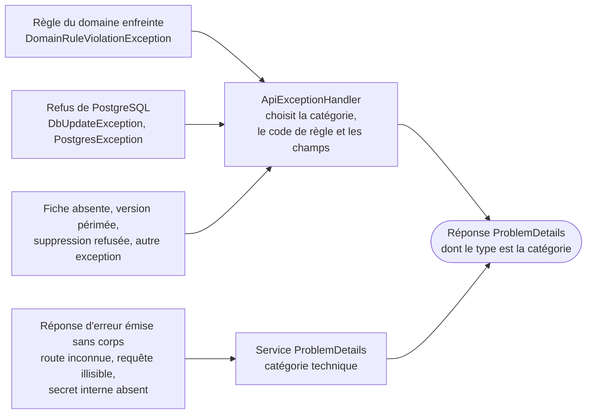
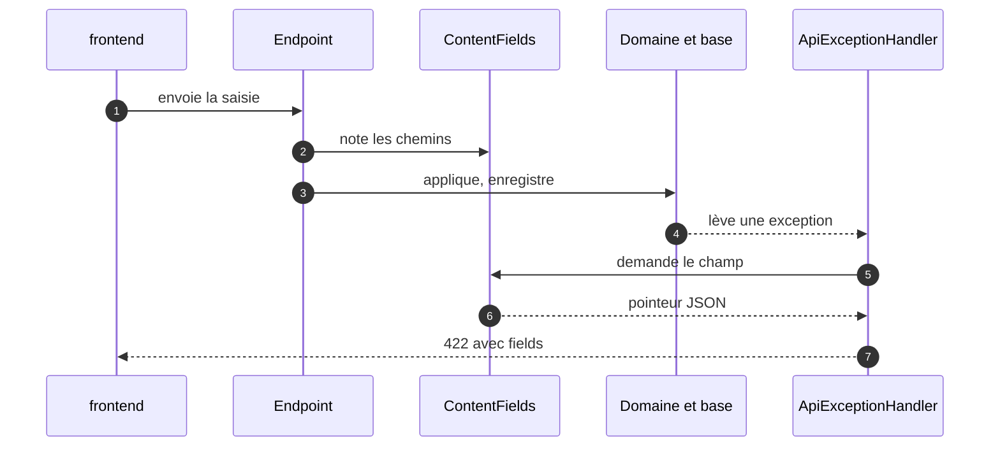
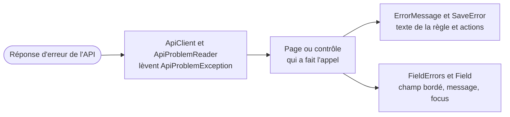

# Erreurs, de la règle à leur présentation

L'application distingue trois catégories d'erreurs, que l'utilisateur doit reconnaître au premier coup d'œil ([Présentation des erreurs](../../../.speckit/fonctionnel/presentation-des-erreurs.md)). Une erreur **métier** signale une saisie à corriger, par exemple un titre déjà pris. Une erreur **fonctionnelle** signale une demande qui ne peut pas aboutir dans l'état actuel des données, parce que la fiche a été modifiée ou supprimée entre-temps. Une erreur **technique** signale un problème que l'utilisateur n'a pas causé et qu'il ne peut pas corriger lui-même.

Le travail est partagé entre les deux conteneurs. `api` détecte l'échec, le range dans l'une des trois catégories et le renvoie sous la forme d'un *ProblemDetails*, le format standard des réponses d'erreur HTTP (RFC 9457) : un corps JSON qui porte un `type`, un titre, un statut et des membres supplémentaires propres à l'application. `frontend` lit cette réponse et la présente selon sa catégorie, sur le champ en cause quand il y en a un. Les raisons de ces choix sont exposées dans [Erreurs métier, fonctionnelles et techniques](../../../.speckit/choix-implementation/ecritures/erreurs-metier-fonctionnelles-et-techniques.md) et dans la section « Présentation » de [Frontend](../../../.speckit/choix-implementation/socle/frontend.md).

## Côté `api` : classer l'échec et désigner le champ

### D'où viennent les erreurs, et qui les met en forme

Le schéma suivant, tracé à la main d'après le code, ne regarde que l'intérieur d'`api` et répond à une question : quelles sources d'échec aboutissent à quel composant, pour produire toujours le même format de réponse ?

Une règle du domaine enfreinte lève [`DomainRuleViolationException`](../../../src/Bdtheque.Domain/Common/DomainRuleViolationException.cs). Cette exception porte un code de règle stable, tiré de [`DomainRules`](../../../src/Bdtheque.Domain/Common/DomainRules.cs), et, lorsque la règle porte sur une valeur, la fiche et l'attribut qui la contiennent. Le message de l'exception n'est destiné qu'aux journaux : c'est le code de règle qui permet au frontend de produire le texte affiché, et c'est pourquoi un code publié n'est jamais renommé.

Aucun endpoint ne construit lui-même de réponse d'erreur. Deux composants s'en chargent, et eux seuls :

- [`ApiExceptionHandler`](../../../src/Bdtheque.Api/Errors/ApiExceptionHandler.cs) reçoit toute exception qui remonte d'un endpoint. Il la classe, la journalise au niveau `Error` si elle est technique et au niveau `Information` sinon, puis écrit un ProblemDetails qui ne contient rien d'interne.
- Le service ProblemDetails d'ASP.NET Core, configuré dans [`Program.cs` de l'API](../../../src/Bdtheque.Api/Program.cs), donne un corps aux réponses d'erreur que le framework émet sans corps grâce à `UseStatusCodePages`, par exemple pour une route inconnue, une requête impossible à lier ou une requête sans le secret interne. Ces réponses sont classées techniques, et tout `type` qui ne serait pas l'une des trois catégories est remplacé par la catégorie technique.

Le tableau suivant indique comment chaque échec est classé. Le classement des échecs de la base selon le code d'erreur de PostgreSQL est détaillé dans [Persistance : écriture d'un agrégat](persistance-ecriture-d-un-agregat.md).

| Échec | Catégorie et statut HTTP |
| --- | --- |
| Une règle du domaine est enfreinte, un index unique est violé (son code de règle vient de [`UniqueIndexRules`](../../../src/Bdtheque.Api/Errors/UniqueIndexRules.cs), puis [`ApiExceptionHandler`](../../../src/Bdtheque.Api/Errors/ApiExceptionHandler.cs) le précise d'après la fiche refusée : le nom d'un univers sans parent reçoit `Universe.TopLevelNameAlreadyUsed`), un texte dépasse sa longueur, une suppression est refusée, ou la requête retire une fiche qu'une recherche enregistrée désigne. | Métier, `422`, avec le membre `ruleCode`. |
| La fiche visée n'existe pas, ou une clé étrangère désigne une fiche supprimée entre-temps. | Fonctionnelle, `404`. |
| La version envoyée par le formulaire est périmée, ou l'impact d'une suppression a changé depuis sa confirmation. | Fonctionnelle, `409`. |
| Toute autre exception, et toute réponse d'erreur émise sans corps. | Technique, `500` ou le statut qu'a choisi le framework. |

### Contenu d'une réponse

Les membres d'un ProblemDetails propres à l'application sont nommés par [`ProblemTypes`](../../../src/Bdtheque.Contracts/Errors/ProblemTypes.cs), dans le projet des contrats que partagent `api` et `frontend`, si bien que les deux côtés emploient les mêmes noms.

| Membre | Ce qu'il contient |
| --- | --- |
| `type` | La catégorie de l'erreur, sous la forme `urn:bdtheque:problem:business`, `…:functional` ou `…:technical`, et jamais une autre valeur. |
| `ruleCode` | Le code de la règle enfreinte, présent pour une erreur métier. |
| `fields` | Les champs à corriger, désignés par des pointeurs JSON dans le contenu que la requête a envoyé, le premier étant celui à corriger d'abord. |
| `relatedFields` | Les champs dont la valeur entre en conflit avec celle à corriger mais que la requête n'a pas modifiés : ils sont montrés avec l'erreur sans être à corriger. |
| `impact` | L'impact actuel d'une suppression refusée, ou d'une suppression dont l'impact a changé depuis sa confirmation. |

Un *pointeur JSON* (RFC 6901) est un chemin qui désigne une valeur à l'intérieur d'un document JSON, par exemple `/title` pour le titre d'un album ou `/collections/1/name` pour le nom de la deuxième collection d'un éditeur. Comme le formulaire a lui-même construit ce document, il sait retrouver le champ qui correspond à chaque pointeur.

### Comment l'API trouve le champ en cause

Le domaine et la base ne connaissent que des fiches et des attributs ; ils ignorent où ces fiches se trouvaient dans le contenu envoyé par le formulaire. L'API doit donc retenir, pendant la requête, à quel endroit du contenu chaque fiche a été saisie, pour traduire ensuite « tel attribut de telle fiche » en pointeur JSON.

Le schéma suivant, tracé à la main d'après le code, décrit les appels échangés au cours d'une seule requête et répond à la question : comment une erreur métier sait-elle quel champ du formulaire désigner ?

[`ContentFields`](../../../src/Bdtheque.Api/Errors/ContentFields.cs) est un service créé pour chaque requête. L'endpoint lui indique, par `Place`, le chemin de chaque fiche qu'il applique ; `Create` fait de même pour une fiche à construire, si bien que la fiche est placée même quand sa construction échoue. Le service retient aussi les attributs saisis sous un autre nom que celui du domaine, comme la clé de tri manuelle d'un album, saisie sous `/manualSortKey`. Enfin, il note à chaque enregistrement les fiches que la requête écrit : une contrainte d'unicité différable n'est vérifiée qu'à la validation de la transaction, moment où ces fiches paraissent déjà inchangées pour EF Core, et cette liste permet malgré tout de savoir qui a été écrit.

[`BusinessErrorFields`](../../../src/Bdtheque.Api/Errors/BusinessErrorFields.cs) détermine ensuite les valeurs en cause selon la nature de l'exception :

- Pour une règle du domaine, il reprend la fiche et l'attribut que nomme l'exception.
- Pour un texte trop long, il recherche les valeurs écrites dont la longueur dépasse celle que le modèle déclare pour leur colonne, parce que PostgreSQL ne nomme ni la colonne ni la ligne en cause.
- Pour une valeur déjà prise, il cherche d'abord, parmi les fiches de la requête, celles dont les valeurs de l'index se heurtent entre elles, en les comparant comme leur collation les compare ; à défaut, il retient la fiche dont la base indique que la valeur appartient déjà à une autre ligne. Parmi ces fiches, celles que la requête a écrites sont à corriger, et les autres ne sont qu'associées. Seules comptent les propriétés saisies de l'index, à l'exclusion des clés étrangères.

## Côté `frontend` : lire la réponse et la présenter

Le schéma suivant, tracé à la main d'après le code, ne regarde que l'intérieur de `frontend` et répond à la question : que devient une réponse d'erreur, depuis sa lecture jusqu'aux composants qui l'affichent ?

### Lecture de la réponse

Tout appel à l'API qui n'aboutit pas fait lever par [`ApiClient`](../../../src/Bdtheque.Frontend/Api/ApiClient.cs) une [`ApiProblemException`](../../../src/Bdtheque.Frontend/Api/ApiProblem.cs). Elle porte un [`ApiProblem`](../../../src/Bdtheque.Frontend/Api/ApiProblem.cs) qui réunit la catégorie, le statut, le code de règle, l'impact et les champs. [`ApiProblemReader`](../../../src/Bdtheque.Frontend/Api/ApiProblemReader.cs) ne croit une réponse que si elle est un `application/problem+json` de l'une des trois catégories. Tout autre échec est traité comme technique : un autre corps, la page d'erreur d'un proxy, une panne du réseau, un délai dépassé ou une réponse illisible.

### Présentation commune

Le composant [`ErrorMessage`](../../../src/Bdtheque.Frontend/Components/Errors/ErrorMessage.razor) affiche toutes les erreurs. Il se présente en entier en tête d'une page, ou sous une forme compacte à l'intérieur d'un contrôle, comme les suggestions d'un choix, l'envoi d'un visuel ou les collections d'un éditeur. Sa catégorie est portée par l'attribut `data-error-category`, auquel chaque thème associe un cadre, une icône et une couleur. Une erreur technique n'affiche jamais de détail : seulement un texte générique, ou celui de l'action du contrôle qui a échoué.

Lorsqu'un enregistrement échoue, [`SaveError`](../../../src/Bdtheque.Frontend/Components/Controls/SaveError.razor) ajoute à ce message les actions qui conviennent à sa catégorie, aussi bien sur une fiche de saisie interactive que dans un formulaire statique d'une liste. Pour une fiche modifiée entre-temps, il propose « Recharger la fiche » et « Voir mes changements » ; pour un problème technique, il propose « Réessayer ».

Le frontend ne référence pas le domaine et ne connaît donc pas le texte des règles. Ces textes sont dans des fichiers de ressources de [`Components/Errors/`](../../../src/Bdtheque.Frontend/Components/Errors/), comme les autres textes de l'interface :

- `RuleMessages.resx` donne le texte de chaque code de règle, affiché en tête de l'erreur.
- `FieldMessages.resx` donne le texte court écrit sous le champ en cause, à défaut duquel le texte de la règle est repris, ainsi que le texte d'un champ associé.
- `ErrorMessage.resx` donne les noms des catégories et les textes génériques.
- `EntityNames.resx` donne le nom des types de fiche qui apparaissent dans l'impact d'une suppression.

### Champ en cause et focus

Une fiche de saisie construit un [`FieldErrors`](../../../src/Bdtheque.Frontend/Components/Errors/FieldErrors.cs) à partir de l'erreur de son dernier enregistrement. Chaque contrôle lui demande l'erreur du champ qu'il saisit, en donnant son pointeur, par exemple `Errors.For("/title")`. Le texte écrit sous le champ peut citer ce qui a été saisi : un nom déjà pris est ainsi rappelé entre guillemets. `For` y cite le sujet de la fiche, comme le nom de l'éditeur saisi. Une ligne d'une liste saisie avec la fiche, comme une collection d'un éditeur, est citée par son propre nom grâce à `ForNamed`, si bien que, lorsque deux lignes sont bordées, le message dit laquelle corriger. Une fiche créée sur place pendant la saisie n'a pas encore d'identifiant ; elle est retrouvée par sa place parmi les fiches nouvelles que l'enregistrement a envoyées, grâce à `ForAdded`, qui la cite par son nom. Le composant [`Field`](../../../src/Bdtheque.Frontend/Components/Controls/Field.razor) borde alors le champ, écrit le message sous lui, et marque d'un attribut `data-error-related` un champ qui n'est qu'associé.

Une fois l'erreur affichée, la fonction `revealProblem` de [`entry-form.js`](../../../src/Bdtheque.Frontend/wwwroot/entry-form.js), appelée par `EntryForm`, donne le focus au premier champ marqué `aria-invalid` ou `data-error-focus` qui n'est pas seulement associé. Elle le centre à l'écran, au-dessus de la barre d'enregistrement. S'il n'y a aucun champ à désigner, elle fait défiler la page jusqu'au message en tête. Dans un panneau ou une ligne d'une liste statique, c'est l'attribut `autofocus` du premier champ à corriger qui place le focus.

### Erreurs que le frontend rencontre seul

Certaines erreurs ne viennent pas de l'API, mais sont présentées par le même composant. Une page introuvable est une erreur fonctionnelle : `UseStatusCodePagesWithReExecute("/not-found")`, dans [`Program.cs` du frontend](../../../src/Bdtheque.Frontend/Program.cs), réexécute la requête vers la page qui l'affiche. Une erreur non gérée d'un composant interactif, présentée par le bandeau [`UnhandledErrorBanner`](../../../src/Bdtheque.Frontend/Components/Layout/UnhandledErrorBanner.razor), et un échec de la reconnexion au serveur, présenté par [`ReconnectModal`](../../../src/Bdtheque.Frontend/Components/Layout/ReconnectModal.razor), sont des erreurs techniques ; c'est le script de Blazor qui les fait apparaître.

## Ajouter une règle métier

Une nouvelle règle métier traverse toute la chaîne décrite ci-dessus. Il faut, dans l'ordre :

1. Ajouter son code dans [`DomainRules`](../../../src/Bdtheque.Domain/Common/DomainRules.cs) et la règle elle-même dans le domaine, en indiquant la fiche et l'attribut en cause quand elle porte sur une valeur.
2. Écrire ses textes dans `RuleMessages.resx`, et au besoin dans `FieldMessages.resx`. [`RuleMessagesTests`](../../../tests/Bdtheque.Frontend.Tests/Errors/RuleMessagesTests.cs) échoue pour tout code qui n'a pas de texte.
3. Pour une règle d'unicité, déclarer l'index unique dans le modèle et associer son code dans [`UniqueIndexRules`](../../../src/Bdtheque.Api/Errors/UniqueIndexRules.cs), ce que vérifie [`UniqueIndexRulesTests`](../../../tests/Bdtheque.Api.Tests/UniqueIndexRulesTests.cs).
4. Dans l'endpoint, placer chaque fiche du contenu par `ContentFields`, sous le nom que le contenu donne à ses champs.

## Tests

- Les codes de règle sont vérifiés par [`DomainRulesTests`](../../../tests/Bdtheque.Domain.Tests/DomainRulesTests.cs).
- Les réponses de l'API sont vérifiées par [`ErrorResponseTests`](../../../tests/Bdtheque.Api.Tests/ErrorResponseTests.cs), qui s'appuie sur les assertions partagées de [`ProblemAssert`](../../../tests/Bdtheque.Api.Tests/ProblemAssert.cs).
- La lecture des réponses par le frontend est vérifiée par [`ApiClientTests`](../../../tests/Bdtheque.Frontend.Tests/Api/ApiClientTests.cs).
- La présentation est vérifiée par [`ErrorMessageTests`](../../../tests/Bdtheque.Frontend.Tests/Errors/ErrorMessageTests.cs) ; le champ en cause et le focus le sont par les tests bUnit et de bout en bout de chaque fiche de saisie.

## Invariants à préserver

- Aucun endpoint ne construit de réponse d'erreur, et aucune réponse ne contient de détail interne, qu'il s'agisse d'un message d'exception, de SQL ou d'une pile d'appels.
- Le frontend ne déduit jamais un champ du code de règle : il présente l'erreur sur le champ que désigne la réponse.
- Une erreur technique porte partout la même mention, « Problème technique ».
- Un code de règle publié n'est jamais renommé ni réaffecté à une autre règle.
