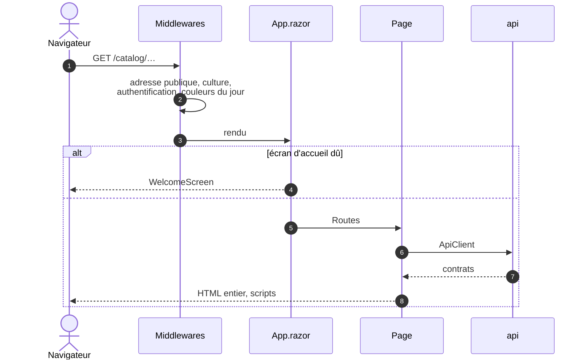
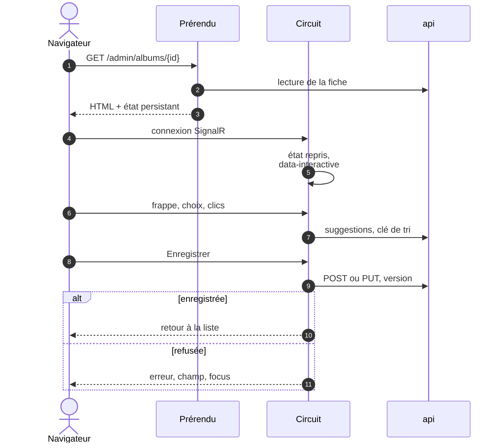

# Frontend : rendu des pages et fiches de saisie

`frontend` est une application Blazor rendue côté serveur : chaque page arrive entière du serveur, en HTML ; seuls quelques composants deviennent interactifs, par un circuit SignalR. Il ne lit ni n'écrit aucune donnée lui-même : tout passe par l'API ([Authentification et appels internes](authentification-et-appels-internes.md)). Les raisons de ces choix sont dans [Frontend](../../../.speckit/choix-implementation/socle/frontend.md). La visite, le thème, la culture et la mesure d'audience sont décrits dans [Frontend : visite, thème, culture et mesure d'audience](frontend-visite-theme-et-culture.md).

## Une requête de page

Question du schéma : *que traverse la requête d'une page rendue en statique, du navigateur à son HTML ?* Schéma interprétatif.

- **Chaîne des middlewares**, dans [`Program.cs` du frontend](../../../src/Bdtheque.Frontend/Program.cs) : adresse publique du reverse proxy reprise en premier ; page d'erreur hors développement ; culture fixée (`UseRequestLocalization`) ; page introuvable par réexécution (`/not-found`) ; authentification et autorisation ; protection contre la falsification ; couleurs du jour lues avant le rendu ([`PageDayColors`](../../../src/Bdtheque.Frontend/Theming/PageDayColors.cs)) ; sonde `/health`, fichiers statiques, relais des médias, puis les composants Razor.
- **Racine de la page** : [`App.razor`](../../../src/Bdtheque.Frontend/Components/App.razor) rend l'écran d'accueil de la première requête, ou le document. Sur `<html>`, elle pose le fuseau transmis (`data-time-zone`), le thème (`data-theme`), l'opposition à la mesure d'audience (`data-audience`), les couleurs du jour (`style`) et `data-local` quand le thème dépend de la date. Elle charge la feuille du thème de base, celle du thème, les styles isolés des composants, les scripts communs et ceux de tous les thèmes proposés, puis `blazor.web.js`.
- **Routes** : [`Routes.razor`](../../../src/Bdtheque.Frontend/Components/Routes.razor) ; les pages de `Components/Pages/Admin/` sont réservées en bloc à l'administrateur. Tout chemin de page vient de [`AppPaths`](../../../src/Bdtheque.Frontend/Navigation/AppPaths.cs).
- **Navigation améliorée** : un lien de l'application est suivi par `blazor.web.js`, qui demande la page par `fetch` et ne remplace que ce qui change dans le document, attributs de `<html>` compris. Les scripts déjà chargés restent, et ceux de la nouvelle page ne s'exécutent pas : chaque script se réapplique donc lui-même à chaque navigation.

## Rendu statique et îlots interactifs

- **Statique par défaut** : consultation, listes de l'administration, accueil, connexion. Un formulaire d'une liste est un `GET` (recherche, filtres) ou un `POST` protégé (suppression confirmée, saisie dans une ligne ou un panneau), qui redirige vers la liste ou la présente de nouveau avec l'erreur. Critères, dialogues et panneaux sont portés par l'adresse.
- **Îlots interactifs** (`@rendermode="InteractiveServer"` sur un composant) : le choix d'une fiche dans les filtres d'une liste ([`RecordPicker`](../../../src/Bdtheque.Frontend/Components/Controls/RecordPicker.razor)), les filtres liés, le parent d'un univers dans son panneau. Le reste de la page reste statique.
- **Pages entièrement interactives** (`@rendermode InteractiveServer`) : les fiches de saisie d'un album, d'une série, d'un éditeur et d'une édition, dans `Components/Pages/Admin/`.
- **Services portés dans le circuit** : un circuit n'a pas de requête HTTP, donc pas de cookie. Le fuseau du navigateur et la visite de la mesure d'audience lui sont transmis par l'état persistant (`RegisterPersistentService`, dans `Program.cs`).

## Fiche de saisie

Question du schéma : *comment une fiche de saisie passe-t-elle de son prérendu à son enregistrement par le circuit ?* Schéma interprétatif.

- **Lue une fois** : le prérendu lit la fiche, et ses propriétés marquées `[PersistentState]` (la saisie en cours, la fiche telle que lue, le paramétrage) passent au circuit dans la page, sans seconde lecture. Exemple : [`AdminAlbumForm`](../../../src/Bdtheque.Frontend/Components/Pages/Admin/AdminAlbumForm.razor).
- **Saisie en cours** : un type par fiche dans [`Entries/`](../../../src/Bdtheque.Frontend/Entries/) (ex. [`AlbumEntry`](../../../src/Bdtheque.Frontend/Entries/AlbumEntry.cs)) tient les champs du contenu, ce que la fiche cite, son empreinte (fiche modifiée ou non) et ce que « Voir mes changements » présente.
- **Cadre commun** : [`EntryForm`](../../../src/Bdtheque.Frontend/Components/Controls/EntryForm.razor) porte le fil d'Ariane, le titre, l'erreur d'enregistrement, les blocs et la barre d'enregistrement. Il marque `data-interactive` une fois rendu par le circuit (`RendererInfo.IsInteractive`) : avant, la fiche prérendue ne répond à rien. Le formulaire est désactivé pendant l'enregistrement.
- **Aucune règle de saisie dans le frontend** : la clé de tri, les auteurs repris d'une série et la vérification d'un ISBN sont demandés à l'API ; chaque demande est numérotée, et seule la réponse de la dernière s'affiche. L'enregistrement envoie ce qui est saisi, avec la version lue. Un refus est présenté sur le champ en cause ([Erreurs, de la règle à leur présentation](erreurs.md)).
- **Fiches créées sur place** : envoyées avec la fiche qui les cite, sous une clé qu'elle leur donne, et créées par l'API dans la même transaction.

## Scripts du navigateur

Courts, écrits à la main, sans dépendance ; chacun se réapplique après une navigation améliorée et n'insère aucun nœud dans une page rendue par Blazor. Ils sont tous dans [`wwwroot/`](../../../src/Bdtheque.Frontend/wwwroot/).

| Script | Rôle |
| --- | --- |
| `browser-time-zone.js` | Fuseau du navigateur en cookie, page rendue de nouveau s'il a changé. |
| `touch-screen.js` | Écran tactile en cookie, pour la mesure d'audience (iPad). |
| `modal-dialog.js` | Ouvre en modal tout `<dialog>` qui entre dans la page ; Échap suit son lien de fermeture. |
| `scroll-row.js` | Lignes défilantes (menu, navigation par initiale) : chevrons et entrée courante centrée. |
| `fold-row.js` | Noms d'un rôle repliés selon la largeur de leur ligne. |
| `bibliography-folds.js` | « Tout déplier » et « Tout replier » d'une bibliographie (élément personnalisé). |
| `record-picker.js` | Retient l'action des touches de la liste ouverte d'un choix de fiche (module). |
| `entry-form.js` | Met en vue le premier champ à corriger après un refus (module). |
| `themes/planche.js` | Dessin du thème « La planche encrée ». |

## Tests

- **Composants**, par bUnit, sans navigateur, dans [`Bdtheque.Frontend.Tests`](../../../tests/Bdtheque.Frontend.Tests/Bdtheque.Frontend.Tests.csproj), un dossier par dossier du projet. Tout évènement y est déclenché sur le répartiteur du rendu et attendu jusqu'à la fin de son traitement ; les autres façons sont refusées par le compilateur ([`BannedSymbols.txt`](../../../tests/Bdtheque.Frontend.Tests/BannedSymbols.txt)).
- **Bout en bout**, par Playwright dans Chromium, dans [`Bdtheque.EndToEnd.Tests`](../../../tests/Bdtheque.EndToEnd.Tests/Bdtheque.EndToEnd.Tests.csproj) :
  - [`ApplicationHost`](../../../tests/Bdtheque.EndToEnd.Tests/ApplicationHost.cs) héberge l'application entière, `frontend` sur un vrai port et `api` sur sa base, à une heure fixe ;
  - [`BrowserTest`](../../../tests/Bdtheque.EndToEnd.Tests/BrowserTest.cs) ouvre et ferme les contextes du navigateur ;
  - [`PageReadiness`](../../../tests/Bdtheque.EndToEnd.Tests/PageReadiness.cs) juge une page prête sur son propre état ;
  - [`TestThemes`](../../../tests/Bdtheque.EndToEnd.Tests/TestThemes.cs) fait exécuter chaque test dans chaque thème proposé.
- **Captures de référence** : un test par écran dans [`Captures/`](../../../tests/Bdtheque.EndToEnd.Tests/Captures/), comparé pixel par pixel aux images de `Captures/References/<thème>/`, sous Linux seulement, en local par [`Test-Captures.ps1`](../../../scripts/Test-Captures.ps1).

## Invariants à préserver

- Une page est statique, sauf ce qui a besoin d'interactivité : un composant interactif ajouté coûte une connexion par visiteur.
- Une page qui écrit un cookie (connexion, déconnexion, choix de l'opposition) reste rendue en statique.
- Un script ne porte ni règle métier ni donnée de l'application, et n'insère aucun nœud dans une page rendue par Blazor.
- Aucun texte destiné à l'utilisateur dans le code : il vient des ressources de son composant.
