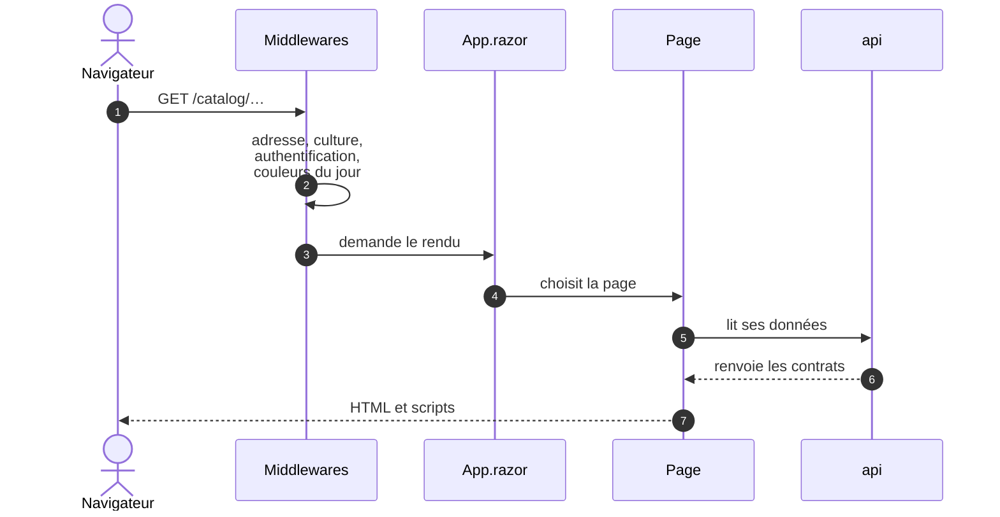
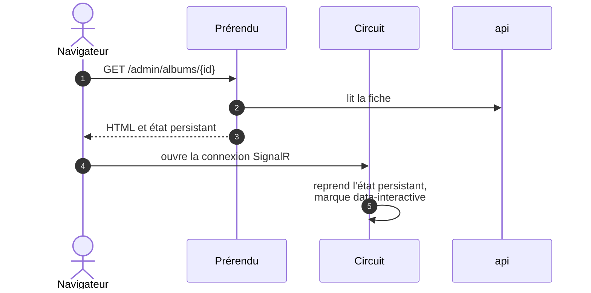
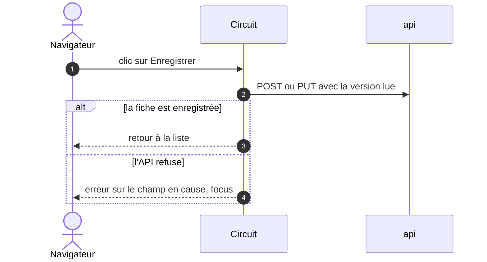

# Frontend : rendu des pages et fiches de saisie

`frontend` est une application Blazor rendue côté serveur. Chaque page est produite par le serveur et arrive entière dans le navigateur, sous forme de HTML ordinaire. Seuls quelques composants deviennent *interactifs* : ils réagissent alors aux actions de l'utilisateur grâce à un *circuit*, c'est-à-dire une connexion SignalR permanente entre le navigateur et le serveur, par laquelle le serveur reçoit les évènements et renvoie les modifications de la page. `frontend` ne lit ni n'écrit aucune donnée lui-même : tout passe par l'API ([Authentification et appels internes](authentification-et-appels-internes.md)).

Les raisons de ces choix sont exposées dans [Frontend](../../../.speckit/choix-implementation/socle/frontend.md). La visite, le thème, la culture et la mesure d'audience sont décrits dans une page à part, [Frontend : visite, thème, culture et mesure d'audience](frontend-visite-theme-et-culture.md).

## Le parcours d'une requête de page

Le schéma suivant, tracé à la main d'après le code, répond à une question : par quelles étapes passe la requête d'une page rendue en statique, depuis le navigateur jusqu'au HTML qu'il reçoit ?

La requête traverse d'abord la chaîne des *middlewares*, les traitements qu'ASP.NET Core applique à chaque requête dans l'ordre où [`Program.cs` du frontend](../../../src/Bdtheque.Frontend/Program.cs) les déclare :

1. L'adresse publique du reverse proxy remplace celle de la connexion, avant tout autre traitement, pour que tout ce qui suit voie l'adresse que voit le navigateur.
2. Hors développement, une page d'erreur prend en charge les exceptions non gérées.
3. La culture d'affichage est fixée par `UseRequestLocalization`.
4. Une réponse « introuvable » est réexécutée vers la page `/not-found`.
5. L'authentification et l'autorisation identifient l'administrateur et protègent les pages qui lui sont réservées.
6. La protection contre la falsification des requêtes (*antiforgery*) vérifie les formulaires envoyés en `POST`.
7. Les couleurs du jour sont lues avant le rendu par [`PageDayColors`](../../../src/Bdtheque.Frontend/Theming/PageDayColors.cs).
8. Viennent ensuite la sonde `/health`, les fichiers statiques, le relais des médias des visuels, et enfin le rendu des composants Razor.

La racine de toute page est [`App.razor`](../../../src/Bdtheque.Frontend/Components/App.razor). Lors de la première requête d'un navigateur, elle rend l'écran d'accueil au lieu de la page demandée ; ce cas est décrit avec la visite dans [Frontend : visite, thème, culture et mesure d'audience](frontend-visite-theme-et-culture.md). Sinon, elle rend le document. Sur l'élément `<html>`, elle pose le fuseau horaire transmis par le navigateur (`data-time-zone`), le thème de la visite (`data-theme`), l'opposition à la mesure d'audience (`data-audience`), les couleurs du jour (dans l'attribut `style`) et, quand le thème dépend de la date, l'attribut `data-local`. Elle charge la feuille de style commune de l'application, celle du thème de base, celle du thème de la visite et les styles isolés des composants, puis les scripts communs, ceux de tous les thèmes proposés, et enfin `blazor.web.js`, le script de Blazor.

[`Routes.razor`](../../../src/Bdtheque.Frontend/Components/Routes.razor) choisit le composant de la page d'après l'adresse. Les pages du dossier `Components/Pages/Admin/` sont toutes réservées à l'administrateur. Les chemins des pages ne sont jamais écrits en dur : ils viennent tous d'[`AppPaths`](../../../src/Bdtheque.Frontend/Navigation/AppPaths.cs).

### La navigation améliorée

Quand l'utilisateur suit un lien interne, le navigateur ne charge pas une nouvelle page de façon classique. `blazor.web.js` intercepte le clic, demande la page par `fetch` et ne remplace dans le document que ce qui a changé, y compris les attributs de `<html>` : c'est la *navigation améliorée* de Blazor. Elle évite de recharger les feuilles de style et les scripts, mais elle a une conséquence importante : les scripts déjà chargés restent en place, et les scripts de la nouvelle page ne s'exécutent pas. Chaque script de l'application doit donc se réappliquer lui-même après chaque navigation.

## Pages statiques et îlots interactifs

Une page est **statique par défaut** : le serveur la rend une fois, et elle ne réagit ensuite qu'aux liens et aux formulaires, comme une page web classique. C'est le cas de la consultation, des listes de l'administration, de l'accueil et de la connexion. Un formulaire d'une liste est soit un `GET`, pour la recherche et les filtres, soit un `POST` protégé, pour une suppression confirmée ou une saisie dans une ligne ou un panneau. Le `POST` redirige vers la liste en cas de succès, ou présente de nouveau la liste avec l'erreur. Les critères de recherche, les dialogues ouverts et les panneaux sont portés par l'adresse de la page, ce qui permet de les retrouver en rechargeant la page.

Lorsqu'un élément a vraiment besoin de réagir sans recharger la page, il devient un *îlot interactif* : un composant marqué `@rendermode="InteractiveServer"` à l'intérieur d'une page qui reste statique. C'est le cas du choix d'une fiche dans les filtres d'une liste ([`RecordPicker`](../../../src/Bdtheque.Frontend/Components/Controls/RecordPicker.razor)), des filtres liés entre eux, et du choix du parent d'un univers dans son panneau.

Les fiches de saisie d'un album, d'une série, d'un éditeur et d'une édition, dans `Components/Pages/Admin/`, sont au contraire des pages **entièrement interactives**, déclarées par la directive `@rendermode InteractiveServer`.

Un circuit n'a pas de requête HTTP, et donc pas de cookie. Les informations qu'une page statique lit dans les cookies doivent par conséquent lui être transmises autrement. Le fuseau horaire du navigateur et la visite de la mesure d'audience passent ainsi au circuit par l'*état persistant*, un mécanisme de Blazor qui sérialise des valeurs dans la page prérendue pour que le circuit les reprenne ; ces deux services sont enregistrés par `RegisterPersistentService`, dans `Program.cs`.

## Le fonctionnement d'une fiche de saisie

Une fiche de saisie passe par deux phases. Elle est d'abord *prérendue* : le serveur la rend en HTML statique, pour que l'utilisateur la voie immédiatement. Puis le navigateur ouvre le circuit, et la même fiche devient interactive.

Le schéma suivant, tracé à la main d'après le code, se limite à l'ouverture de la fiche et répond à la question : comment la fiche passe-t-elle de son prérendu au circuit sans relire ses données ?

Le prérendu lit la fiche une seule fois. Les propriétés du composant marquées `[PersistentState]`, à savoir la saisie en cours, la fiche telle qu'elle a été lue et le paramétrage, sont transmises au circuit dans la page, si bien que le circuit ne relit rien. [`AdminAlbumForm`](../../../src/Bdtheque.Frontend/Components/Pages/Admin/AdminAlbumForm.razor) en est un exemple complet.

Le schéma suivant, tracé à la main d'après le code, porte sur l'enregistrement et répond à la question : que se passe-t-il entre le clic sur « Enregistrer » et le retour à la liste ou l'affichage de l'erreur ?

Les éléments qui composent une fiche de saisie se répartissent ainsi :

- La saisie en cours est tenue par un type propre à chaque fiche, dans [`Entries/`](../../../src/Bdtheque.Frontend/Entries/), par exemple [`AlbumEntry`](../../../src/Bdtheque.Frontend/Entries/AlbumEntry.cs). Il contient les champs du contenu envoyé à l'API et les fiches que la saisie cite. Il calcule aussi son empreinte, qui indique si la fiche a été modifiée, et ce que présente « Voir mes changements ».
- Le cadre commun à toutes les fiches est [`EntryForm`](../../../src/Bdtheque.Frontend/Components/Controls/EntryForm.razor), qui porte le fil d'Ariane, le titre, l'erreur d'enregistrement, les blocs du formulaire et la barre d'enregistrement. Il marque la fiche `data-interactive` lorsqu'il est rendu par le circuit, ce qu'il sait par `RendererInfo.IsInteractive` ; tant que cet attribut est absent, la fiche prérendue est visible mais ne répond à rien. Le formulaire est désactivé pendant un enregistrement.
- Le frontend n'applique lui-même aucune règle de saisie. La clé de tri, les auteurs repris d'une série et la vérification d'un ISBN sont demandés à l'API pendant la saisie. Chaque demande est numérotée, et seule la réponse de la dernière est affichée, pour qu'une réponse lente ne remplace pas une réponse plus récente.
- L'enregistrement envoie ce qui a été saisi, accompagné de la version de la fiche lue à l'ouverture, ce qui permet à l'API de refuser l'écriture si la fiche a changé entre-temps. Un refus est présenté sur le champ en cause, comme le décrit [Erreurs, de la règle à leur présentation](erreurs.md).
- Une fiche créée sur place pendant la saisie, par exemple un nouvel auteur, est envoyée avec la fiche qui la cite, sous une clé que celle-ci lui donne. L'API la crée dans la même transaction que la fiche principale.

## Les scripts du navigateur

Les scripts de l'application sont courts, écrits à la main et sans dépendance. Chacun se réapplique après une navigation améliorée, et aucun n'insère de nœud dans une partie de page rendue par Blazor, qui ne saurait plus la mettre à jour. Ils se trouvent tous dans [`wwwroot/`](../../../src/Bdtheque.Frontend/wwwroot/).

| Script | Ce qu'il fait |
| --- | --- |
| `browser-time-zone.js` | Il enregistre le fuseau horaire du navigateur dans un cookie et fait rendre la page de nouveau si ce fuseau a changé. |
| `touch-screen.js` | Il enregistre dans un cookie que l'écran est tactile, ce qui sert à la mesure d'audience pour reconnaître un iPad. |
| `modal-dialog.js` | Il ouvre en mode modal tout élément `<dialog>` qui apparaît dans la page, et la touche Échap y suit le lien de fermeture. |
| `scroll-row.js` | Il gère les lignes qui défilent horizontalement, comme le menu ou la navigation par initiale : il affiche les chevrons et centre l'entrée courante. |
| `fold-row.js` | Il replie les noms d'un rôle selon la largeur disponible sur leur ligne. |
| `bibliography-folds.js` | Il fournit les boutons « Tout déplier » et « Tout replier » d'une bibliographie, sous la forme d'un élément HTML personnalisé. |
| `record-picker.js` | Ce module retient l'action des touches du clavier dans la liste ouverte d'un choix de fiche. |
| `entry-form.js` | Ce module met en vue le premier champ à corriger après un refus de l'API. |
| `themes/planche.js` | Il réalise le dessin propre au thème « La planche encrée ». |

## Tests

Les composants sont testés par bUnit, sans navigateur, dans [`Bdtheque.Frontend.Tests`](../../../tests/Bdtheque.Frontend.Tests/Bdtheque.Frontend.Tests.csproj), qui reprend un dossier par dossier du projet. Tout évènement y est déclenché sur le répartiteur du rendu, puis attendu jusqu'à la fin de son traitement. Les autres façons de déclencher un évènement sont interdites par le compilateur au moyen de [`BannedSymbols.txt`](../../../tests/Bdtheque.Frontend.Tests/BannedSymbols.txt), parce qu'elles laissent l'évènement sans l'attendre, ou cherchent l'élément hors du répartiteur, ce qui rend les tests instables.

Les tests de bout en bout, dans [`Bdtheque.EndToEnd.Tests`](../../../tests/Bdtheque.EndToEnd.Tests/Bdtheque.EndToEnd.Tests.csproj), pilotent un vrai navigateur Chromium par Playwright. Quatre éléments les organisent :

- [`ApplicationHost`](../../../tests/Bdtheque.EndToEnd.Tests/ApplicationHost.cs) héberge l'application entière, avec `frontend` sur un vrai port et `api` sur sa base de données, à une heure fixe.
- [`BrowserTest`](../../../tests/Bdtheque.EndToEnd.Tests/BrowserTest.cs) ouvre et ferme les contextes du navigateur.
- [`PageReadiness`](../../../tests/Bdtheque.EndToEnd.Tests/PageReadiness.cs) juge qu'une page est prête d'après son propre état, plutôt qu'après un délai.
- [`TestThemes`](../../../tests/Bdtheque.EndToEnd.Tests/TestThemes.cs) fait exécuter chaque test dans chacun des thèmes proposés.

Les captures de référence vérifient le rendu des écrans. Chaque écran a son test dans [`Captures/`](../../../tests/Bdtheque.EndToEnd.Tests/Captures/), qui compare pixel par pixel la page obtenue aux images de `Captures/References/<thème>/`. Ces comparaisons ne s'exécutent que sous Linux ; en local, elles se lancent par [`Test-Captures.ps1`](../../../scripts/Test-Captures.ps1).

## Invariants à préserver

- Une page reste statique, sauf pour ce qui a réellement besoin d'interactivité, car chaque composant interactif ajouté coûte une connexion permanente par visiteur.
- Une page qui écrit un cookie, comme la connexion, la déconnexion ou le choix de l'opposition à la mesure d'audience, reste rendue en statique, puisqu'un circuit ne peut pas écrire de cookie.
- Un script ne porte ni règle métier ni donnée de l'application, et n'insère aucun nœud dans une partie de page rendue par Blazor.
- Aucun texte destiné à l'utilisateur n'est écrit dans le code : il vient toujours des ressources de son composant.
