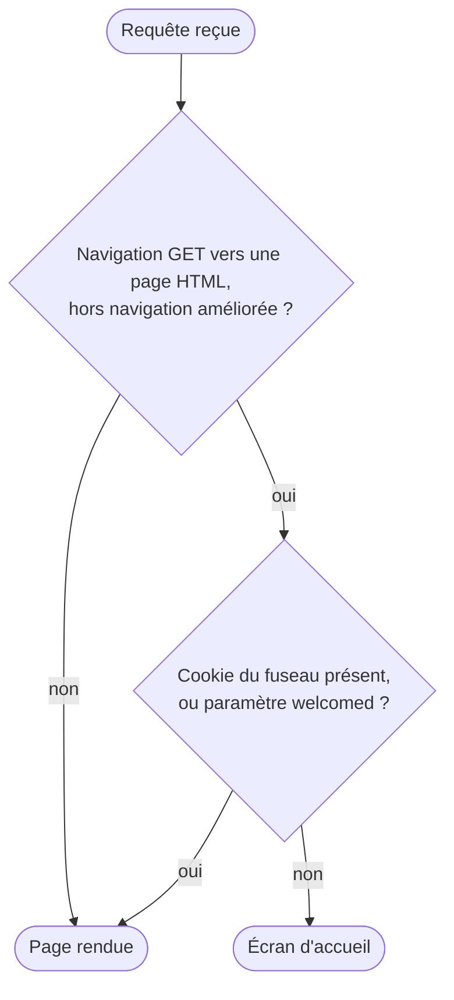
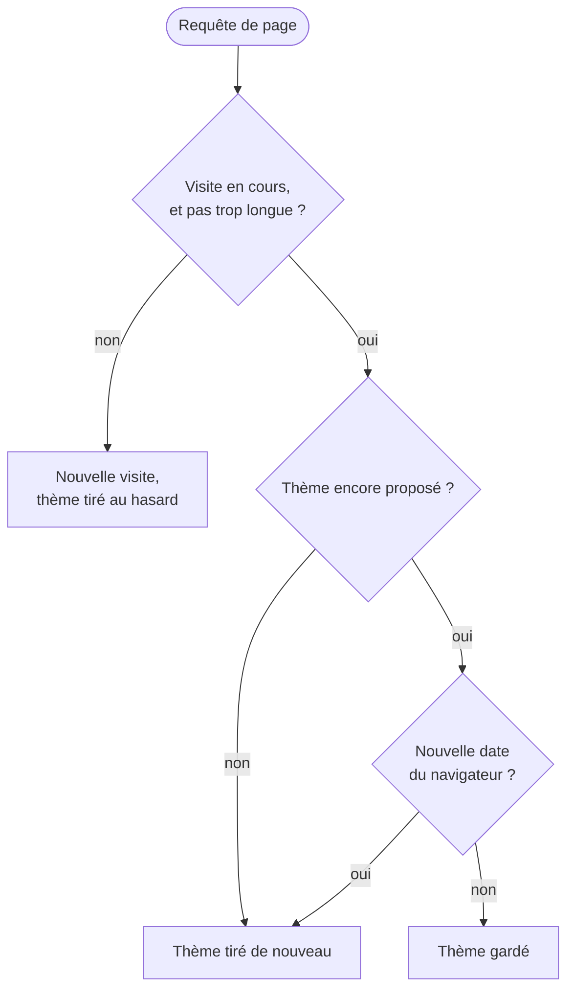

# Frontend : visite, thème, culture et mesure d'audience

Certaines décisions de `frontend` ne dépendent pas des données de la collection, mais du navigateur qui affiche la page : son fuseau horaire, et donc la date du jour chez l'utilisateur, la visite en cours, le thème tiré pour cette visite, et ce que la mesure d'audience relève. Comme les pages sont rendues par le serveur, tout ce que seul le navigateur sait doit parvenir au serveur par des cookies, que des scripts écrivent.

Les raisons et les règles de ces mécanismes sont exposées dans [Internationalisation](../../../.speckit/choix-implementation/socle/transverse/internationalisation.md), [Thèmes](../../../.speckit/choix-implementation/socle/themes.md) et [Relevé par le frontend](../../../.speckit/choix-implementation/mesure-audience/releve-par-le-frontend.md). Le rendu des pages lui-même est décrit dans [Frontend : rendu des pages et fiches de saisie](frontend-rendu-et-saisie.md).

## L'écran d'accueil de la première requête

Lors de sa toute première requête, le navigateur n'a encore transmis ni son fuseau horaire ni la présence d'un écran tactile. Sans fuseau, le serveur ne connaît pas la date du jour de l'utilisateur, et il ne peut donc ni présenter correctement les dates ni tirer le thème du jour. Pour éviter de rendre une première page incomplète, l'application répond à cette requête par un court écran d'accueil, dont le script écrit les cookies manquants puis recharge l'adresse demandée.

Le schéma suivant, tracé à la main d'après le code, répond à une seule question : quand une requête reçoit-elle l'écran d'accueil plutôt que sa page ?

C'est [`BrowserWelcome`](../../../src/Bdtheque.Frontend/Visits/BrowserWelcome.cs) qui prend cette décision. Une navigation améliorée ou l'envoi d'un formulaire ne reçoivent jamais l'écran, puisqu'ils viennent d'une page déjà affichée, dont les scripts ont déjà écrit les cookies. L'écran lui-même, [`WelcomeScreen`](../../../src/Bdtheque.Frontend/Components/WelcomeScreen.razor), est autonome : ses styles, son dessin et son script sont écrits en ligne dans la page. Son script enregistre le fuseau horaire et l'écran tactile, puis recharge l'adresse. Si le navigateur refuse les cookies ou n'exécute pas de script, l'écran renvoie à la même adresse marquée du paramètre `welcomed`, et la page est alors rendue telle quelle, pour que l'utilisateur ne retombe pas indéfiniment sur l'écran d'accueil.

## Les cookies du navigateur

Quatre cookies portent ce que l'application retient d'un navigateur.

| Cookie | Qui l'écrit | Ce qu'il contient et combien de temps il dure |
| --- | --- | --- |
| `Bdtheque.TimeZone` | `browser-time-zone.js` et l'écran d'accueil | Le fuseau horaire IANA du navigateur, conservé un an. |
| `Bdtheque.TouchScreen` | `touch-screen.js` et l'écran d'accueil | L'indication que l'écran est tactile, utile à la mesure d'audience. |
| `Bdtheque.Visit` | [`VisitCookie`](../../../src/Bdtheque.Frontend/Visits/VisitCookie.cs) | La visite en cours : son début, son thème, la date de ce thème et la visite de la mesure d'audience. C'est un cookie de session, qui ne dure pas plus de 13 mois. |
| `Bdtheque.AudienceOpposition` | [`AudienceOpposition`](../../../src/Bdtheque.Frontend/Audience/AudienceOpposition.cs) | L'opposition du visiteur à la mesure d'audience, conservée un an. |

## La visite et son thème

Une *visite* est la suite des pages qu'un navigateur affiche pendant une session. Elle est représentée par [`BrowserVisit`](../../../src/Bdtheque.Frontend/Visits/BrowserVisit.cs), lue dans le cookie de session à chaque requête et réécrite au plus une fois par réponse, seulement si elle a changé. Le thème et la mesure d'audience partagent cette même visite.

Le *thème de la visite* est l'habillage graphique tiré au hasard pour cette visite, parmi les thèmes proposés. Le schéma suivant, tracé à la main d'après le code, répond à la question : à chaque requête de page, le thème de la visite est-il gardé ou tiré de nouveau ?

Cette règle est appliquée par [`VisitTheme.Continue`](../../../src/Bdtheque.Frontend/Theming/VisitTheme.cs). Une visite dont la date est inconnue, parce que le fuseau horaire n'a pas été transmis, adopte la première date donnée ensuite sans tirer de nouveau son thème. Lorsque la visite a changé, son cookie est réécrit avec la réponse.

## Les thèmes

Les thèmes proposés sont déclarés par [`ThemeCatalog`](../../../src/Bdtheque.Frontend/Theming/ThemeCatalog.cs) : `planche`, `gazette` et `couverture`. Chacun y est décrit par sa feuille de style, son script éventuel et la police de texte que la page charge en avance. Le thème de base n'en fait pas partie : il n'est jamais présenté seul, et ne fait que donner ses contrats à chaque thème proposé (ci-dessous). Une visite dont le cookie porte encore le thème `base`, commencée par une version antérieure, reçoit donc un thème tiré de nouveau, comme toute visite dont le thème n'est plus proposé.

Le thème d'une requête est choisi par un service `IThemeSelector`, dont il existe trois mises en œuvre selon le contexte :

- Dans l'application, [`VisitThemeSelector`](../../../src/Bdtheque.Frontend/Theming/IThemeSelector.cs) retient le thème de la visite.
- Dans l'environnement de validation seulement, [`ChosenThemeSelector`](../../../src/Bdtheque.Frontend/Theming/ChosenThemeSelector.cs) permet de choisir le thème par le paramètre `?theme=` de l'adresse.
- Dans les tests de bout en bout, [`RequestThemeSelector`](../../../tests/Bdtheque.EndToEnd.Tests/RequestThemeSelector.cs) impose le thème par l'en-tête `X-Test-Theme`.

Les thèmes reposent sur des *contrats CSS*. La feuille [`themes/base.css`](../../../src/Bdtheque.Frontend/wwwroot/themes/base.css) déclare les propriétés personnalisées CSS, c'est-à-dire les variables de la forme `--nom`, que lisent les composants. Chaque thème se contente de redéfinir ces propriétés sous le sélecteur `[data-theme="…"]`, dans sa propre feuille de [`wwwroot/themes/`](../../../src/Bdtheque.Frontend/wwwroot/themes/). Ainsi, un composant n'a jamais à connaître les thèmes. Les styles propres à un composant sont isolés dans son fichier `.razor.css`.

Un thème peut avoir un script. Chaque page charge les scripts de tous les thèmes, mais chacun n'agit que lorsque son thème est actif. Un tel script dessine en SVG et pose son dessin dans une propriété personnalisée, sans insérer de nœud dans la page ; [`planche.js`](../../../src/Bdtheque.Frontend/wwwroot/themes/planche.js) en est l'exemple.

Le thème « La couverture du jour » colore la page avec les *couleurs du jour*, tirées de la couverture de l'édition mise à la une ce jour-là. [`SpotlightDayColors`](../../../src/Bdtheque.Frontend/Theming/DayColors.cs) les demande à l'API pour la date du navigateur, par `/catalog/spotlight/colors`. [`DayPalette`](../../../src/Bdtheque.Frontend/Theming/DayPalette.cs) en dérive les couleurs de la page, en respectant les contrastes attendus. Enfin, [`PageDayColors`](../../../src/Bdtheque.Frontend/Theming/PageDayColors.cs), qu'un middleware lit avant le rendu, les pose sur `<html>` sous la forme de propriétés `--day-…`. Si ces couleurs manquent, le thème garde ses propres couleurs : leur absence ne fait jamais échouer une page.

Les polices sont servies par l'application elle-même, au format WOFF2, depuis [`wwwroot/fonts/`](../../../src/Bdtheque.Frontend/wwwroot/fonts/).

## Culture, fuseau horaire et formatage

La culture d'affichage est fixée au français de France par [`DisplayCulture`](../../../src/Bdtheque.Frontend/Formatting/DisplayCulture.cs). C'est la seule culture que connaît `UseRequestLocalization`, configuré sans fournisseur de culture : la langue que demande le navigateur n'est donc jamais prise en compte. Les textes de l'interface sont dans des fichiers de ressources `.resx` placés à côté de chaque composant, et lus par `IStringLocalizer`.

Le fuseau horaire est porté par [`BrowserTimeZone`](../../../src/Bdtheque.Frontend/Formatting/BrowserTimeZone.cs). Il est lu dans le cookie de la requête, ou dans l'état persistant lorsque le composant s'exécute dans un circuit, qui n'a pas de cookie. En l'absence de fuseau, les dates sont présentées en temps universel et la date du jour du navigateur reste inconnue. Une page dont le contenu dépend du fuseau porte l'attribut `data-local`, et `browser-time-zone.js` la recharge si sa requête n'a pas transmis le fuseau courant du navigateur.

La présentation des valeurs est confiée à quelques classes, dans `Formatting/` :

- [`DisplayFormatter`](../../../src/Bdtheque.Frontend/Formatting/DisplayFormatter.cs) présente les dates, les nombres et les montants dans la culture et le fuseau de la requête. Un montant y prend les décimales de sa devise, que donne [`CurrencyDecimals`](../../../src/Bdtheque.Currencies/CurrencyDecimals.cs) d'après l'ISO 4217 : aucune pour le yen, trois pour le dinar koweïtien, deux pour l'euro et pour toute devise que la table ne connaît pas.
- [`RecordLabels`](../../../src/Bdtheque.Frontend/Formatting/RecordLabels.cs) produit les libellés des fiches.
- [`ValueLabels`](../../../src/Bdtheque.Frontend/Formatting/ValueLabels.cs) donne le libellé des valeurs des énumérations.
- [`IsbnFormatter`](../../../src/Bdtheque.Frontend/Formatting/IsbnFormatter.cs) place les tirets d'un ISBN d'après les plages publiées par l'Agence internationale de l'ISBN, que [`IsbnRangesRefresher`](../../../src/Bdtheque.Frontend/Formatting/IsbnRangesRefresher.cs) télécharge chaque jour.

## Le relevé de la mesure d'audience

La mesure d'audience enregistre les écrans affichés et les actions effectuées, par l'intermédiaire de l'API.

Un écran est relevé par le composant [`AudienceScreen`](../../../src/Bdtheque.Frontend/Components/Audience/AudienceScreen.razor), placé dans la page, au moment de la requête `GET` qui la rend. Il ne l'est donc qu'une fois par affichage : le rendu interactif qui suit le prérendu d'une page ne le relève pas une seconde fois.

Une action est relevée par la méthode `RecordActionAsync` d'[`AudienceRecorder`](../../../src/Bdtheque.Frontend/Audience/AudienceRecorder.cs). Dans une page interactive, elle est rattachée à la visite que le prérendu a relevée, transmise au circuit par [`CircuitAudienceVisit`](../../../src/Bdtheque.Frontend/Audience/CircuitAudienceVisit.cs), et le circuit n'ouvre jamais de visite lui-même. Dans une liste statique, les actions sont déduites de l'adresse de la page. Chaque fonction suivie est désignée par une clé stable, déclarée dans [`AudienceFunction`](../../../src/Bdtheque.Frontend/Audience/AudienceFunction.cs). Le type d'appareil et le moteur du navigateur sont déterminés par [`AudienceDevice`](../../../src/Bdtheque.Frontend/Audience/AudienceDevice.cs), d'après l'agent utilisateur et le cookie de l'écran tactile.

La mesure d'audience ne doit jamais gêner l'utilisateur. Une utilisation que l'API n'enregistre pas est journalisée en avertissement, sans faire échouer la page. Lorsqu'un visiteur s'oppose à la mesure, plus rien n'est relevé et toute trace de la mesure est supprimée du navigateur ; sa visite continue néanmoins, puisqu'elle porte aussi son thème.

## Les indicateurs dans l'administration

Les statistiques privées de l'administration, la page [`AdminStatistics`](../../../src/Bdtheque.Frontend/Components/Pages/Admin/AdminStatistics.razor), présentent les indicateurs de chaque fonction suivie. C'est une page statique, dont les critères sont portés par l'adresse, comme ceux d'une liste : une période, comptée en mois jusqu'au mois en cours, et le genre d'utilisateur, le type d'appareil et le moteur de rendu dont les visites sont comptées. [`AudienceIndicatorsQuery`](../../../src/Bdtheque.Frontend/Audience/AudienceIndicatorsQuery.cs) lit ces critères dans l'adresse et en déduit la lecture des indicateurs de l'API. La page reprend la recherche, le panneau des filtres et leurs étiquettes des listes de l'administration : la recherche porte sur le nom de la fonction, et le filtre par écran garde un écran et ses actions, qu'il reconnaît à leur nom (`AudienceFunctionNames.ScreenOf`). Ni l'une ni l'autre ne changent ce que lit l'API, dont la page ne retient que les lignes qu'ils désignent. La page ne relève rien pour la mesure, ni son affichage, ni ses critères, ni ses pages : la mesure ne se mesure pas elle-même. Le mois en cours est celui de l'horloge de l'application en temps universel, puisque l'API compte chaque visite au mois de son début dans ce temps.

L'API ne connaît que les fonctions utilisées. La page part donc de la liste des fonctions suivies, `AudienceFunctions.Followed`, et présente sans indicateur celles que l'API ne cite pas : elles n'ont jamais été utilisées sur la période et pour les visites choisies. Elle présente aussi une fonction que l'API cite sans qu'elle soit encore suivie, sous sa clé, ses utilisations restant comptées. Chaque fonction est nommée par [`AudienceFunctionNames`](../../../src/Bdtheque.Frontend/Audience/AudienceFunctionNames.cs), dont les textes sont rangés sous la clé de la fonction ; un test exige un nom pour chaque fonction suivie. La fréquence d'une fonction est dessinée par une barre par mois de la période, dont la hauteur rapporte ses utilisations du mois à celles du mois le plus chargé de la page, toutes fonctions confondues, pour que deux lignes se comparent. Une page ne présente que vingt fonctions, et donc autant de graphiques ; les suivantes, rangées de même, sont sur les pages suivantes, que l'adresse désigne avec les mêmes critères.

## Tests

Les règles sont vérifiées par des tests unitaires et des tests bUnit, rangés dans les dossiers [`Theming/`](../../../tests/Bdtheque.Frontend.Tests/Theming/), [`Visits/`](../../../tests/Bdtheque.Frontend.Tests/Visits/), [`Audience/`](../../../tests/Bdtheque.Frontend.Tests/Audience/) et [`Formatting/`](../../../tests/Bdtheque.Frontend.Tests/Formatting/) de `Bdtheque.Frontend.Tests`.

Le comportement dans un vrai navigateur est vérifié par [`WelcomeScreenTests`](../../../tests/Bdtheque.EndToEnd.Tests/WelcomeScreenTests.cs), [`BrowserTimeZoneTests`](../../../tests/Bdtheque.EndToEnd.Tests/BrowserTimeZoneTests.cs), [`ThemeTests`](../../../tests/Bdtheque.EndToEnd.Tests/ThemeTests.cs), [`AudienceTests`](../../../tests/Bdtheque.EndToEnd.Tests/AudienceTests.cs), [`AdminStatisticsTests`](../../../tests/Bdtheque.EndToEnd.Tests/AdminStatisticsTests.cs), qui lit les indicateurs d'une application dont la base porte ses propres visites, dans un navigateur qui s'oppose à la mesure pour que ses propres pages ne les changent pas, et [`LocalizationTests`](../../../tests/Bdtheque.EndToEnd.Tests/LocalizationTests.cs). Ce qui est propre à un thème, comme les contrastes, les couleurs du jour ou les scripts, est vérifié dans le dossier [`Theming/`](../../../tests/Bdtheque.EndToEnd.Tests/Theming/).

## Invariants à préserver

- L'application de production n'impose jamais le thème : seuls l'environnement de validation et les tests peuvent le choisir.
- Un composant ne lit que les contrats du thème de base ; si ces contrats ne couvrent pas un besoin, c'est `base.css` qui évolue.
- La date du jour du navigateur n'est jamais devinée : sans fuseau horaire, rien n'est décidé ni écrit pour une date.
- La mesure d'audience ne fait jamais échouer une page, et rien n'est relevé ni écrit pour un visiteur qui s'y oppose.
