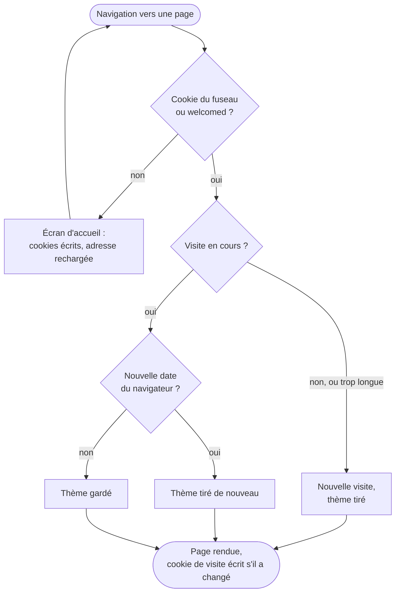

# Frontend : visite, thème, culture et mesure d'audience

Ce qui, dans `frontend`, dépend du navigateur plutôt que des données : son fuseau horaire, sa visite, le thème qu'elle tire, ce que la mesure d'audience en relève. Le serveur rendant les pages, tout ce que seul le navigateur sait lui parvient par des cookies. Raisons et règles : [Internationalisation](../../../.speckit/choix-implementation/socle/transverse/internationalisation.md), [Thèmes](../../../.speckit/choix-implementation/socle/themes.md), [Relevé par le frontend](../../../.speckit/choix-implementation/mesure-audience/releve-par-le-frontend.md). Le rendu des pages lui-même est décrit dans [Frontend : rendu des pages et fiches de saisie](frontend-rendu-et-saisie.md).

## Première requête et visite

Question du schéma : *qu'est-ce qui décide, à chaque requête de page, de l'écran d'accueil, de la visite et de son thème ?* Schéma interprétatif.

- **Écran d'accueil** : [`BrowserWelcome`](../../../src/Bdtheque.Frontend/Visits/BrowserWelcome.cs) le décide pour une navigation `GET` vers une page HTML, sans le cookie du fuseau ni le paramètre `welcomed`, jamais pour une navigation améliorée ni un formulaire. [`WelcomeScreen`](../../../src/Bdtheque.Frontend/Components/WelcomeScreen.razor), autonome (styles, dessin et script en ligne), écrit le fuseau et l'écran tactile, puis recharge l'adresse ; sans cookie ni script, il renvoie à l'adresse marquée `welcomed`, où la page est rendue telle quelle.
- **Cookies du navigateur** :

| Cookie | Écrit par | Contenu, durée |
| --- | --- | --- |
| `Bdtheque.TimeZone` | `browser-time-zone.js`, écran d'accueil | Fuseau IANA du navigateur, un an. |
| `Bdtheque.TouchScreen` | `touch-screen.js`, écran d'accueil | Écran tactile, pour la mesure d'audience. |
| `Bdtheque.Visit` | [`VisitCookie`](../../../src/Bdtheque.Frontend/Visits/VisitCookie.cs) | Visite : début, thème, date du thème, visite de la mesure ; cookie de session, au plus 13 mois. |
| `Bdtheque.AudienceOpposition` | [`AudienceOpposition`](../../../src/Bdtheque.Frontend/Audience/AudienceOpposition.cs) | Opposition à la mesure, un an. |

- **Visite** : [`BrowserVisit`](../../../src/Bdtheque.Frontend/Visits/BrowserVisit.cs), lue du cookie de session et réécrite une fois par réponse, seulement si elle a changé. Thème et mesure d'audience la partagent.
- **Thème de la visite** : [`VisitTheme.Continue`](../../../src/Bdtheque.Frontend/Theming/VisitTheme.cs) tire le thème au début d'une visite, puis à chaque nouvelle date du navigateur, ou si le thème n'est plus proposé. Une visite sans date (fuseau inconnu) prend la première date donnée ensuite, sans nouveau tirage.

## Thèmes

- **Catalogue** : [`ThemeCatalog`](../../../src/Bdtheque.Frontend/Theming/ThemeCatalog.cs) déclare les thèmes proposés (`base`, `planche`, `gazette`, `couverture`), chacun avec sa feuille, son script éventuel et la police de texte que la page précharge.
- **Choix du thème d'une requête** (`IThemeSelector`) : [`VisitThemeSelector`](../../../src/Bdtheque.Frontend/Theming/IThemeSelector.cs) dans l'application ; [`ChosenThemeSelector`](../../../src/Bdtheque.Frontend/Theming/ChosenThemeSelector.cs), par le paramètre `?theme=`, dans l'environnement de validation seulement ; [`RequestThemeSelector`](../../../tests/Bdtheque.EndToEnd.Tests/RequestThemeSelector.cs), par l'en-tête `X-Test-Theme`, dans les tests de bout en bout.
- **Contrats CSS** : [`themes/base.css`](../../../src/Bdtheque.Frontend/wwwroot/themes/base.css) déclare les propriétés personnalisées que lisent les composants ; chaque thème ne redéfinit que celles-ci, sous `[data-theme="…"]`, dans sa feuille de [`wwwroot/themes/`](../../../src/Bdtheque.Frontend/wwwroot/themes/). Les styles d'un composant sont isolés dans son `.razor.css`.
- **Script d'un thème** : chaque page charge ceux de tous les thèmes, chacun n'agissant que sous son thème ; il dessine en SVG posé dans une propriété personnalisée, sans insérer de nœud (ex. [`planche.js`](../../../src/Bdtheque.Frontend/wwwroot/themes/planche.js)).
- **Couleurs du jour** du thème « La couverture du jour » : [`SpotlightDayColors`](../../../src/Bdtheque.Frontend/Theming/DayColors.cs) les lit à l'API pour la date du navigateur (`/catalog/spotlight/colors`). [`DayPalette`](../../../src/Bdtheque.Frontend/Theming/DayPalette.cs) en dérive les couleurs de la page, au contraste attendu. [`PageDayColors`](../../../src/Bdtheque.Frontend/Theming/PageDayColors.cs), lu par un middleware avant le rendu, les pose en propriétés `--day-…` sur `<html>`. Sans elles, le thème garde ses propres couleurs ; leur absence ne fait jamais échouer une page.
- **Polices** : servies par l'application, en WOFF2, sous [`wwwroot/fonts/`](../../../src/Bdtheque.Frontend/wwwroot/fonts/).

## Culture, fuseau et formatage

- **Culture fixée** : français de France ([`DisplayCulture`](../../../src/Bdtheque.Frontend/Formatting/DisplayCulture.cs)), seule culture prise en charge par `UseRequestLocalization`, sans fournisseur : jamais la langue que demande le navigateur.
- **Textes** : en ressources `.resx` à côté de chaque composant, lues par `IStringLocalizer`.
- **Fuseau** : [`BrowserTimeZone`](../../../src/Bdtheque.Frontend/Formatting/BrowserTimeZone.cs), tiré du cookie de la requête, ou de l'état persistant dans un circuit. Sans lui, les dates sont présentées en temps universel, et la date du jour du navigateur est inconnue. Une page qui en dépend porte `data-local`, et `browser-time-zone.js` la recharge si sa requête n'a pas transmis le fuseau courant.
- **Formatage** : [`DisplayFormatter`](../../../src/Bdtheque.Frontend/Formatting/DisplayFormatter.cs) pour les dates, nombres et montants dans la culture et le fuseau ; [`RecordLabels`](../../../src/Bdtheque.Frontend/Formatting/RecordLabels.cs) pour les libellés des fiches ; [`ValueLabels`](../../../src/Bdtheque.Frontend/Formatting/ValueLabels.cs) pour les valeurs des énumérations ; [`IsbnFormatter`](../../../src/Bdtheque.Frontend/Formatting/IsbnFormatter.cs) avec les plages de l'Agence internationale de l'ISBN, téléchargées chaque jour par [`IsbnRangesRefresher`](../../../src/Bdtheque.Frontend/Formatting/IsbnRangesRefresher.cs).

## Mesure d'audience

- **Écran** : relevé par le composant [`AudienceScreen`](../../../src/Bdtheque.Frontend/Components/Audience/AudienceScreen.razor), placé dans la page, lors de la requête `GET` qui la rend : une seule fois par affichage, jamais par le rendu interactif qui suit un prérendu.
- **Action** : relevée par [`AudienceRecorder`](../../../src/Bdtheque.Frontend/Audience/AudienceRecorder.cs) (`RecordActionAsync`). Dans une page interactive, elle l'est dans la visite que le prérendu a relevée ([`CircuitAudienceVisit`](../../../src/Bdtheque.Frontend/Audience/CircuitAudienceVisit.cs)), et le circuit n'en ouvre jamais. Les actions d'une liste statique sont déduites de son adresse.
- **Fonctions** : sous une clé stable ([`AudienceFunction`](../../../src/Bdtheque.Frontend/Audience/AudienceFunction.cs)).
- **Appareil et moteur** : [`AudienceDevice`](../../../src/Bdtheque.Frontend/Audience/AudienceDevice.cs) les lit dans l'agent utilisateur et le cookie de l'écran tactile.
- **Sans échec** : une utilisation que l'API n'enregistre pas est journalisée en avertissement, sans faire échouer la page. Une opposition supprime tout relevé et toute trace de la mesure dans le navigateur ; la visite continue pour son thème.

## Tests

- **Règles, en bUnit et en tests unitaires** : dossiers [`Theming/`](../../../tests/Bdtheque.Frontend.Tests/Theming/), [`Visits/`](../../../tests/Bdtheque.Frontend.Tests/Visits/), [`Audience/`](../../../tests/Bdtheque.Frontend.Tests/Audience/) et [`Formatting/`](../../../tests/Bdtheque.Frontend.Tests/Formatting/) de `Bdtheque.Frontend.Tests`.
- **Dans le navigateur** : [`WelcomeScreenTests`](../../../tests/Bdtheque.EndToEnd.Tests/WelcomeScreenTests.cs), [`BrowserTimeZoneTests`](../../../tests/Bdtheque.EndToEnd.Tests/BrowserTimeZoneTests.cs), [`ThemeTests`](../../../tests/Bdtheque.EndToEnd.Tests/ThemeTests.cs), [`AudienceTests`](../../../tests/Bdtheque.EndToEnd.Tests/AudienceTests.cs), [`LocalizationTests`](../../../tests/Bdtheque.EndToEnd.Tests/LocalizationTests.cs), et le dossier [`Theming/`](../../../tests/Bdtheque.EndToEnd.Tests/Theming/) pour ce qui est propre à un thème (contrastes, couleurs du jour, scripts).

## Invariants à préserver

- Le thème n'est jamais imposé par l'application de production : seuls l'environnement de validation et les tests le choisissent.
- Un composant ne lit que les contrats du thème de base ; un besoin qu'ils ne couvrent pas les fait évoluer dans `base.css`.
- La date du jour du navigateur n'est jamais devinée : sans fuseau, rien n'est décidé ni écrit pour une date.
- La mesure d'audience ne fait jamais échouer une page, et rien n'est relevé ni écrit pour un visiteur qui s'y oppose.
