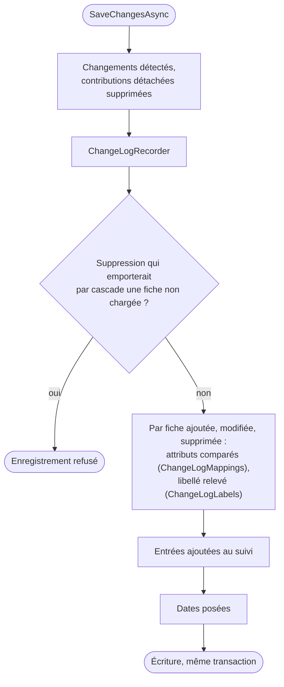

# Journal des modifications

Chaque écriture sur une fiche ajoute, dans le même enregistrement, une entrée au journal : la fiche, son libellé, l'opération et, pour une modification, chaque attribut changé avec sa valeur avant et après. Aucun endpoint ni aucune opération du domaine n'y pense : l'enregistrement du contexte le fait. Raisons et règles : [Journal des modifications : mise en œuvre](../../../.speckit/choix-implementation/domaine/journal-des-modifications-mise-en-oeuvre.md), [Entrée du journal des modifications](../../../.speckit/modele-metier/entree-du-journal-des-modifications.md).

## Capture à l'enregistrement

Question du schéma : *comment un enregistrement produit-il ses entrées du journal ?* Schéma interprétatif.

- **Point de passage** : `SaveChangesAsync` de [`BdthequeDbContext`](../../../src/Bdtheque.Infrastructure/BdthequeDbContext.cs) appelle [`ChangeLogRecorder`](../../../src/Bdtheque.Infrastructure/ChangeLogRecorder.cs) avant de poser les dates, si bien que les entrées sont datées comme toute entité ([Persistance : écriture d'un agrégat](persistance-ecriture-d-un-agregat.md)). Un enregistrement synchrone lève une exception : le libellé d'une fiche que l'enregistrement ne suit pas se lit en base, de façon asynchrone.
- **Modification déduite des valeurs** : une fiche modifiée ne reçoit une entrée que si l'un de ses attributs change de valeur. La racine d'un agrégat, marquée modifiée à toute écriture, n'en reçoit donc pas pour rien.
- **Éléments portés** : un genre, un univers, une contribution ou un visuel ajouté, retiré ou réarrangé est un changement de la fiche qui le porte.
- **Suppressions** : chaque fiche supprimée, y compris avec une autre, reçoit son entrée ; elle doit donc être chargée. Le recorder refuse un enregistrement qui supprimerait par cascade, dans la base, une fiche que le suivi ne voit pas.

## Correspondance des attributs

- **Une correspondance par type de fiche** : [`ChangeLogMappings`](../../../src/Bdtheque.Infrastructure/ChangeLogMappings.cs) déclare, pour chaque type, les attributs que forment ses propriétés (un attribut peut en réunir plusieurs, ex. un montant et sa devise) et les propriétés écartées délibérément (valeurs dérivées ou posées automatiquement). Une valeur qui désigne une autre fiche (la série d'un album) est enregistrée par le libellé de cette fiche.
- **Énumérations** : [`ChangeLogEnumerations`](../../../src/Bdtheque.Infrastructure/ChangeLogEnumerations.cs) dit, pour chaque attribut dont les valeurs sont les membres d'une énumération, laquelle, pour que le lecteur les nomme.
- **Libellés** : [`ChangeLogLabels`](../../../src/Bdtheque.Infrastructure/ChangeLogLabels.cs) relève les composantes du libellé de chaque fiche ([`RecordLabel`](../../../src/Bdtheque.Domain/Entities/RecordLabel.cs)) telle que l'écriture la laisse, ou telle qu'elle était pour une suppression.
- **Des données, jamais des textes** : type de fiche, opération, attribut, valeurs et libellé sont enregistrés par leurs composantes ; le frontend construit le message dans la culture d'affichage, à la lecture.

## Stockage et lecture

- **Table `ChangeLogEntries`** ([`ChangeLogEntryConfiguration`](../../../src/Bdtheque.Infrastructure/Configurations/ChangeLogEntryConfiguration.cs)) : libellé et changements en colonnes `jsonb`, sans clé étrangère vers la fiche, qui peut disparaître. [`ChangeLogJson`](../../../src/Bdtheque.Infrastructure/ChangeLogJson.cs) en fixe la forme ; le journal n'étant jamais purgé, discriminants et noms de propriétés ne sont jamais renommés.
- **Lecture** ([`ChangeLogEndpoints`](../../../src/Bdtheque.Api/Endpoints/ChangeLogEndpoints.cs), administration seule) : `GET /admin/change-log` lit les entrées ; `GET /admin/change-log/latest-records` donne les dernières fiches écrites, chacune une fois par sa dernière entrée, sans les fiches supprimées, avec le parent des fiches qui n'ont de page que sous lui (édition, intention d'achat, collection). L'accueil de l'administration en présente le bloc « Dernières modifications » ([`AdminHome`](../../../src/Bdtheque.Frontend/Components/Pages/Admin/AdminHome.razor)).

## Tests

- **Capture** : [`ChangeLogTests`](../../../tests/Bdtheque.Infrastructure.Tests/ChangeLogTests.cs).
- **Toute propriété classée** : [`ChangeLogMappingTests`](../../../tests/Bdtheque.Infrastructure.Tests/ChangeLogMappingTests.cs) échoue pour une propriété ajoutée à une fiche sans être enregistrée ni écartée.
- **Forme JSON figée** : [`ChangeLogJsonTests`](../../../tests/Bdtheque.Infrastructure.Tests/ChangeLogJsonTests.cs).
- **Domaine et lecture** : [`ChangeLogEntryTests`](../../../tests/Bdtheque.Domain.Tests/ChangeLogEntryTests.cs), [`ChangeLogEndpointsTests`](../../../tests/Bdtheque.Api.Tests/ChangeLogEndpointsTests.cs).

## Invariants à préserver

- Une fiche ajoutée au modèle reçoit sa correspondance et son libellé ; une propriété ajoutée est enregistrée ou écartée explicitement.
- Aucune écriture sur une fiche ne contourne `SaveChangesAsync`.
- La forme JSON des entrées ne change jamais de façon incompatible avec celles déjà écrites.
