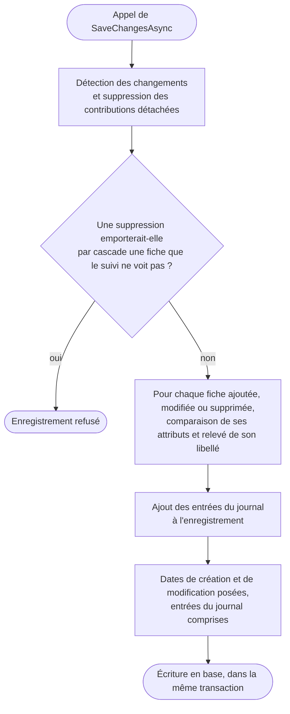

# Journal des modifications

Le **journal des modifications** garde la trace de chaque écriture sur une fiche : quelle fiche a été créée, modifiée ou supprimée, sous quel libellé, et, pour une modification, quels attributs ont changé, avec leur valeur avant et après. Une entrée est ajoutée au journal dans le même enregistrement que l'écriture qu'elle décrit, donc dans la même transaction : l'une n'existe jamais sans l'autre. Aucun endpoint ni aucune opération du domaine n'a à y penser, car c'est l'enregistrement du contexte EF Core qui produit les entrées. Les raisons de cette conception sont dans [Journal des modifications : mise en œuvre](../../../.speckit/choix-implementation/domaine/journal-des-modifications-mise-en-oeuvre.md), et les attributs d'une entrée dans [Entrée du journal des modifications](../../../.speckit/modele-metier/entree-du-journal-des-modifications.md).

## Capture à l'enregistrement

EF Core tient un **suivi des modifications** (*change tracker*) : il connaît chaque entité chargée ou ajoutée, son état (ajoutée, modifiée, supprimée) et la valeur d'origine de chacune de ses propriétés. Le journal s'appuie entièrement sur ce suivi. La méthode `SaveChangesAsync` de [`BdthequeDbContext`](../../../src/Bdtheque.Infrastructure/BdthequeDbContext.cs), seul chemin par lequel l'application écrit ses fiches, appelle [`ChangeLogRecorder`](../../../src/Bdtheque.Infrastructure/ChangeLogRecorder.cs), qui lit ce suivi et ajoute les entrées du journal à l'enregistrement en cours.

Le schéma suivant, tracé à la main d'après le code, décrit les seules étapes de `SaveChangesAsync` : dans quel ordre un enregistrement produit-il ses entrées du journal ?

Les entrées sont ajoutées avant que les dates ne soient posées : elles reçoivent ainsi leur date comme n'importe quelle entité ([Persistance : écriture d'un agrégat](persistance-ecriture-d-un-agregat.md)). Un enregistrement synchrone, par `SaveChanges`, lève une exception : le libellé d'une fiche que l'enregistrement ne suit pas, par exemple la série d'un album modifié, doit parfois être lu en base, et cette lecture est asynchrone.

Plusieurs règles déterminent quelles entrées sont produites :

- Une fiche modifiée ne reçoit une entrée que si l'un de ses attributs a réellement changé de valeur. C'est important parce que toute écriture sur un agrégat marque sa racine comme modifiée, pour en changer la version ; sans cette règle, chaque écriture laisserait une entrée vide sur la racine.
- Les éléments qu'une fiche porte, comme un genre ou un univers rattaché, une contribution ou un visuel, ne sont pas journalisés pour eux-mêmes : en ajouter, en retirer ou en réarranger un est enregistré comme un changement de la fiche qui le porte, de même qu'une contribution que la fusion de deux auteurs crédite à l'auteur qui reste, avec son auteur avant et après, et qu'une contribution que la fusion de deux séries fait passer à la série qui reste, ajoutée à celle-ci et retirée de l'autre. Une collection, fiche à part entière, consigne en revanche son changement d'éditeur, que seule la fusion de deux éditeurs produit, comme une modification de son attribut « éditeur » ; de même, une édition et une intention d'acquisition consignent leur changement d'album, que seule la fusion de deux albums produit, comme une modification de leur attribut « album ».
- Chaque fiche supprimée reçoit sa propre entrée, y compris quand elle disparaît avec une autre, comme l'édition supprimée avec son album. Le recorder doit donc la voir, ce qui suppose qu'elle soit chargée. Il refuse pour cette raison un enregistrement dont une suppression emporterait par cascade, dans la base, une fiche que le suivi ne connaît pas : elle disparaîtrait sans laisser de trace.

## Correspondance des attributs

Un **attribut** du journal est ce que l'utilisateur perçoit comme une information de la fiche ; il ne correspond pas toujours à une seule propriété de l'entité. [`ChangeLogMappings`](../../../src/Bdtheque.Infrastructure/ChangeLogMappings.cs) déclare, pour chaque type de fiche, les attributs que forment ses propriétés, un attribut pouvant en réunir plusieurs, comme un montant et sa devise. Il déclare aussi les propriétés écartées délibérément du journal, parce qu'elles sont dérivées d'autres ou posées automatiquement. Une valeur qui désigne une autre fiche, comme la série d'un album, est enregistrée par le libellé de cette fiche, lisible même si elle est supprimée plus tard.

Deux autres classes complètent cette correspondance. [`ChangeLogEnumerations`](../../../src/Bdtheque.Infrastructure/ChangeLogEnumerations.cs) indique, pour chaque attribut dont les valeurs sont les membres d'une énumération, de quelle énumération il s'agit, afin que le lecteur puisse les nommer. [`ChangeLogLabels`](../../../src/Bdtheque.Infrastructure/ChangeLogLabels.cs) relève les composantes du libellé de chaque fiche, au sens de [`RecordLabel`](../../../src/Bdtheque.Domain/Entities/RecordLabel.cs), telle que l'écriture la laisse, ou telle qu'elle était avant sa suppression.

Le journal enregistre des **données, jamais des textes** : le type de fiche, l'opération, l'attribut, les valeurs et le libellé sont conservés par leurs composantes. C'est `frontend` qui, à la lecture, en compose le message dans la culture d'affichage ; un même journal peut ainsi être présenté dans une autre langue ou sous un autre format de libellé.

## Stockage et lecture

Les entrées sont stockées dans la table `ChangeLogEntries`, configurée par [`ChangeLogEntryConfiguration`](../../../src/Bdtheque.Infrastructure/Configurations/ChangeLogEntryConfiguration.cs). Le libellé et les changements d'une entrée y sont des colonnes `jsonb`, le type JSON binaire de PostgreSQL, parce que leur forme varie d'un type de fiche à l'autre. Aucune clé étrangère ne relie une entrée à sa fiche : celle-ci peut disparaître, et son entrée doit rester. [`ChangeLogJson`](../../../src/Bdtheque.Infrastructure/ChangeLogJson.cs) fixe la forme de ce JSON. Comme le journal n'est jamais purgé, des entrées écrites il y a longtemps doivent rester lisibles : les discriminants et les noms de propriétés de cette forme ne sont donc jamais renommés.

[`ChangeLogEndpoints`](../../../src/Bdtheque.Api/Endpoints/ChangeLogEndpoints.cs) expose le journal à l'administration seule. `GET /admin/change-log` lit les entrées, de la plus récente à la plus ancienne, page par page ; les entrées d'une même écriture, qui partagent son instant, se suivent dans l'ordre des types de leurs fiches, la partie aléatoire de leurs identifiants ne donnant aucun ordre stable. Ses critères se combinent : une recherche sur le libellé des fiches, le type de fiche, l'opération, une période et une fiche donnée. La période est faite de deux jours inclus, que l'API traduit en instants dans le fuseau horaire du navigateur, transmis par le paramètre `timeZone` comme pour la recherche avancée. La recherche trouve ce qui identifie une fiche dans les listes, sans tenir compte des majuscules ni des accents : chaque chaîne du libellé enregistré, celles du libellé de l'album d'une édition comprises, le nom complet d'un auteur dans ses deux ordres, et l'ISBN d'une édition sans ses séparateurs, comme [`IsbnSearch`](../../../src/Bdtheque.Api/Endpoints/IsbnSearch.cs). EF Core ne sachant pas parcourir le JSON d'une colonne convertie, cette condition est écrite en SQL : un chemin JSON (`jsonb_path_query`) donne chaque objet du libellé, dont chaque chaîne, hors du discriminant `kind`, est décodée (`->>`) et comparée seule au texte cherché sous la collation insensible à la casse et aux accents ; le reste de la requête se compose par-dessus. Chaque entrée dit enfin si sa fiche existe encore, c'est-à-dire si aucune suppression ne la suit, et la réponse donne le nombre d'entrées du journal entier ainsi que, pour l'historique d'une fiche, le type et le libellé de sa dernière entrée. `GET /admin/change-log/latest-records` donne les dernières fiches écrites, chacune une seule fois, d'après sa dernière entrée, sans les fiches supprimées depuis ; pour une fiche qui n'a de page que sous une autre, comme une édition, une intention d'acquisition ou une collection d'éditeur, il donne aussi cette fiche parente, vers laquelle mener l'utilisateur. L'accueil de l'administration, [`AdminHome`](../../../src/Bdtheque.Frontend/Components/Pages/Admin/AdminHome.razor), présente ces fiches dans son bloc « Dernières modifications », qui mène au journal entier.

## Écran du journal

La page [`AdminChangeLog`](../../../src/Bdtheque.Frontend/Components/Pages/Admin/AdminChangeLog.razor) présente le journal entier dans l'administration. Comme les listes de l'administration, elle est rendue en statique et ses critères sont portés par son adresse, que lit [`ChangeLogQuery`](../../../src/Bdtheque.Frontend/Lists/ChangeLogQuery.cs) ; l'historique d'une fiche n'est que l'un de ces critères. Les entrées y sont regroupées par jour dans le fuseau horaire du navigateur, et chaque modification présente ses changements sous sa ligne. C'est [`ChangeLogTexts`](../../../src/Bdtheque.Frontend/Formatting/ChangeLogTexts.cs) qui compose, dans la culture d'affichage, le nom d'un type de fiche, d'une opération ou d'un attribut, et le texte de chaque sorte de valeur. Le menu d'une entrée ne mène à la saisie de sa fiche, ou à sa fiche de la consultation, que si elle existe encore.

## Tests

- [`ChangeLogTests`](../../../tests/Bdtheque.Infrastructure.Tests/ChangeLogTests.cs) vérifie la capture des entrées à l'enregistrement.
- [`ChangeLogMappingTests`](../../../tests/Bdtheque.Infrastructure.Tests/ChangeLogMappingTests.cs) échoue dès qu'une propriété est ajoutée à une fiche sans être déclarée comme attribut du journal ni écartée explicitement : aucune propriété ne peut ainsi être oubliée.
- [`ChangeLogJsonTests`](../../../tests/Bdtheque.Infrastructure.Tests/ChangeLogJsonTests.cs) fige la forme JSON des entrées.
- [`ChangeLogEntryTests`](../../../tests/Bdtheque.Domain.Tests/ChangeLogEntryTests.cs) couvre les règles du domaine, et [`ChangeLogEndpointsTests`](../../../tests/Bdtheque.Api.Tests/ChangeLogEndpointsTests.cs) la lecture par l'API, recherche et filtres compris.
- [`AdminChangeLogTests`](../../../tests/Bdtheque.Frontend.Tests/Pages/AdminChangeLogTests.cs) et [`ChangeLogTextsTests`](../../../tests/Bdtheque.Frontend.Tests/Formatting/ChangeLogTextsTests.cs) vérifient l'écran et ses textes, chaque type de fiche, opération et attribut devant avoir son nom ; les tests de bout en bout du même nom l'exercent dans un navigateur.

## Invariants à préserver

- Une fiche ajoutée au modèle reçoit sa correspondance et son libellé ; une propriété ajoutée à une fiche est déclarée comme attribut ou écartée explicitement.
- Aucune écriture sur une fiche ne contourne `SaveChangesAsync`, sans quoi elle échapperait au journal.
- La forme JSON des entrées ne change jamais de façon incompatible avec celles déjà écrites.
