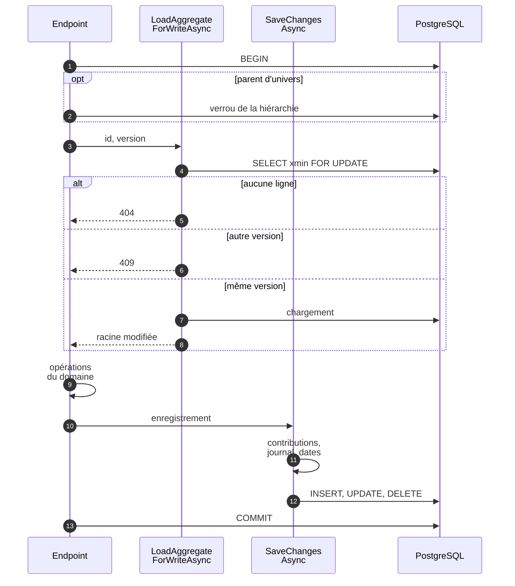
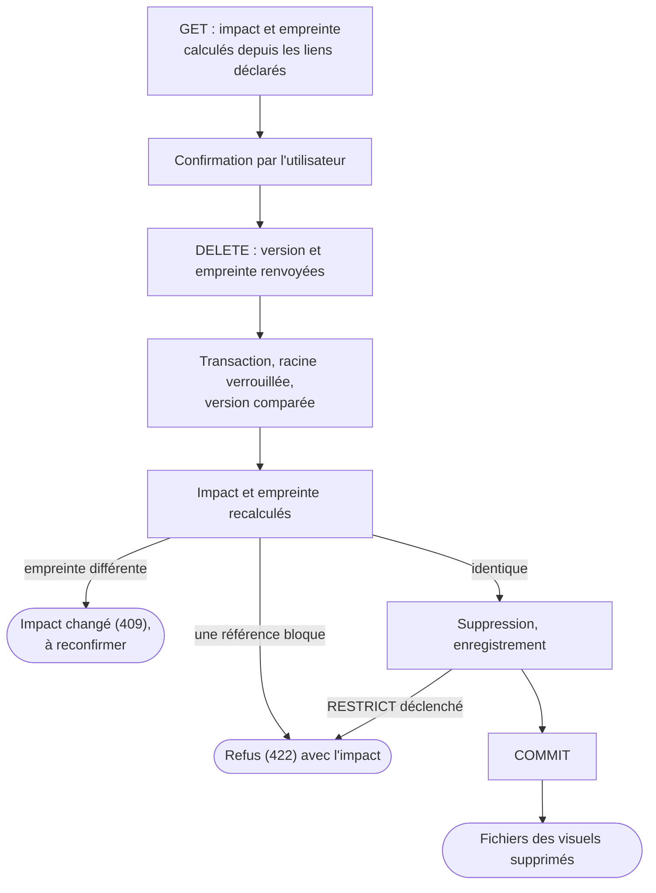

# Persistance : écriture d'un agrégat

Toute écriture d'une fiche passe par un endpoint de la famille `/admin`, qui ouvre une transaction, charge l'agrégat par sa racine, applique les opérations du domaine et enregistre. Le contexte, ses conventions et le schéma sont décrits dans [Persistance : modèle et schéma](persistance-modele-et-schema.md) ; les raisons, dans [Concurrence d'accès](../../../.speckit/choix-implementation/persistance/concurrence-d-acces.md) et [Suppression des entités : mise en œuvre](../../../.speckit/choix-implementation/ecritures/suppression-des-entites-mise-en-oeuvre.md).

## Agrégats et version

- **Racines** : les entités marquées [`IAggregateRoot`](../../../src/Bdtheque.Domain/Entities/Common/IAggregateRoot.cs) (album, série, auteur, genre, éditeur, univers, recherche enregistrée, paramétrage). Leurs enfants (éditions et leurs visuels, contributions, intentions d'achat, collections d'un éditeur) n'ont ni version ni écriture propres : ils sont créés, modifiés et retirés par une opération de leur racine.
- **Version d'un agrégat** : la colonne système `xmin` de la ligne de sa racine. Le formulaire la reçoit à la lecture (`VersionOf`, ou `EF.Property<uint>(…, VersionProperty)` dans une projection) et la renvoie avec toute modification ou suppression.

## Modification d'un agrégat existant

Question du schéma : *dans quel ordre une modification verrouille-t-elle, vérifie-t-elle et enregistre-t-elle un agrégat ?* Schéma interprétatif.

- **Point d'entrée unique** : [`LoadAggregateForWriteAsync`](../../../src/Bdtheque.Infrastructure/AggregateWriteExtensions.cs) exige une transaction ouverte et un contexte qui ne suit encore aucune entité, sans quoi il lève `InvalidOperationException` : une entité lue avant le verrou ne serait pas rafraîchie par EF Core. Ce qu'un endpoint lit avant, il le lit sans suivi (`AsNoTracking`).
- **Verrou puis version** : la version est lue sur la ligne verrouillée et comparée aussitôt, si bien qu'un formulaire périmé est signalé comme tel avant toute règle métier ; le verrou tient jusqu'à la fin de la transaction. Une racine absente lève [`EntityNotFoundException`](../../../src/Bdtheque.Infrastructure/EntityNotFoundException.cs) (`404`), une autre version `DbUpdateConcurrencyException` (`409`).
- **Racine marquée modifiée** : son `UPDATE` change son `xmin` même quand seul un enfant ou une association change (un genre ajouté à un album), et sa date de modification suit ; deux écritures concurrentes sur les enfants d'un même agrégat ne peuvent donc aboutir toutes deux.
- **Forme du chargement** : le paramètre `shape` ajoute les `Include` dont l'opération a besoin ; les collections de l'album sont chargées d'office (`AutoInclude`). Exemple complet : `UpdateAsync` de [`AlbumEndpoints`](../../../src/Bdtheque.Api/Endpoints/AlbumEndpoints.cs).
- **Création** : sans verrou ni version ; l'endpoint ouvre la transaction, construit l'agrégat par le domaine, l'ajoute (`Add`) et enregistre. Les fiches créées sur place depuis un formulaire (genre, auteur, univers, série) le sont par [`FormReferences.CreateAddedAsync`](../../../src/Bdtheque.Api/Endpoints/FormReferences.cs), dans la même transaction.

## Enregistrement

`SaveChangesAsync` de [`BdthequeDbContext`](../../../src/Bdtheque.Infrastructure/BdthequeDbContext.cs), seul chemin d'écriture par EF Core, enchaîne, après la détection des changements :

1. **Contributions détachées supprimées** (`DeleteSeveredContributions`) : retirée par son album ou sa série, une contribution verrait sinon ses deux clés étrangères mises à `null`, ce que refuse une contrainte CHECK.
2. **Journal des modifications** : [`ChangeLogRecorder`](../../../src/Bdtheque.Infrastructure/ChangeLogRecorder.cs) ajoute à l'enregistrement en cours une entrée par fiche écrite ([Journal des modifications : mise en œuvre](../../../.speckit/choix-implementation/domaine/journal-des-modifications-mise-en-oeuvre.md)).
3. **Dates** (`StampAuditDates`) : création et modification de toute entité ajoutée ou modifiée, à l'heure de l'horloge de l'application tronquée à la microseconde ; date d'entrée dans la collection d'une édition devenue possédée, jamais réécrite ensuite.
4. **Écriture** par EF Core, dans l'ordre qu'il déduit des clés étrangères et des index uniques du modèle.

Les contraintes unique différables ne sont vérifiées qu'au `COMMIT` : leur violation y est levée en `PostgresException`, sans l'enveloppe `DbUpdateException` d'un échec à l'enregistrement.

## Verrous propres à certaines écritures

| Verrou | Pris par | Ce qu'il sérialise |
| --- | --- | --- |
| Verrou consultatif de la hiérarchie des univers, [`UniverseHierarchy.LockAsync`](../../../src/Bdtheque.Infrastructure/UniverseHierarchy.cs) | Création ou modification d'un univers avec un parent ([`UniverseEndpoints`](../../../src/Bdtheque.Api/Endpoints/UniverseEndpoints.cs)), univers créé sur place sous un parent | Les changements de hiérarchie, dont chacun vérifie l'absence de cycle sur une hiérarchie qui voit les précédents ; pris avant le verrou de la ligne de l'univers. |
| Ligne d'une entité, [`LockAsync`](../../../src/Bdtheque.Infrastructure/AggregateWriteExtensions.cs) | Retrait d'une collection depuis la saisie de son éditeur ([`PublisherEndpoints`](../../../src/Bdtheque.Api/Endpoints/PublisherEndpoints.cs)), après la racine ; utilisation enregistrée sur une visite de la mesure d'audience ([`AudienceEndpoints`](../../../src/Bdtheque.Api/Endpoints/AudienceEndpoints.cs)) | Une édition ou une série qui référencerait la collection pendant son retrait ; les utilisations successives d'une même visite. |
| Verrou consultatif de la conservation de l'audience, [`AudienceRetention`](../../../src/Bdtheque.Api/Audience/AudienceRetention.cs) | Clôture quotidienne des mois de la mesure d'audience | Deux clôtures simultanées, qui établiraient chacune les compteurs des mêmes mois. |

## Écritures hors agrégat

Quelques écritures passent par du SQL, sans `SaveChangesAsync`, donc sans journal des modifications ni date posée par le contexte : l'insertion du paramétrage au démarrage ([Persistance : modèle et schéma](persistance-modele-et-schema.md)), celle de l'édition à la une du jour ([`EditionSpotlightWrites`](../../../src/Bdtheque.Infrastructure/EditionSpotlightWrites.cs), `ON CONFLICT DO NOTHING`, une clé étrangère refusée signifiant une édition supprimée depuis le tirage).

## Suppression d'une fiche

Question du schéma : *qu'est-ce qui garantit qu'une suppression n'emporte que ce que l'utilisateur a confirmé ?* Schéma interprétatif.

- **Mécanisme commun** : [`AggregateDeletion`](../../../src/Bdtheque.Api/Deletion/AggregateDeletion.cs), appelé par [`DeletionEndpoints`](../../../src/Bdtheque.Api/Endpoints/DeletionEndpoints.cs) pour une racine (`DeleteAsync`) ou un enfant d'agrégat (`DeleteChildAsync`, supprimé par sa racine, éventuellement par une opération du domaine qui emporte plus que sa ligne). Chaque ressource déclare ses liens ([`DeletionLink`](../../../src/Bdtheque.Api/Deletion/DeletionLink.cs) : référence, association, composition, albums qui sortent de la collection) ; le mécanisme y ajoute lui-même les recherches enregistrées qui désignent la fiche.
- **Empreinte** : un SHA-256 des identités relevées par nature de lien et type de fiche ; elle change si une association disparaît pendant qu'une autre apparaît, ce que des nombres égaux cacheraient.
- **Filet de sécurité** : une référence que l'impact n'aurait pas relevée est refusée par le `ON DELETE RESTRICT` de la base ; la transaction est alors annulée et l'impact recalculé hors d'elle, pour un refus présenté comme les autres ([`DeletionRefusedException`](../../../src/Bdtheque.Api/Deletion/DeletionRefusedException.cs)).
- **Fichiers** : supprimés après le `COMMIT`, d'après les visuels que l'impact annonçait ; un échec ne laisse qu'un orphelin, que rattrape la réconciliation quotidienne des visuels.

## Échecs de la base

Ils remontent en exception jusqu'à [`ApiExceptionHandler`](../../../src/Bdtheque.Api/Errors/ApiExceptionHandler.cs), qui les classe selon le code d'erreur de PostgreSQL ([Erreurs métier, fonctionnelles et techniques](../../../.speckit/choix-implementation/ecritures/erreurs-metier-fonctionnelles-et-techniques.md)) :

| Échec | Catégorie |
| --- | --- |
| Fiche absente (`EntityNotFoundException`), clé étrangère vers une fiche supprimée entre-temps | Fonctionnelle, `404` |
| Version périmée (`DbUpdateConcurrencyException`), impact de suppression changé | Fonctionnelle, `409` |
| Index unique ou contrainte unique différable violés, par leur code de règle ([`UniqueIndexRules`](../../../src/Bdtheque.Api/Errors/UniqueIndexRules.cs)) ; texte trop long ; suppression refusée ; retrait, hors suppression, d'une fiche que désigne une recherche enregistrée | Métier, `422` |
| Toute autre violation | Technique, `500` |

## Tests

- **Verrou, version et racine marquée** : [`AggregateConcurrencyTests`](../../../tests/Bdtheque.Infrastructure.Tests/AggregateConcurrencyTests.cs).
- **Dates** : [`AuditTimestampsTests`](../../../tests/Bdtheque.Infrastructure.Tests/AuditTimestampsTests.cs), [`CollectionEntryDateTests`](../../../tests/Bdtheque.Infrastructure.Tests/CollectionEntryDateTests.cs).
- **Suppression** : [`AggregateDeletionTests`](../../../tests/Bdtheque.Api.Tests/AggregateDeletionTests.cs) pour le mécanisme, [`DeleteRuleTests`](../../../tests/Bdtheque.Infrastructure.Tests/DeleteRuleTests.cs) pour les règles `ON DELETE`.
- **Réponses d'erreur** : [`ErrorResponseTests`](../../../tests/Bdtheque.Api.Tests/ErrorResponseTests.cs).

## Invariants à préserver

- Toute écriture sur un agrégat existant passe par `LoadAggregateForWriteAsync`, dans une transaction, avant que le contexte ne suive quoi que ce soit.
- Les verrous de ligne se prennent toujours de la racine vers l'enfant, et le verrou de la hiérarchie des univers avant celui de toute ligne d'univers : deux écritures ne peuvent ainsi s'attendre mutuellement.
- Aucune écriture d'une fiche ne passe par du SQL brut : elle échapperait au journal des modifications et aux dates.
- Un enregistrement est toujours asynchrone (`SaveChangesAsync`) ; `SaveChanges` lève une exception.
