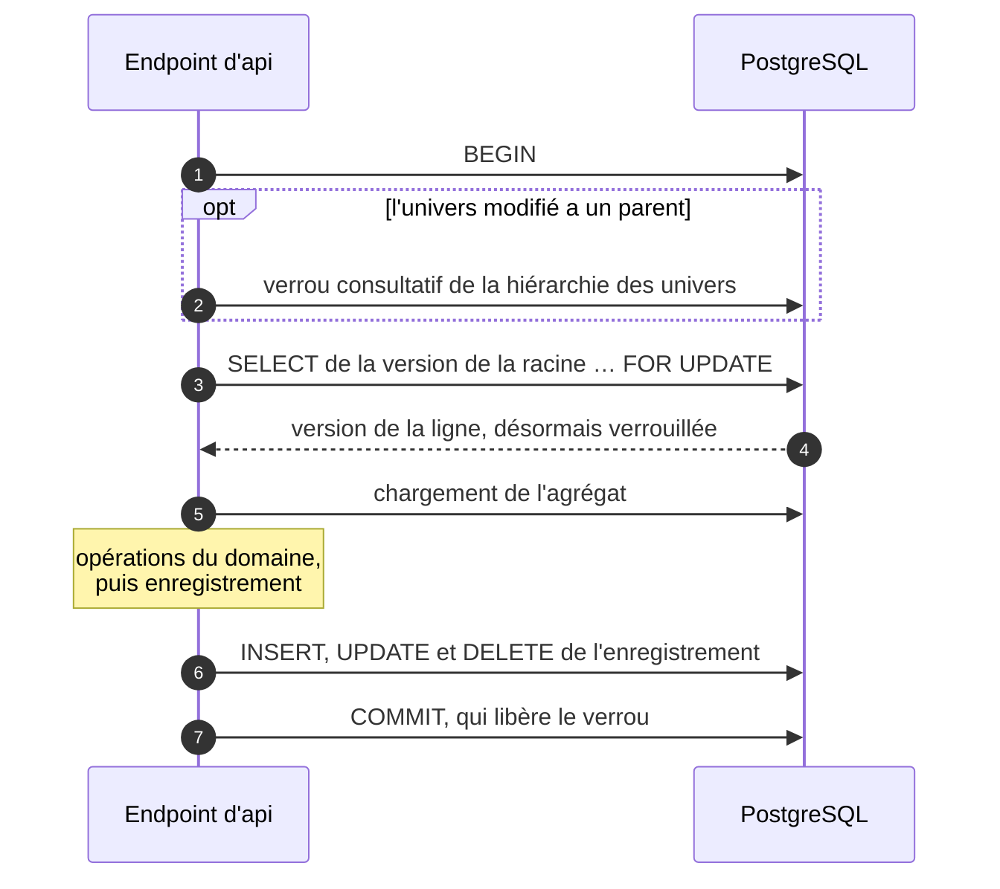
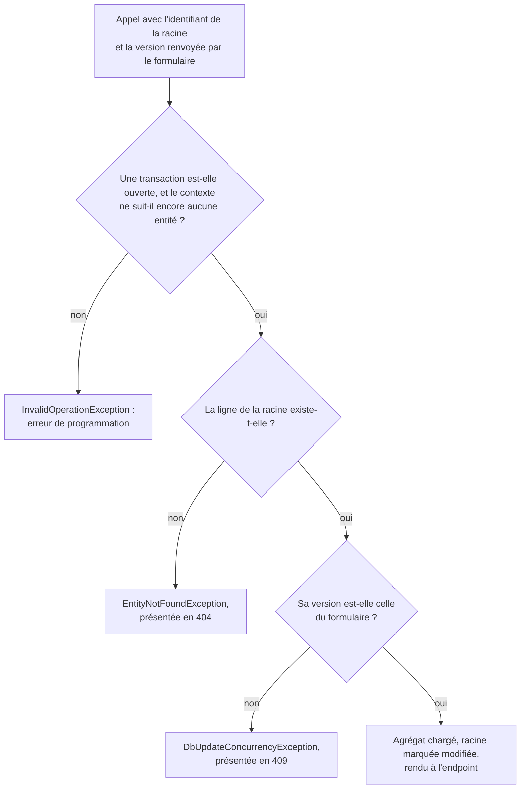
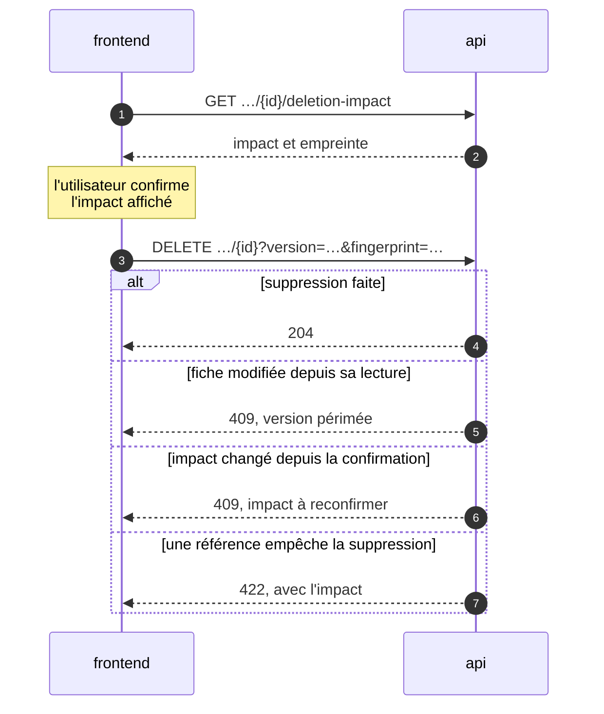
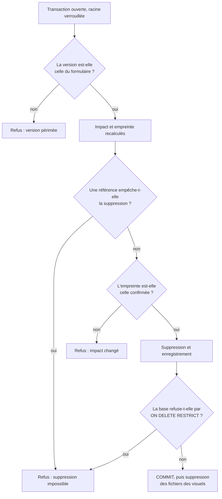
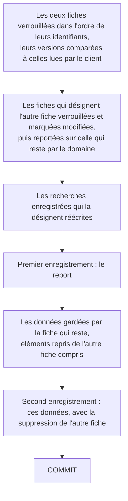

# Persistance : écriture d'un agrégat

Toute écriture d'une fiche passe par un endpoint de la famille `/admin` d'`api`. Le problème que règle cette page est celui des écritures concurrentes : l'administrateur peut avoir la même fiche ouverte dans deux onglets, ou enregistrer un formulaire affiché depuis longtemps, et aucune de ces situations ne doit écraser en silence une modification faite entre-temps. La solution repose sur trois éléments : une transaction par écriture, un verrou posé sur la ligne de la fiche principale, et une version que le formulaire renvoie pour prouver qu'il a été rempli à partir de l'état actuel. Le contexte EF Core, ses conventions et le schéma sont décrits dans [Persistance : modèle et schéma](persistance-modele-et-schema.md). Les raisons de ces choix sont données dans [Concurrence d'accès](../../../.speckit/choix-implementation/persistance/concurrence-d-acces.md) et dans [Suppression des entités : mise en œuvre](../../../.speckit/choix-implementation/ecritures/suppression-des-entites-mise-en-oeuvre.md).

## Agrégats et version

Le domaine regroupe ses entités en **agrégats**. Un agrégat est un ensemble d'entités que l'on modifie toujours ensemble, en passant par son entité principale, appelée sa **racine**. Les racines sont les entités marquées par l'interface [`IAggregateRoot`](../../../src/Bdtheque.Domain/Entities/Common/IAggregateRoot.cs) : l'album, la série, l'auteur, le genre, l'éditeur, l'univers, la recherche enregistrée et le paramétrage de l'application. Les autres entités sont les enfants d'une racine : les éditions d'un album et leurs visuels, les contributions des auteurs, les intentions d'acquisition, ou encore les collections d'un éditeur. Un enfant n'a ni version ni écriture propre : il est créé, modifié et retiré par une opération de sa racine.

La **version** d'un agrégat est la valeur de la colonne système `xmin` sur la ligne de sa racine. PostgreSQL change cette valeur à chaque mise à jour de la ligne, sans qu'il faille l'entretenir. Le formulaire reçoit la version quand il lit la fiche, par `VersionOf` ou par `EF.Property<uint>(…, VersionProperty)` dans une projection, et la renvoie avec toute modification ou suppression.

## Modification d'un agrégat existant

Une modification se déroule dans une transaction qui commence par verrouiller la ligne de la racine. Le schéma suivant, tracé à la main d'après le code, ne montre que les échanges entre l'endpoint et la base. Il répond à la question : quelles instructions une modification envoie-t-elle à PostgreSQL, et dans quel ordre ?

Le verrou et la vérification de la version sont faits par une méthode unique, [`LoadAggregateForWriteAsync`](../../../src/Bdtheque.Infrastructure/AggregateWriteExtensions.cs), que tout endpoint appelle avant de modifier un agrégat existant. Le second schéma, lui aussi tracé à la main, répond à une autre question : comment cette méthode décide-t-elle de rendre l'agrégat à l'endpoint ou de refuser l'écriture ?

Plusieurs détails de cette méthode comptent pour qui écrit un endpoint :

- Elle exige que le contexte ne suive encore aucune entité. EF Core ne rafraîchit jamais une entité qu'il suit déjà : une fiche lue avant le verrou garderait donc ses anciennes valeurs, qui seraient réécrites en base et effaceraient une modification concurrente. Tout ce qu'un endpoint doit lire avant le verrou, il le lit donc sans suivi, par `AsNoTracking`.
- Elle lit la version sur la ligne même qu'elle verrouille, puis la compare aussitôt. Un formulaire périmé est ainsi signalé comme tel, avant qu'une règle métier ne refuse ses valeurs dépassées pour une raison trompeuse. Le verrou empêche ensuite la version de changer jusqu'à la fin de la transaction.
- Elle marque la racine comme modifiée, si bien que l'enregistrement réécrit sa ligne et change son `xmin` même lorsque seul un enfant ou une association change, par exemple quand on ajoute un genre à un album. Sans cela, deux écritures concurrentes sur les enfants d'un même agrégat ne seraient pas détectées. La date de modification de la racine change de la même façon.
- Son paramètre `shape` ajoute au chargement les `Include` dont l'opération a besoin. Les collections de l'album, elles, sont toujours chargées (`AutoInclude`). La méthode `UpdateAsync` d'[`AlbumEndpoints`](../../../src/Bdtheque.Api/Endpoints/AlbumEndpoints.cs) en donne un exemple complet.

La création d'une fiche n'a ni verrou ni version, puisque la fiche n'existe pas encore. L'endpoint ouvre la transaction, construit l'agrégat par le domaine, l'ajoute au contexte par `Add` et enregistre. Certaines fiches peuvent aussi être créées sur place depuis un formulaire, sans quitter la saisie en cours : un genre, un auteur, un univers, une série, un éditeur ou une collection d'un éditeur. Elles le sont par [`FormReferences.CreateAddedAsync`](../../../src/Bdtheque.Api/Endpoints/FormReferences.cs), dans la même transaction que la fiche qui les cite. Le panneau d'un univers s'en sert aussi pour créer sur place le parent qu'il lui donne.

## Enregistrement

L'enregistrement passe toujours par `SaveChangesAsync` de [`BdthequeDbContext`](../../../src/Bdtheque.Infrastructure/BdthequeDbContext.cs) ; la version synchrone, `SaveChanges`, lève une exception. Après avoir détecté les changements, cette méthode enchaîne quatre étapes :

1. Elle supprime les contributions détachées (`DeleteSeveredContributions`). Une contribution appartient soit à un album, soit à une série, et sa clé vers chacun est facultative. Quand son propriétaire la retire, EF Core mettrait donc simplement ses deux clés à `null`, ce que refuse une contrainte `CHECK` ; la méthode transforme ce détachement en suppression.
2. Elle ajoute le journal des modifications : [`ChangeLogRecorder`](../../../src/Bdtheque.Infrastructure/ChangeLogRecorder.cs) ajoute à l'enregistrement en cours une entrée pour chaque fiche écrite ([Journal des modifications](journal-des-modifications.md)).
3. Elle pose les dates (`StampAuditDates`). Toute entité ajoutée ou modifiée reçoit sa date de création ou de modification, à l'heure de l'horloge de l'application tronquée à la microseconde, qui est la précision de PostgreSQL. Une édition qui devient possédée reçoit en outre sa date d'entrée dans la collection, qui n'est ensuite jamais réécrite.
4. Elle laisse EF Core écrire les lignes, dans l'ordre qu'il déduit des clés étrangères et des index uniques du modèle.

Une contrainte unique différable n'est vérifiée qu'au `COMMIT`, et non pendant l'enregistrement ([Persistance : modèle et schéma](persistance-modele-et-schema.md)). Sa violation est donc levée par le `COMMIT` sous la forme d'une `PostgresException` brute, sans l'enveloppe `DbUpdateException` qui entoure un échec survenu pendant l'enregistrement.

## Verrous propres à certaines écritures

Le verrou de la racine suffit à la plupart des écritures. Quatre situations demandent un verrou supplémentaire, parce que l'écriture dépend de lignes qu'elle ne modifie pas elle-même. Deux de ces verrous sont des **verrous consultatifs** : des verrous PostgreSQL qui ne portent sur aucune ligne, mais sur un nombre convenu par l'application, et qui servent à sérialiser des traitements entiers.

| Verrou | Qui le prend | Ce qu'il empêche |
| --- | --- | --- |
| Le verrou consultatif de la hiérarchie des univers, pris par [`UniverseHierarchy.LockAsync`](../../../src/Bdtheque.Infrastructure/UniverseHierarchy.cs). | La création ou la modification d'un univers qui a un parent ([`UniverseEndpoints`](../../../src/Bdtheque.Api/Endpoints/UniverseEndpoints.cs)), que ce parent existe déjà ou que le panneau de l'univers le crée sur place. Un univers créé sur place depuis un album ou une série est de premier niveau : il ne prend pas ce verrou. | Chaque changement de hiérarchie vérifie qu'il ne crée pas de cycle ; le verrou garantit qu'il le vérifie sur une hiérarchie qui inclut les changements précédents. Il est pris avant le verrou de la ligne de l'univers. |
| Le verrou de la ligne d'une entité, pris par [`LockAsync`](../../../src/Bdtheque.Infrastructure/AggregateWriteExtensions.cs). | Le retrait d'une collection depuis la saisie de son éditeur ([`PublisherEndpoints`](../../../src/Bdtheque.Api/Endpoints/PublisherEndpoints.cs)), après le verrou de la racine, et l'enregistrement d'une utilisation sur une visite de la mesure d'audience ([`AudienceEndpoints`](../../../src/Bdtheque.Api/Endpoints/AudienceEndpoints.cs)). | Dans le premier cas, qu'une édition ou une série se mette à référencer la collection pendant son retrait ; dans le second, que deux utilisations successives d'une même visite s'enregistrent en même temps. |
| Le verrou de la racine d'un autre agrégat, pris par [`LoadOtherAggregateForWriteAsync`](../../../src/Bdtheque.Infrastructure/AggregateWriteExtensions.cs), qui marque aussi cette racine modifiée. | La création sur place d'une collection d'un éditeur existant, depuis la saisie d'une série ou d'une édition ([`FormReferences.CreateAddedAsync`](../../../src/Bdtheque.Api/Endpoints/FormReferences.cs)), après le verrou de la fiche saisie. | Qu'une saisie de l'éditeur ouverte auparavant enregistre ses collections sans voir la nouvelle : la version de l'éditeur change, et cette saisie est refusée comme périmée. L'éditeur, que la fiche saisie a pu déjà lire, est relu depuis sa ligne verrouillée avant d'être marqué. |
| Le verrou consultatif de la conservation de l'audience, pris par [`AudienceRetention`](../../../src/Bdtheque.Api/Audience/AudienceRetention.cs). | La clôture quotidienne des mois de la mesure d'audience. | Que deux clôtures simultanées établissent chacune les compteurs des mêmes mois. |

## Écritures hors agrégat

Quelques écritures passent directement par du SQL, sans `SaveChangesAsync`. Elles n'ont donc ni entrée au journal des modifications ni dates posées par le contexte. Il y en a deux. La première est l'insertion du paramétrage de l'application au démarrage ([Persistance : modèle et schéma](persistance-modele-et-schema.md)). La seconde est l'insertion de l'édition à la une du jour par [`EditionSpotlightWrites`](../../../src/Bdtheque.Infrastructure/EditionSpotlightWrites.cs), avec `ON CONFLICT DO NOTHING` : si une clé étrangère est refusée, c'est que l'édition tirée au sort a été supprimée depuis le tirage.

## Suppression d'une fiche

La suppression doit garantir que l'on n'emporte jamais plus que ce que l'utilisateur a accepté. Avant de supprimer, l'application lui présente un **impact** : la liste, par nature de lien et par type de fiche, des fiches qui disparaîtront avec celle-ci, perdront un lien vers elle ou empêchent sa suppression. Comme cet impact peut changer entre son affichage et la confirmation, `api` y associe une **empreinte**, un hachage SHA-256 des identités des fiches concernées, que le client renvoie avec sa demande de suppression. Comparer des empreintes plutôt que des nombres permet de détecter qu'un lien a disparu pendant qu'un autre apparaissait, ce que des totaux égaux cacheraient.

Le schéma suivant, tracé à la main, ne montre que le dialogue entre `frontend` et `api`. Il répond à la question : quelles requêtes une suppression demande-t-elle, et quelles réponses peut-elle recevoir ?

Le second schéma, lui aussi tracé à la main, montre ce que fait `api` en traitant la requête `DELETE`. Il répond à la question : par quelles vérifications successives `api` passe-t-il avant de supprimer réellement ?

Le recalcul a lieu après le verrou de la racine, et c'est ce qui rend la garantie solide. À partir de ce moment, aucune écriture ne peut ajouter un lien vers la fiche : créer une clé étrangère vers une ligne oblige PostgreSQL à poser un verrou partagé sur cette ligne, qui attend la fin de la suppression puis échoue, puisque la ligne n'existe plus.

Le mécanisme est commun à toutes les fiches. Il est implémenté par [`AggregateDeletion`](../../../src/Bdtheque.Api/Deletion/AggregateDeletion.cs) et appelé par [`DeletionEndpoints`](../../../src/Bdtheque.Api/Endpoints/DeletionEndpoints.cs), soit pour une racine (`DeleteAsync`), soit pour un enfant d'agrégat (`DeleteChildAsync`). Dans le second cas, c'est la racine qui est verrouillée et dont la version est vérifiée, et l'enfant est supprimé par elle, parfois par une opération du domaine qui emporte plus que sa seule ligne. Chaque ressource déclare ses liens par des [`DeletionLink`](../../../src/Bdtheque.Api/Deletion/DeletionLink.cs), selon leur nature : référence, association, composition, ou albums qui sortent de la collection. Le mécanisme ajoute lui-même les recherches enregistrées qui désignent la fiche, qu'aucune ressource ne déclare.

Si une référence a échappé au calcul de l'impact, la règle `ON DELETE RESTRICT` de la base refuse la suppression et sert de filet de sécurité. La transaction est alors annulée, l'impact est recalculé hors d'elle, et le refus est présenté comme les autres, par une [`DeletionRefusedException`](../../../src/Bdtheque.Api/Deletion/DeletionRefusedException.cs).

Les fichiers des visuels ne sont pas dans la base, et aucune cascade ne les atteint. Ils sont supprimés après le `COMMIT`, d'après les visuels que l'impact annonçait. Une suppression qui échoue les laisse donc intacts ; un fichier qui ne peut pas être supprimé devient un orphelin, que la réconciliation quotidienne des visuels finit par retirer ([Visuels](visuels.md)).

## Fusion de deux fiches

La fusion réunit en une seule deux fiches d'un même type saisies en double. L'utilisateur choisit, donnée par donnée, la fiche dont la valeur est gardée ; tout ce qui désignait l'une ou l'autre désigne ensuite la fiche qui reste, et l'autre est supprimée. Les règles en sont données dans [Fusion de deux fiches](../../../.speckit/fonctionnel/regles-metier/fusion-des-fiches.md), et les raisons de leur mise en œuvre dans [Fusion de deux fiches : mise en œuvre](../../../.speckit/choix-implementation/ecritures/fusion-des-fiches-mise-en-oeuvre.md).

Le client n'envoie pas les valeurs choisies, mais, pour chaque donnée, la fiche dont la valeur est gardée, avec l'identifiant et la version des deux fiches. Le mécanisme commun, [`RecordMerge`](../../../src/Bdtheque.Api/Merge/RecordMerge.cs), relit alors les deux fiches sous leur verrou par [`LoadAggregatesForWriteAsync`](../../../src/Bdtheque.Infrastructure/AggregateWriteExtensions.cs), qui les verrouille dans l'ordre de leurs identifiants et refuse l'écriture si l'une d'elles a changé depuis sa lecture. La fiche qui reste est celle dont la fusion garde le plus de données. Le schéma suivant, tracé à la main d'après le code, montre les étapes de la fusion dans sa transaction. Il répond à la question : dans quel ordre la fusion écrit-elle, et pourquoi en deux enregistrements ?

Le report est confié au domaine : un album ou une série remplace le genre supprimé par celui qui reste (`TransferGenre`), ou crédite à l'auteur qui reste les contributions de l'autre (`TransferAuthor`) ; un album passe à la série qui reste (`TransferSeries`). Une contribution garde son identité, qu'une recherche enregistrée peut désigner ; une contribution que portaient déjà les deux fiches n'est gardée qu'une fois, la contribution retirée étant remplacée, dans les recherches enregistrées qui la désignaient, par celle qui reste. Aucune contrainte d'unicité ne refuse donc le report. Chaque album ou série concerné est verrouillé et marqué modifié par `LoadOtherAggregateForWriteAsync`, comme toute écriture sur un agrégat, pour qu'une saisie ouverte auparavant soit refusée comme périmée. Les recherches enregistrées sont réécrites par le schéma de la recherche avancée, qui seul sait quelle valeur d'un critère désigne une fiche ([Recherche simple et avancée](recherche.md)).

La fusion de deux éditeurs ([`PublisherEndpoints`](../../../src/Bdtheque.Api/Endpoints/PublisherEndpoints.cs)) reporte aussi les collections, que l'éditeur supprimé emporterait sinon avec lui. L'API cherche d'abord les collections homonymes des deux éditeurs par une jointure sur leur nom, que la base compare sans tenir compte de la casse ni des accents, comme l'unicité de ce nom chez un éditeur ; le client a choisi, pour chaque paire, le nom gardé, et la collection qui porte ce nom est celle qui reste. Le domaine fait le reste : `Publisher.Absorb` retire de son éditeur la collection remplacée, fait passer toutes les autres collections de l'éditeur supprimé à celui qui reste, en gardant leur identité, et rend un [`PublisherMerge`](../../../src/Bdtheque.Domain/Entities/PublisherMerge.cs). Les éditions de chaque album et l'éditeur de chaque série suivent ce report (`TransferPublisher`) : une fiche de l'éditeur supprimé, ou rangée dans une collection remplacée, passe à l'éditeur qui reste, dans la collection qui reste de la sienne. Les recherches enregistrées sont réécrites pour l'éditeur supprimé et pour chaque collection remplacée. Le nom des collections étant vérifié par une contrainte différable, au `COMMIT`, une collection déplacée peut prendre chez l'éditeur qui reste le nom de celle qu'elle remplace dans le même enregistrement.

L'écriture se fait en deux enregistrements d'une même transaction. Le report est enregistré à part, d'abord, parce qu'une contribution qu'il retire, en double, n'est supprimée que par l'enregistrement (`DeleteSeveredContributions`) : avant lui, elle désigne encore l'auteur supprimé, dont la suppression serait alors refusée. Les données de la fiche qui reste et la suppression de l'autre sont ensuite enregistrées ensemble, pour deux raisons. D'une part, une fiche peut porter elle-même des éléments que celle qui reste reprend : une série porte ses contributions, et la série qui reste reçoit celles qu'elle retient de l'autre avec leur identité (`MergeTemplateContributions`), avant que la suppression de l'autre ne les emporte. D'autre part, le journal des modifications consigne ainsi la fiche qui reste, l'autre et chaque fiche reportée une seule fois chacune. Une valeur unique que la fiche qui reste reprend de l'autre, comme le nom affiché d'un auteur, reste libre dans ce même enregistrement : EF Core ordonne la suppression qui libère la valeur d'un index unique avant la mise à jour qui la prend.

Pour une série, une contribution que portaient déjà les deux séries, du même auteur dans le même rôle, n'est gardée qu'une fois, par la série qui reste (`CreditsHeldOf`), et les recherches enregistrées qui désignaient l'autre la désignent ; une contribution écartée est supprimée, et la fusion est refusée, comme toute écriture, si une recherche enregistrée la désigne. L'éditeur et la collection reprennent ceux d'une même série.

## Échecs de la base

Les échecs de la base remontent sous forme d'exception jusqu'à [`ApiExceptionHandler`](../../../src/Bdtheque.Api/Errors/ApiExceptionHandler.cs), qui les classe d'après le code d'erreur de PostgreSQL dans l'une des trois catégories d'erreur de l'application ([Erreurs métier, fonctionnelles et techniques](../../../.speckit/choix-implementation/ecritures/erreurs-metier-fonctionnelles-et-techniques.md)). La suite de leur parcours, jusqu'à leur présentation à l'utilisateur, est décrite dans [Erreurs, de la règle à leur présentation](erreurs.md).

| Échec | Catégorie et statut HTTP |
| --- | --- |
| La fiche n'existe pas (`EntityNotFoundException`), ou une clé étrangère désigne une fiche supprimée entre-temps. | Erreur fonctionnelle, `404`. |
| La version est périmée (`DbUpdateConcurrencyException`), ou l'impact d'une suppression a changé. | Erreur fonctionnelle, `409`. |
| Un index unique ou une contrainte unique différable est violé, et l'erreur reçoit alors le code de règle que lui associe [`UniqueIndexRules`](../../../src/Bdtheque.Api/Errors/UniqueIndexRules.cs) ; ou un texte est trop long ; ou une suppression est refusée ; ou l'on retire, hors suppression, une fiche que désigne une recherche enregistrée. | Erreur métier, `422`. |
| Toute autre violation. | Erreur technique, `500`. |

## Où lire les tests

- [`AggregateConcurrencyTests`](../../../tests/Bdtheque.Infrastructure.Tests/AggregateConcurrencyTests.cs) vérifie le verrou, la version et le marquage de la racine.
- [`AuditTimestampsTests`](../../../tests/Bdtheque.Infrastructure.Tests/AuditTimestampsTests.cs) et [`CollectionEntryDateTests`](../../../tests/Bdtheque.Infrastructure.Tests/CollectionEntryDateTests.cs) vérifient les dates.
- [`AggregateDeletionTests`](../../../tests/Bdtheque.Api.Tests/AggregateDeletionTests.cs) vérifie le mécanisme de suppression, et [`DeleteRuleTests`](../../../tests/Bdtheque.Infrastructure.Tests/DeleteRuleTests.cs) les règles `ON DELETE` de la base.
- [`MergeEndpointsTests`](../../../tests/Bdtheque.Api.Tests/MergeEndpointsTests.cs) vérifie la fusion de deux genres et de deux auteurs, report et recherches enregistrées compris, [`SeriesMergeEndpointsTests`](../../../tests/Bdtheque.Api.Tests/SeriesMergeEndpointsTests.cs) celle de deux séries, journal compris, et [`PublisherMergeEndpointsTests`](../../../tests/Bdtheque.Api.Tests/PublisherMergeEndpointsTests.cs) celle de deux éditeurs et de leurs collections homonymes.
- [`ErrorResponseTests`](../../../tests/Bdtheque.Api.Tests/ErrorResponseTests.cs) vérifie les réponses d'erreur.

## Invariants à préserver

- Toute écriture sur un agrégat existant passe par `LoadAggregateForWriteAsync`, dans une transaction, avant que le contexte ne suive la moindre entité. Seuls l'éditeur d'une collection créée sur place depuis une autre fiche, et les fiches reportées par une fusion, sont verrouillés ensuite, par `LoadOtherAggregateForWriteAsync`, qui relit leur racine si le contexte la suit déjà ; une fusion verrouille ses deux fiches ensemble, par `LoadAggregatesForWriteAsync`.
- Les verrous de ligne se prennent toujours de la racine vers l'enfant, d'une fiche saisie vers l'éditeur d'une collection qu'elle crée sur place, jamais dans l'autre sens, et le verrou de la hiérarchie des univers avant celui de toute ligne d'univers. Deux écritures ne peuvent ainsi jamais s'attendre mutuellement.
- Aucune écriture d'une fiche ne passe par du SQL brut, car elle échapperait au journal des modifications et aux dates.
- Un enregistrement est toujours asynchrone, par `SaveChangesAsync`.
