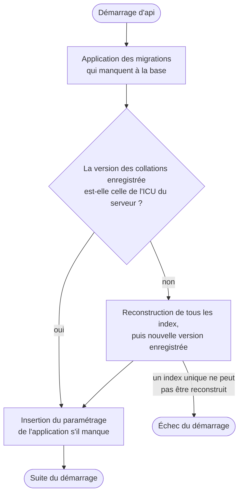

# Persistance : modèle et schéma

Seul le conteneur `api` accède à la base PostgreSQL. Il le fait par EF Core, l'ORM de .NET, et par Npgsql, le pilote PostgreSQL qu'EF Core utilise. Tout passe par un contexte unique, [`BdthequeDbContext`](../../../src/Bdtheque.Infrastructure/BdthequeDbContext.cs), défini dans le projet `Bdtheque.Infrastructure` : c'est lui qui décrit comment les entités du domaine correspondent aux tables, et par lui que l'on lit et que l'on écrit. Cette page explique les conventions de ce contexte, la façon dont le schéma de la base est produit, ce qu'`api` fait de la base à son démarrage, et la base sur laquelle tournent les tests. Les raisons de chaque convention sont données dans les concepts de [Persistance](../../../.speckit/choix-implementation/persistance/index.md). Le déroulement d'une écriture, avec ses verrous, sa version et la suppression d'une fiche, fait l'objet d'une page à part, [Persistance : écriture d'un agrégat](persistance-ecriture-d-un-agregat.md).

## Le contexte

`api` crée une instance du contexte pour chaque requête HTTP. Il l'enregistre par `AddDbContext` dans le [`Program.cs` de l'API](../../../src/Bdtheque.Api/Program.cs), avec la chaîne de connexion `ConnectionStrings__Bdtheque`, et le bilan de santé `/health` vérifie, par `AddDbContextCheck`, que la base répond. Le contexte reçoit aussi l'horloge de l'application (`TimeProvider`), qui sert à dater les écritures ; les tests la remplacent par une horloge fixe ([Dates renseignées automatiquement : mise en œuvre](../../../.speckit/choix-implementation/persistance/dates-renseignees-automatiquement-mise-en-oeuvre.md)).

Les outils de conception d'EF Core, comme `dotnet ef migrations add`, construisent le contexte par [`BdthequeDbContextFactory`](../../../src/Bdtheque.Infrastructure/BdthequeDbContextFactory.cs), sans chaîne de connexion. Générer une migration, ou comparer le modèle aux migrations existantes, ne demande donc aucune base.

Deux comportements du contexte surprennent à la première lecture. D'abord, la méthode synchrone `SaveChanges` lève `NotSupportedException` : seul `SaveChangesAsync` enregistre, parce que c'est là que sont ajoutés le journal des modifications et les dates. Ensuite, `OnConfiguring` demande à EF Core de ne pas journaliser l'échec d'une commande, d'une transaction, d'un enregistrement ou d'une requête. L'exception remonte toujours à l'appelant, qui la journalise une seule fois et selon sa nature : une valeur déjà prise par une autre fiche est une erreur de l'utilisateur, pas une panne, et ne doit pas apparaître comme une erreur dans le journal.

## Conventions du modèle

Certaines conventions sont posées une fois pour toutes dans le contexte et valent pour toutes les entités. Le reste de la correspondance est décrit entité par entité, dans une classe de configuration par entité, rangée dans [`Configurations/`](../../../src/Bdtheque.Infrastructure/Configurations/) et chargée par `ApplyConfigurationsFromAssembly`. Le tableau suivant récapitule les conventions communes.

| Convention | Où elle est posée | Ce qu'elle produit |
| --- | --- | --- |
| Les collections sont chargées par des requêtes séparées. | `OnConfiguring`, par `UseQuerySplittingBehavior(SplitQuery)`. | Quand un album est chargé avec ses éditions, ses intentions d'acquisition et ses contributions, EF Core émet une requête par collection au lieu d'une jointure unique, qui multiplierait les lignes en un produit cartésien. |
| Les énumérations sont stockées en entier. | `ConfigureConventions`, par `HaveConversion<int>()`. | Chaque valeur d'énumération a un entier explicite, que le registre [`EnumValueLedger`](../../../tests/Bdtheque.Domain.Tests/EnumValueLedger.cs) des tests empêche de changer par mégarde ; le domaine refuse une valeur hors de la définition ([`EnumGuard`](../../../src/Bdtheque.Domain/Common/EnumGuard.cs)). |
| Toute colonne texte utilise la collation française. | `ConfigureConventions`, par `UseCollation(FrenchCollation)`. | La collation `fr-FR-x-icu`, fournie par la bibliothèque ICU, fait trier les textes dans l'ordre du français par la base elle-même, y compris pour la pagination. |
| Certaines colonnes utilisent une collation qui ignore la casse et les accents. | `OnModelCreating`, par `HasCollation(CaseAndAccentInsensitiveFrenchCollation, …)`, puis les configurations des colonnes concernées. | La collation `fr_case_accent_insensitive`, créée par la migration, considère « Éditions » et « editions » comme égaux ; un index unique sur une telle colonne refuse donc deux noms qui ne diffèrent que par la casse ou les accents. |
| Les identifiants ne sont jamais générés par la base. | `OnModelCreating`, par `ValueGeneratedNever()`. | Chaque entité reçoit son identifiant, un `Guid` de version 7, dès sa construction dans [`EntityBase`](../../../src/Bdtheque.Domain/Entities/Common/EntityBase.cs). EF Core sait ainsi qu'un enfant nouveau, rattaché à un parent déjà chargé, doit être inséré et non mis à jour. |
| Chaque racine d'agrégat porte une version. | `OnModelCreating`, par une propriété fantôme `Version` liée à la colonne `xmin` et marquée `IsRowVersion()`. | Voir le paragraphe qui suit le tableau. |
| Certaines collections sont toujours chargées avec leur parent. | Les configurations, par `AutoInclude()`. | Un album arrive toujours avec ses éditions, ses intentions d'acquisition et ses contributions ([`AlbumConfiguration`](../../../src/Bdtheque.Infrastructure/Configurations/AlbumConfiguration.cs)), et une recherche enregistrée avec les fiches qu'elle désigne ([`SavedSearchConfiguration`](../../../src/Bdtheque.Infrastructure/Configurations/SavedSearchConfiguration.cs)). |

La version des racines d'agrégat demande une explication. Un **agrégat** est un groupe d'entités que le domaine modifie toujours ensemble, par l'intermédiaire d'une entité principale, sa **racine** : un album et ses éditions, par exemple, ou un éditeur et ses collections. Les racines sont les entités marquées par l'interface [`IAggregateRoot`](../../../src/Bdtheque.Domain/Entities/Common/IAggregateRoot.cs) : l'album, la série, l'auteur, le genre, l'éditeur, l'univers, la recherche enregistrée et le paramétrage de l'application. Leur version est la colonne système `xmin` de PostgreSQL, qui change à chaque mise à jour de la ligne ; aucune colonne n'est donc ajoutée aux tables, d'où la propriété « fantôme », connue d'EF Core mais absente de la classe C#. Un formulaire reçoit cette version à la lecture, par `VersionOf` ou par `EF.Property<uint>(…, VersionProperty)` dans une projection, et la renvoie quand il enregistre, ce qui permet de détecter qu'un autre enregistrement est passé entre-temps ([Persistance : écriture d'un agrégat](persistance-ecriture-d-un-agregat.md)).

## Schéma

Le schéma physique que produisent les migrations, avec ses tables, ses colonnes, ses contraintes, ses index et ses relations, est publié sous forme de référence générée : [Schéma de la base](../references/schema-de-la-base.md). Les paragraphes qui suivent expliquent comment ce schéma est produit.

Il n'existe qu'une seule migration EF Core, `InitialCreate`, dans [`Migrations/`](../../../src/Bdtheque.Infrastructure/Migrations/). Tant que l'application n'a jamais été déployée, on la régénère à chaque évolution du modèle plutôt que d'empiler des migrations successives ([Migrations EF Core](../../../.speckit/choix-implementation/persistance/migrations-ef-core.md)). Le job « Build & tests (.NET) » du [CI](../../../.github/workflows/ci.yml) échoue si le modèle a changé sans que la migration ait suivi, grâce à la commande `dotnet ef migrations has-pending-model-changes`.

Une **contrainte unique différable** est une contrainte d'unicité que PostgreSQL ne vérifie qu'au moment de la validation de la transaction (`COMMIT`), et non ligne par ligne. Elle est nécessaire quand un même enregistrement peut échanger deux valeurs uniques : par exemple, renommer la collection A en B et la collection B en A chez un même éditeur. EF Core ne sait pas déclarer une telle contrainte. Le projet marque donc l'index concerné par `IsUniqueAtCommit()` ([`DeferredUniqueness`](../../../src/Bdtheque.Infrastructure/DeferredUniqueness.cs)) : EF Core le voit comme un index ordinaire, et [`BdthequeMigrationsSqlGenerator`](../../../src/Bdtheque.Infrastructure/BdthequeMigrationsSqlGenerator.cs), qui remplace le générateur SQL de Npgsql, le crée en contrainte `UNIQUE … DEFERRABLE INITIALLY DEFERRED`, avec `NULLS NOT DISTINCT` quand l'index déclare des valeurs nulles égales entre elles. Deux noms le sont aujourd'hui : celui d'une collection chez son éditeur, et celui d'un univers sous son parent, que le panneau d'un univers peut donner au parent qu'il crée sur place en renommant l'univers dans le même enregistrement ; toutes les autres unicités sont des index uniques ordinaires ([Unicité vérifiée à la validation](../../../.speckit/choix-implementation/persistance/unicite-verifiee-a-la-validation.md)).

Les configurations déclarent aussi des contraintes `CHECK`, qui répètent en base les règles du domaine portant sur une seule ligne : un auteur doit avoir au moins un nom ou un pseudonyme, une édition n'a de date d'entrée dans la collection que si elle est possédée, et ainsi de suite. Les règles qui portent sur plusieurs lignes ou plusieurs tables ne sont garanties que par le domaine ([Cohérence entre tables](../../../.speckit/choix-implementation/persistance/coherence-entre-tables.md)).

Enfin, chaque clé étrangère a une règle de suppression qui dépend de la nature du lien. Une simple référence vers une autre fiche est en `ON DELETE RESTRICT`, si bien que la base refuse de supprimer une fiche encore référencée. Une composition, c'est-à-dire un enfant qui n'existe que par son parent, et chaque table de jointure d'une association sont en `ON DELETE CASCADE`, si bien qu'ils disparaissent avec leur parent ([Suppression des entités : mise en œuvre](../../../.speckit/choix-implementation/ecritures/suppression-des-entites-mise-en-oeuvre.md)).

## Application du schéma au démarrage

Aucun outil externe n'applique le schéma : c'est `api` qui le fait lui-même au démarrage, avant de servir la moindre requête ([Application du schéma au démarrage](../../../.speckit/choix-implementation/deploiement/application-du-schema-au-demarrage.md)). Une base vide reçoit ainsi son schéma dès le premier démarrage, sans autre étape de déploiement. Le schéma suivant, tracé à la main d'après le [`Program.cs` de l'API](../../../src/Bdtheque.Api/Program.cs), répond à la question : quelles opérations `api` effectue-t-il sur la base avant de servir sa première requête, et dans quel ordre ?

La première étape appelle `Database.MigrateAsync()`, qui applique les migrations que la base n'a pas encore reçues.

La deuxième étape protège les index des colonnes texte. Le tri et l'égalité de ces colonnes dépendent de la version de la bibliothèque ICU que fournit l'image de PostgreSQL. Si une mise à jour de l'image change cette version, les index construits avec l'ancienne peuvent devenir incohérents, et PostgreSQL se contente d'un avertissement. [`CollationVersions.RefreshAsync`](../../../src/Bdtheque.Infrastructure/CollationVersions.cs) compare donc la version enregistrée des deux collations du projet à celle que fournit ICU. À la moindre différence, il reconstruit tous les index de la base par `REINDEX DATABASE`, hors transaction, puis enregistre la nouvelle version par `ALTER COLLATION … REFRESH VERSION` ; `api` l'écrit alors dans son journal sous forme d'avertissement. Si deux valeurs, distinctes selon l'ancienne version, deviennent égales selon la nouvelle, la reconstruction d'un index unique échoue et `api` ne démarre pas ([Collation des colonnes texte](../../../.speckit/choix-implementation/persistance/collation-des-colonnes-texte.md)).

La troisième étape garantit que le paramétrage de l'application, qui est une fiche unique, existe toujours. [`ProvisionApplicationSettingsAsync`](../../../src/Bdtheque.Infrastructure/ApplicationSettingsProvisioning.cs) l'insère avec ses valeurs par défaut par une instruction SQL `INSERT … ON CONFLICT DO NOTHING`, qui ne fait rien si la fiche existe déjà. Cette insertion ne passe pas par `SaveChangesAsync` et n'entre donc pas dans le journal des modifications.

Le démarrage se poursuit ensuite par des étapes qui ne concernent plus la base, comme la vérification du volume des visuels ([Visuels](visuels.md)).

## Base des tests

Les tests utilisent le même moteur que la production. [`PostgreSqlTestServer`](../../../tests/Bdtheque.Testing/PostgreSqlTestServer.cs) démarre, par Testcontainers, un conteneur PostgreSQL par processus de test. Il applique une seule fois les vraies migrations à une base modèle, puis donne à chaque test une base clonée de ce modèle : chaque test part ainsi d'une base neuve, sans payer le coût des migrations. [`BdthequeDbContextFixture`](../../../tests/Bdtheque.Infrastructure.Tests/BdthequeDbContextFixture.cs) en tire un contexte et son horloge pour les tests de l'infrastructure.

Dans les tests, [`StrictQueryWarnings`](../../../tests/Bdtheque.Testing/StrictQueryWarnings.cs) transforme en exception l'avertissement qu'EF Core émet lorsqu'une requête charge plusieurs collections en une seule instruction. Une requête de ce genre, qui ne ferait qu'un avertissement en production, fait donc échouer le test qui l'exécute.

Les tests de `Bdtheque.Infrastructure.Tests` fixent les propriétés suivantes du schéma :

- [`ModelCreationTests`](../../../tests/Bdtheque.Infrastructure.Tests/ModelCreationTests.cs) vérifie que le schéma est conforme au modèle.
- [`CheckConstraintTests`](../../../tests/Bdtheque.Infrastructure.Tests/CheckConstraintTests.cs) vérifie les contraintes `CHECK` et les index uniques par du SQL brut, sans passer par le domaine qui les protège déjà.
- [`DeleteRuleTests`](../../../tests/Bdtheque.Infrastructure.Tests/DeleteRuleTests.cs) vérifie la règle `ON DELETE` de chaque clé étrangère selon la nature de son lien ; une clé que le test ne classe pas le fait échouer.
- [`LinguisticOrderingTests`](../../../tests/Bdtheque.Infrastructure.Tests/LinguisticOrderingTests.cs) vérifie l'ordre de tri français.
- [`NameUniquenessTests`](../../../tests/Bdtheque.Infrastructure.Tests/NameUniquenessTests.cs) vérifie les unicités qui ignorent la casse et les accents.
- [`CollationVersionsTests`](../../../tests/Bdtheque.Infrastructure.Tests/CollationVersionsTests.cs) vérifie la reconstruction des index après un changement de version d'ICU.

Le démarrage d'`api` sur une base vide est, lui, exercé par [`StartupMigrationTests`](../../../tests/Bdtheque.Api.Tests/StartupMigrationTests.cs).

## Invariants à préserver

- Toute évolution du modèle s'accompagne de la migration qui la porte. Avant le premier déploiement, c'est la migration unique que l'on régénère, et le schéma qu'elle produit ne doit différer du précédent que par l'évolution voulue.
- Une collation est toujours déclarée sur la colonne, jamais sur une seule requête : le tri et l'unicité de la base reposent sur la collation de la colonne.
- Tout index unique d'une table que l'utilisateur écrit a son code de règle dans [`UniqueIndexRules`](../../../src/Bdtheque.Api/Errors/UniqueIndexRules.cs), ce que vérifie [`UniqueIndexRulesTests`](../../../tests/Bdtheque.Api.Tests/UniqueIndexRulesTests.cs). Sans ce code, une valeur déjà prise serait présentée comme une erreur technique au lieu d'une erreur métier.
