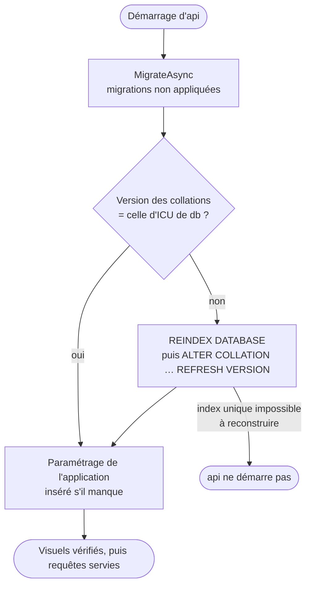

# Persistance : modèle et schéma

Seul `api` accède à `db`, par EF Core et Npgsql, à travers un contexte unique, [`BdthequeDbContext`](../../../src/Bdtheque.Infrastructure/BdthequeDbContext.cs), du projet `Bdtheque.Infrastructure`. Les raisons de chaque convention sont dans les concepts de [Persistance](../../../.speckit/choix-implementation/persistance/index.md) ; cette page dit où elles vivent et comment elles s'enchaînent. L'écriture d'un agrégat (verrou, version, enregistrement, suppression) est décrite à part : [Persistance : écriture d'un agrégat](persistance-ecriture-d-un-agregat.md).

## Le contexte

- **Une instance par requête HTTP** : enregistré par `AddDbContext` dans [`Program.cs` de l'API](../../../src/Bdtheque.Api/Program.cs), avec la chaîne de connexion `ConnectionStrings__Bdtheque`, et vérifié par le bilan de santé (`AddDbContextCheck`). Il reçoit en paramètre obligatoire l'horloge de l'application (`TimeProvider`), qui date les écritures ([Dates renseignées automatiquement : mise en œuvre](../../../.speckit/choix-implementation/persistance/dates-renseignees-automatiquement-mise-en-oeuvre.md)).
- **Outillage de conception** (`dotnet ef`) : [`BdthequeDbContextFactory`](../../../src/Bdtheque.Infrastructure/BdthequeDbContextFactory.cs) construit le contexte sans chaîne de connexion ; générer une migration ou comparer le modèle aux migrations ne se connecte à aucune base.
- **Enregistrement asynchrone seulement** : `SaveChanges` lève `NotSupportedException`, `SaveChangesAsync` étant le seul chemin où le journal des modifications et les dates sont posés.
- **Échecs non journalisés par EF Core** : les évènements d'échec d'une commande, d'une transaction, d'un enregistrement ou d'une requête sont ignorés dans `OnConfiguring` ; l'exception atteint toujours son appelant, qui la journalise une fois, selon sa nature (une valeur déjà prise est une erreur métier, pas une panne).

## Conventions du modèle

Posées une fois dans le contexte, elles valent pour toute entité ; chaque entité a en outre sa configuration dans [`Configurations/`](../../../src/Bdtheque.Infrastructure/Configurations/), chargée par `ApplyConfigurationsFromAssembly`.

| Convention | Où | Effet |
| --- | --- | --- |
| Collections chargées en requêtes séparées | `OnConfiguring`, `UseQuerySplittingBehavior(SplitQuery)` | Aucun produit cartésien quand un album arrive avec ses éditions, intentions et contributions. |
| Énumérations en entier | `ConfigureConventions`, `HaveConversion<int>()` | Valeurs explicites, tenues par le registre [`EnumValueLedger`](../../../tests/Bdtheque.Domain.Tests/EnumValueLedger.cs) ; une valeur hors définition est refusée par le domaine ([`EnumGuard`](../../../src/Bdtheque.Domain/Common/EnumGuard.cs)). |
| Collation française sur toute colonne texte | `ConfigureConventions`, `UseCollation(FrenchCollation)` | `fr-FR-x-icu` : tri linguistique en base, pagination comprise. |
| Collation insensible à la casse et aux accents | `OnModelCreating`, `HasCollation(CaseAndAccentInsensitiveFrenchCollation, …)` | `fr_case_accent_insensitive`, non déterministe, créée par la migration et posée par les configurations sur les colonnes dont l'unicité ignore casse et accents. |
| Identifiants jamais générés | `OnModelCreating`, `ValueGeneratedNever()` | Le `Guid` v7 que pose [`EntityBase`](../../../src/Bdtheque.Domain/Entities/Common/EntityBase.cs) dès la construction ; un enfant atteint par la navigation d'un parent chargé est inséré, pas mis à jour. |
| Version des racines d'agrégat | `OnModelCreating`, propriété fantôme `Version` sur `xmin`, `IsRowVersion()` | Sur toute entité marquée [`IAggregateRoot`](../../../src/Bdtheque.Domain/Entities/Common/IAggregateRoot.cs) : album, série, auteur, genre, éditeur, univers, recherche enregistrée, paramétrage. Lue par `VersionOf` ou `EF.Property<uint>(…, VersionProperty)`. |
| Collections toujours chargées | `AutoInclude()` des configurations | Éditions, intentions d'achat et contributions de l'album ([`AlbumConfiguration`](../../../src/Bdtheque.Infrastructure/Configurations/AlbumConfiguration.cs)) ; fiches désignées d'une recherche enregistrée ([`SavedSearchConfiguration`](../../../src/Bdtheque.Infrastructure/Configurations/SavedSearchConfiguration.cs)). |

## Schéma

- **Une migration unique**, `InitialCreate`, dans [`Migrations/`](../../../src/Bdtheque.Infrastructure/Migrations/), régénérée tant qu'aucun déploiement n'a eu lieu ([Migrations EF Core](../../../.speckit/choix-implementation/persistance/migrations-ef-core.md)). Le job « Build & tests (.NET) » du [CI](../../../.github/workflows/ci.yml) échoue si le modèle a changé sans elle (`dotnet ef migrations has-pending-model-changes`).
- **Contraintes unique différables** : un index du modèle marqué par `IsUniqueAtCommit()` ([`DeferredUniqueness`](../../../src/Bdtheque.Infrastructure/DeferredUniqueness.cs)) est non unique pour EF Core, et [`BdthequeMigrationsSqlGenerator`](../../../src/Bdtheque.Infrastructure/BdthequeMigrationsSqlGenerator.cs), qui remplace le générateur de Npgsql, le crée en `UNIQUE … DEFERRABLE INITIALLY DEFERRED`. Seul cas aujourd'hui : le nom d'une collection chez son éditeur ([Unicité vérifiée à la validation](../../../.speckit/choix-implementation/persistance/unicite-verifiee-a-la-validation.md)). Les autres unicités sont des index uniques.
- **Contraintes CHECK** : déclarées dans les configurations, elles doublent en base la partie mono-ligne des règles du domaine (ex. au moins un nom ou un pseudonyme d'auteur, date d'entrée dans la collection liée à la possession) ; les règles sur plusieurs lignes ne sont tenues que par le domaine ([Cohérence entre tables](../../../.speckit/choix-implementation/persistance/coherence-entre-tables.md)).
- **Règles `ON DELETE`** : `RESTRICT` pour chaque référence, `CASCADE` pour chaque composition et chaque table de jointure d'une association ([Suppression des entités : mise en œuvre](../../../.speckit/choix-implementation/ecritures/suppression-des-entites-mise-en-oeuvre.md)).

## Application du schéma au démarrage

Question du schéma : *qu'est-ce qu'`api` fait de la base avant de servir sa première requête ?* Schéma interprétatif.

- **Migrations** : `Database.MigrateAsync()` dans [`Program.cs` de l'API](../../../src/Bdtheque.Api/Program.cs), avant tout middleware : une base vide reçoit son schéma au premier démarrage, sans autre étape ([Application du schéma au démarrage](../../../.speckit/choix-implementation/deploiement/application-du-schema-au-demarrage.md)).
- **Collations** : [`CollationVersions.RefreshAsync`](../../../src/Bdtheque.Infrastructure/CollationVersions.cs) compare la version enregistrée des deux collations à celle qu'ICU fournit ; à la moindre différence, il reconstruit tous les index de la base, hors transaction, puis enregistre la nouvelle version, et `api` le journalise en avertissement ([Collation des colonnes texte](../../../.speckit/choix-implementation/persistance/collation-des-colonnes-texte.md)).
- **Paramétrage** : [`ProvisionApplicationSettingsAsync`](../../../src/Bdtheque.Infrastructure/ApplicationSettingsProvisioning.cs) insère par SQL, avec `ON CONFLICT DO NOTHING`, la fiche unique du paramétrage avec ses valeurs par défaut ; hors de `SaveChangesAsync`, elle n'entre pas au journal des modifications.

## Base des tests

- **Même moteur qu'en production** : [`PostgreSqlTestServer`](../../../tests/Bdtheque.Testing/PostgreSqlTestServer.cs) démarre un conteneur PostgreSQL par processus de test (Testcontainers), y applique une fois les migrations réelles à une base modèle, puis donne à chaque test une base clonée de ce modèle. [`BdthequeDbContextFixture`](../../../tests/Bdtheque.Infrastructure.Tests/BdthequeDbContextFixture.cs) en tire un contexte et son horloge.
- **Requête à corriger rendue visible** : [`StrictQueryWarnings`](../../../tests/Bdtheque.Testing/StrictQueryWarnings.cs) change en exception, dans les tests, l'avertissement d'EF Core qu'émettrait une requête chargeant plusieurs collections en une seule instruction.
- **Ce que fixent les tests de `Bdtheque.Infrastructure.Tests`** : schéma conforme au modèle ([`ModelCreationTests`](../../../tests/Bdtheque.Infrastructure.Tests/ModelCreationTests.cs)), contraintes CHECK et index uniques écrits en SQL brut, hors domaine ([`CheckConstraintTests`](../../../tests/Bdtheque.Infrastructure.Tests/CheckConstraintTests.cs)), règle `ON DELETE` de chaque clé étrangère selon sa nature, une clé non classée faisant échouer le test ([`DeleteRuleTests`](../../../tests/Bdtheque.Infrastructure.Tests/DeleteRuleTests.cs)), ordre linguistique ([`LinguisticOrderingTests`](../../../tests/Bdtheque.Infrastructure.Tests/LinguisticOrderingTests.cs)), unicités insensibles à la casse et aux accents ([`NameUniquenessTests`](../../../tests/Bdtheque.Infrastructure.Tests/NameUniquenessTests.cs)), reconstruction après un changement d'ICU ([`CollationVersionsTests`](../../../tests/Bdtheque.Infrastructure.Tests/CollationVersionsTests.cs)). Le démarrage d'`api` sur une base vide est exercé par [`StartupMigrationTests`](../../../tests/Bdtheque.Api.Tests/StartupMigrationTests.cs).

## Invariants à préserver

- Toute évolution du modèle s'accompagne de la migration qui la porte ; avant le premier déploiement, c'est la migration unique qui est régénérée, à schéma identique hors l'évolution voulue.
- Une collation n'est jamais déclarée sur une seule requête à la place de la colonne : le tri et l'unicité de la base reposent sur celle de la colonne.
- Tout index unique d'une table que l'utilisateur écrit a son code de règle dans [`UniqueIndexRules`](../../../src/Bdtheque.Api/Errors/UniqueIndexRules.cs), ce que vérifie [`UniqueIndexRulesTests`](../../../tests/Bdtheque.Api.Tests/UniqueIndexRulesTests.cs) : sans lui, une valeur déjà prise deviendrait une erreur technique.
