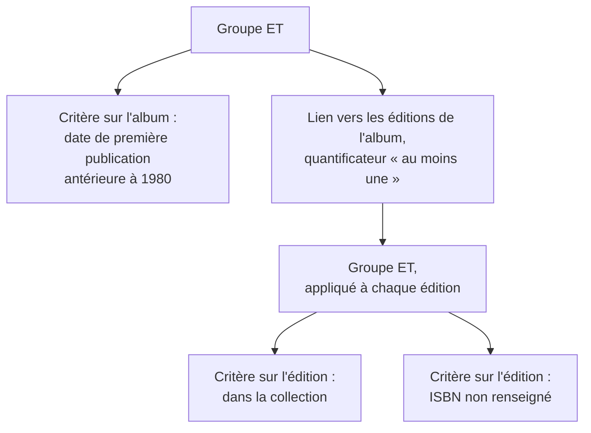
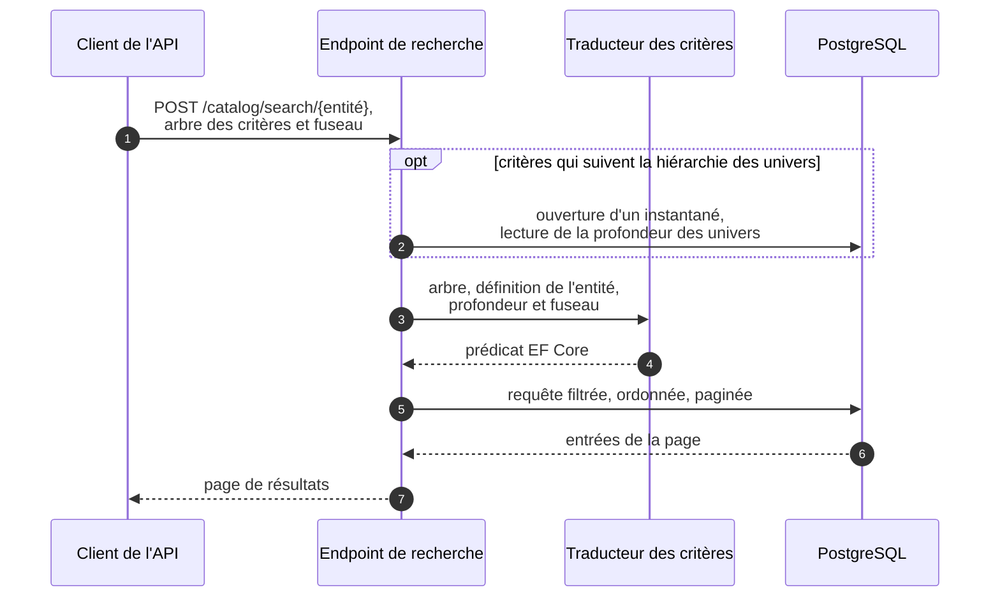

# Recherche simple et avancée

`api` propose deux façons de chercher des fiches. La première est celle des listes : l'utilisateur tape un texte et choisit quelques filtres, et la liste se réduit aux fiches qui y répondent. La seconde est la recherche avancée, qui accepte n'importe quelle combinaison de critères sur les données d'une entité et sur celles des fiches qui lui sont liées ; une recherche avancée peut être enregistrée sous un nom, puis rejouée plus tard avec d'autres valeurs. Dans les deux cas, la recherche est traduite en une requête EF Core que PostgreSQL exécute : aucune fiche n'est chargée en mémoire pour être filtrée. Les raisons de ces choix et les règles qu'ils appliquent sont dans [Recherche](../../../.speckit/choix-implementation/api/recherche.md), [Recherche avancée : mise en œuvre](../../../.speckit/choix-implementation/recherche-avancee/recherche-avancee-mise-en-oeuvre.md) et [Recherches enregistrées : mise en œuvre](../../../.speckit/choix-implementation/recherche-avancee/recherches-enregistrees-mise-en-oeuvre.md).

## Recherche des listes

Le texte saisi dans une liste est recherché **par inclusion** : une fiche répond s'il apparaît n'importe où dans ce qui l'identifie dans sa liste, c'est-à-dire son titre ou son nom, le nom d'un auteur, dans un ordre comme dans l'autre, ou encore la série d'un album. La comparaison ignore la casse et les accents, parce que la requête applique une collation qui les ignore à l'expression comparée, et non à la colonne elle-même ; aucun index n'est dédié à cette recherche. Une édition se cherche aussi par son ISBN, dont les séparateurs sont retirés aussi bien du texte saisi que de la valeur enregistrée, si bien que « 978-2-… » et « 9782… » se retrouvent.

Les filtres d'une liste se combinent entre eux, et chacun restreint le résultat des autres : ce sont des **filtres croisés**. Ceux qui valent pour plusieurs listes sont écrits une fois dans [`CatalogFilters`](../../../src/Bdtheque.Api/Endpoints/CatalogFilters.cs), les autres dans les filtres propres à chaque entité (`AlbumFilters`, `SeriesFilters`, `EditionFilters`). Un filtre sur un univers retient aussi les fiches rattachées à ses sous-univers : [`UniverseTree`](../../../src/Bdtheque.Api/Endpoints/UniverseTree.cs) charge pour cela la table des univers en entier, qui reste petite, et calcule la descendance en mémoire. Un filtre qui désigne une fiche inexistante donne simplement une liste vide.

La plupart des listes proposent aussi la **navigation par initiale**, qui ne garde que les fiches rangées sous une lettre, sous `#` pour un chiffre ou sous `@` pour tout autre caractère ; son paramètre d'adresse est `entry`. Cette entrée n'est jamais calculée par la requête : le domaine la calcule à chaque écriture, avec [`NavigationEntryCalculator`](../../../src/Bdtheque.Domain/Common/NavigationEntryCalculator.cs), depuis la clé de tri d'une série, d'un album ou d'un auteur, ou depuis le nom d'un éditeur et le libellé d'un genre, et la stocke dans une colonne indexée avec ce qui ordonne la liste. Une édition et une intention d'achat n'ont pas d'entrée propre : elles sont rangées sous celle de leur album, que la méthode `WhereAlbumEntry` de `CatalogExpressions` lit à la requête, comme pour la liste des albums, un album sans titre prenant l'entrée de sa série. Une entrée qui n'est pas l'une de ces vingt-huit valeurs est une erreur technique, puisque c'est le frontend qui construit la navigation.

Plusieurs expressions reviennent dans de nombreuses requêtes : le libellé d'un album, son appartenance à la collection, ses contributions ou l'ordre des albums d'une série. [`CatalogExpressions`](../../../src/Bdtheque.Api/Endpoints/CatalogExpressions.cs) les écrit une seule fois sous forme d'arbres d'expression, et la méthode `Expand` les insère dans chaque requête qui s'en sert. EF Core voit ainsi une seule expression, qu'il traduit entièrement en SQL, au lieu d'un appel de méthode qu'il ne saurait pas traduire.

## Recherche avancée

### Les critères, un arbre

Un client décrit sa recherche par un **arbre des critères**, envoyé en JSON et défini dans les contrats par [`SearchCondition`](../../../src/Bdtheque.Contracts/Search/SearchCondition.cs). Chaque nœud de l'arbre est d'une des sortes suivantes, que distingue la propriété `kind` du JSON :

- un **groupe** réunit plusieurs conditions par ET ou par OU ;
- un **NON** retient les fiches que sa condition n'établit pas ;
- un **critère** compare une donnée de l'entité à une ou plusieurs valeurs, par exemple « la date de première publication est comprise entre 1990 et 1999 » ;
- une **comparaison entre deux données** confronte deux données de même type, de la même fiche ou d'une fiche liée ;
- un **lien** passe aux fiches liées par une relation du modèle, par exemple des albums à leurs éditions, et porte la condition que ces fiches doivent remplir. Quand la relation mène à plusieurs fiches, un **quantificateur** précise combien d'entre elles doivent la remplir : au moins une, toutes, aucune, ou un nombre comparé à une valeur.

Toutes les valeurs sont écrites en texte, selon le type de la donnée : un nombre en chiffres décimaux, une date sous la forme `aaaa`, `aaaa-MM` ou `aaaa-MM-jj` selon la précision voulue, une fiche par son identifiant. Une donnée absente ne satisfait aucune comparaison, sauf « n'est pas renseignée ».

Le schéma suivant, tracé à la main, illustre la structure d'un tel arbre sur un exemple : comment des groupes, des liens et des critères s'emboîtent-ils pour exprimer « albums publiés avant 1980 dont au moins une édition est dans la collection et n'a pas d'ISBN » ?

### Le schéma de la recherche, par entité

Les données et les liens qu'un arbre peut citer sont déclarés une seule fois, entité par entité, dans [`AdvancedSearchSchema`](../../../src/Bdtheque.Api/Search/AdvancedSearchSchema.cs), sous la forme d'une [`SearchEntityDefinition`](../../../src/Bdtheque.Api/Search/SearchEntityDefinition.cs) par entité. Chaque donnée et chaque lien y ont une clé, que l'arbre emploie pour les désigner. Cette déclaration unique sert à deux choses : elle produit la description que les clients lisent pour construire leurs critères, servie par `GET /catalog/search/schema` sous la forme d'un [`SearchSchema`](../../../src/Bdtheque.Contracts/Search/SearchSchema.cs), et elle porte la traduction de chaque donnée et de chaque lien en expression EF Core. Comme les recherches enregistrées conservent ces clés dans leurs critères, une clé n'est jamais renommée.

### Traduction et exécution

Une recherche s'exécute par `POST /catalog/search/{entité}`, l'arbre des critères dans le corps de la requête. Le paramètre d'adresse du fuseau horaire indique, par un nom IANA comme `Europe/Paris`, le fuseau dans lequel interpréter les dates ; [`SearchTimeZones`](../../../src/Bdtheque.Api/Search/SearchTimeZones.cs) le résout. Les résultats sont les entrées de la liste de consultation de l'entité, dans son ordre habituel, et sont paginés.

Le schéma suivant, tracé à la main d'après le code, répond à une seule question : dans quel ordre `api` traite-t-il une requête de recherche avancée, de sa réception à la page de résultats ?

La traduction est le cœur du mécanisme. [`SearchTranslator`](../../../src/Bdtheque.Api/Search/SearchTranslator.cs) parcourt l'arbre et construit un **prédicat EF Core**, c'est-à-dire une expression `Expression<Func<T, bool>>` qui dit si une fiche répond, et qu'EF Core sait traduire en clause `WHERE`. Chaque critère est traduit par la [`SearchField`](../../../src/Bdtheque.Api/Search/SearchFields.cs) de sa donnée, dont il existe une variante par type (texte, nombre, date, montant, énumération…), et chaque lien par sa [`SearchLinkDefinition`](../../../src/Bdtheque.Api/Search/SearchLinks.cs), qui produit un sous-prédicat sur les fiches liées et lui applique le quantificateur. [`SearchScope`](../../../src/Bdtheque.Api/Search/SearchLinks.cs) transporte pendant le parcours ce dont la traduction a besoin, notamment la profondeur de la hiérarchie des univers et le fuseau horaire, et [`SearchValues`](../../../src/Bdtheque.Api/Search/SearchValues.cs) lit les valeurs écrites en texte.

Quelques règles de traduction méritent d'être connues :

- Les valeurs des critères ne sont jamais écrites dans le SQL : elles y entrent comme paramètres. Deux recherches de même forme, qui ne diffèrent que par leurs valeurs, produisent donc la même requête, qu'EF Core ne compile qu'une fois et garde en cache, et aucune valeur ne peut altérer le SQL.
- Un texte est comparé avec la collation qui ignore la casse et les accents, sauf si le critère demande de les respecter ; la requête utilise alors la collation française. Dans les deux cas, la collation est écrite explicitement dans la requête.
- Une date est comparée comme une période : « 1985 » couvre toute l'année. Une donnée qui porte une date et une heure est d'abord ramenée à son jour dans le fuseau de la requête.
- Un critère sur un univers retient aussi ses descendants. Comme une requête SQL ne peut pas parcourir une hiérarchie de profondeur inconnue sans requête récursive, la traduction déroule la relation d'ancêtre sur autant de niveaux que la hiérarchie en compte. Cette profondeur est lue dans le même instantané, de niveau `REPEATABLE READ`, que les résultats : un univers déplacé plus bas entre les deux lectures ne peut donc pas échapper à la recherche.

Une valeur vide dans un critère est refusée comme une erreur métier, que l'utilisateur peut corriger. Des critères qui citent une donnée ou un lien que le schéma ne décrit pas, en revanche, sont une erreur technique, puisqu'un client correct ne les envoie jamais.

## Recherches enregistrées

Une **recherche enregistrée** est une recherche avancée conservée sous un nom, avec l'entité qu'elle cherche et son arbre des critères. L'entité du domaine [`SavedSearch`](../../../src/Bdtheque.Domain/Entities/SavedSearch.cs) garde les critères tels qu'ils ont été écrits, dans la forme JSON du contrat que fixe [`SearchCriteriaJson`](../../../src/Bdtheque.Api/Search/SearchCriteriaJson.cs), dans une colonne `text` et non `jsonb` : PostgreSQL n'a pas à les interpréter, et le texte est restitué exactement tel qu'il a été envoyé. À chaque création ou modification, l'API traduit les critères sans les exécuter ; une erreur y est donc signalée dès l'enregistrement, comme elle l'aurait été à l'exécution.

Une recherche enregistrée peut déclarer des **variables**, pour être rejouée avec d'autres valeurs que celles de ses critères. Chaque variable porte un nom et désigne, par un pointeur JSON (une adresse dans le document, comme `/conditions/0/values/0`), la valeur des critères qu'elle remplace ; cette valeur est aussi sa valeur par défaut. Deux variables d'une même recherche ne peuvent pas avoir des noms qui ne diffèrent que par la casse ou les accents. Au rejeu, par `POST /catalog/saved-searches/{id}/results`, le client donne la valeur de certaines variables par leur nom : la méthode `CriteriaWith` de `SavedSearch` les substitue dans le texte des critères, les autres variables gardant leur valeur par défaut, puis la recherche s'exécute exactement comme une recherche avancée.

Les critères d'une recherche enregistrée peuvent désigner des fiches précises, par exemple « albums de la série *X* ». Si l'une de ces fiches disparaissait, la recherche deviendrait silencieusement fausse. Pour l'empêcher, [`SearchDesignations`](../../../src/Bdtheque.Api/Search/SearchDesignations.cs) relève, d'après le schéma, toutes les fiches que les critères désignent, à n'importe quelle profondeur de lien, et le domaine les enregistre dans la table `SavedSearchDesignations`. Cette table porte une colonne générée par entité désignable, chacune munie d'une clé étrangère `ON DELETE RESTRICT` ([`SavedSearchDesignationConfiguration`](../../../src/Bdtheque.Infrastructure/Configurations/SavedSearchDesignationConfiguration.cs)) : c'est donc la base elle-même qui refuse la suppression d'une fiche désignée, quelle que soit l'écriture qui tente de la supprimer.

Les routes des recherches enregistrées sont déclarées dans [`SavedSearchEndpoints`](../../../src/Bdtheque.Api/Endpoints/SavedSearchEndpoints.cs). L'administration les lit, les crée et les modifie sous `/admin/saved-searches`. La consultation en obtient la liste et le détail sous `/catalog/saved-searches`, et les rejoue par `POST /catalog/saved-searches/{id}/results`.

## Tests

- [`AdvancedSearchTests`](../../../tests/Bdtheque.Api.Tests/AdvancedSearchTests.cs) vérifie la traduction et l'exécution de la recherche avancée, [`SearchParametersTests`](../../../tests/Bdtheque.Api.Tests/SearchParametersTests.cs) que les valeurs restent des paramètres du SQL, et [`SearchTimeZonesTests`](../../../tests/Bdtheque.Api.Tests/SearchTimeZonesTests.cs) la résolution du fuseau.
- [`SearchCriteriaJsonTests`](../../../tests/Bdtheque.Api.Tests/SearchCriteriaJsonTests.cs) fige la forme JSON des critères. [`SavedSearchEndpointsTests`](../../../tests/Bdtheque.Api.Tests/SavedSearchEndpointsTests.cs) et [`SavedSearchDesignationTests`](../../../tests/Bdtheque.Api.Tests/SavedSearchDesignationTests.cs) couvrent les routes et la protection des fiches désignées, et [`SavedSearchTests`](../../../tests/Bdtheque.Domain.Tests/SavedSearchTests.cs) les règles du domaine.

## Invariants à préserver

- Une clé du schéma, un discriminant `kind` ou un nom de propriété de la forme JSON des critères n'est jamais renommé, parce que les recherches enregistrées et le journal des modifications les conservent.
- Aucune valeur d'un critère n'est écrite dans le SQL.
- Une donnée ou un lien ajouté au modèle, s'il doit être cherchable, s'ajoute au schéma de la recherche, seul endroit qui le décrit et le traduit.
