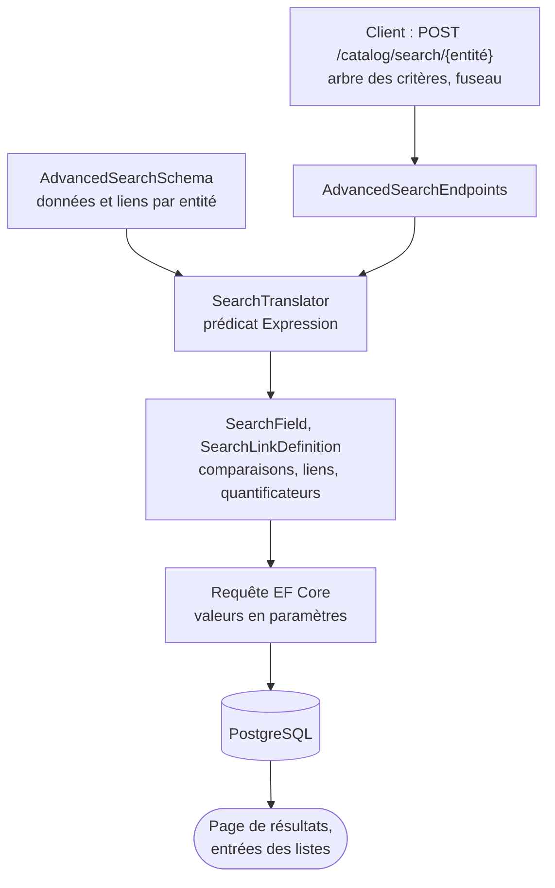

# Recherche simple et avancée

`api` offre deux recherches : celle des listes, par un texte et des filtres, et la recherche avancée, sur toute combinaison de critères, que les recherches enregistrées rejouent. Les deux s'exécutent dans la base, par EF Core. Raisons et règles : [Recherche](../../../.speckit/choix-implementation/api/recherche.md), [Recherche avancée : mise en œuvre](../../../.speckit/choix-implementation/recherche-avancee/recherche-avancee-mise-en-oeuvre.md), [Recherches enregistrées : mise en œuvre](../../../.speckit/choix-implementation/recherche-avancee/recherches-enregistrees-mise-en-oeuvre.md).

## Recherche des listes

- **Texte recherché** : inclusion, comparée avec la collation insensible à la casse et aux accents, posée sur l'expression et non sur la colonne ; sans index dédié. Une fiche se cherche par ce qui l'identifie dans sa liste (titre, nom, nom d'un auteur dans ses deux ordres, série d'un album) ; une édition par son ISBN, séparateurs ignorés des deux côtés.
- **Filtres croisés** : [`CatalogFilters`](../../../src/Bdtheque.Api/Endpoints/CatalogFilters.cs) et les filtres propres à chaque entité (`AlbumFilters`, `SeriesFilters`, `EditionFilters`). Un filtre sur un univers couvre ses sous-univers, calculés en mémoire sur le référentiel chargé en entier ([`UniverseTree`](../../../src/Bdtheque.Api/Endpoints/UniverseTree.cs)) ; un filtre sur une fiche inexistante donne une liste vide.
- **Expressions partagées** : [`CatalogExpressions`](../../../src/Bdtheque.Api/Endpoints/CatalogExpressions.cs) écrit une fois les libellés, l'appartenance à la collection, les contributions ou l'ordre des albums, et les insère dans chaque requête par composition d'arbres d'expression (`Expand`).

## Recherche avancée

Question du schéma : *comment des critères envoyés par un client deviennent-ils une requête SQL ?* Schéma interprétatif.

- **Critères** : un arbre polymorphe en JSON, [`SearchCondition`](../../../src/Bdtheque.Contracts/Search/SearchCondition.cs), dans les contrats : groupe ET/OU, NON, critère sur une donnée, comparaison entre deux données, lien vers des fiches liées (avec son quantificateur s'il est multiple) qui porte sa propre condition. Toute valeur est écrite en texte.
- **Schéma** : [`AdvancedSearchSchema`](../../../src/Bdtheque.Api/Search/AdvancedSearchSchema.cs) déclare une fois, par entité ([`SearchEntityDefinition`](../../../src/Bdtheque.Api/Search/SearchEntityDefinition.cs)), ses données et ses liens. Il produit à la fois la description exposée aux clients (`GET /catalog/search/schema`, [`SearchSchema`](../../../src/Bdtheque.Contracts/Search/SearchSchema.cs)) et la traduction. Ses clés sont stockées par les recherches enregistrées : elles ne sont jamais renommées.
- **Traduction** : [`SearchTranslator`](../../../src/Bdtheque.Api/Search/SearchTranslator.cs) construit un prédicat `Expression<Func<T, bool>>` qu'EF Core exécute dans la base, liens compris. [`SearchField`](../../../src/Bdtheque.Api/Search/SearchFields.cs) et ses dérivés, un par type de donnée, traduisent chaque comparaison ; [`SearchLinkDefinition`](../../../src/Bdtheque.Api/Search/SearchLinks.cs) traduit chaque lien et son quantificateur, et [`SearchScope`](../../../src/Bdtheque.Api/Search/SearchLinks.cs) porte le contexte de la traduction, dont la profondeur de la hiérarchie des univers et le fuseau ; [`SearchValues`](../../../src/Bdtheque.Api/Search/SearchValues.cs) lit les valeurs écrites en texte.
  - **Paramètres** : les valeurs ne sont jamais écrites dans le SQL ; une même forme de critères reste une seule requête en cache.
  - **Texte** : comparé avec la collation insensible à la casse et aux accents, ou la collation française quand le critère distingue casse et accents, toujours explicite.
  - **Dates** : comparées comme des périodes ; une date et heure, par son jour dans le fuseau de la requête (paramètre de l'adresse, nom IANA seul, [`SearchTimeZones`](../../../src/Bdtheque.Api/Search/SearchTimeZones.cs)).
  - **Univers** : la relation d'ancêtre est déroulée sur la profondeur de la hiérarchie, lue dans le même instantané que les résultats.
- **Exécution** : `POST /catalog/search/{entité}`, les critères dans le corps ; les résultats sont les entrées de la liste de consultation de l'entité, dans son ordre, paginés. Une valeur vide est une erreur métier ; des critères que le schéma ne décrit pas, une erreur technique.

## Recherches enregistrées

- **Critères en texte** : [`SavedSearch`](../../../src/Bdtheque.Domain/Entities/SavedSearch.cs) les garde tels qu'écrits, dans la forme JSON du contrat ([`SearchCriteriaJson`](../../../src/Bdtheque.Api/Search/SearchCriteriaJson.cs)), en `text` et non en `jsonb`. L'API les traduit, sans les exécuter, à chaque écriture : une erreur y est celle qu'aurait l'exécution.
- **Variables** : chacune désigne par pointeur JSON la constante des critères qu'elle remplace, qui est sa valeur par défaut. Leurs noms se distinguent sans casse ni accents.
- **Fiches désignées** : [`SearchDesignations`](../../../src/Bdtheque.Api/Search/SearchDesignations.cs) relève, d'après le schéma, les fiches que comparent les critères, à tout niveau de lien. Le domaine les enregistre dans la table `SavedSearchDesignations`, qui porte une colonne générée stockée par entité désignable, chacune avec sa clé étrangère `RESTRICT` ([`SavedSearchDesignationConfiguration`](../../../src/Bdtheque.Infrastructure/Configurations/SavedSearchDesignationConfiguration.cs)) : la base refuse la suppression d'une fiche désignée, quelle que soit l'écriture qui la supprime.
- **Routes** ([`SavedSearchEndpoints`](../../../src/Bdtheque.Api/Endpoints/SavedSearchEndpoints.cs)) : administration sous `/admin/saved-searches` (lecture, création, modification) ; consultation sous `/catalog/saved-searches` (liste, détail, rejeu par `POST /{id}/results`, avec la valeur des variables par leur nom).

## Tests

- **Recherche avancée** : [`AdvancedSearchTests`](../../../tests/Bdtheque.Api.Tests/AdvancedSearchTests.cs), [`SearchParametersTests`](../../../tests/Bdtheque.Api.Tests/SearchParametersTests.cs) (valeurs en paramètres), [`SearchTimeZonesTests`](../../../tests/Bdtheque.Api.Tests/SearchTimeZonesTests.cs).
- **Recherches enregistrées** : [`SearchCriteriaJsonTests`](../../../tests/Bdtheque.Api.Tests/SearchCriteriaJsonTests.cs) (forme JSON figée), [`SavedSearchEndpointsTests`](../../../tests/Bdtheque.Api.Tests/SavedSearchEndpointsTests.cs), [`SavedSearchDesignationTests`](../../../tests/Bdtheque.Api.Tests/SavedSearchDesignationTests.cs), [`SavedSearchTests`](../../../tests/Bdtheque.Domain.Tests/SavedSearchTests.cs) pour le domaine.

## Invariants à préserver

- Une clé du schéma, un discriminant ou un nom de propriété de la forme JSON des critères n'est jamais renommé : des recherches enregistrées et le journal les stockent.
- Aucune valeur d'un critère n'est écrite dans le SQL.
- Une donnée ou un lien ajouté au modèle s'ajoute au schéma, seul endroit qui le décrit et le traduit.
