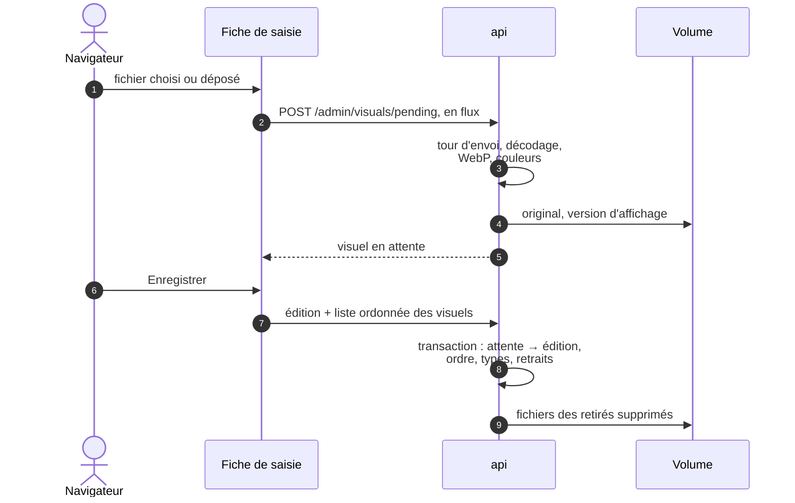

# Visuels

Les images d'une édition (couvertures, dos, pages…) sont des fichiers sur un volume que seul `api` monte ; la base ne garde que leur référence et leurs couleurs. `frontend` les téléverse et les relaie au navigateur, sans connaître leurs fichiers. Raisons et règles : [Visuels : stockage et traitement](../../../.speckit/choix-implementation/domaine/visuels-stockage-et-traitement.md). Le relais des médias et son secret sont décrits dans [Authentification et appels internes](authentification-et-appels-internes.md).

## Du fichier choisi au visuel enregistré

Question du schéma : *par où passe un fichier, du navigateur au visuel d'une édition enregistrée ?* Schéma interprétatif.

- **Envoi** : [`EditionVisualsEditor`](../../../src/Bdtheque.Frontend/Components/Controls/EditionVisualsEditor.razor), bloc de la fiche d'une édition, envoie chaque fichier un à la fois, depuis le circuit, en *multipart* et en flux, par [`ApiUploadClient`](../../../src/Bdtheque.Frontend/Api/ApiUploadClient.cs) : le client de l'API sans son délai fixe. Il refuse sans le lire un fichier plus lourd que la limite que donne `GET /admin/visuals/limits`, et retire de la fiche les visuels en attente arrivés au terme de leur conservation.
- **Réception** : [`PendingVisualEndpoints`](../../../src/Bdtheque.Api/Endpoints/PendingVisualEndpoints.cs). [`VisualUploadGate`](../../../src/Bdtheque.Api/Visuals/VisualUploadGate.cs) ne laisse passer qu'un téléversement à la fois, les autres attendant leur tour avant la lecture du corps. [`VisualUploadReader`](../../../src/Bdtheque.Api/Visuals/VisualUploadReader.cs) lit le formulaire en flux et en borne le poids.
- **Validation et conversion**, en mémoire, avant toute écriture : [`VisualImage`](../../../src/Bdtheque.Api/Visuals/VisualImage.cs), par SkiaSharp, décode l'image (JPEG, PNG, WebP ou GIF), borne ses dimensions avant d'allouer, applique l'orientation EXIF et produit la version d'affichage WebP (1200 pixels au plus). [`VisualColors`](../../../src/Bdtheque.Api/Visuals/VisualColors.cs) tire de cette version les trois couleurs du visuel. Une image refusée est une erreur métier.
- **Zone d'attente** : le visuel est enregistré comme visuel en attente, rattaché à aucune édition, et conservé 24 heures. Ses médias sont servis à l'administration seule (`/admin/visuals/pending/{id}/display` et `/original`).
- **Enregistrement avec l'édition** : la fiche envoie la liste ordonnée de ses visuels, existants ou en attente, avec leur type. Dans la transaction de l'édition, sous la version de l'album, [`EditionVisualEntries`](../../../src/Bdtheque.Api/Visuals/EditionVisualEntries.cs) fait des visuels en attente ceux de l'édition, applique ordre et types, et retire les absents, dont les fichiers sont supprimés après la validation. Un visuel en attente expiré ou disparu refuse l'enregistrement.
- **Visuels d'une édition existante** : [`EditionVisualEndpoints`](../../../src/Bdtheque.Api/Endpoints/EditionVisualEndpoints.cs), sous `/admin/albums/{album}/editions/{édition}/visuals` (lecture, téléversement, réarrangement en une écriture, suppression par le mécanisme commun).

## Stockage et médias

- **Volume** : [`VisualStorage`](../../../src/Bdtheque.Api/Visuals/VisualStorage.cs) range l'original sous `originals/` et la version d'affichage sous `display/`, nommés par la référence du média, un `Guid` jamais réutilisé suivi de l'extension de l'original. Son chemin vient de la configuration ([`VisualStorageOptions`](../../../src/Bdtheque.Api/Visuals/VisualStorageOptions.cs)).
- **Démarrage** : `api` refuse de démarrer si le volume n'est pas accessible en écriture, et avertit s'il n'est pas monté depuis l'hôte ([`MountInfo`](../../../src/Bdtheque.Api/Visuals/MountInfo.cs)).
- **Médias servis** : [`VisualMediaEndpoints`](../../../src/Bdtheque.Api/Endpoints/VisualMediaEndpoints.cs), `/catalog/visuals/{id}/display` et `/original`, désignés par l'identifiant du visuel, jamais par un chemin ; en flux, avec un cache HTTP d'un an `immutable`. `frontend` les relaie sous les mêmes chemins ([`VisualMediaRelay`](../../../src/Bdtheque.Frontend/Api/VisualMediaRelay.cs)).
- **Couleurs du jour** : celles de la couverture de l'édition à la une, lues par `GET /catalog/spotlight/colors` ([Frontend : visite, thème, culture et mesure d'audience](frontend-visite-theme-et-culture.md)).

## Cohérence entre fichiers et base

- **Écritures compensées** : les fichiers sont écrits juste avant l'enregistrement, et supprimés si celui-ci échoue avant la validation de la transaction ; un échec de la validation elle-même n'est pas compensé, la transaction ayant pu aboutir.
- **Réconciliation** : [`VisualReconciliation`](../../../src/Bdtheque.Api/Visuals/VisualReconciliation.cs), tâche de fond au démarrage puis chaque jour, supprime les visuels en attente expirés, puis tout fichier qu'aucun visuel ne désigne et qui date de plus d'une heure.

## Tests

- **Traitement de l'image** : [`VisualImageTests`](../../../tests/Bdtheque.Api.Tests/VisualImageTests.cs), [`VisualColorsTests`](../../../tests/Bdtheque.Api.Tests/VisualColorsTests.cs).
- **Volume** : [`VisualVolumeTests`](../../../tests/Bdtheque.Api.Tests/VisualVolumeTests.cs).
- **Endpoints**, zone d'attente et réconciliation comprises : [`PendingVisualEndpointsTests`](../../../tests/Bdtheque.Api.Tests/PendingVisualEndpointsTests.cs), [`EditionVisualEndpointsTests`](../../../tests/Bdtheque.Api.Tests/EditionVisualEndpointsTests.cs) ; règles du domaine : [`EditionVisualsEntryTests`](../../../tests/Bdtheque.Domain.Tests/EditionVisualsEntryTests.cs).
- **Relais dans le navigateur** : [`VisualMediaRelayTests`](../../../tests/Bdtheque.EndToEnd.Tests/VisualMediaRelayTests.cs).

## Invariants à préserver

- Seul `api` lit et écrit le volume ; aucun contrat ne révèle un chemin de fichier.
- Toute validation et toute conversion ont lieu avant la première écriture.
- Le média d'un visuel ne change jamais : son cache d'un an en dépend.
