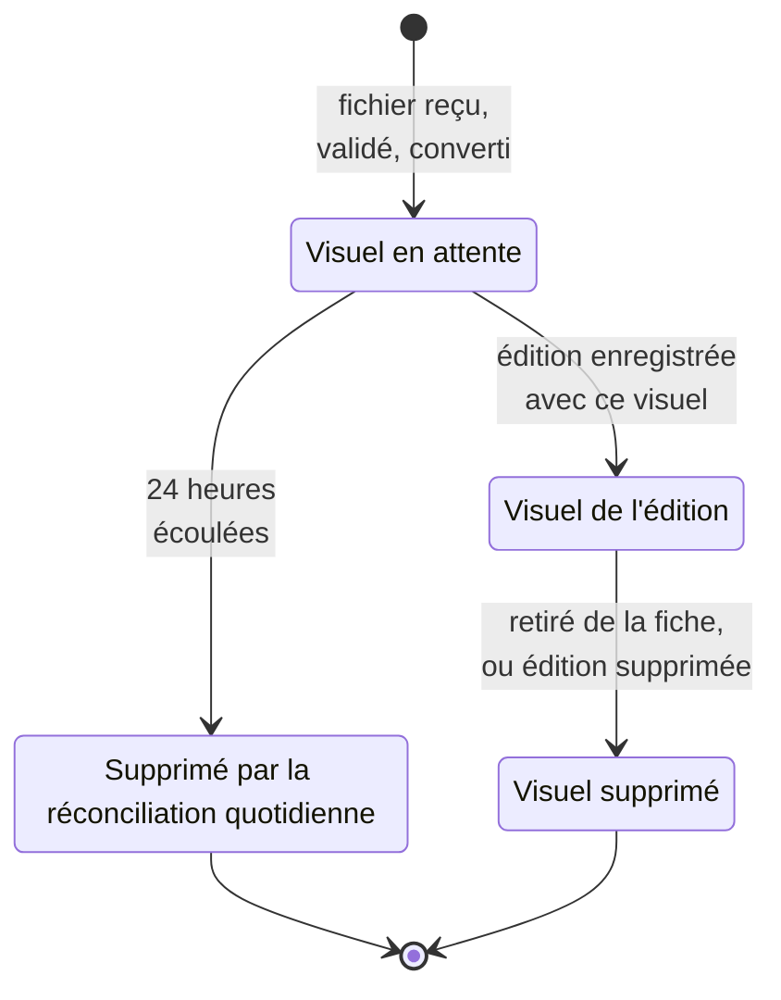
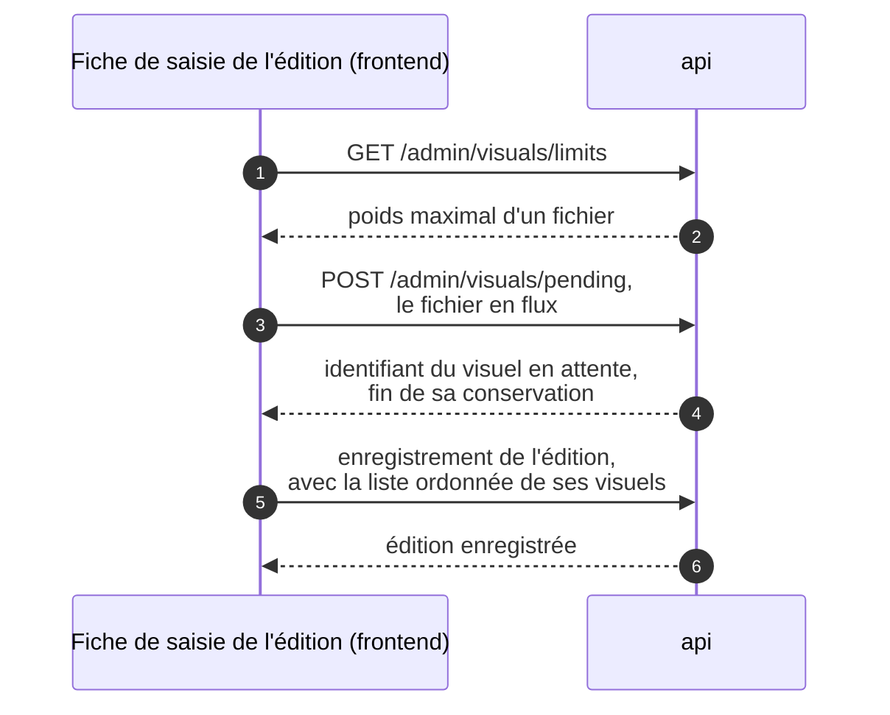

# Visuels

Un **visuel** est une image attachée à une édition : sa couverture, son dos, une page intérieure… Les fichiers de ces images ne sont pas dans la base. Ils sont rangés sur un volume Docker que seul le conteneur `api` monte, et la base ne garde de chaque visuel que sa référence, son type, son ordre et ses couleurs. `frontend` n'accède jamais à ce volume : il transmet à `api` les fichiers que l'administrateur choisit, et relaie au navigateur les images qu'`api` lui sert. Les raisons de cette organisation sont dans [Visuels : stockage et traitement](../../../.speckit/choix-implementation/domaine/visuels-stockage-et-traitement.md) ; le relais des médias et le secret qui protège ses appels sont décrits dans [Authentification et appels internes](authentification-et-appels-internes.md).

## Vie d'un visuel

Un fichier choisi dans la fiche d'une édition n'appartient pas tout de suite à cette édition. L'administrateur peut encore abandonner sa saisie, et l'édition elle-même n'existe peut-être pas encore. Le fichier est donc d'abord reçu, vérifié et converti, puis conservé comme **visuel en attente** : un visuel rattaché à aucune édition, qu'`api` garde 24 heures. C'est l'enregistrement de la fiche de l'édition qui en fait un visuel de l'édition. Cette **zone d'attente** permet à la fiche de montrer aussitôt l'image téléversée, sans rien écrire dans l'édition avant que l'administrateur n'enregistre.

Le schéma suivant, tracé à la main d'après le code, ne montre que les états d'un visuel : par quels états passe-t-il, et qu'est-ce qui le fait passer de l'un à l'autre ?

Changer l'ordre ou le type d'un visuel de l'édition ne change pas son état : il reste un visuel de l'édition, et le schéma ne le montre donc pas.

## Du fichier choisi au visuel enregistré

Le schéma suivant, tracé à la main d'après le code, montre seulement les requêtes échangées entre la fiche de saisie, qui s'exécute dans `frontend`, et `api` : quelles requêtes font passer un fichier de la fiche au visuel d'une édition enregistrée ?

### Envoi depuis la fiche

Le bloc des visuels de la fiche d'une édition, [`EditionVisualsEditor`](../../../src/Bdtheque.Frontend/Components/Controls/EditionVisualsEditor.razor), envoie les fichiers que l'administrateur choisit ou dépose un par un. Il les transmet depuis le circuit Blazor, c'est-à-dire depuis le serveur `frontend` qui exécute la fiche, et non depuis le navigateur. L'envoi passe par [`ApiUploadClient`](../../../src/Bdtheque.Frontend/Api/ApiUploadClient.cs), un client de l'API sans le délai fixe du client ordinaire, parce qu'un gros fichier peut mettre longtemps à transiter ; le fichier part en *multipart* et en flux, sans être chargé entier en mémoire. Avant cela, la fiche refuse sans le lire un fichier plus lourd que la limite que lui donne `GET /admin/visuals/limits`. Elle retire aussi d'elle-même les visuels en attente qui ont atteint la fin de leur conservation, puisqu'`api` ne les accepterait plus.

### Réception, validation et conversion

[`PendingVisualEndpoints`](../../../src/Bdtheque.Api/Endpoints/PendingVisualEndpoints.cs) reçoit le fichier. Le décodage et la conversion d'une image demandent beaucoup de mémoire ; [`VisualUploadGate`](../../../src/Bdtheque.Api/Visuals/VisualUploadGate.cs) ne laisse donc passer qu'un téléversement à la fois, les autres attendant leur tour avant même que leur corps ne soit lu. [`VisualUploadReader`](../../../src/Bdtheque.Api/Visuals/VisualUploadReader.cs) lit ensuite le formulaire en flux et s'arrête dès que le poids maximal est dépassé.

Tout est vérifié et converti en mémoire, avant la moindre écriture sur le volume. [`VisualImage`](../../../src/Bdtheque.Api/Visuals/VisualImage.cs) s'appuie sur la bibliothèque SkiaSharp : elle décode l'image, qui doit être un JPEG, un PNG, un WebP ou un GIF, vérifie ses dimensions avant d'allouer la mémoire de ses pixels, applique l'orientation indiquée par ses données EXIF, puis produit une **version d'affichage** au format WebP, dont le plus grand côté mesure au plus 1200 pixels. L'original est conservé tel quel à côté d'elle. [`VisualColors`](../../../src/Bdtheque.Api/Visuals/VisualColors.cs) tire enfin de la version d'affichage les trois couleurs du visuel, enregistrées avec lui. Une image illisible, d'un format non pris en charge ou trop grande est refusée par une erreur métier, que la fiche présente à l'administrateur.

Le visuel est alors enregistré en attente. Tant qu'il l'est, ses images ne sont servies qu'à l'administration, sous `/admin/visuals/pending/{id}/display` et `/original`.

### Enregistrement avec l'édition

Quand l'administrateur enregistre la fiche, elle envoie avec l'édition la liste ordonnée de tous ses visuels, ceux qu'elle avait déjà comme ceux en attente, chacun avec son type. Cet enregistrement a lieu dans la transaction de l'édition, sous la version de l'album qui la porte ([Persistance : écriture d'un agrégat](persistance-ecriture-d-un-agregat.md)). [`EditionVisualEntries`](../../../src/Bdtheque.Api/Visuals/EditionVisualEntries.cs) y fait des visuels en attente des visuels de l'édition, applique l'ordre et les types reçus, et retire les visuels qui ne figurent plus dans la liste ; les fichiers des visuels retirés ne sont supprimés qu'après la validation de la transaction. Si un visuel en attente a expiré ou disparu entre-temps, l'enregistrement est refusé, plutôt que de laisser l'édition sans l'image que l'administrateur croyait lui avoir donnée.

Les visuels d'une édition déjà enregistrée ont aussi leurs propres routes, dans [`EditionVisualEndpoints`](../../../src/Bdtheque.Api/Endpoints/EditionVisualEndpoints.cs), sous `/admin/albums/{album}/editions/{édition}/visuals`. Elles permettent de lire ces visuels, d'en téléverser un nouveau, de les réarranger tous en une seule écriture, et d'en supprimer un par le mécanisme commun de suppression des fiches.

## Stockage et médias servis

Sur le volume, [`VisualStorage`](../../../src/Bdtheque.Api/Visuals/VisualStorage.cs) range les originaux dans le dossier `originals/` et les versions d'affichage dans `display/`. Chaque fichier est nommé par la référence de son média, un `Guid` qui n'est jamais réutilisé, suivie de l'extension de l'original. Le chemin du volume vient de la configuration, par [`VisualStorageOptions`](../../../src/Bdtheque.Api/Visuals/VisualStorageOptions.cs). Au démarrage, `api` refuse de démarrer si ce dossier n'est pas accessible en écriture, en nommant l'utilisateur et le groupe sous lesquels il tourne réellement, que le déploiement peut choisir ([`ProcessIdentity`](../../../src/Bdtheque.Api/Visuals/ProcessIdentity.cs)), et prévient dans son journal s'il n'est pas monté depuis l'hôte, car les images seraient alors perdues chaque fois que le conteneur est recréé ([`MountInfo`](../../../src/Bdtheque.Api/Visuals/MountInfo.cs)).

[`VisualMediaEndpoints`](../../../src/Bdtheque.Api/Endpoints/VisualMediaEndpoints.cs) sert les images des visuels enregistrés sous `/catalog/visuals/{id}/display` et `/original`. Un visuel y est désigné par son identifiant, jamais par un chemin de fichier, si bien qu'aucune requête ne peut atteindre un autre fichier du volume. Les images sont envoyées en flux, avec un cache HTTP d'un an marqué `immutable` : le navigateur ne les redemande jamais, ce qui n'est possible que parce que le média d'un visuel ne change jamais. `frontend` relaie ces médias au navigateur sous les mêmes chemins, par [`VisualMediaRelay`](../../../src/Bdtheque.Frontend/Api/VisualMediaRelay.cs).

Les couleurs de la couverture de l'édition à la une servent aussi de **couleurs du jour** à l'interface ; `frontend` les lit par `GET /catalog/spotlight/colors` ([Frontend : visite, thème, culture et mesure d'audience](frontend-visite-theme-et-culture.md)).

## Cohérence entre les fichiers et la base

Un fichier sur le volume et la ligne de son visuel en base ne peuvent pas être écrits dans une même transaction. `api` limite donc les écarts de deux façons.

D'abord, les écritures sont **compensées** : les fichiers sont écrits juste avant l'enregistrement en base, et supprimés si cet enregistrement échoue avant la validation de la transaction. Un échec pendant la validation elle-même n'est pas compensé, parce que la transaction a pu aboutir malgré l'erreur reçue ; supprimer les fichiers risquerait alors de priver un visuel enregistré de son image.

Ensuite, une **réconciliation** rattrape ce qui reste : [`VisualReconciliation`](../../../src/Bdtheque.Api/Visuals/VisualReconciliation.cs) est une tâche de fond d'`api`, exécutée au démarrage puis une fois par jour. Elle supprime les visuels en attente arrivés au terme de leurs 24 heures, puis tout fichier du volume qu'aucun visuel ne désigne et qui date de plus d'une heure. Ce délai d'une heure protège les fichiers d'un téléversement en cours, écrits juste avant l'enregistrement de leur visuel.

## Tests

- [`VisualImageTests`](../../../tests/Bdtheque.Api.Tests/VisualImageTests.cs) et [`VisualColorsTests`](../../../tests/Bdtheque.Api.Tests/VisualColorsTests.cs) vérifient le traitement de l'image, et [`VisualVolumeTests`](../../../tests/Bdtheque.Api.Tests/VisualVolumeTests.cs) les contrôles du volume.
- [`PendingVisualEndpointsTests`](../../../tests/Bdtheque.Api.Tests/PendingVisualEndpointsTests.cs) et [`EditionVisualEndpointsTests`](../../../tests/Bdtheque.Api.Tests/EditionVisualEndpointsTests.cs) couvrent les endpoints, la zone d'attente et la réconciliation ; [`EditionVisualsEntryTests`](../../../tests/Bdtheque.Domain.Tests/EditionVisualsEntryTests.cs) couvre les règles du domaine.
- [`VisualMediaRelayTests`](../../../tests/Bdtheque.EndToEnd.Tests/VisualMediaRelayTests.cs) vérifie le relais des médias dans un vrai navigateur.

## Invariants à préserver

- Seul `api` lit et écrit le volume, et aucun contrat de l'API ne révèle un chemin de fichier.
- Toute validation et toute conversion ont lieu avant la première écriture sur le volume.
- Le média d'un visuel ne change jamais, puisque son cache d'un an en dépend : une nouvelle image est un nouveau média.
