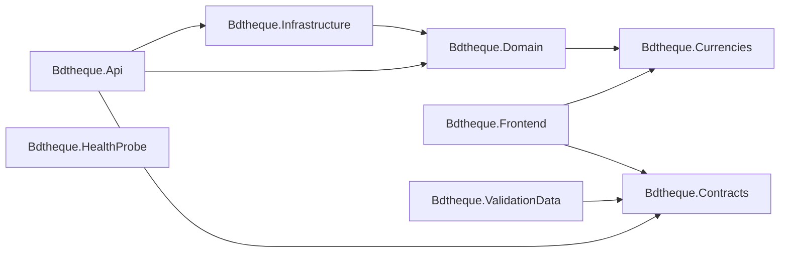
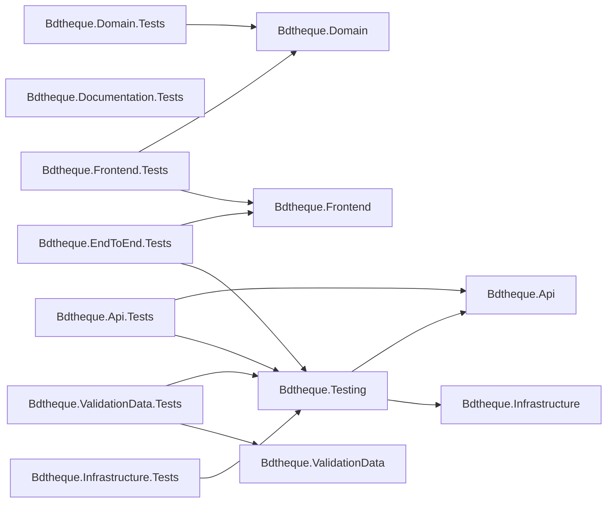

# Dépendances des projets

Cette page est générée par [`Update-TechnicalReferences.ps1`](../../../scripts/Update-TechnicalReferences.ps1), qui lit la liste des projets dans [`Bdtheque.slnx`](../../../Bdtheque.slnx) puis les références de projet (`ProjectReference`) déclarées dans chaque fichier de projet ; elle ne se modifie donc jamais à la main. Le rôle de chaque projet, et la façon dont ils communiquent à l'exécution, sont expliqués dans [Projets de la solution](../architecture/projets-de-la-solution.md).

Les deux schémas suivants sont générés : ils reproduisent exactement les références directes de chaque projet, sans les références transitives, et séparent les projets de l'application de ceux des tests pour rester lisibles.

Le premier répond à une question : quel projet de l'application référence directement quel autre ?

Le second répond à une autre : quels projets chaque projet de tests référence-t-il directement ?

| Projet | Dossier | Référence |
| --- | --- | --- |
| `Bdtheque.Api` | `src` | `Bdtheque.Contracts`, `Bdtheque.Domain`, `Bdtheque.Infrastructure` |
| `Bdtheque.Contracts` | `src` | — |
| `Bdtheque.Currencies` | `src` | — |
| `Bdtheque.Domain` | `src` | `Bdtheque.Currencies` |
| `Bdtheque.Frontend` | `src` | `Bdtheque.Contracts`, `Bdtheque.Currencies` |
| `Bdtheque.HealthProbe` | `src` | — |
| `Bdtheque.Infrastructure` | `src` | `Bdtheque.Domain` |
| `Bdtheque.ValidationData` | `src` | `Bdtheque.Contracts` |
| `Bdtheque.Api.Tests` | `tests` | `Bdtheque.Api`, `Bdtheque.Testing` |
| `Bdtheque.Documentation.Tests` | `tests` | — |
| `Bdtheque.Domain.Tests` | `tests` | `Bdtheque.Domain` |
| `Bdtheque.EndToEnd.Tests` | `tests` | `Bdtheque.Frontend`, `Bdtheque.Testing` |
| `Bdtheque.Frontend.Tests` | `tests` | `Bdtheque.Domain`, `Bdtheque.Frontend` |
| `Bdtheque.Infrastructure.Tests` | `tests` | `Bdtheque.Testing` |
| `Bdtheque.Testing` | `tests` | `Bdtheque.Api`, `Bdtheque.Infrastructure` |
| `Bdtheque.ValidationData.Tests` | `tests` | `Bdtheque.Testing`, `Bdtheque.ValidationData` |
