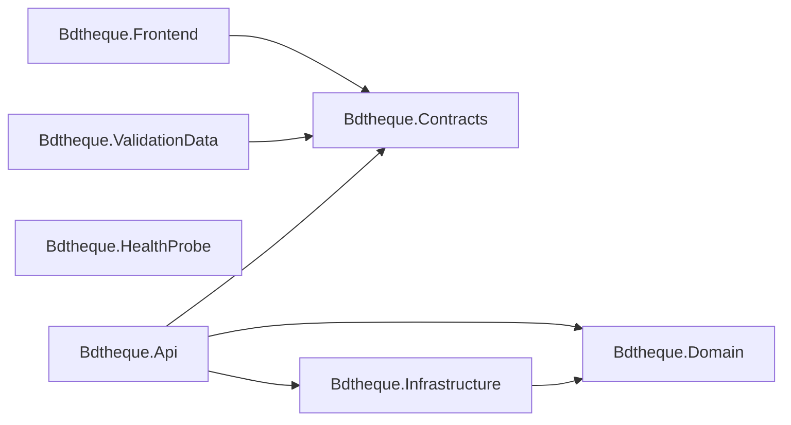
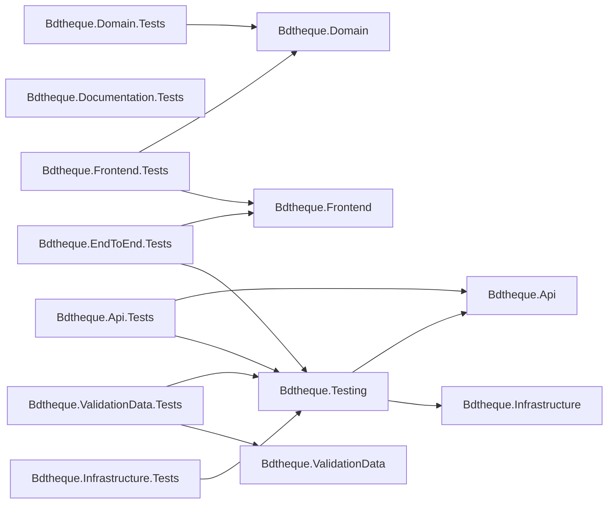

# Dépendances des projets

Page générée par [`Update-TechnicalReferences.ps1`](../../../scripts/Update-TechnicalReferences.ps1) depuis [`Bdtheque.slnx`](../../../Bdtheque.slnx) et les références (`ProjectReference`) de chaque fichier de projet : elle ne se modifie pas à la main. Le rôle de chaque projet est décrit dans [Projets de la solution](../architecture/projets-de-la-solution.md).

Schémas générés : ils reproduisent exactement les références directes, sans les références transitives, en deux vues pour rester lisibles.

Question du schéma : *quel projet de l'application référence directement quel autre ?*

Question du schéma : *quels projets chaque projet de tests référence-t-il directement ?*

| Projet | Dossier | Référence |
| --- | --- | --- |
| `Bdtheque.Api` | `src` | `Bdtheque.Contracts`, `Bdtheque.Domain`, `Bdtheque.Infrastructure` |
| `Bdtheque.Contracts` | `src` | — |
| `Bdtheque.Domain` | `src` | — |
| `Bdtheque.Frontend` | `src` | `Bdtheque.Contracts` |
| `Bdtheque.HealthProbe` | `src` | — |
| `Bdtheque.Infrastructure` | `src` | `Bdtheque.Domain` |
| `Bdtheque.ValidationData` | `src` | `Bdtheque.Contracts` |
| `Bdtheque.Api.Tests` | `tests` | `Bdtheque.Api`, `Bdtheque.Testing` |
| `Bdtheque.Documentation.Tests` | `tests` | — |
| `Bdtheque.Domain.Tests` | `tests` | `Bdtheque.Domain` |
| `Bdtheque.EndToEnd.Tests` | `tests` | `Bdtheque.Frontend`, `Bdtheque.Testing` |
| `Bdtheque.Frontend.Tests` | `tests` | `Bdtheque.Domain`, `Bdtheque.Frontend` |
| `Bdtheque.Infrastructure.Tests` | `tests` | `Bdtheque.Testing` |
| `Bdtheque.Testing` | `tests` | `Bdtheque.Api`, `Bdtheque.Infrastructure` |
| `Bdtheque.ValidationData.Tests` | `tests` | `Bdtheque.Testing`, `Bdtheque.ValidationData` |
