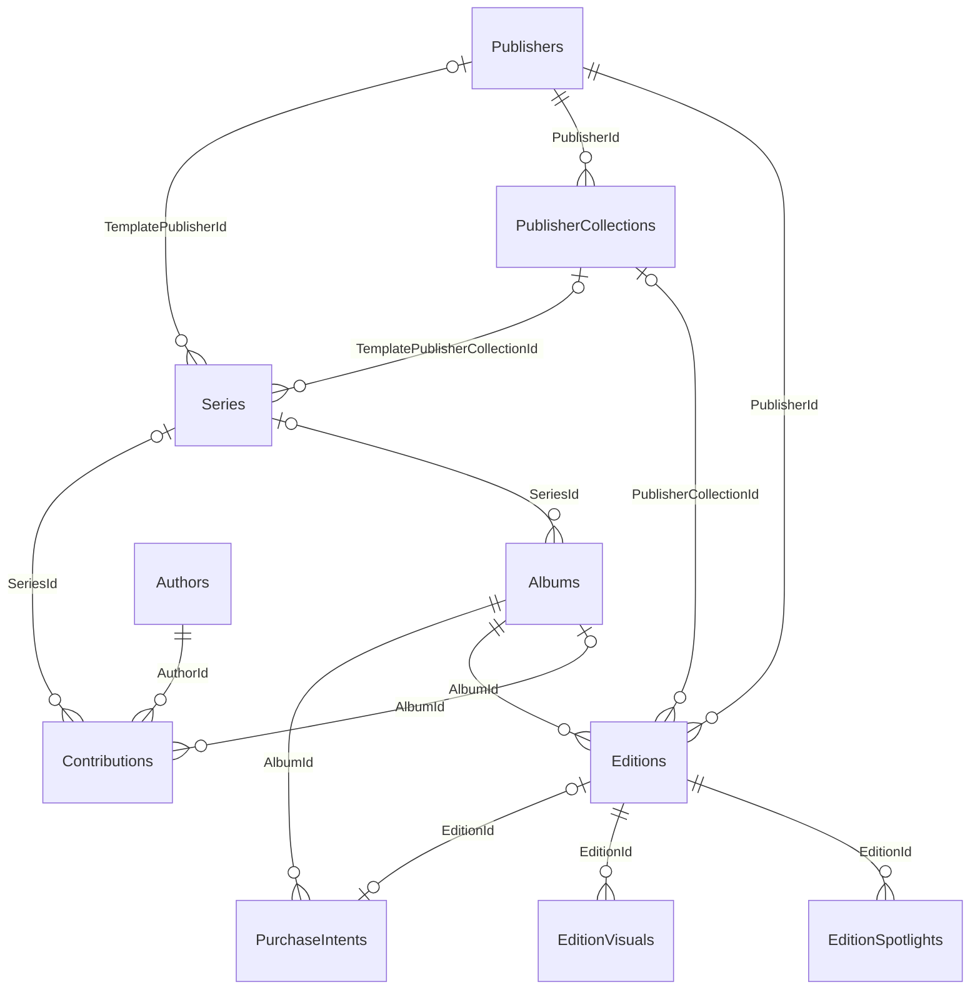
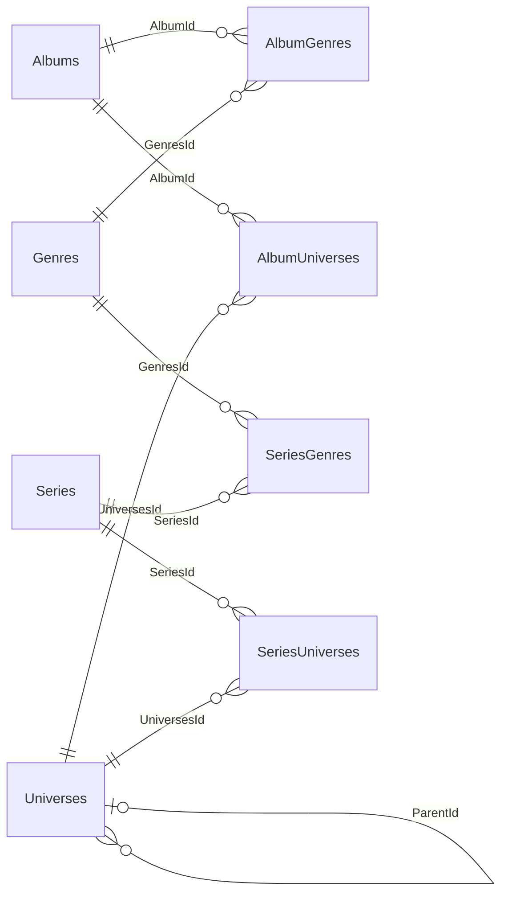
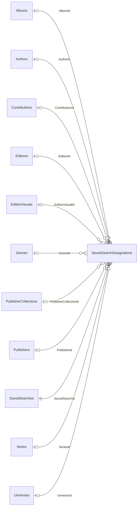
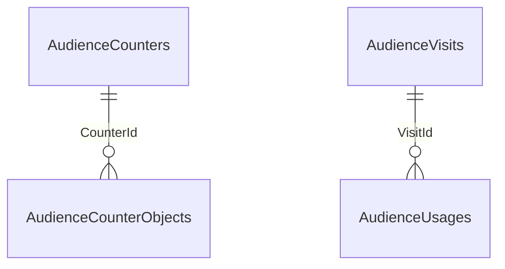

# Schéma de la base

Cette page est générée par [`Update-TechnicalReferences.ps1`](../../../scripts/Update-TechnicalReferences.ps1), au moyen de [`DatabaseSchemaReference`](../../../tests/Bdtheque.Infrastructure.Tests/DatabaseSchemaReference.cs). Le script crée une base PostgreSQL avec l'image de production, lui applique les [migrations](../../../src/Bdtheque.Infrastructure/Migrations/) du commit, puis lit son catalogue : la page décrit donc exactement le schéma que produisent les migrations, et ne se modifie jamais à la main. Elle écarte tout ce qui dépend du serveur plutôt que du schéma, comme la version de PostgreSQL, le nom de la base, son propriétaire ou la version des collations, si bien qu'elle ne change qu'avec le schéma lui-même. Le rôle des conventions et des contraintes, et la façon dont le schéma est appliqué au démarrage, sont expliqués dans [Persistance : modèle et schéma](../mecanismes/persistance-modele-et-schema.md).

## Collations

Le tableau suivant liste les collations que créent les migrations. Les colonnes texte utilisent en outre la collation `fr-FR-x-icu`, que PostgreSQL fournit lui-même.

| Collation | Fournisseur | Locale | Déterministe |
| --- | --- | --- | --- |
| `fr_case_accent_insensitive` | ICU | `fr-FR-u-ks-level1` | non |

## Relations

Les schémas de cette section sont générés depuis le catalogue de la base. Chaque clé étrangère y figure une fois, dans le schéma de la table qui la porte, reliée à la table qu'elle référence. Une clé qui admet `NULL` rend la référence facultative, ce que note `|o` ; une clé sur laquelle porte un index unique sans condition désigne au plus une ligne, ce que note `o|`. Les règles `ON DELETE` ne figurent pas sur les schémas : elles se lisent dans les contraintes de chaque table, plus bas.

Certaines tables ne référencent aucune autre table, et aucune ne les référence ; elles n'apparaissent donc sur aucun schéma : `ApplicationSettings`, `ChangeLogEntries`, `PendingVisuals`, `__EFMigrationsHistory`.

### Albums, séries et éditions

Ce schéma généré répond à une question : quelles tables du catalogue référencent quelles autres ?

### Genres et univers

Ce schéma généré répond à une question : comment albums et séries sont-ils rattachés aux genres et aux univers ?

### Recherches enregistrées

Ce schéma généré répond à une question : quelles fiches une recherche enregistrée peut-elle désigner ?

### Mesure d'audience

Ce schéma généré répond à une question : comment les tables de la mesure d'audience se référencent-elles ?

## Tables

### `AlbumGenres`

| Colonne | Type | NULL | Défaut ou expression | Collation |
| --- | --- | --- | --- | --- |
| `AlbumId` | `uuid` | non |  |  |
| `GenresId` | `uuid` | non |  |  |

| Contrainte | Définition |
| --- | --- |
| `PK_AlbumGenres` | `PRIMARY KEY ("AlbumId", "GenresId")` |
| `FK_AlbumGenres_Albums_AlbumId` | `FOREIGN KEY ("AlbumId") REFERENCES "Albums"("Id") ON DELETE CASCADE` |
| `FK_AlbumGenres_Genres_GenresId` | `FOREIGN KEY ("GenresId") REFERENCES "Genres"("Id") ON DELETE CASCADE` |

| Index | Unique | Définition |
| --- | --- | --- |
| `IX_AlbumGenres_GenresId` | non | `btree ("GenresId")` |

### `AlbumUniverses`

| Colonne | Type | NULL | Défaut ou expression | Collation |
| --- | --- | --- | --- | --- |
| `AlbumId` | `uuid` | non |  |  |
| `UniversesId` | `uuid` | non |  |  |

| Contrainte | Définition |
| --- | --- |
| `PK_AlbumUniverses` | `PRIMARY KEY ("AlbumId", "UniversesId")` |
| `FK_AlbumUniverses_Albums_AlbumId` | `FOREIGN KEY ("AlbumId") REFERENCES "Albums"("Id") ON DELETE CASCADE` |
| `FK_AlbumUniverses_Universes_UniversesId` | `FOREIGN KEY ("UniversesId") REFERENCES "Universes"("Id") ON DELETE CASCADE` |

| Index | Unique | Définition |
| --- | --- | --- |
| `IX_AlbumUniverses_UniversesId` | non | `btree ("UniversesId")` |

### `Albums`

| Colonne | Type | NULL | Défaut ou expression | Collation |
| --- | --- | --- | --- | --- |
| `Id` | `uuid` | non |  |  |
| `Title` | `character varying(500)` | oui |  | `fr-FR-x-icu` |
| `SortKey` | `character varying(510)` | oui |  | `fr-FR-x-icu` |
| `IsManualSortKey` | `boolean` | non |  |  |
| `NavigationEntry` | `character varying(1)` | oui |  | `fr-FR-x-icu` |
| `SeriesId` | `uuid` | oui |  |  |
| `Type` | `integer` | non |  |  |
| `IsSpecialIssue` | `boolean` | non |  |  |
| `VolumeNumber` | `integer` | oui |  |  |
| `StartVolumeNumber` | `integer` | oui |  |  |
| `EndVolumeNumber` | `integer` | oui |  |  |
| `FirstPublicationYear` | `integer` | oui |  |  |
| `FirstPublicationMonth` | `integer` | oui |  |  |
| `Summary` | `text` | oui |  | `fr-FR-x-icu` |
| `PersonalNotes` | `text` | oui |  | `fr-FR-x-icu` |
| `Rating` | `integer` | oui |  |  |
| `CreatedAt` | `timestamp with time zone` | non |  |  |
| `ModifiedAt` | `timestamp with time zone` | non |  |  |

| Contrainte | Définition |
| --- | --- |
| `PK_Albums` | `PRIMARY KEY ("Id")` |
| `FK_Albums_Series_SeriesId` | `FOREIGN KEY ("SeriesId") REFERENCES "Series"("Id") ON DELETE RESTRICT` |
| `CK_Albums_ManualSortKeyRequiresTitle` | `CHECK ((("IsManualSortKey" = false) OR ("Title" IS NOT NULL)))` |
| `CK_Albums_NavigationEntryPresenceMatchesSortKey` | `CHECK ((("SortKey" IS NULL) = ("NavigationEntry" IS NULL)))` |
| `CK_Albums_NavigationEntryValid` | `CHECK ((("NavigationEntry")::text = ANY ((ARRAY['A'::character varying, 'B'::character varying, 'C'::character varying, 'D'::character varying, 'E'::character varying, 'F'::character varying, 'G'::character varying, 'H'::character varying, 'I'::character varying, 'J'::character varying, 'K'::character varying, 'L'::character varying, 'M'::character varying, 'N'::character varying, 'O'::character varying, 'P'::character varying, 'Q'::character varying, 'R'::character varying, 'S'::character varying, 'T'::character varying, 'U'::character varying, 'V'::character varying, 'W'::character varying, 'X'::character varying, 'Y'::character varying, 'Z'::character varying, '#'::character varying, '@'::character varying])::text[])))` |
| `CK_Albums_PublicationMonthRange` | `CHECK ((("FirstPublicationMonth" IS NULL) OR (("FirstPublicationMonth" >= 1) AND ("FirstPublicationMonth" <= 12))))` |
| `CK_Albums_PublicationMonthRequiresYear` | `CHECK ((("FirstPublicationMonth" IS NULL) OR ("FirstPublicationYear" IS NOT NULL)))` |
| `CK_Albums_PublicationYearPositive` | `CHECK ((("FirstPublicationYear" IS NULL) OR ("FirstPublicationYear" > 0)))` |
| `CK_Albums_SortKeyNotBlank` | `CHECK ((("SortKey" IS NULL) OR (length(TRIM(BOTH FROM "SortKey")) > 0)))` |
| `CK_Albums_SortKeyPresenceMatchesTitle` | `CHECK ((("Title" IS NULL) = ("SortKey" IS NULL)))` |
| `CK_Albums_TitleNotBlank` | `CHECK ((("Title" IS NULL) OR (length(TRIM(BOTH FROM "Title")) > 0)))` |
| `CK_Albums_TitleRequiredWithoutSeries` | `CHECK ((("SeriesId" IS NOT NULL) OR (length(TRIM(BOTH FROM COALESCE("Title", ''::character varying))) > 0)))` |
| `CK_Albums_VolumeNumberPositive` | `CHECK ((("VolumeNumber" IS NULL) OR ("VolumeNumber" > 0)))` |
| `CK_Albums_VolumeRangeBothOrNeither` | `CHECK ((("StartVolumeNumber" IS NULL) = ("EndVolumeNumber" IS NULL)))` |
| `CK_Albums_VolumeRangeOmnibusOnly` | `CHECK ((("StartVolumeNumber" IS NULL) OR ("Type" = 2)))` |
| `CK_Albums_VolumeRangeOrder` | `CHECK ((("StartVolumeNumber" IS NULL) OR ("StartVolumeNumber" <= "EndVolumeNumber")))` |
| `CK_Albums_VolumeRangeStartPositive` | `CHECK ((("StartVolumeNumber" IS NULL) OR ("StartVolumeNumber" > 0)))` |

| Index | Unique | Définition |
| --- | --- | --- |
| `IX_Albums_NavigationEntry_SortKey` | non | `btree ("NavigationEntry", "SortKey")` |
| `IX_Albums_SeriesId` | non | `btree ("SeriesId")` |
| `IX_Albums_SortKey` | non | `btree ("SortKey")` |

### `ApplicationSettings`

| Colonne | Type | NULL | Défaut ou expression | Collation |
| --- | --- | --- | --- | --- |
| `Id` | `uuid` | non |  |  |
| `AlbumLabelFormat` | `integer` | non |  |  |
| `DisplayCulture` | `integer` | non |  |  |
| `CreatedAt` | `timestamp with time zone` | non |  |  |
| `ModifiedAt` | `timestamp with time zone` | non |  |  |

| Contrainte | Définition |
| --- | --- |
| `PK_ApplicationSettings` | `PRIMARY KEY ("Id")` |
| `CK_ApplicationSettings_Single` | `CHECK (("Id" = '0199c0de-5e77-7000-8000-000000000001'::uuid))` |

### `AudienceCounterObjects`

| Colonne | Type | NULL | Défaut ou expression | Collation |
| --- | --- | --- | --- | --- |
| `Id` | `uuid` | non |  |  |
| `RecordType` | `integer` | oui |  |  |
| `RecordId` | `uuid` | oui |  |  |
| `Parameters` | `text` | oui |  | `fr-FR-x-icu` |
| `UsageCount` | `integer` | non |  |  |
| `CounterId` | `uuid` | non |  |  |

| Contrainte | Définition |
| --- | --- |
| `PK_AudienceCounterObjects` | `PRIMARY KEY ("Id")` |
| `FK_AudienceCounterObjects_AudienceCounters_CounterId` | `FOREIGN KEY ("CounterId") REFERENCES "AudienceCounters"("Id") ON DELETE CASCADE` |
| `CK_AudienceCounterObjects_RecordOrParameters` | `CHECK (((("RecordType" IS NULL) = ("RecordId" IS NULL)) AND (("RecordType" IS NULL) <> ("Parameters" IS NULL))))` |
| `CK_AudienceCounterObjects_UsageCountPositive` | `CHECK (("UsageCount" >= 1))` |

| Index | Unique | Définition |
| --- | --- | --- |
| `IX_AudienceCounterObjects_CounterId` | non | `btree ("CounterId")` |

### `AudienceCounters`

| Colonne | Type | NULL | Défaut ou expression | Collation |
| --- | --- | --- | --- | --- |
| `Id` | `uuid` | non |  |  |
| `Function` | `character varying(200)` | non |  | `fr-FR-x-icu` |
| `Month` | `date` | non |  |  |
| `IsAdministrator` | `boolean` | non |  |  |
| `DeviceType` | `integer` | non |  |  |
| `RenderingEngine` | `integer` | non |  |  |
| `EngineVersion` | `character varying(50)` | oui |  | `fr-FR-x-icu` |
| `UsageCount` | `integer` | non |  |  |
| `VisitCount` | `integer` | non |  |  |
| `RepeatedUsageCount` | `integer` | non |  |  |
| `LastUsage` | `timestamp with time zone` | non |  |  |
| `CreatedAt` | `timestamp with time zone` | non |  |  |
| `ModifiedAt` | `timestamp with time zone` | non |  |  |

| Contrainte | Définition |
| --- | --- |
| `PK_AudienceCounters` | `PRIMARY KEY ("Id")` |
| `CK_AudienceCounters_Counts` | `CHECK ((("VisitCount" >= 1) AND ("VisitCount" <= "UsageCount") AND (("RepeatedUsageCount" >= 0) AND ("RepeatedUsageCount" <= ("UsageCount" - "VisitCount")))))` |
| `CK_AudienceCounters_MonthFirstDay` | `CHECK ((EXTRACT(day FROM "Month") = (1)::numeric))` |

| Index | Unique | Définition |
| --- | --- | --- |
| `IX_AudienceCounters_FunctionMonthCompartment` | oui | `btree ("Month", "Function", "IsAdministrator", "DeviceType", "RenderingEngine", "EngineVersion") NULLS NOT DISTINCT` |

### `AudienceUsages`

| Colonne | Type | NULL | Défaut ou expression | Collation |
| --- | --- | --- | --- | --- |
| `Id` | `uuid` | non |  |  |
| `VisitId` | `uuid` | non |  |  |
| `Function` | `character varying(200)` | non |  | `fr-FR-x-icu` |
| `PresentedRecordType` | `integer` | oui |  |  |
| `PresentedRecordId` | `uuid` | oui |  |  |
| `Parameters` | `text` | oui |  | `fr-FR-x-icu` |
| `IsRepeat` | `boolean` | non |  |  |
| `CreatedAt` | `timestamp with time zone` | non |  |  |
| `ModifiedAt` | `timestamp with time zone` | non |  |  |

| Contrainte | Définition |
| --- | --- |
| `PK_AudienceUsages` | `PRIMARY KEY ("Id")` |
| `FK_AudienceUsages_AudienceVisits_VisitId` | `FOREIGN KEY ("VisitId") REFERENCES "AudienceVisits"("Id") ON DELETE CASCADE` |
| `CK_AudienceUsages_FunctionNotBlank` | `CHECK ((COALESCE(length(TRIM(BOTH FROM "Function")), 0) > 0))` |
| `CK_AudienceUsages_RecordOrParameters` | `CHECK (((("PresentedRecordType" IS NULL) = ("PresentedRecordId" IS NULL)) AND (("PresentedRecordType" IS NULL) OR ("Parameters" IS NULL))))` |

| Index | Unique | Définition |
| --- | --- | --- |
| `IX_AudienceUsages_VisitId_CreatedAt_Id` | non | `btree ("VisitId", "CreatedAt", "Id")` |

### `AudienceVisits`

| Colonne | Type | NULL | Défaut ou expression | Collation |
| --- | --- | --- | --- | --- |
| `Id` | `uuid` | non |  |  |
| `IsAdministrator` | `boolean` | non |  |  |
| `DeviceType` | `integer` | non |  |  |
| `RenderingEngine` | `integer` | non |  |  |
| `EngineVersion` | `character varying(50)` | oui |  | `fr-FR-x-icu` |
| `CreatedAt` | `timestamp with time zone` | non |  |  |
| `ModifiedAt` | `timestamp with time zone` | non |  |  |

| Contrainte | Définition |
| --- | --- |
| `PK_AudienceVisits` | `PRIMARY KEY ("Id")` |

| Index | Unique | Définition |
| --- | --- | --- |
| `IX_AudienceVisits_CreatedAt_Id` | non | `btree ("CreatedAt", "Id")` |

### `Authors`

| Colonne | Type | NULL | Défaut ou expression | Collation |
| --- | --- | --- | --- | --- |
| `Id` | `uuid` | non |  |  |
| `LastName` | `character varying(200)` | oui |  | `fr-FR-x-icu` |
| `FirstName` | `character varying(200)` | oui |  | `fr-FR-x-icu` |
| `Pseudonym` | `character varying(200)` | oui |  | `fr-FR-x-icu` |
| `Biography` | `text` | oui |  | `fr-FR-x-icu` |
| `Nationality` | `character varying(100)` | oui |  | `fr-FR-x-icu` |
| `DisplayName` | `character varying(401)` | non |  | `fr_case_accent_insensitive` |
| `SortKey` | `character varying(401)` | non |  | `fr-FR-x-icu` |
| `NavigationEntry` | `character varying(1)` | non |  | `fr-FR-x-icu` |
| `CreatedAt` | `timestamp with time zone` | non |  |  |
| `ModifiedAt` | `timestamp with time zone` | non |  |  |

| Contrainte | Définition |
| --- | --- |
| `PK_Authors` | `PRIMARY KEY ("Id")` |
| `CK_Authors_LastNameOrPseudonym` | `CHECK (((COALESCE(length(TRIM(BOTH FROM "LastName")), 0) > 0) OR (COALESCE(length(TRIM(BOTH FROM "Pseudonym")), 0) > 0)))` |
| `CK_Authors_NavigationEntryValid` | `CHECK ((("NavigationEntry")::text = ANY ((ARRAY['A'::character varying, 'B'::character varying, 'C'::character varying, 'D'::character varying, 'E'::character varying, 'F'::character varying, 'G'::character varying, 'H'::character varying, 'I'::character varying, 'J'::character varying, 'K'::character varying, 'L'::character varying, 'M'::character varying, 'N'::character varying, 'O'::character varying, 'P'::character varying, 'Q'::character varying, 'R'::character varying, 'S'::character varying, 'T'::character varying, 'U'::character varying, 'V'::character varying, 'W'::character varying, 'X'::character varying, 'Y'::character varying, 'Z'::character varying, '#'::character varying, '@'::character varying])::text[])))` |
| `CK_Authors_SortKeyNotBlank` | `CHECK ((COALESCE(length(TRIM(BOTH FROM "SortKey")), 0) > 0))` |

| Index | Unique | Définition |
| --- | --- | --- |
| `IX_Authors_DisplayName` | oui | `btree ("DisplayName")` |
| `IX_Authors_NavigationEntry_SortKey` | non | `btree ("NavigationEntry", "SortKey")` |
| `IX_Authors_SortKey` | non | `btree ("SortKey")` |

### `ChangeLogEntries`

| Colonne | Type | NULL | Défaut ou expression | Collation |
| --- | --- | --- | --- | --- |
| `Id` | `uuid` | non |  |  |
| `RecordType` | `integer` | non |  |  |
| `RecordId` | `uuid` | non |  |  |
| `Label` | `jsonb` | non |  |  |
| `Operation` | `integer` | non |  |  |
| `Changes` | `jsonb` | non |  |  |
| `CreatedAt` | `timestamp with time zone` | non |  |  |
| `ModifiedAt` | `timestamp with time zone` | non |  |  |

| Contrainte | Définition |
| --- | --- |
| `PK_ChangeLogEntries` | `PRIMARY KEY ("Id")` |
| `CK_ChangeLogEntries_ChangesOfModificationOnly` | `CHECK (((jsonb_array_length("Changes") > 0) = ("Operation" = 2)))` |

| Index | Unique | Définition |
| --- | --- | --- |
| `IX_ChangeLogEntries_CreatedAt_Id` | non | `btree ("CreatedAt", "Id")` |

### `Contributions`

| Colonne | Type | NULL | Défaut ou expression | Collation |
| --- | --- | --- | --- | --- |
| `Id` | `uuid` | non |  |  |
| `AlbumId` | `uuid` | oui |  |  |
| `SeriesId` | `uuid` | oui |  |  |
| `AuthorId` | `uuid` | non |  |  |
| `Role` | `integer` | non |  |  |
| `CreatedAt` | `timestamp with time zone` | non |  |  |
| `ModifiedAt` | `timestamp with time zone` | non |  |  |

| Contrainte | Définition |
| --- | --- |
| `PK_Contributions` | `PRIMARY KEY ("Id")` |
| `FK_Contributions_Albums_AlbumId` | `FOREIGN KEY ("AlbumId") REFERENCES "Albums"("Id") ON DELETE CASCADE` |
| `FK_Contributions_Authors_AuthorId` | `FOREIGN KEY ("AuthorId") REFERENCES "Authors"("Id") ON DELETE RESTRICT` |
| `FK_Contributions_Series_SeriesId` | `FOREIGN KEY ("SeriesId") REFERENCES "Series"("Id") ON DELETE CASCADE` |
| `CK_Contributions_ExactlyOneOfAlbumOrSeries` | `CHECK ((("AlbumId" IS NOT NULL) <> ("SeriesId" IS NOT NULL)))` |

| Index | Unique | Définition |
| --- | --- | --- |
| `IX_Contributions_AlbumId_Role_AuthorId` | oui | `btree ("AlbumId", "Role", "AuthorId") WHERE ("AlbumId" IS NOT NULL)` |
| `IX_Contributions_AuthorId` | non | `btree ("AuthorId")` |
| `IX_Contributions_SeriesId_Role_AuthorId` | oui | `btree ("SeriesId", "Role", "AuthorId") WHERE ("SeriesId" IS NOT NULL)` |

### `EditionSpotlights`

| Colonne | Type | NULL | Défaut ou expression | Collation |
| --- | --- | --- | --- | --- |
| `Day` | `date` | non |  |  |
| `EditionId` | `uuid` | non |  |  |

| Contrainte | Définition |
| --- | --- |
| `PK_EditionSpotlights` | `PRIMARY KEY ("Day")` |
| `FK_EditionSpotlights_Editions_EditionId` | `FOREIGN KEY ("EditionId") REFERENCES "Editions"("Id") ON DELETE CASCADE` |

| Index | Unique | Définition |
| --- | --- | --- |
| `IX_EditionSpotlights_EditionId` | non | `btree ("EditionId")` |

### `EditionVisuals`

| Colonne | Type | NULL | Défaut ou expression | Collation |
| --- | --- | --- | --- | --- |
| `Id` | `uuid` | non |  |  |
| `EditionId` | `uuid` | non |  |  |
| `Type` | `integer` | non |  |  |
| `MediaReference` | `character varying(2048)` | non |  | `fr-FR-x-icu` |
| `DisplayOrder` | `integer` | non |  |  |
| `Palette_Accent` | `integer` | non |  |  |
| `Palette_Deep` | `integer` | non |  |  |
| `Palette_Dominant` | `integer` | non |  |  |
| `CreatedAt` | `timestamp with time zone` | non |  |  |
| `ModifiedAt` | `timestamp with time zone` | non |  |  |

| Contrainte | Définition |
| --- | --- |
| `PK_EditionVisuals` | `PRIMARY KEY ("Id")` |
| `FK_EditionVisuals_Editions_EditionId` | `FOREIGN KEY ("EditionId") REFERENCES "Editions"("Id") ON DELETE CASCADE` |
| `CK_EditionVisuals_DisplayOrderNotNegative` | `CHECK (("DisplayOrder" >= 0))` |
| `CK_EditionVisuals_MediaReferenceNotBlank` | `CHECK ((COALESCE(length(TRIM(BOTH FROM "MediaReference")), 0) > 0))` |
| `CK_EditionVisuals_Palette_AccentIsRgb` | `CHECK ((("Palette_Accent" >= 0) AND ("Palette_Accent" <= 16777215)))` |
| `CK_EditionVisuals_Palette_DeepIsRgb` | `CHECK ((("Palette_Deep" >= 0) AND ("Palette_Deep" <= 16777215)))` |
| `CK_EditionVisuals_Palette_DominantIsRgb` | `CHECK ((("Palette_Dominant" >= 0) AND ("Palette_Dominant" <= 16777215)))` |

| Index | Unique | Définition |
| --- | --- | --- |
| `IX_EditionVisuals_EditionId_Type_DisplayOrder` | non | `btree ("EditionId", "Type", "DisplayOrder")` |

### `Editions`

| Colonne | Type | NULL | Défaut ou expression | Collation |
| --- | --- | --- | --- | --- |
| `Id` | `uuid` | non |  |  |
| `AlbumId` | `uuid` | non |  |  |
| `PublisherId` | `uuid` | non |  |  |
| `PublisherCollectionId` | `uuid` | oui |  |  |
| `PublicationYear` | `integer` | oui |  |  |
| `Isbn` | `character varying(20)` | oui |  | `fr-FR-x-icu` |
| `AcceptedIsbn` | `character varying(20)` | oui |  | `fr-FR-x-icu` |
| `Binding` | `integer` | oui |  |  |
| `Orientation` | `integer` | oui |  |  |
| `ReadingDirection` | `integer` | oui |  |  |
| `Format` | `integer` | oui |  |  |
| `PageCount` | `integer` | oui |  |  |
| `Category` | `integer` | oui |  |  |
| `IsDedicated` | `boolean` | non |  |  |
| `IsColor` | `boolean` | non |  |  |
| `Condition` | `integer` | oui |  |  |
| `AcquisitionMode` | `integer` | oui |  |  |
| `IsSecondHand` | `boolean` | non |  |  |
| `AcquisitionDate` | `date` | oui |  |  |
| `AcquisitionAmount` | `numeric(14,4)` | oui |  |  |
| `AcquisitionCurrency` | `character varying(3)` | oui |  | `fr-FR-x-icu` |
| `IsFree` | `boolean` | non |  |  |
| `InitialValueAmount` | `numeric(14,4)` | oui |  |  |
| `InitialValueCurrency` | `character varying(3)` | oui |  | `fr-FR-x-icu` |
| `EnteredCollectionAt` | `timestamp with time zone` | oui |  |  |
| `PersonalReference` | `character varying(200)` | oui |  | `fr-FR-x-icu` |
| `PersonalNotes` | `text` | oui |  | `fr-FR-x-icu` |
| `CreatedAt` | `timestamp with time zone` | non |  |  |
| `ModifiedAt` | `timestamp with time zone` | non |  |  |

| Contrainte | Définition |
| --- | --- |
| `PK_Editions` | `PRIMARY KEY ("Id")` |
| `FK_Editions_Albums_AlbumId` | `FOREIGN KEY ("AlbumId") REFERENCES "Albums"("Id") ON DELETE CASCADE` |
| `FK_Editions_PublisherCollections_PublisherCollectionId` | `FOREIGN KEY ("PublisherCollectionId") REFERENCES "PublisherCollections"("Id") ON DELETE RESTRICT` |
| `FK_Editions_Publishers_PublisherId` | `FOREIGN KEY ("PublisherId") REFERENCES "Publishers"("Id") ON DELETE RESTRICT` |
| `CK_Editions_AcquisitionAmountCurrencyTogether` | `CHECK ((("AcquisitionAmount" IS NULL) = ("AcquisitionCurrency" IS NULL)))` |
| `CK_Editions_AcquisitionAmountPositive` | `CHECK ((("AcquisitionAmount" IS NULL) OR ("AcquisitionAmount" > (0)::numeric)))` |
| `CK_Editions_AcquisitionModeRequiredForDateOrAmounts` | `CHECK ((("AcquisitionMode" IS NOT NULL) OR (("AcquisitionDate" IS NULL) AND ("AcquisitionAmount" IS NULL) AND ("InitialValueAmount" IS NULL))))` |
| `CK_Editions_EnteredCollectionIffOwned` | `CHECK ((("AcquisitionMode" IS NULL) = ("EnteredCollectionAt" IS NULL)))` |
| `CK_Editions_FreeRequiresNoAmount` | `CHECK ((("IsFree" = false) OR (("AcquisitionAmount" IS NULL) AND ("InitialValueAmount" IS NULL))))` |
| `CK_Editions_InitialValueAmountCurrencyTogether` | `CHECK ((("InitialValueAmount" IS NULL) = ("InitialValueCurrency" IS NULL)))` |
| `CK_Editions_InitialValueAmountPositive` | `CHECK ((("InitialValueAmount" IS NULL) OR ("InitialValueAmount" > (0)::numeric)))` |
| `CK_Editions_PageCountPositive` | `CHECK ((("PageCount" IS NULL) OR ("PageCount" > 0)))` |
| `CK_Editions_PublicationYearPositive` | `CHECK ((("PublicationYear" IS NULL) OR ("PublicationYear" > 0)))` |
| `CK_Editions_PurchaseNotFree` | `CHECK ((("IsFree" = false) OR ("AcquisitionMode" IS DISTINCT FROM 1)))` |

| Index | Unique | Définition |
| --- | --- | --- |
| `IX_Editions_AlbumId` | non | `btree ("AlbumId")` |
| `IX_Editions_PublisherCollectionId` | non | `btree ("PublisherCollectionId")` |
| `IX_Editions_PublisherId` | non | `btree ("PublisherId")` |

### `Genres`

| Colonne | Type | NULL | Défaut ou expression | Collation |
| --- | --- | --- | --- | --- |
| `Id` | `uuid` | non |  |  |
| `Label` | `character varying(200)` | non |  | `fr_case_accent_insensitive` |
| `NavigationEntry` | `character varying(1)` | non |  | `fr-FR-x-icu` |
| `CreatedAt` | `timestamp with time zone` | non |  |  |
| `ModifiedAt` | `timestamp with time zone` | non |  |  |

| Contrainte | Définition |
| --- | --- |
| `PK_Genres` | `PRIMARY KEY ("Id")` |
| `CK_Genres_LabelNotBlank` | `CHECK ((COALESCE(length(TRIM(BOTH FROM "Label")), 0) > 0))` |
| `CK_Genres_NavigationEntryValid` | `CHECK ((("NavigationEntry")::text = ANY ((ARRAY['A'::character varying, 'B'::character varying, 'C'::character varying, 'D'::character varying, 'E'::character varying, 'F'::character varying, 'G'::character varying, 'H'::character varying, 'I'::character varying, 'J'::character varying, 'K'::character varying, 'L'::character varying, 'M'::character varying, 'N'::character varying, 'O'::character varying, 'P'::character varying, 'Q'::character varying, 'R'::character varying, 'S'::character varying, 'T'::character varying, 'U'::character varying, 'V'::character varying, 'W'::character varying, 'X'::character varying, 'Y'::character varying, 'Z'::character varying, '#'::character varying, '@'::character varying])::text[])))` |

| Index | Unique | Définition |
| --- | --- | --- |
| `IX_Genres_Label` | oui | `btree ("Label")` |
| `IX_Genres_NavigationEntry_Label` | non | `btree ("NavigationEntry", "Label")` |

### `PendingVisuals`

| Colonne | Type | NULL | Défaut ou expression | Collation |
| --- | --- | --- | --- | --- |
| `Id` | `uuid` | non |  |  |
| `MediaReference` | `character varying(2048)` | non |  | `fr-FR-x-icu` |
| `Palette_Accent` | `integer` | non |  |  |
| `Palette_Deep` | `integer` | non |  |  |
| `Palette_Dominant` | `integer` | non |  |  |
| `CreatedAt` | `timestamp with time zone` | non |  |  |
| `ModifiedAt` | `timestamp with time zone` | non |  |  |

| Contrainte | Définition |
| --- | --- |
| `PK_PendingVisuals` | `PRIMARY KEY ("Id")` |
| `CK_PendingVisuals_MediaReferenceNotBlank` | `CHECK ((COALESCE(length(TRIM(BOTH FROM "MediaReference")), 0) > 0))` |
| `CK_PendingVisuals_Palette_AccentIsRgb` | `CHECK ((("Palette_Accent" >= 0) AND ("Palette_Accent" <= 16777215)))` |
| `CK_PendingVisuals_Palette_DeepIsRgb` | `CHECK ((("Palette_Deep" >= 0) AND ("Palette_Deep" <= 16777215)))` |
| `CK_PendingVisuals_Palette_DominantIsRgb` | `CHECK ((("Palette_Dominant" >= 0) AND ("Palette_Dominant" <= 16777215)))` |

| Index | Unique | Définition |
| --- | --- | --- |
| `IX_PendingVisuals_CreatedAt` | non | `btree ("CreatedAt")` |

### `PublisherCollections`

| Colonne | Type | NULL | Défaut ou expression | Collation |
| --- | --- | --- | --- | --- |
| `Id` | `uuid` | non |  |  |
| `Name` | `character varying(300)` | non |  | `fr_case_accent_insensitive` |
| `PublisherId` | `uuid` | non |  |  |
| `CreatedAt` | `timestamp with time zone` | non |  |  |
| `ModifiedAt` | `timestamp with time zone` | non |  |  |

| Contrainte | Définition |
| --- | --- |
| `PK_PublisherCollections` | `PRIMARY KEY ("Id")` |
| `IX_PublisherCollections_PublisherId_Name` | `UNIQUE ("PublisherId", "Name") DEFERRABLE INITIALLY DEFERRED` |
| `FK_PublisherCollections_Publishers_PublisherId` | `FOREIGN KEY ("PublisherId") REFERENCES "Publishers"("Id") ON DELETE CASCADE` |
| `CK_PublisherCollections_NameNotBlank` | `CHECK ((COALESCE(length(TRIM(BOTH FROM "Name")), 0) > 0))` |

### `Publishers`

| Colonne | Type | NULL | Défaut ou expression | Collation |
| --- | --- | --- | --- | --- |
| `Id` | `uuid` | non |  |  |
| `Name` | `character varying(300)` | non |  | `fr_case_accent_insensitive` |
| `Website` | `character varying(2048)` | oui |  | `fr-FR-x-icu` |
| `NavigationEntry` | `character varying(1)` | non |  | `fr-FR-x-icu` |
| `CreatedAt` | `timestamp with time zone` | non |  |  |
| `ModifiedAt` | `timestamp with time zone` | non |  |  |

| Contrainte | Définition |
| --- | --- |
| `PK_Publishers` | `PRIMARY KEY ("Id")` |
| `CK_Publishers_NameNotBlank` | `CHECK ((COALESCE(length(TRIM(BOTH FROM "Name")), 0) > 0))` |
| `CK_Publishers_NavigationEntryValid` | `CHECK ((("NavigationEntry")::text = ANY ((ARRAY['A'::character varying, 'B'::character varying, 'C'::character varying, 'D'::character varying, 'E'::character varying, 'F'::character varying, 'G'::character varying, 'H'::character varying, 'I'::character varying, 'J'::character varying, 'K'::character varying, 'L'::character varying, 'M'::character varying, 'N'::character varying, 'O'::character varying, 'P'::character varying, 'Q'::character varying, 'R'::character varying, 'S'::character varying, 'T'::character varying, 'U'::character varying, 'V'::character varying, 'W'::character varying, 'X'::character varying, 'Y'::character varying, 'Z'::character varying, '#'::character varying, '@'::character varying])::text[])))` |

| Index | Unique | Définition |
| --- | --- | --- |
| `IX_Publishers_Name` | oui | `btree ("Name")` |
| `IX_Publishers_NavigationEntry_Name` | non | `btree ("NavigationEntry", "Name")` |

### `PurchaseIntents`

| Colonne | Type | NULL | Défaut ou expression | Collation |
| --- | --- | --- | --- | --- |
| `Id` | `uuid` | non |  |  |
| `AlbumId` | `uuid` | non |  |  |
| `EditionId` | `uuid` | oui |  |  |
| `CreatedAt` | `timestamp with time zone` | non |  |  |
| `ModifiedAt` | `timestamp with time zone` | non |  |  |

| Contrainte | Définition |
| --- | --- |
| `PK_PurchaseIntents` | `PRIMARY KEY ("Id")` |
| `FK_PurchaseIntents_Albums_AlbumId` | `FOREIGN KEY ("AlbumId") REFERENCES "Albums"("Id") ON DELETE CASCADE` |
| `FK_PurchaseIntents_Editions_EditionId` | `FOREIGN KEY ("EditionId") REFERENCES "Editions"("Id") ON DELETE CASCADE` |

| Index | Unique | Définition |
| --- | --- | --- |
| `IX_PurchaseIntents_AlbumId` | non | `btree ("AlbumId")` |
| `IX_PurchaseIntents_AlbumId_WholeAlbum` | oui | `btree ("AlbumId") WHERE ("EditionId" IS NULL)` |
| `IX_PurchaseIntents_EditionId` | oui | `btree ("EditionId")` |

### `SavedSearchDesignations`

| Colonne | Type | NULL | Défaut ou expression | Collation |
| --- | --- | --- | --- | --- |
| `Kind` | `integer` | non |  |  |
| `RecordId` | `uuid` | non |  |  |
| `SavedSearchId` | `uuid` | non |  |  |
| `AlbumId` | `uuid, calculée et stockée` | oui | `CASE WHEN ("Kind" = 1) THEN "RecordId" ELSE NULL::uuid END` |  |
| `AuthorId` | `uuid, calculée et stockée` | oui | `CASE WHEN ("Kind" = 9) THEN "RecordId" ELSE NULL::uuid END` |  |
| `ContributionId` | `uuid, calculée et stockée` | oui | `CASE WHEN ("Kind" = 7) THEN "RecordId" ELSE NULL::uuid END` |  |
| `EditionId` | `uuid, calculée et stockée` | oui | `CASE WHEN ("Kind" = 4) THEN "RecordId" ELSE NULL::uuid END` |  |
| `EditionVisualId` | `uuid, calculée et stockée` | oui | `CASE WHEN ("Kind" = 5) THEN "RecordId" ELSE NULL::uuid END` |  |
| `GenreId` | `uuid, calculée et stockée` | oui | `CASE WHEN ("Kind" = 11) THEN "RecordId" ELSE NULL::uuid END` |  |
| `PublisherCollectionId` | `uuid, calculée et stockée` | oui | `CASE WHEN ("Kind" = 6) THEN "RecordId" ELSE NULL::uuid END` |  |
| `PublisherId` | `uuid, calculée et stockée` | oui | `CASE WHEN ("Kind" = 10) THEN "RecordId" ELSE NULL::uuid END` |  |
| `SeriesId` | `uuid, calculée et stockée` | oui | `CASE WHEN ("Kind" = 2) THEN "RecordId" ELSE NULL::uuid END` |  |
| `UniverseId` | `uuid, calculée et stockée` | oui | `CASE WHEN ("Kind" = 3) THEN "RecordId" ELSE NULL::uuid END` |  |

| Contrainte | Définition |
| --- | --- |
| `PK_SavedSearchDesignations` | `PRIMARY KEY ("SavedSearchId", "Kind", "RecordId")` |
| `FK_SavedSearchDesignations_Albums_AlbumId` | `FOREIGN KEY ("AlbumId") REFERENCES "Albums"("Id") ON DELETE RESTRICT` |
| `FK_SavedSearchDesignations_Authors_AuthorId` | `FOREIGN KEY ("AuthorId") REFERENCES "Authors"("Id") ON DELETE RESTRICT` |
| `FK_SavedSearchDesignations_Contributions_ContributionId` | `FOREIGN KEY ("ContributionId") REFERENCES "Contributions"("Id") ON DELETE RESTRICT` |
| `FK_SavedSearchDesignations_EditionVisuals_EditionVisualId` | `FOREIGN KEY ("EditionVisualId") REFERENCES "EditionVisuals"("Id") ON DELETE RESTRICT` |
| `FK_SavedSearchDesignations_Editions_EditionId` | `FOREIGN KEY ("EditionId") REFERENCES "Editions"("Id") ON DELETE RESTRICT` |
| `FK_SavedSearchDesignations_Genres_GenreId` | `FOREIGN KEY ("GenreId") REFERENCES "Genres"("Id") ON DELETE RESTRICT` |
| `FK_SavedSearchDesignations_PublisherCollections_PublisherColle~` | `FOREIGN KEY ("PublisherCollectionId") REFERENCES "PublisherCollections"("Id") ON DELETE RESTRICT` |
| `FK_SavedSearchDesignations_Publishers_PublisherId` | `FOREIGN KEY ("PublisherId") REFERENCES "Publishers"("Id") ON DELETE RESTRICT` |
| `FK_SavedSearchDesignations_SavedSearches_SavedSearchId` | `FOREIGN KEY ("SavedSearchId") REFERENCES "SavedSearches"("Id") ON DELETE CASCADE` |
| `FK_SavedSearchDesignations_Series_SeriesId` | `FOREIGN KEY ("SeriesId") REFERENCES "Series"("Id") ON DELETE RESTRICT` |
| `FK_SavedSearchDesignations_Universes_UniverseId` | `FOREIGN KEY ("UniverseId") REFERENCES "Universes"("Id") ON DELETE RESTRICT` |
| `CK_SavedSearchDesignations_DesignatesAReferenceableRecord` | `CHECK ((num_nonnulls("AlbumId", "SeriesId", "UniverseId", "EditionId", "EditionVisualId", "PublisherCollectionId", "ContributionId", "AuthorId", "PublisherId", "GenreId") = 1))` |

| Index | Unique | Définition |
| --- | --- | --- |
| `IX_SavedSearchDesignations_AlbumId` | non | `btree ("AlbumId")` |
| `IX_SavedSearchDesignations_AuthorId` | non | `btree ("AuthorId")` |
| `IX_SavedSearchDesignations_ContributionId` | non | `btree ("ContributionId")` |
| `IX_SavedSearchDesignations_EditionId` | non | `btree ("EditionId")` |
| `IX_SavedSearchDesignations_EditionVisualId` | non | `btree ("EditionVisualId")` |
| `IX_SavedSearchDesignations_GenreId` | non | `btree ("GenreId")` |
| `IX_SavedSearchDesignations_Kind_RecordId` | non | `btree ("Kind", "RecordId")` |
| `IX_SavedSearchDesignations_PublisherCollectionId` | non | `btree ("PublisherCollectionId")` |
| `IX_SavedSearchDesignations_PublisherId` | non | `btree ("PublisherId")` |
| `IX_SavedSearchDesignations_SeriesId` | non | `btree ("SeriesId")` |
| `IX_SavedSearchDesignations_UniverseId` | non | `btree ("UniverseId")` |

### `SavedSearches`

| Colonne | Type | NULL | Défaut ou expression | Collation |
| --- | --- | --- | --- | --- |
| `Id` | `uuid` | non |  |  |
| `Name` | `character varying(200)` | non |  | `fr_case_accent_insensitive` |
| `Entity` | `integer` | non |  |  |
| `Criteria` | `text` | non |  | `fr-FR-x-icu` |
| `Variables` | `text` | non |  | `default` |
| `CreatedAt` | `timestamp with time zone` | non |  |  |
| `ModifiedAt` | `timestamp with time zone` | non |  |  |

| Contrainte | Définition |
| --- | --- |
| `PK_SavedSearches` | `PRIMARY KEY ("Id")` |
| `CK_SavedSearches_NameNotBlank` | `CHECK ((COALESCE(length(TRIM(BOTH FROM "Name")), 0) > 0))` |

| Index | Unique | Définition |
| --- | --- | --- |
| `IX_SavedSearches_Name` | oui | `btree ("Name")` |

### `Series`

| Colonne | Type | NULL | Défaut ou expression | Collation |
| --- | --- | --- | --- | --- |
| `Id` | `uuid` | non |  |  |
| `Title` | `character varying(500)` | non |  | `fr-FR-x-icu` |
| `SortKey` | `character varying(510)` | non |  | `fr-FR-x-icu` |
| `IsManualSortKey` | `boolean` | non |  |  |
| `NavigationEntry` | `character varying(1)` | non |  | `fr-FR-x-icu` |
| `Status` | `integer` | oui |  |  |
| `TheoreticalVolumeCount` | `integer` | oui |  |  |
| `IsComplete` | `boolean` | non |  |  |
| `ExcludeFromMissingVolumes` | `boolean` | non |  |  |
| `ExcludeFromReleaseEstimates` | `boolean` | non |  |  |
| `Summary` | `text` | oui |  | `fr-FR-x-icu` |
| `PersonalNotes` | `text` | oui |  | `fr-FR-x-icu` |
| `TemplateBinding` | `integer` | oui |  |  |
| `TemplateOrientation` | `integer` | oui |  |  |
| `TemplateReadingDirection` | `integer` | oui |  |  |
| `TemplateFormat` | `integer` | oui |  |  |
| `TemplateEditionCategory` | `integer` | oui |  |  |
| `TemplateCondition` | `integer` | oui |  |  |
| `TemplateIsColor` | `boolean` | oui |  |  |
| `TemplatePublisherId` | `uuid` | oui |  |  |
| `TemplatePublisherCollectionId` | `uuid` | oui |  |  |
| `CreatedAt` | `timestamp with time zone` | non |  |  |
| `ModifiedAt` | `timestamp with time zone` | non |  |  |

| Contrainte | Définition |
| --- | --- |
| `PK_Series` | `PRIMARY KEY ("Id")` |
| `FK_Series_PublisherCollections_TemplatePublisherCollectionId` | `FOREIGN KEY ("TemplatePublisherCollectionId") REFERENCES "PublisherCollections"("Id") ON DELETE RESTRICT` |
| `FK_Series_Publishers_TemplatePublisherId` | `FOREIGN KEY ("TemplatePublisherId") REFERENCES "Publishers"("Id") ON DELETE RESTRICT` |
| `CK_Series_NavigationEntryValid` | `CHECK ((("NavigationEntry")::text = ANY ((ARRAY['A'::character varying, 'B'::character varying, 'C'::character varying, 'D'::character varying, 'E'::character varying, 'F'::character varying, 'G'::character varying, 'H'::character varying, 'I'::character varying, 'J'::character varying, 'K'::character varying, 'L'::character varying, 'M'::character varying, 'N'::character varying, 'O'::character varying, 'P'::character varying, 'Q'::character varying, 'R'::character varying, 'S'::character varying, 'T'::character varying, 'U'::character varying, 'V'::character varying, 'W'::character varying, 'X'::character varying, 'Y'::character varying, 'Z'::character varying, '#'::character varying, '@'::character varying])::text[])))` |
| `CK_Series_SortKeyNotBlank` | `CHECK ((COALESCE(length(TRIM(BOTH FROM "SortKey")), 0) > 0))` |
| `CK_Series_TemplateCollectionRequiresPublisher` | `CHECK ((("TemplatePublisherCollectionId" IS NULL) OR ("TemplatePublisherId" IS NOT NULL)))` |
| `CK_Series_TheoreticalVolumeCountPositive` | `CHECK ((("TheoreticalVolumeCount" IS NULL) OR ("TheoreticalVolumeCount" > 0)))` |
| `CK_Series_TitleNotBlank` | `CHECK ((COALESCE(length(TRIM(BOTH FROM "Title")), 0) > 0))` |

| Index | Unique | Définition |
| --- | --- | --- |
| `IX_Series_NavigationEntry_SortKey` | non | `btree ("NavigationEntry", "SortKey")` |
| `IX_Series_SortKey` | non | `btree ("SortKey")` |
| `IX_Series_TemplatePublisherCollectionId` | non | `btree ("TemplatePublisherCollectionId")` |
| `IX_Series_TemplatePublisherId` | non | `btree ("TemplatePublisherId")` |

### `SeriesGenres`

| Colonne | Type | NULL | Défaut ou expression | Collation |
| --- | --- | --- | --- | --- |
| `GenresId` | `uuid` | non |  |  |
| `SeriesId` | `uuid` | non |  |  |

| Contrainte | Définition |
| --- | --- |
| `PK_SeriesGenres` | `PRIMARY KEY ("GenresId", "SeriesId")` |
| `FK_SeriesGenres_Genres_GenresId` | `FOREIGN KEY ("GenresId") REFERENCES "Genres"("Id") ON DELETE CASCADE` |
| `FK_SeriesGenres_Series_SeriesId` | `FOREIGN KEY ("SeriesId") REFERENCES "Series"("Id") ON DELETE CASCADE` |

| Index | Unique | Définition |
| --- | --- | --- |
| `IX_SeriesGenres_SeriesId` | non | `btree ("SeriesId")` |

### `SeriesUniverses`

| Colonne | Type | NULL | Défaut ou expression | Collation |
| --- | --- | --- | --- | --- |
| `SeriesId` | `uuid` | non |  |  |
| `UniversesId` | `uuid` | non |  |  |

| Contrainte | Définition |
| --- | --- |
| `PK_SeriesUniverses` | `PRIMARY KEY ("SeriesId", "UniversesId")` |
| `FK_SeriesUniverses_Series_SeriesId` | `FOREIGN KEY ("SeriesId") REFERENCES "Series"("Id") ON DELETE CASCADE` |
| `FK_SeriesUniverses_Universes_UniversesId` | `FOREIGN KEY ("UniversesId") REFERENCES "Universes"("Id") ON DELETE CASCADE` |

| Index | Unique | Définition |
| --- | --- | --- |
| `IX_SeriesUniverses_UniversesId` | non | `btree ("UniversesId")` |

### `Universes`

| Colonne | Type | NULL | Défaut ou expression | Collation |
| --- | --- | --- | --- | --- |
| `Id` | `uuid` | non |  |  |
| `Name` | `character varying(300)` | non |  | `fr_case_accent_insensitive` |
| `Description` | `text` | oui |  | `fr-FR-x-icu` |
| `ParentId` | `uuid` | oui |  |  |
| `CreatedAt` | `timestamp with time zone` | non |  |  |
| `ModifiedAt` | `timestamp with time zone` | non |  |  |

| Contrainte | Définition |
| --- | --- |
| `PK_Universes` | `PRIMARY KEY ("Id")` |
| `IX_Universes_ParentId_Name` | `UNIQUE NULLS NOT DISTINCT ("ParentId", "Name") DEFERRABLE INITIALLY DEFERRED` |
| `FK_Universes_Universes_ParentId` | `FOREIGN KEY ("ParentId") REFERENCES "Universes"("Id") ON DELETE RESTRICT` |
| `CK_Universes_NameNotBlank` | `CHECK ((COALESCE(length(TRIM(BOTH FROM "Name")), 0) > 0))` |
| `CK_Universes_NoSelfParent` | `CHECK ((("ParentId" IS NULL) OR ("ParentId" <> "Id")))` |

### `__EFMigrationsHistory`

| Colonne | Type | NULL | Défaut ou expression | Collation |
| --- | --- | --- | --- | --- |
| `MigrationId` | `character varying(150)` | non |  | `default` |
| `ProductVersion` | `character varying(32)` | non |  | `default` |

| Contrainte | Définition |
| --- | --- |
| `PK___EFMigrationsHistory` | `PRIMARY KEY ("MigrationId")` |
